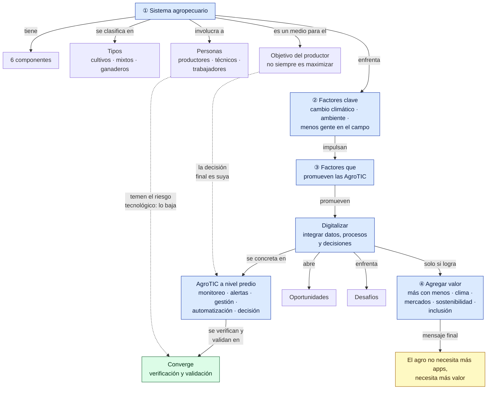
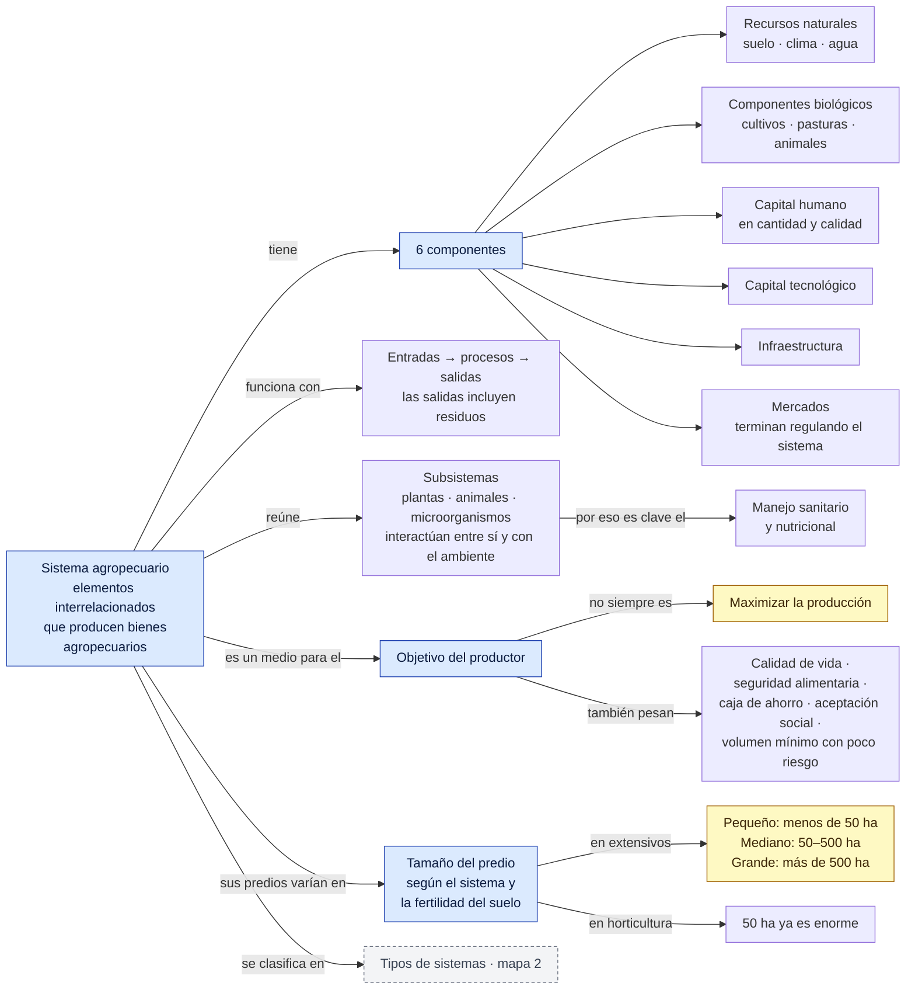
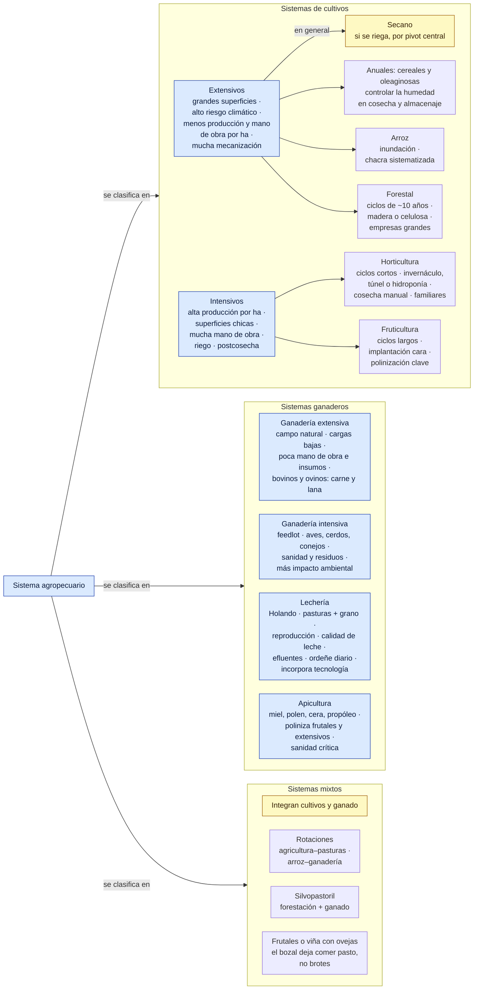
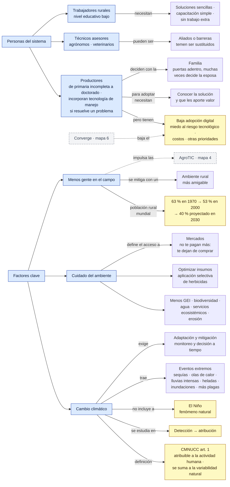
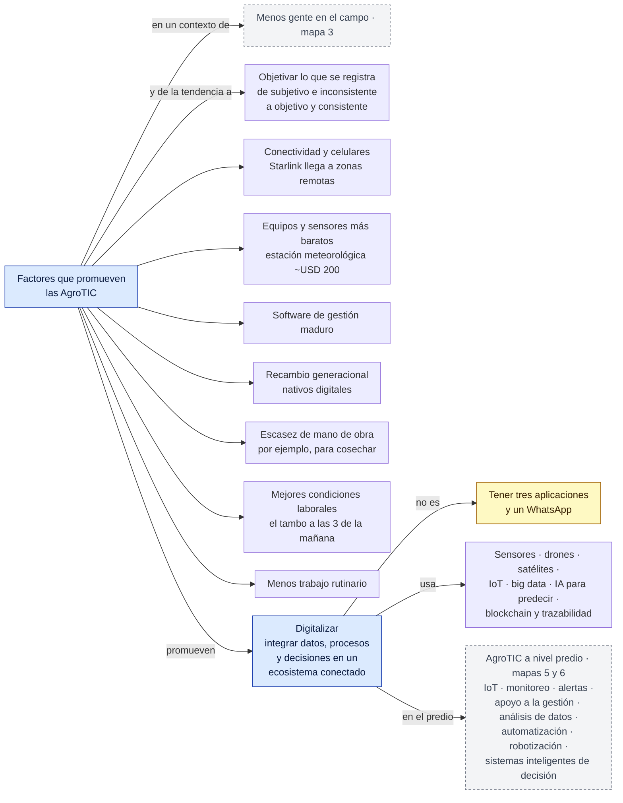
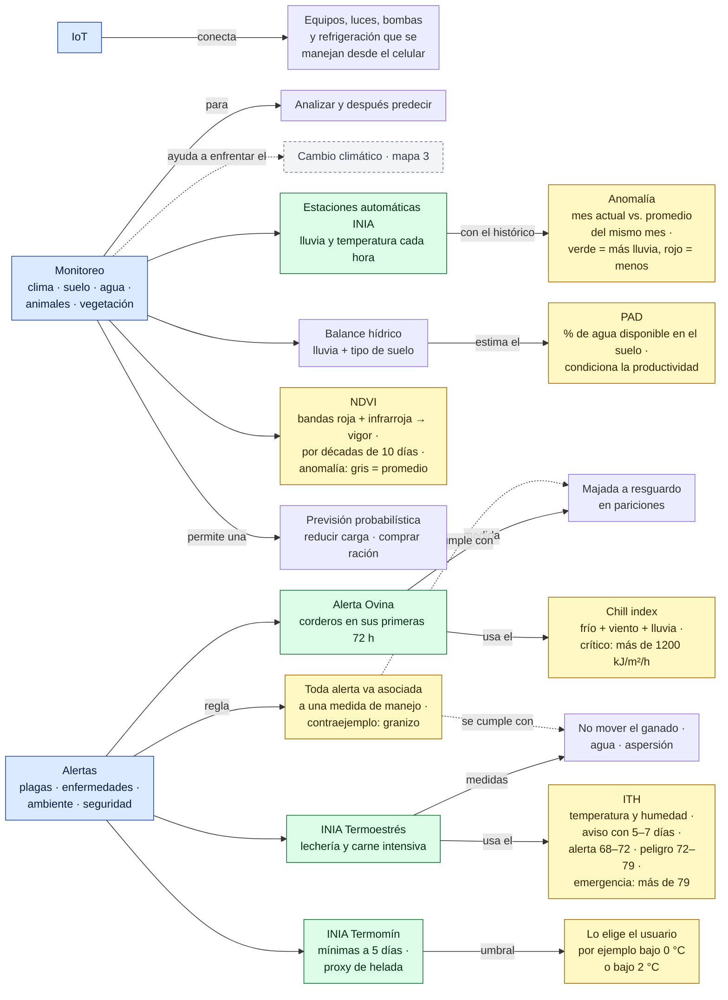
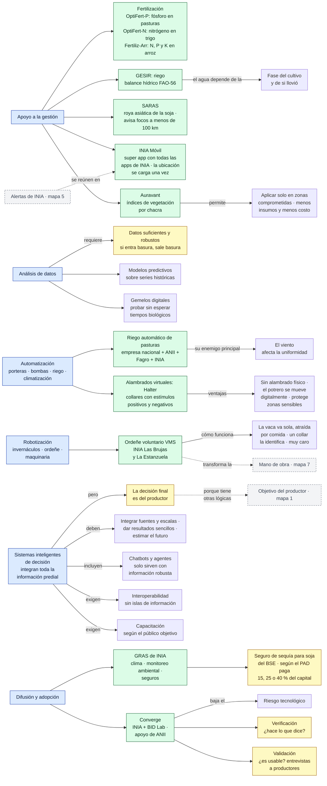
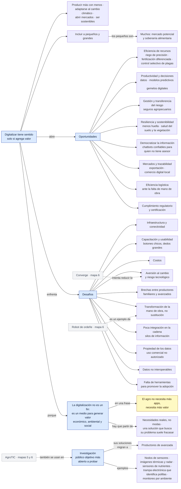

# Red conceptual — Clase 1: Introducción a los sistemas agropecuarios

Complemento del [resumen](resumen.md). Primero hay una vista general de toda la clase y después un mapa por tema, en el orden en que se dieron. Los números de sección (§) remiten al resumen.

**Cómo leerla**
- Cada flecha forma una frase: *Sistema agropecuario → tiene → 6 componentes*. Una flecha sin texto quiere decir "incluye".
- Las flechas punteadas unen conceptos de temas distintos.
- Colores: azul = tema · verde = herramienta, app o programa · amarillo = dato para memorizar · gris punteado = concepto que se desarrolla en otro mapa.

> Todo el contenido sale de la clase. La organización y las frases de las flechas son propias.

## Vista general

## 1. ¿Qué es un sistema agropecuario? (§1, §2 y §7)

## 2. Tipos de sistemas productivos (§3 a §6)

## 3. Personas y factores clave (§8 y §9)

## 4. Por qué y qué es digitalizar (§10 y §11)

## 5. AgroTIC: IoT, monitoreo y alertas (§12 a–c)

## 6. AgroTIC: gestión, datos, automatización, decisión y difusión (§12 d–j)

## 7. Valor, oportunidades y desafíos (§13 a §17)

