# Clase 1 — Introducción a los sistemas agropecuarios

- **Docente:** Lic. Biol. Guadalupe Tiscornia (Mag. Dra.). Bióloga, maestría en ciencias ambientales, doctorado en agronomía. Trabaja en el INIA (Instituto Nacional de Investigación Agropecuaria, Uruguay), donde coordina hace ~7 años el área de Sistemas de Información y Transformación Digital (GRAS).
- **Fecha:** miércoles 21/10/2026. Fue un día excepcional: el cronograma decía martes 20/10.
- **Duración:** 02:49 h. Recreo entre 01:31 y 01:46.
- **Grabación:** [Google Drive](https://drive.google.com/file/d/18BGqsrmyBp-I0znhr0XbOmUqmCRLFYeS/view)
- **Material:** [slides](material/slides-introduccion-sistemas.pdf) · [presentación del curso](material/presentacion-curso.pdf) · [notas Gemini](material/notas-gemini.docx) · [transcripción](material/transcripcion.txt)
- **Red conceptual:** [red-conceptual.md](red-conceptual.md)

> **Fuentes:** la transcripción completa y las slides. Los tiempos `(hh:mm:ss)` indican dónde arranca cada tema en la grabación. Las secciones marcadas con ✎ son elaboración propia y no se dijeron en clase. Las imágenes son de las slides: cuando una slide apila varias fotos o mapas, acá aparecen uno al lado del otro.

---

## Repaso rápido para el examen

- **Sistema agropecuario:** conjunto organizado de elementos interrelacionados que permiten producir bienes agropecuarios usando recursos naturales, humanos y tecnológicos.
- **6 componentes:** recursos naturales (suelo, clima, agua) · componentes biológicos (cultivos, pasturas, animales) · capital humano (cantidad y calidad) · capital tecnológico · infraestructura · mercados.
- **Enfoque de sistemas:** relaciones entre las partes + **entradas → procesos → salidas**.
- **El objetivo del productor no es siempre maximizar la producción.** También cuentan la calidad de vida, la seguridad alimentaria, la "caja de ahorro", la aceptación social y limitar el riesgo de una cosecha catastrófica.
- **Clasificación:** cultivos (extensivos / intensivos), mixtos y ganaderos (ganadería extensiva / ganadería intensiva / lechería).
- **Extensivos:** grandes superficies, alto riesgo climático, menos producción por ha, poca mano de obra por ha, mucha mecanización. Mayormente de **secano**; si hay riego, por **pivot**.
- **Intensivos:** alta producción por ha, superficies chicas, buscan maximizar el rendimiento, mucha mano de obra, el riego es importante, la **postcosecha** es clave.
- **Puntos críticos por sistema:** humedad en cosecha y almacenaje (granos) · inundación y riego (arroz) · ciclos de ~10 años (forestal) · **polinización** (fruticultura) · sanidad y residuos (ganadería intensiva) · reproducción, calidad de leche y **efluentes** (lechería) · sanidad de colmenas (apicultura).
- **Predios en cultivos extensivos:** pequeño < 50 ha · mediano 50–500 ha · grande > 500 ha. Los rangos dependen del sistema y de la fertilidad del suelo.
- **Personas:** productores (educación muy variada, baja adopción digital por **miedo al riesgo tecnológico**, la familia influye), técnicos asesores (aliados o barreras) y trabajadores rurales (soluciones simples).
- **Cambio climático (CMNUCC art. 1):** cambio de clima atribuible directa o indirectamente a la actividad humana, que se suma a la variabilidad natural. Se estudia en dos etapas: **detección** y **atribución**. El Niño es un fenómeno natural, no cambio climático.
- **Menos gente en el campo:** la población rural mundial pasa del 63 % (1970) al 53 % (2000) y a un 40 % proyectado para 2030.
- **Factores que promueven las AgroTIC:** conectividad, abaratamiento de equipos, madurez del software de gestión, recambio generacional, escasez de mano de obra, mejores condiciones laborales, menos trabajo rutinario.
- **Digitalizar** es integrar datos, procesos y decisiones en un ecosistema conectado. No es "tener tres aplicaciones y un WhatsApp".
- **AgroTIC a nivel predio:** IoT · monitoreo · alertas · apoyo a la gestión · análisis de datos · automatización · robotización · sistemas inteligentes de toma de decisión.
- **Toda alerta debe ir asociada a una medida de manejo posible.** Contraejemplo: avisar de granizo cuando no hay nada que hacer.
- **Herramientas de INIA citadas:**
  - Alerta Ovina: chill index, crítico > 1200 kJ/m²/h.
  - INIA Termoestrés: ITH, aviso a 7 días. Riesgo: alerta 68–72, peligro 72–79, emergencia > 79.
  - INIA Termomín: temperaturas mínimas a 5 días.
  - OptiFert-P y OptiFert-N: fertilización con fósforo y nitrógeno.
  - Fertiliz-Arr: fertilización en arroz.
  - GESIR: gestión del riego.
  - SARAS: alerta de roya asiática de la soja.
  - INIA Móvil: la super app que las reúne.
- **Herramientas externas:** Auravant (gestión con índices de vegetación) y Halter (alambrado virtual).
- **Converge (INIA + BID Lab):** baja el riesgo tecnológico. Hace **verificación** (¿hace lo que dice?) y **validación** (¿es usable?, con entrevistas a productores).
- **Digitalizar solo tiene sentido si agrega valor:** producir más con menos, adaptarse al clima, abrir mercados, ser sostenible e incluir a pequeños y grandes productores.
- **Cierre:** "El agro no necesita más apps, necesita más valor". Partir de necesidades reales, no de modas.

---

## 0. Presentación del curso (00:06:44)

**Coordinación y modalidad**
- **Coordinadora:** Lola Llaneza. Es su 7.ª cohorte entre esta materia y la de medicina digital.
- **Participación:** el director Ariel Lutenberg remarca que es muy importante aunque la materia sea optativa. Se puede abrir el micrófono y preguntar sin esperar a que vean la mano.
- **Modalidad:** virtual sincrónica, martes de 19 a 22 h, hasta el 8/12.
- **Contenido:** 8 módulos intensivos. Esta primera clase es larga porque es "un pequeño resumen de lo que es agricultura" para entrar en el tema. Algunas clases suman expositores que ya trabajan con tecnología en el agro.

**Evaluación (00:11:21)**
- Al **comienzo de la clase siguiente** hay un **multiple choice de 5–7 preguntas**, "fácil", sobre la clase anterior.
- Después del examen, una **encuesta de terminología** del área que viene (por ejemplo, ganadería).
- Además: conversación abierta, **asistencia regularizada** y el TP final.

**TP final (00:12:57)**
- Individual o de a 2.
- Un problema del sector agrícola resoluble con las herramientas del posgrado. Puede plantearse en un "mundo ideal", sin datos reales.
- Puede servir para la tesis o para un proyecto real. Tiene que ser coherente con lo que se aprende de agro y con lo que se sabe de tecnología.
- Se trabaja en un documento con ida y vuelta con Martín Horn. A mitad de cursada se entrega por Google Forms, y se presenta en la última clase con cámara prendida.

**Consejos de Martín (00:16:56) y de Lola (00:19:09)**
- Buscar la mayor cantidad de interacciones posible.
- Empezar lo antes posible, aunque sea con temas candidatos.
- Arrancar con una idea grande e ir acotando el alcance.
- Lola: no esperar más allá de la **clase 4**. Martín es "puntilloso" y manda mails detallados con feedback.

**Presentación de alumnos (00:22:34)**
- Gabriel Quiroga: trabajo final con drones.
- Rodrigo Hernández: busca ideas para el trabajo final.
- Gonzalo Cuervo: ingeniero mecatrónico; cosechadora autónoma de manzanas con visión artificial.
- Lucas Didone: ingeniero informático en Rafaela.
- Tomás Moretti: ERP con clientes que fabrican sembradoras y tolvas.
- Luis Ali: estimación de **materia seca** en Córdoba para decidir carga animal y suplementación. La parte difícil fue obtener los datos, que venían en revistas en PDF.
- Facundo Quiroga: software de pesaje y balanzas para mixer; modelo predictivo de consumos, desvíos y alertas en feedlot.
- Carlos Villalobos: ingeniero electrónico.

---

## 1. ¿Qué es un sistema agropecuario? (00:35:34)

> **Definición:** un conjunto organizado de elementos interrelacionados que permiten la producción de bienes agropecuarios mediante el uso de recursos naturales, humanos y tecnológicos.

**Componentes básicos (00:36:51)**
1. **Recursos naturales:** suelo, clima, fuentes de agua.
2. **Componentes biológicos:** cultivos, pasturas, producción animal.
3. **Capital humano:** en cantidad **y calidad** adecuadas para ese sistema.
4. **Capital tecnológico.**
5. **Infraestructura.**
6. **Mercados:** son los que "terminan regulando y actuando sobre estos sistemas".

**Como todo sistema** tiene interrelaciones entre las partes y está determinado por **entradas, procesos y salidas**. Fuente: Barrezueta Unda (2015), *Introducción a la sostenibilidad agraria: con enfoque de sistemas e indicadores*.

| Entradas | Procesos | Salidas |
|---|---|---|
| Energía, semilla, animales, maquinaria y otros | Preparación de la tierra, siembra, cosecha, etc. | Productos (agropecuarios) y **residuos** |

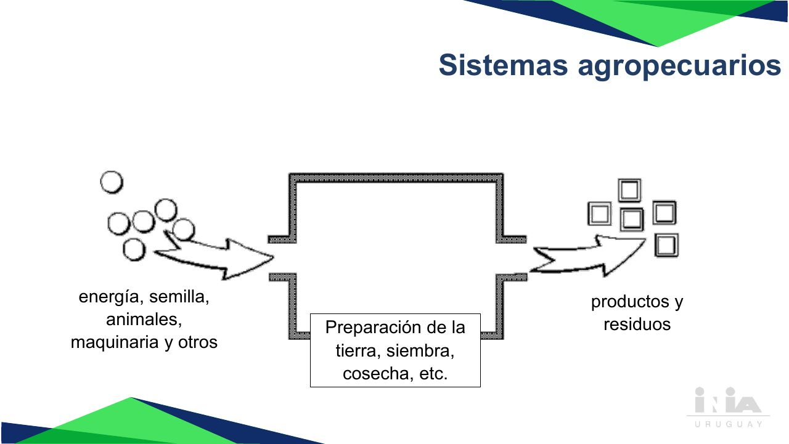
*Slide 5: el sistema como una caja con entradas, procesos y salidas.*

**Poblaciones y subsistemas (00:38:16)**
- El sistema es un conjunto de poblaciones de **plantas, animales y microorganismos** (también los del suelo).
- Cada población da valor agropecuario por sí misma y también por la interacción con las otras. Se definen **subsistemas** de cultivos, de animales o de microorganismos.
- Interactúan **entre sí** (por ejemplo, planta–animal) y **con el ambiente** (suelo, clima).
- En ese marco de interrelación, **el manejo sanitario y nutricional es clave**, tanto en plantas como en animales.

## 2. Objetivo de la empresa agropecuaria (00:39:36)

- Para el productor, la unidad de producción es **un medio para lograr sus fines personales**. No siempre se satisfacen con más producción y más eficiencia.
- Por eso, a veces una propuesta que rinde más parece "contraintuitivamente" rechazada: hay otras cosas en juego.
- Mejorar la producción física por unidad de recurso (kg de carne, lana, papas, tomates o trigo por ha) puede ser un objetivo, pero no el único. Todo productor quiere vivir de eso, pero no es necesariamente su objetivo último.
- Fuente: "Bolilla 4 – Sistemas de producción" (fing.edu.uy).

**Ejemplos de la clase (00:40:56)**
- Un sistema que produce más pero **requiere más tiempo** del productor, que prefiere usarlo en otra cosa.
- Un sistema que obliga a usar un **área que el productor destina a recreación**.
- **"Caja de ahorro":** se guardan animales para venderlos cuando hace falta (por ejemplo, para el casamiento de un hijo).
- **Grado de aceptación en la sociedad:** si la comunidad valora tener un área recreativa, el productor no la va a usar para producir.
- **Garantizar un volumen mínimo anual** limitando el riesgo de una cosecha catastrófica. Los productores suelen ser **conservadores**: pueden dejar pasar una buena oportunidad de un año para no arriesgar.
- Otros: **calidad de vida, seguridad alimentaria, ingreso económico**.

> **Implicancia para diseñar soluciones:** hay que entender qué prioriza el productor, no asumir que quiere maximizar el rendimiento.

## 3. Tipología de sistemas (00:42:12)

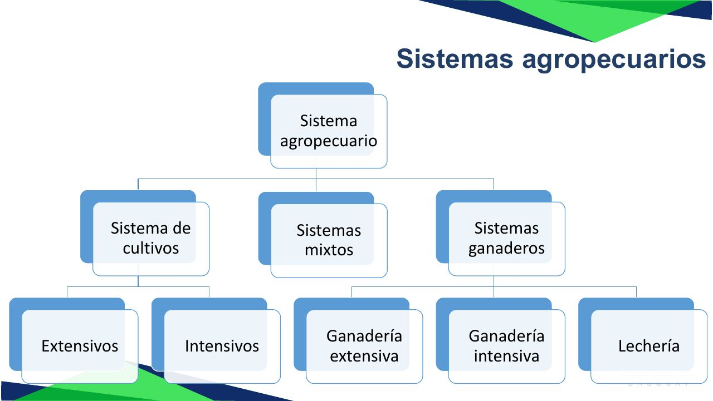
*Slide 9: la clasificación de la clase.*

Con los ejemplos que dio la docente:

```
Sistema agropecuario
├── Sistema de cultivos ── Extensivos (anuales: cereales/oleaginosas, arroz; forestal)
│                      └── Intensivos (horticultura, fruticultura)
├── Sistemas mixtos (combinan cultivos y ganadería)
└── Sistemas ganaderos ─── Ganadería extensiva (carne y lana)
                       ├── Ganadería intensiva
                       └── Lechería
```

## 4. Cultivos extensivos (00:43:37)

**Características**
- **Grandes superficies.**
- **Riesgos climáticos altos:** producción a cielo abierto y, por la extensión, muy difícil implementar riego.
- **Menor producción por hectárea** que los intensivos; lo compensan con superficie.
- **Baja mano de obra por hectárea.**
- **Mucha mecanización:** tractores, sembradoras, cosechadoras.

**Anuales: cereales y oleaginosas (00:43:37)**
- **Cereales:** avena, maíz, sorgo, trigo, cebada. **Oleaginosas:** soja, girasol, colza.
- Principalmente de **secano**: solo usan agua de lluvia, no se riegan.
- Si hay riego, es principalmente por **pivot central**: los círculos verdes que se ven en imágenes aéreas o desde un avión.
- **Cosecha controlando la humedad (00:45:02):** con grano muy húmedo hay deficiencias de calidad y deterioro en el almacenaje (hongos y enfermedades).
- Imágenes de sorgo, cosechadora, soja, maquinaria de aplicación y trigo: grandes extensiones de **monocultivo**.
- La slide enlaza un video de Juan Farinatti (CEO de Bayer Cono Sur). En clase no se llegó a ver ni a comentar.
- **Idea de TP sugerida por la docente (00:46:25):** un sistema de monitoreo de humedad en cosecha o en almacenamiento. Contó los sistemas para "activar alguna idea latente".

**Arroz (00:47:43)**
- Cultivo extensivo anual con **etapas de inundación durante el crecimiento** → el riego es fundamental.
- No es riego convencional: la chacra está **sistematizada** con canales y terrazas. Se bombea agua y la zona de crecimiento queda inundada.
- Antes de cosechar se retira el agua y se **orea** el terreno para que entre la maquinaria.
- **Control de humedad para el almacenamiento**, como en todo grano. Las slides muestran la panoja de arroz.

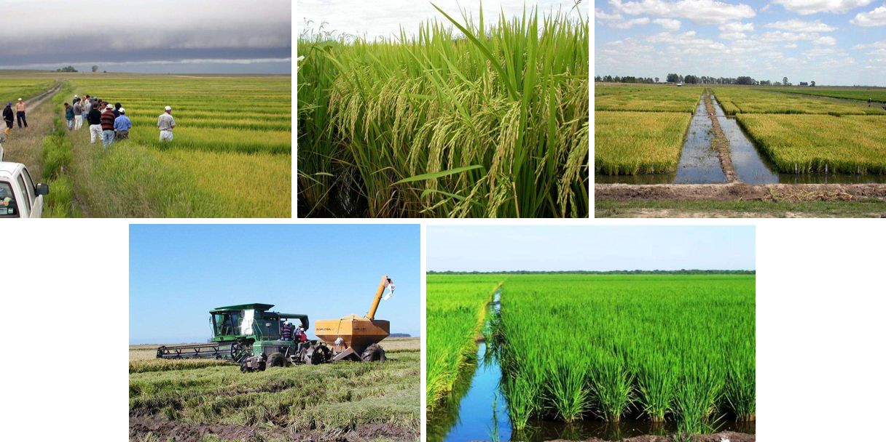
*Slide 14: recorrida de una chacra, panojas, canal de riego, cosecha y chacra inundada.*

**Forestal (00:49:19)**
- Extensivo, **no anual**, con **ciclos largos** (en general ~10 años).
- Producción de **madera o celulosa**.
- Mayoritariamente manejado por **empresas grandes**. Las imágenes son de Uruguay: eucaliptus y algunos pinos.
- Las empresas se autoabastecen: tienen **genética propia**, **viveros** con plantines que después pasan a campo, e investigación propia.
- Usan mucha maquinaria y sistemas para **optimizar la operativa**: por dónde entra la maquinaria, cuál es la ruta óptima, cómo se organizan las cosechas.
- Las fotos de la slide recorren toda la cadena: **vivero** (plantines en bandejas bajo media sombra) → plantación de eucalipto → cosecha (grúa con rollizos) → **chips** de madera cargándose en un barco en el puerto.

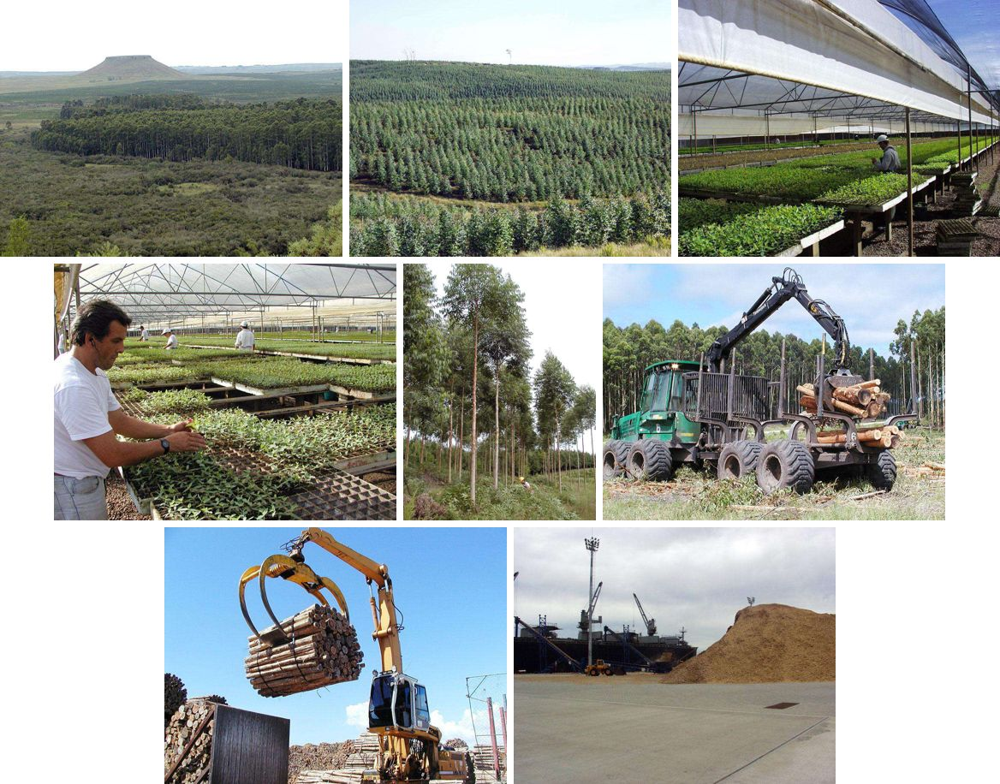
*Slide 16: montes, viveros con plantines, eucaliptos, cosecha con grúa y chips en el puerto.*

## 5. Cultivos intensivos (00:50:45)

**Características**
- **Alta densidad de producción por hectárea.**
- **Superficies relativamente pequeñas:** unas pocas hectáreas, contra las 2.000–5.000 ha que puede tener un extensivo. En intensivos, 100 y pico de hectáreas ya es muy grande.
- **Buscan maximizar el rendimiento por hectárea**, porque producir es más caro por hectárea.
- **Más mano de obra.**
- **Riego muy importante**, aunque no todos lo usan.
- **Importancia de la postcosecha.**

**Horticultura (00:52:10)**
- **Ciclos cortos** y **gran diversidad** de cultivos.
- Se produce a cielo abierto, en **invernáculos**, en **túneles de plástico** o en **hidroponía** (sin tierra).
- **Muy intensiva en mano de obra.** La cosecha suele ser **manual**, y la maquinaria, cuando la hay, es pequeña y pensada para esas superficies.
- Ejemplos: **frutilla** en túneles y en invernáculo (cosecha y manejo muy manuales y detallistas), **tomate** a cielo abierto.
  - En la slide se ve un productor cosechando frutillas a mano en un túnel de madera y nylon, con mulch plástico negro.
  - También un invernáculo con canteros elevados y riego.
- Muchos **productores familiares o pequeños** tienen la horticultura como principal fuente de ingreso.

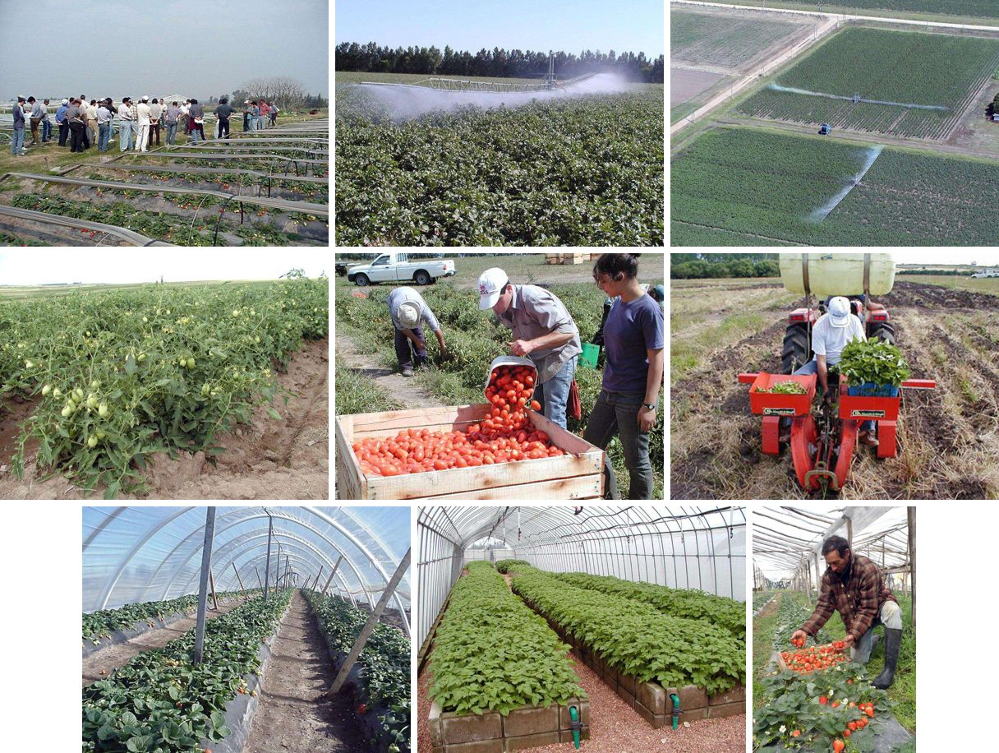
*Slide 19: riego por aspersión, tomate a cielo abierto y su cosecha, maquinaria chica, túneles, invernáculos y cosecha de frutilla.*

**Fruticultura (00:53:31)**
- Fruta para **consumo fresco o procesamiento**.
- **Ciclos largos:** algunos frutales tardan años en dar fruto (2–3 años; nueces pecán y olivos demoran más).
- **La polinización es clave**, así que la apicultura es muy beneficiosa para estos sistemas.
- El **costo de implantación es más alto** que en los anuales, y los árboles se cuidan mucho para que produzcan cuanto antes.
- Ejemplos: cítricos (mandarinas), manzanas, cerezas, duraznos.

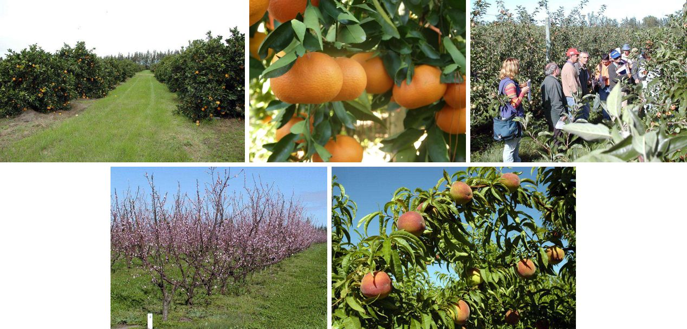
*Slide 21: monte cítrico, mandarinas, recorrida de un monte frutal, durazneros en flor y duraznos.*

## 6. Producción animal

**Ganadería extensiva (00:56:31)**
- Grandes extensiones, en general sobre **pastizales naturales** (campo natural).
- **Cargas ganaderas bajas**, que fluctúan.
- **Con más o menos potreros**, según el manejo. Cuantos más potreros, más intensivo es el manejo: hay que mover a los animales de un potrero a otro cuando se acaba el pasto.
- **Baja utilización de mano de obra** (2–4 peones para muchos animales) y **bajo uso de insumos externos**.
- **Bovinos y/o ovinos (00:57:52):** hay establecimientos solo de carne bovina, otros de ovinos para lana y carne, y otros que combinan vacas y ovejas. La raza depende del objetivo productivo (carne o lana).
- En las fotos se ven una majada con corderos en campo natural, ovejas laneras (tipo Merino), vacunos Hereford y el manejo a caballo y con perros.

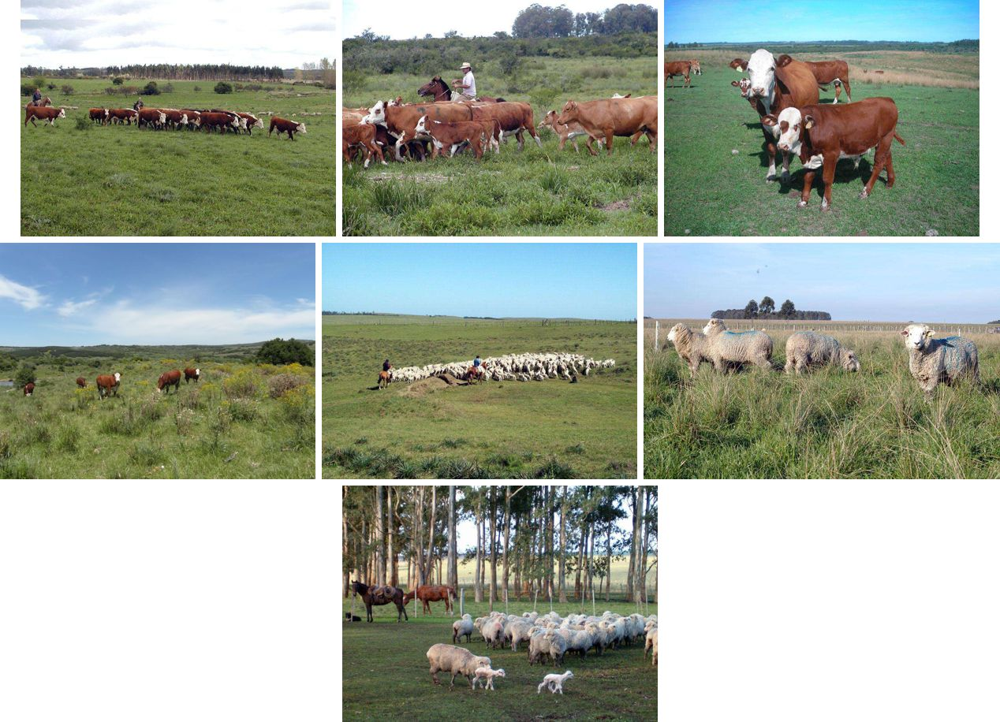
*Slide 23: vacunos Hereford y ovinos sobre campo natural, y manejo a caballo.*

**Ganadería intensiva bovina (00:57:52)**
- **Alta densidad** de animales en espacios relativamente pequeños.
- **Uso intensivo de recursos**, alta mano de obra y **alto uso de insumos externos**.
- **Ciclos productivos más cortos.**
- **Mayor impacto ambiental** que los sistemas extensivos sobre pasturas naturales.
- Básicamente son **feedlots (00:59:15):** parcelas chicas con animales muy confinados. Se les da grano, agua y a veces sombra; el **bienestar animal** también importa.
- Se mostró un video de feedlots en el norte argentino. Las fotos muestran corrales con cientos de vacunos Angus y Hereford comiendo en comederos lineales.

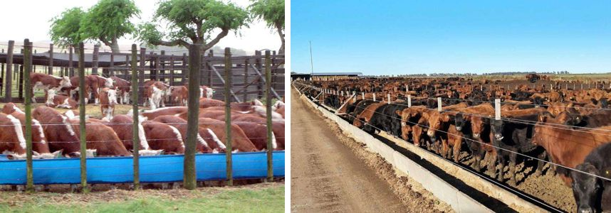
*Slide 25: corrales de engorde con comederos lineales.*

**Ganadería intensiva de otros animales (01:00:50)**
- **Aves de corral, conejos y cerdos:** alta densidad, ambientes controlados, ciclos muy cortos.
- **Manejo sanitario muy intensivo**, porque con animales confinados las enfermedades se contagian fácil.
- **Gestión de residuos** importante.
- **Cabras:** sistemas **semi-intensivos** asociados a productos de alto valor, como el queso de cabra.
- **Imágenes (01:02:05):** cerdos a campo (menos intensivo) contra sistemas muy intensivos donde las madres casi no se paran; pollos para huevos y para carne.
  - La slide muestra **gallinas ponedoras en jaulas de batería** de varios pisos y cerdos confinados en jaulas metálicas sobre piso emparrillado.

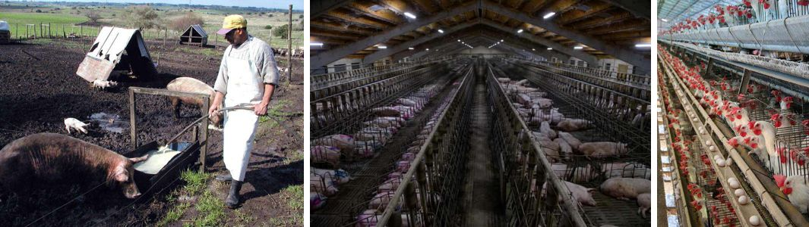
*Slide 27: cerdos a campo, cerdos confinados y gallinas ponedoras en jaulas de batería.*

**Lechería (01:02:05)**
- Se usan **especies (razas) lecheras**, como la Holando.
- En general se basa en **pastoreo de pasturas cultivadas**, combinado con granos como suplemento. Muchos productores tienen **riego** para manejar mejor la pastura.
- **Manejo reproductivo clave:** las vacas tienen que estar dando leche, así que hay que manejar la producción de terneros.
- **Control de calidad de la leche (01:03:29):** manejo sanitario muy afinado y control de cómo se ordeña y dónde se almacena (por ejemplo, la cámara de enfriamiento).
  - En la slide, una operaria toma una muestra de leche en una sala de ordeñe con **medidores electrónicos**. Se ven también las pezoneras puestas y vacas Holando con caravanas pastoreando.
- **Manejo de efluentes:** las vacas excretan mientras esperan el ordeñe. El tratamiento de efluentes del tambo está **muy regulado**, para que no lleguen a cursos de agua o cañadas.
- **Producción muy sacrificada (01:04:52):** no hay feriados, lluvia ni viento que valgan. Las vacas tienen que ordeñarse sí o sí (si no, se enferman) y a las 3–4 de la mañana hay que salir a juntarlas.
- **Diversidad de productores (01:06:18):** desde familiares de ~39 vacas hasta un proyecto con **15.000 vacas en ordeñe** y sistemas automatizados.
- Los lecheros, incluso los familiares, están **acostumbrados a incorporar tecnología**. Es un plus para adoptar soluciones nuevas.

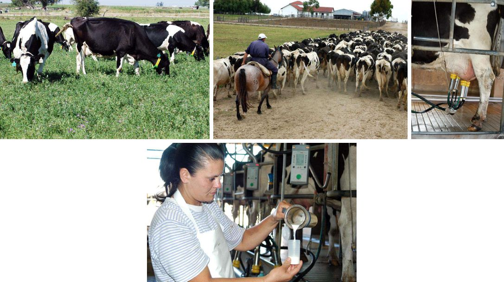
*Slide 29: vacas Holando a pasto, arreo al tambo, pezoneras y toma de muestra de leche.*

**Apicultura (01:06:18)**
- Manejo y cuidado de abejas y colmenas para producir **miel, polen, cera, propóleo** y otros derivados.
- A pequeña, mediana o gran escala: hay apicultores con cientos o miles de colmenas que **las trasladan a donde hay flores**.
- **Colaboran con la polinización** de frutales y extensivos (todo lo que necesite desarrollar frutos). El beneficio es mutuo con los productores de esos cultivos.
- **La sanidad es crítica:** un problema sanitario puede causar mortandades masivas, de miles de colmenas.

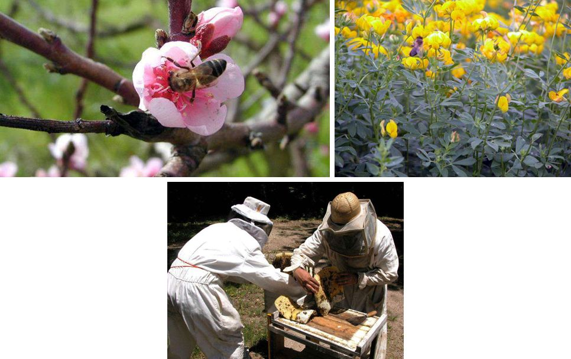
*Slide 31: abejas en flores y revisión de una colmena.*

**Sistemas mixtos (01:09:17)**
- Integran sistemas **agrícolas** (plantas) y **pecuarios** (animales).
- **Rotación agricultura–pasturas:** en la fase de pasturas entran animales a pastorear.
- **Rotación arroz–ganadería:** algunos años arroz y otros años ganadería.
- **Silvopastoriles (01:10:38):** forestación con ganado.
  - Algunos están **diseñados** para eso: 2–3 filas de árboles, una franja de pastura, otra franja de árboles.
  - Otros son forestales donde el ganado entra a pastorear zonas no plantadas o corredores.
- **Fruticultura con ovejas o cabras (01:11:58):** la oveja usa un **bozal** que se levanta cuando apoya la cabeza en el suelo, así puede comer el pasto. Con la cabeza en alto, el bozal le impide comer los brotes. Ejemplo con vid: mantiene el pasto "a raya" sin dañar la planta productiva.
- Las fotos muestran ovejas con bozal bajo un **viñedo** con riego por goteo y entre **limoneros**, vacunos sobre una pradera con trébol blanco y un silvopastoril con vacunos entre filas de eucaliptos.

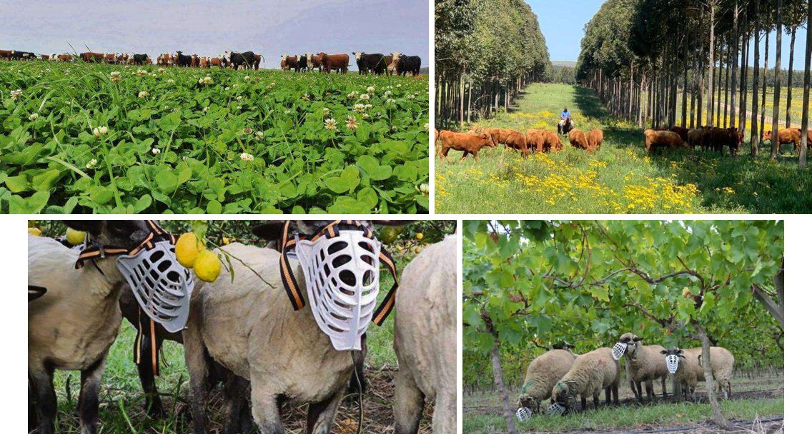
*Slide 33: vacunos sobre una pradera, silvopastoril con eucaliptos y ovejas con bozal entre limoneros y en un viñedo.*

## 7. Tamaño de los predios (01:11:58)

- Hay predios pequeños, medianos y grandes. El tamaño **depende del sistema productivo**: los intensivos manejan predios más chicos y los extensivos, más grandes.
- **También depende de la fertilidad del suelo.** Por ejemplo, 100 ha parecen mucho para un intensivo, pero si el suelo es poco productivo quizás solo sirvan para ganadería extensiva.
- **Escala en cultivos extensivos (01:13:39):** pequeño **< 50 ha** · mediano **50–500 ha** · grande **> 500 ha**.
- En horticultura, fruticultura o lechería es muy distinto: **un predio hortícola de 50 ha es enorme**.

## 8. Personas involucradas (01:13:39)

**Productores**
- Hay "tantos como personas": el nivel educativo va de **primaria incompleta a doctorado**.
- Son **"incorporadores de tecnologías natos"** en tecnologías de manejo y de proceso, siempre que resuelvan un problema o aporten valor económico, ambiental o social.
- **Pero la adopción de soluciones digitales es muy baja (01:15:02)**, sobre todo por **miedo al riesgo tecnológico**: "lo vengo haciendo así hace años y me va bien".
- Otros motivos: costos (en algunos casos, no en todos), otras prioridades, necesidades más básicas.
- Para adoptar una solución, primero tienen que **conocerla** y después tiene que **aportarles valor**.
- **La familia pesa en la decisión (01:16:30):** muchas veces, "puertas adentro", quien decide es la esposa. Hay que tener en cuenta a toda la familia.

**Técnicos asesores (01:17:48)**
- Ingenieros agrónomos, veterinarios y otras profesiones de ciencias biológicas que apoyan las decisiones del productor.
- Entienden las tecnologías "hasta cierto punto". Algunos son más permeables que otros.
- **Muchas veces son los propios técnicos los que no quieren incorporar** una solución, porque la sienten como amenaza o como algo que los va a sustituir.
- Hay que convertirlos en **aliados**: la tecnología también puede ayudarlos a ellos.

**Trabajadores rurales (01:19:08)**
- En general tienen **nivel educativo bajo**.
- Las soluciones tienen que ser **sencillas**, con **capacitación simple**, y **no convertirse en trabajo extra**.

## 9. Factores clave: cambio climático y cuidado del ambiente (01:19:08)

Los sistemas productivos se ocupan cada vez más de estos temas: los eventos extremos son más frecuentes y el cuidado del ambiente define el **acceso y la permanencia en mercados**.

**Definición de cambio climático (01:20:33)**
> Según la **Convención Marco de Naciones Unidas sobre el Cambio Climático (CMNUCC), art. 1**: "cambio de clima que se atribuye directa o indirectamente a la actividad humana que altera la composición de la atmósfera global y que se suma a la variabilidad natural del clima observada en períodos de tiempo comparables".

- **Clave:** tiene que ser **atribuible a la actividad humana**. **El Niño** (que estaba en curso al momento de la clase) es un fenómeno natural, así que **no** es cambio climático.
- **Dos etapas (01:22:03):** **detección** y **atribución**. Detectar un cambio en el clima no implica que sea atribuible a la acción humana.
- **No se limita a cambios en las medias** de lluvia o temperatura. También incluye cambios en la **frecuencia e intensidad de eventos extremos** (olas de calor) e **hidroclimáticos** (déficit y excesos hídricos), siempre que se asocien a la acción humana.

**Impacto en la producción (01:22:03)**
- La **variabilidad climática** es el principal factor a contemplar, porque se produce a cielo abierto.
- **Eventos extremos más frecuentes e intensos (01:23:40):** sequías o déficit hídrico, olas de calor, lluvias intensas.
- Imágenes: sequía; **heladas**, que pueden matar plantas; **inundaciones**, donde el suelo anegado pudre las raíces y mueren las plantas.

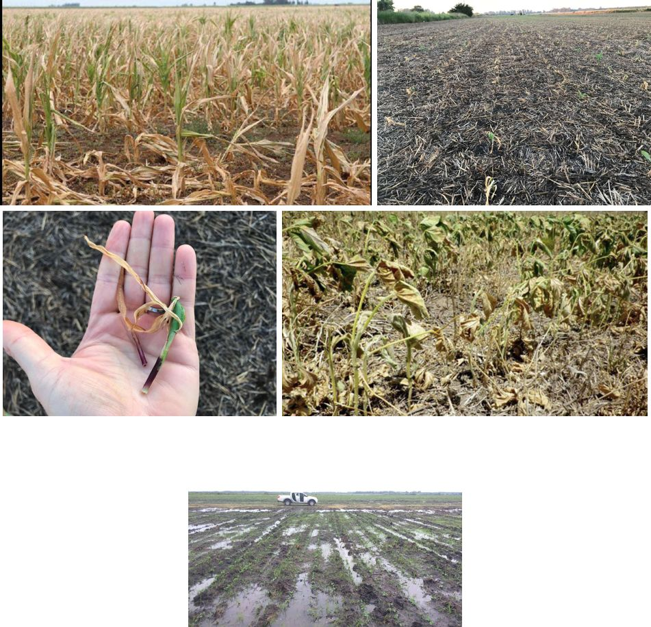
*Slide 43: daños por sequía y heladas, y una chacra inundada.*

- Otros efectos: cambio en los regímenes de lluvias, aumento de temperaturas, impacto en la disponibilidad y calidad del agua, **más plagas y enfermedades**.
- **Clave: adaptación y mitigación.** El monitoreo y la decisión a tiempo son críticos, y los desarrollos que aporten a esto son muy valorados.
- **Ejemplo (01:25:19):** prever cuánta materia seca habrá el año próximo para manejar el sistema con el menor impacto negativo.

**Cuidado del ambiente (01:25:19)**
- **Reducir emisiones de gases de efecto invernadero.**
- **Reducir la pérdida de biodiversidad y hábitats naturales**, clave por ejemplo para certificaciones.
- **Gestión y uso eficiente de recursos naturales**, como el agua.
- **Optimizar el uso de insumos.** Ejemplo: **aplicación selectiva de herbicidas (01:26:45)**. Una máquina detecta la maleza y aplica solo donde está. Hoy muchas veces se aplica **por fecha a todo el campo** sin ver cuántas malezas hay. La aplicación selectiva reduce costos (menos litros de herbicida) y evita producto perdido en el ambiente.
- **Conservar servicios ecosistémicos**, cada vez más valorados.
- **Erosión y degradación** del suelo.
- Todo esto es especialmente importante en sistemas **de exportación**.

**Mercados (01:28:08)**
- Hoy, en muchos sistemas, certificar **no** da mejor precio.
- A futuro, "no te van a pagar más, **te van a dejar de comprar**" si no cumplís con los requisitos ambientales.

**Menos gente en el campo (01:28:08)**
- Una publicación "bastante vieja pero vigente" (gráfico de UN-HABITAT en la slide) da la proporción mundial de población rural: **63 % en 1970, 53 % en 2000 y 40 % proyectado para 2030**.
- **Otro estudio muestra lo mismo (01:29:34):** el gráfico de Our World in Data (datos de la ONU) de población urbana y rural entre 1800 y 2050.
  - La urbana supera a la rural hacia 2005–2007.
  - La rural llega a su máximo (~3.400 millones) hacia 2020–2025 y después baja.
  - Todo el crecimiento futuro es urbano.
- En la región, cada vez hay menos gente en el campo y le interesa menos estar ahí.
- Los sistemas que hagan el ambiente rural **más amigable** pueden mitigar ese proceso.

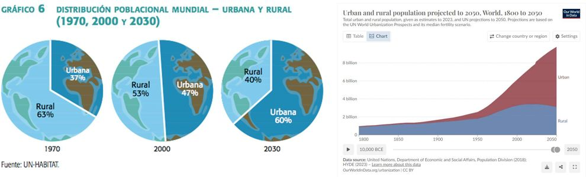
*Slide 46: la distribución de la población mundial según UN-HABITAT (rural: 63 %, 53 % y 40 %) y el gráfico de Our World in Data.*

*(Recreo: 01:31–01:46)*

## 10. AgroTIC: factores que promueven su uso (01:46:15)

**Contexto:** cae la población rural y crece la tendencia a **objetivar lo que se registra en el campo** para tomar decisiones más consistentes.

La slide de ese momento es una foto de una charla en el **Silicon Valley Forum (Rosario, 2018)** sobre la evaluación de la calidad de alimentos. Muestra el paso de un estado actual a uno futuro:

| Dimensión | Hoy | Futuro |
|---|---|---|
| Automatización | una persona revisa una frutilla con lupa | un equipo automatizado |
| Sensor | el ojo | una cámara |
| Interpretación | el cerebro humano | un "cerebro digital" |
| Resultado | **subjetivo e inconsistente** | **objetivo y consistente** |

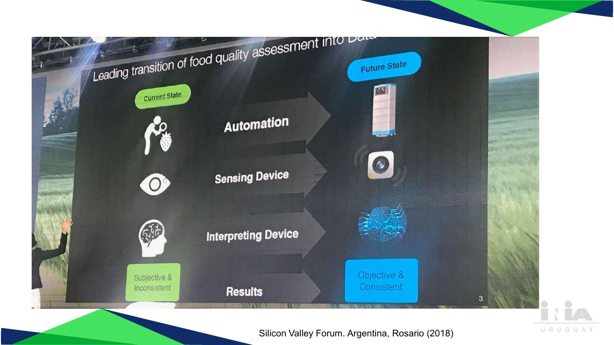
*Slide 47: de una evaluación de la calidad subjetiva a una objetiva y consistente.*

a) **Avances en comunicaciones y terminales móviles.** El medio rural está cada vez más conectado: en Uruguay es más fácil por ser un país chico, y en países grandes como Argentina **Starlink** da conectividad en lugares antes impensados.
b) **Abaratamiento de equipos, sensores e insumos informáticos.** Una **estación meteorológica** antes era carísima y hoy se consigue por **~USD 200**, aunque la calidad va acorde al precio.
c) **Madurez y creciente oferta de aplicaciones avanzadas** de gestión (clientes, insumos, control de producción, gestión predial).
d) **Cambio generacional** de empresarios y técnicos (01:47:36): **nativos digitales** que valoran estas herramientas.
e) **Escasez de mano de obra** para tareas específicas. Por ejemplo, en muchos lugares cuesta conseguir gente para cosechar en producción vegetal intensiva.
f) **Demanda de condiciones laborales menos adversas**, más saludables y más atractivas. Ejemplo: el tambo a las 3 de la mañana, llueva o truene.
g) **Reducción del trabajo rutinario**, sustituyéndolo por automatismos.

## 11. ¿Qué significa digitalizar? (01:48:52)

- Usar sensores, drones, satélites e IoT; plataformas de gestión y big data; **IA para predicciones**; **blockchain y trazabilidad**.
- Pero digitalizar es **mucho más que tener apps o maquinaria inteligente**: es **integrar datos, procesos y decisiones en un ecosistema conectado que transforma la forma de producir**.
- En palabras de la docente, "no es tener tres aplicaciones y un WhatsApp".

## 12. AgroTIC a nivel de predio — aplicaciones y ejemplos

### a) Internet de las cosas (01:48:52)
Equipos, iluminación, bombas y refrigeración conectados, que se pueden prender, apagar o activar desde el celular. La slide lo ilustra con íconos conectados por señal inalámbrica: tractor, iluminación, silo, cámara, riego, galpón con termómetro y un celular.

### b) Monitoreo de variables (01:48:52)
- **Qué se monitorea:** clima, suelo, agua, comportamiento y estado animal, estado de la vegetación.
- **Para qué:** primero para **analizar** y después para **predecir**.
- **Red de estaciones automáticas de INIA (01:50:31):** miden temperatura y lluvia cada hora. Con el monitoreo nacional se arman **mapas de lluvia acumulada**, y con el histórico, **mapas de anomalía de lluvia**.
  - La slide muestra la web de GRAS de la estación automática **INIA Las Brujas** (Canelones). Se actualiza cada hora y tiene gráficos de temperatura del aire y de lluvia.

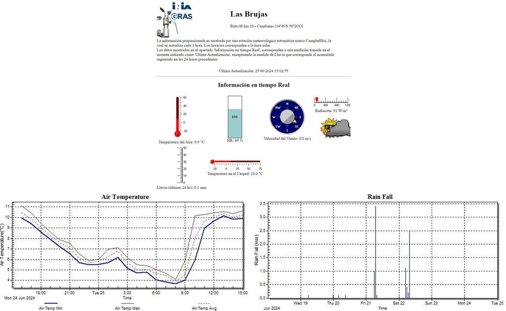
*Slide 53: datos en tiempo real de la estación INIA Las Brujas y sus gráficos de temperatura del aire y lluvia.*

- **Cómo se calcula la anomalía:** se compara, por ejemplo, **el marzo actual contra el promedio de los marzos de una serie histórica**. Verde = llovió por encima de lo normal; rojo = por debajo. A partir de eso se hacen recomendaciones de manejo.
  - En la slide están los mapas INIA–GRAS–INUMET de **precipitación acumulada** y de **anomalía de precipitación acumulada** de marzo de 2026. Muestran mayormente 125–200 mm de lluvia, entre 25 y 100 mm por encima de lo normal.
- **A escala de predio (01:51:50):** con suficientes datos se puede hacer lo mismo para un establecimiento y entender cómo se comporta.
- **Serie histórica de Uruguay:** muestra la **variabilidad entre años y dentro del año**.
  - En **2024** marzo fue más lluvioso de lo normal, julio mucho más seco y agosto otra vez más lluvioso.
  - **Enero de 2023** fue muy seco, mientras que el enero anterior había llovido por encima de lo normal en una zona.
  - La slide muestra una grilla de mapas mensuales de anomalía (de julio a junio) para cada año, de 2018/19 a 2025/26.

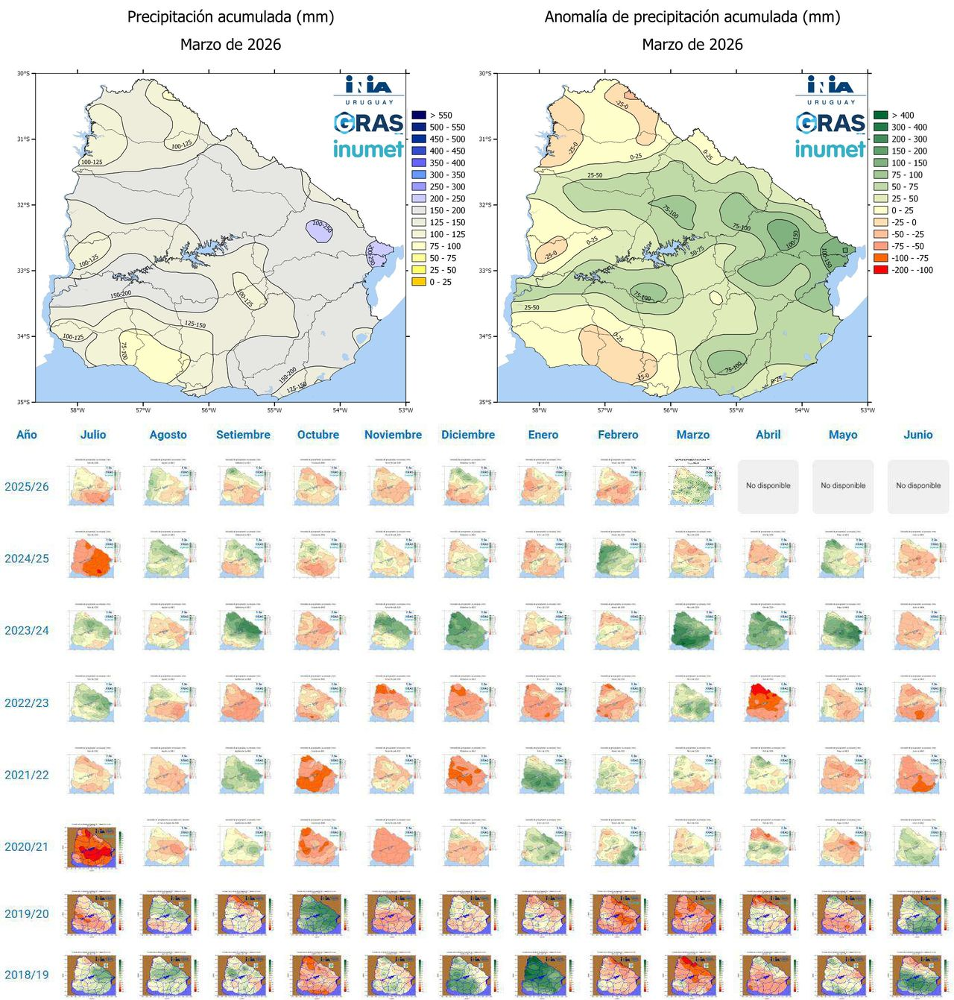
*Slide 54: lluvia acumulada y su anomalía en marzo de 2026 (arriba) y la grilla de anomalías mensuales por año (abajo).*

- **Balance hídrico (01:53:02):** con la lluvia, el **tipo de suelo** y otras variables ambientales se estima el **contenido de agua en el suelo**, que es lo que **condiciona la productividad** de cualquier vegetal.
  - Ejemplo de **enero de 2025**: % de agua disponible en el suelo y su anomalía, con todo el país muy por debajo de lo esperable (rojo, naranja, amarillo).
  - **Abril de 2025**, tres meses después: todo verde, con excesos hídricos.
  - Los mapas de la slide son de **PAD** (porcentaje de agua disponible en el suelo) y de su anomalía. En enero de 2025 hay mayormente 20–40 % (10–20 % en el noroeste) y anomalías de −25 a −75 %. En abril de 2025, mayormente 80–100 %, con anomalías positivas.
  - La herramienta web de balance hídrico de GRAS ("Balance Hídrico Grilla") tiene pestañas para ADI, ANR, ETP, ETR, IBH, PAD y PRE, cada una con su grilla mensual por año.

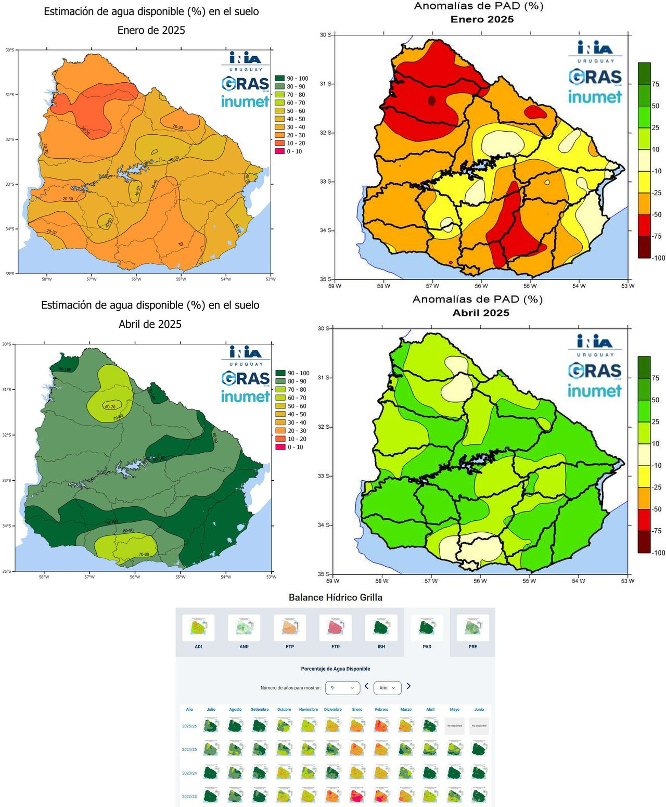
*Slide 55: agua disponible en el suelo (PAD) y su anomalía en enero de 2025 (arriba, con sequía) y en abril de 2025 (medio, con excesos), y la herramienta web de GRAS (abajo).*

- **Estado de la vegetación con NDVI (01:54:39):** índice satelital que **combina las bandas roja e infrarroja**. Da idea del **vigor** de la vegetación según la clorofila; los verdes más oscuros indican más vigor.
  - **Anomalía de NDVI:** verde = por encima del promedio; **gris = promedio**; amarillo y naranja = por debajo.
  - GRAS publica el NDVI por **décadas**, es decir, períodos de 10 días (por ejemplo, la 2.ª década de abril de 2026). También publica la variación porcentual entre décadas (D_NDVI).

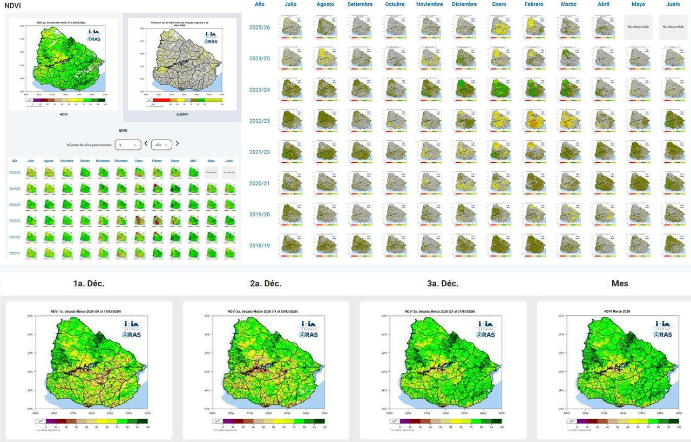
*Slide 56: NDVI de la 2.ª década de abril de 2026 y su variación respecto de la 1.ª (D_NDVI), la grilla de anomalías mensuales de NDVI (arriba a la derecha) y el NDVI de marzo de 2026 por décadas (abajo).*

- **Previsión → manejo (01:55:59):** si se prevé baja productividad de pasturas, se puede **reducir la carga**, reorganizar el rodeo o **comprar ración** para suplementar. Las previsiones son **probabilísticas** y vienen con incertidumbre.

### c) Sistemas de alerta (01:55:59)
- **Qué alertan:** plagas, enfermedades, condiciones ambientales y **seguridad** (equipos de vigilancia). Pueden ser en tiempo real o de previsión.
- **Alerta Ovina (01:57:30):** previsión de condiciones ambientales para **corderos recién nacidos**, muy susceptibles a la combinación de **frío + viento + lluvia** en sus **primeras 72 horas**.
  - Muestra un mapa de nivel de riesgo para los próximos días, según un índice llamado **chill index**.
  - Medida de manejo: en época de **pariciones**, llevar la **majada** a una zona con resguardo.
  - **Según la slide**, el chill index se mide en **kJ/m²/h**:

    | Nivel de riesgo | Chill index (kJ/m²/h) |
    |---|---|
    | Sin riesgo | < 900 |
    | Bajo | 900–1000 |
    | Medio | 1000–1100 |
    | Alto | 1100–1200 |
    | **Crítico** | **> 1200** (umbral crítico para la sobrevivencia de corderos en sus primeras 72 h) |

  - La app **AlertaOvina** ofrece previsión de riesgos, pronóstico del clima a 5 días, notificaciones personalizadas e histórico del chill index. Está en INIA Móvil y participan INIA, la Facultad de Agronomía, la Facultad de Veterinaria y el SUL (Secretariado Uruguayo de la Lana).

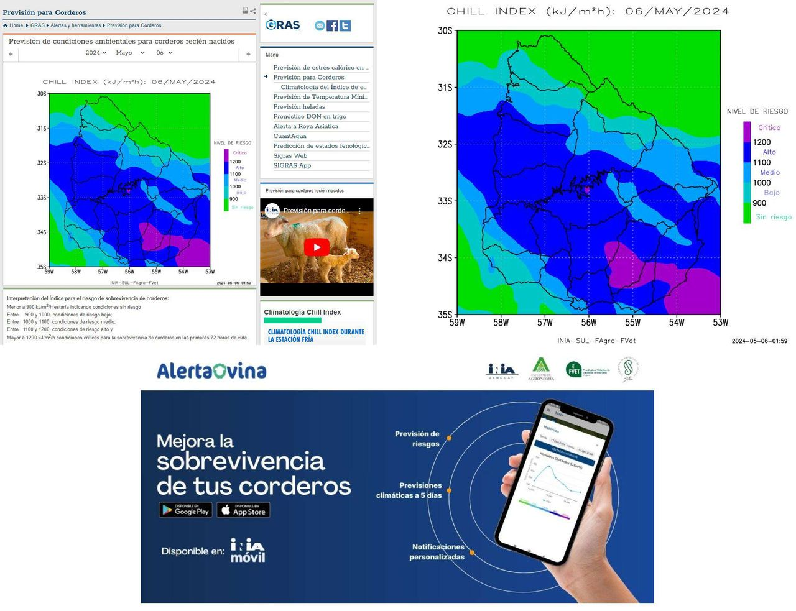
*Slide 58: la previsión para corderos en la web de GRAS (con la interpretación del índice), el mapa de chill index del 6/5/2024 y la app AlertaOvina.*

- **Estrés calórico en bovinos (01:58:59), app INIA Termoestrés:** alerta para **lechería y carne intensiva**. El estrés térmico causa **mermas de productividad y hasta muerte** de animales.
  - Avisa con **5–7 días** de anticipación (la slide dice 7). El índice **se calcula distinto para leche y para carne**.
  - **Según la slide**, el índice es el **ITH** (índice de temperatura y humedad, Thom 1959), el más usado a nivel mundial para relacionar el ambiente con la respuesta del ganado. Uruguay no es una zona donde el estrés térmico sea sostenido y peligroso, pero afecta a las vacas lecheras de alta producción y a la terminación a corral. La app sirve para carne y leche, en sistemas extensivos o intensivos.
  - **Niveles de riesgo del ITH**, según el mapa del 30/04/2024 de la slide:

    | Nivel de riesgo | ITH |
    |---|---|
    | Sin riesgo | < 68 |
    | Alerta | 68–72 |
    | Peligro | 72–79 |
    | **Emergencia** | **> 79** |

  - La web de la herramienta cita resultados de INIA con **acceso a sombra** en verano. Las vacas lecheras de alta producción dieron en promedio **5 litros más** de leche (corregida por sólidos). En terminación a corral, la ganancia media diaria mejoró un **15 %** y la eficiencia de conversión un **7 %**. En pastoreo, la ganancia media diaria subió un **14 %**.
  - Medidas: **no mover el ganado** en las horas de más estrés, asegurar **agua** disponible, poner **aspersión** para refrescar.

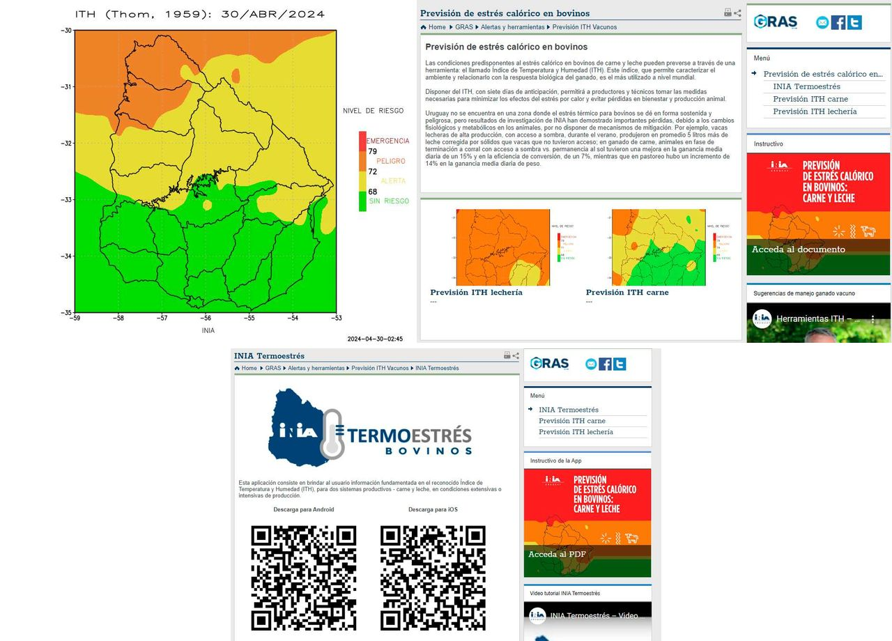
*Slide 59: el mapa de ITH del 30/4/2024 con sus niveles de riesgo, la web de previsión de estrés calórico (ITH lechería y carne) y la app INIA Termoestrés.*

- **Cómo funciona la app (02:00:45):**
  1. Marcar el sistema productivo.
  2. Buscar un lugar (padrón) y marcarlo como **favorito**.
  3. Recibir las alertas y los niveles de riesgo **directo en el celular**, sin tener que mirar mapas todo el día.
- **Temperaturas mínimas, app INIA Termomín (02:02:09):** la temperatura mínima **no es exactamente una helada**, porque la helada depende también del viento y la topografía. Pero es un **proxy bastante certero** del impacto.
  - Hay mapas y alertas con umbrales como **< 0 °C** o **< 2 °C**, y **el usuario define el rango** según su sistema (por ejemplo, avisar debajo de 2 °C).
  - **Según la slide:**
    - Pronostica hasta **5 días** la temperatura mínima del aire (a 2 m) y de superficie (sobre el suelo), para cualquier punto de Uruguay.
    - Muestra la variación dentro del día y permite guardar marcadores.
    - Avisa si puede haber temperaturas **bajo 0 °C** e incluye recomendaciones para manejar heladas.
    - Tiene secciones para citrus y cultivos protegidos.
    - La web de **Previsión de Temperatura Mínima** de GRAS muestra mapas nacionales para el día y los dos siguientes (72 h). Usa el modelo **WRF/CPTEC** (5 × 5 km, actualizado cada 3 horas).

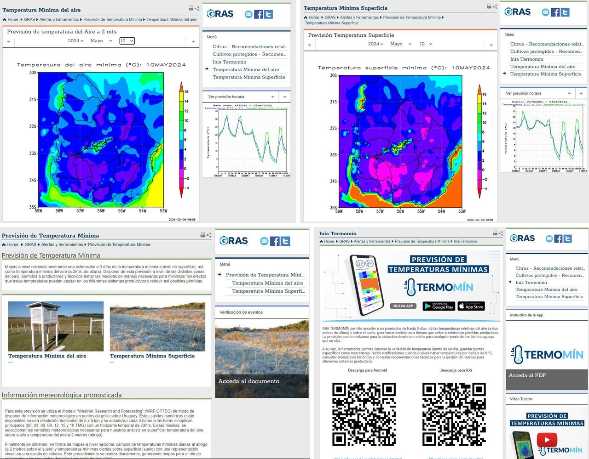
*Slide 61: mapas de temperatura mínima del aire y de superficie del 10/5/2024, la web de previsión y la app INIA Termomín.*

- **Principio clave (02:03:27):** toda alerta tiene que estar **asociada a medidas o recomendaciones de manejo**. Avisar algo sobre lo que no se puede hacer nada (como el **granizo**) es frustrante: "sorry, llorá".

### d) Apoyo a la gestión (02:04:43)
- **Herramientas de fertilización:** de **fósforo**, de **nitrógeno** y de **arroz**, para fertilizar más eficientemente. En próximas clases van a mostrar soluciones de desarrolladores. Las slides las nombran:
  - **OptiFert-P:** define la dosis de fósforo en pasturas sembradas a partir del análisis de suelo, el tipo de suelo (CONEAT), la historia de fertilización y la pastura. Es gratuita por internet.
  - **OptiFert-N:** nitrógeno en trigo.
  - **Fertiliz-Arr:** recomienda N, P y K para arroz a partir del análisis de suelo. Está validada a nivel experimental y comercial.

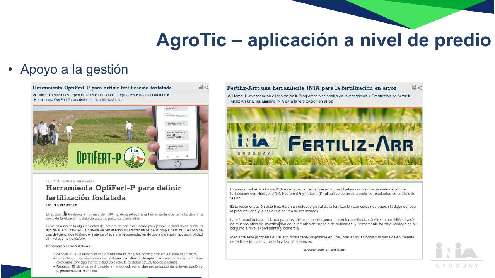
*Slide 63: las webs de OptiFert-P y Fertiliz-Arr.*

- **Gestión del riego:** el requerimiento de agua **depende de la fase del cultivo** (de chico necesita poca agua, al crecer más, y también en la formación del grano) y de las condiciones ambientales (si llovió o no).
  - Ejemplo de la slide: **GESIR** (Gestor inteligente de riego), una app web para planificar el riego suplementario. Usa balance hídrico (método FAO-56) con datos meteorológicos, de suelo y de fenología. Está pensada para extensivos y pasturas, y se puede adaptar a hortalizas, frutales y cítricos.
- **Alertas de enfermedades** (02:06:05). Ejemplo de la slide: **SARAS** (Sistema de Alerta a Roya Asiática de la soja). Muestra focos, riesgo meteorológico y recomendaciones de manejo, y avisa por mail si aparece un foco a menos de 100 km de tus chacras.

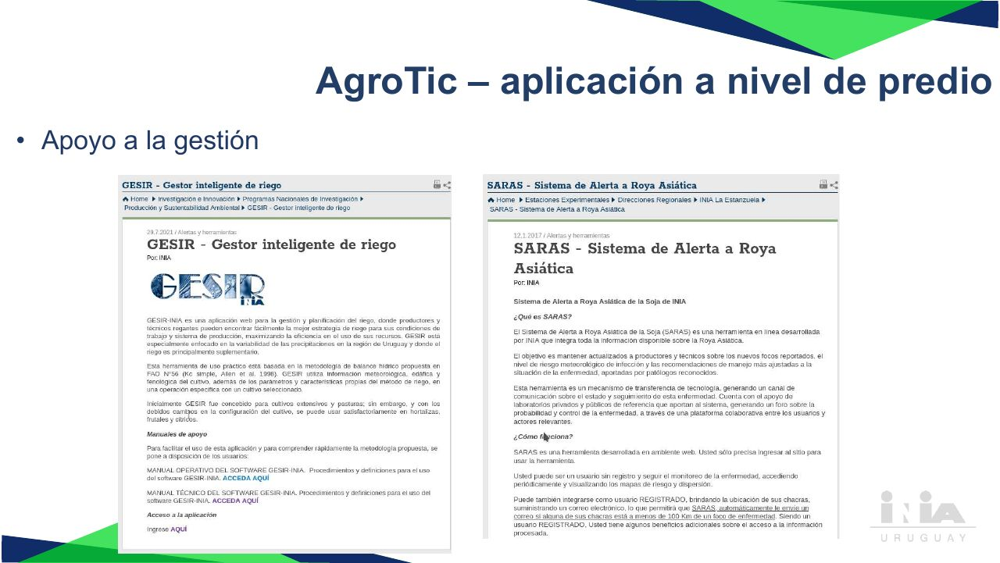
*Slide 64: las webs de GESIR y SARAS.*

- **INIA Móvil (02:06:05):** una **"super app"** que reúne todos los desarrollos web y móviles de INIA, porque los productores decían "no puedo descargarme 10 aplicaciones de INIA".
  - Cada productor marca como favoritos los que le interesan.
  - **Carga su ubicación una sola vez** y recibe todas las alertas en un solo lugar.
  - Además, mejora la comunicación con el productor: es más directa y unificada.
  - La slide dice "Todas las App INIA en un solo lugar". En la grilla se distinguen, con dudas, GESIR, CultiDatos_uy, Previsión Corderos, OptiFert-N y Previsión heladas.


*Slide 65: INIA Móvil, "todas las App INIA en un solo lugar".*

- **Lógica de integración (02:07:34):** integrar simplifica, y la interacción entre la información de distintas aplicaciones **potencia su utilidad** para la gestión del predio.
- **Auravant (02:08:58):** integra información de distintas fuentes a nivel de **chacra**, con **índices de vegetación**. Un agrónomo ve zonas con problemas de vegetación (por ejemplo, una fertilización que no funcionó bien) y **vuelve a aplicar solo en las zonas comprometidas**. Resultado: eficiencia en insumos y **menos costo** que aplicar de forma homogénea en todo el predio.
  - En la captura del video se ven módulos de análisis, gestión, relevamientos, clima, reportes, órdenes de trabajo y maquinarias.
  - Tiene **extensiones de terceros**: por ejemplo, el Modelo Cronos de trigo (CONICET), INTA Campero y Finnegans.
  - Se ve también un mapa de NDVI del lote (escala −1 a 1) con línea de tiempo.

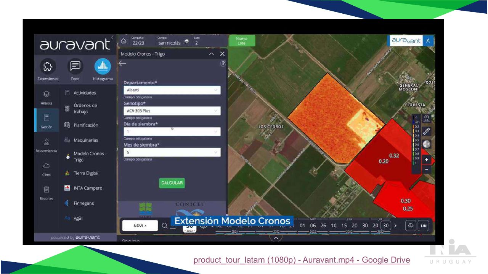
*Slide 66: Auravant, con el NDVI de los lotes y la extensión Modelo Cronos.*

### e) Procesos modernos de análisis de datos (02:10:29)
- Con IA hacen falta **datos suficientes y robustos**: si se analizan datos basura, sale basura. Por eso importan el monitoreo y la **constancia en los registros**.
- **Modelos predictivos:** para prever una situación se necesitan datos suficientes y buenos. Son fundamentales para el sector.
- **Gemelos digitales (02:11:59):** permiten probar modificaciones, simulaciones o mejoras en el predio **sin esperar tiempos biológicos ni ensayos a campo**.
- La slide muestra el flujo completo: clima → estación meteorológica → **series históricas** (unos 10 años de precipitación acumulada en mm y temperatura media en °C, con su ciclo estacional) → **modelos predictivos**.

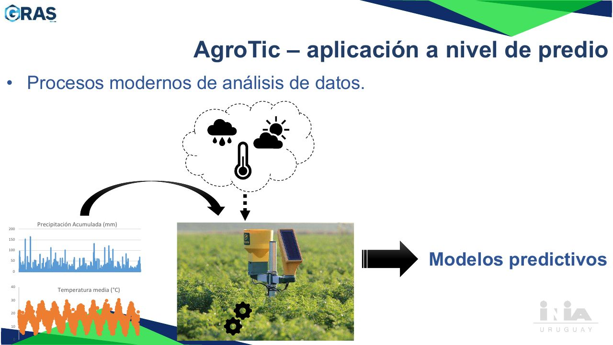
*Slide 67: del clima a la estación meteorológica, a las series históricas y a los modelos predictivos.*

### f) Automatización (02:11:59)
- **Qué se automatiza:** porteras, **alambrados virtuales**, bombas, riego, climatización e invernáculos.
- **Riego automático de pasturas (02:13:38).** La docente lo usa de ejemplo porque es muy sencillo: un verdeo de invierno (avena) regado, con ganado.
  - Lo desarrolló una **empresa nacional** con un proyecto financiado por la **ANII**.
  - Aportaron la **Facultad de Agronomía** (cátedra de hidrología) y el **INIA**, que evaluó el funcionamiento del equipo y la aplicación de agua.
  - Se estudia usar **motores solares** por su baja potencia. El proyecto empezó hace ~8 años con empresas privadas y sigue mejorando.
  - **Prueba en INIA Las Brujas (02:14:59):** un equipo se evalúa semanalmente sobre un cultivo. Se mide la **uniformidad** mientras avanza y cómo se comporta frente al **viento**, "el principal enemigo" de los sistemas de aspersión.
  - Hay riegos automatizados mucho más complejos, incluso en hidroponía. Video de la slide: "Expo Melilla 2017: Ing. Agr. Claudio García – Sistema Automático de Riego".

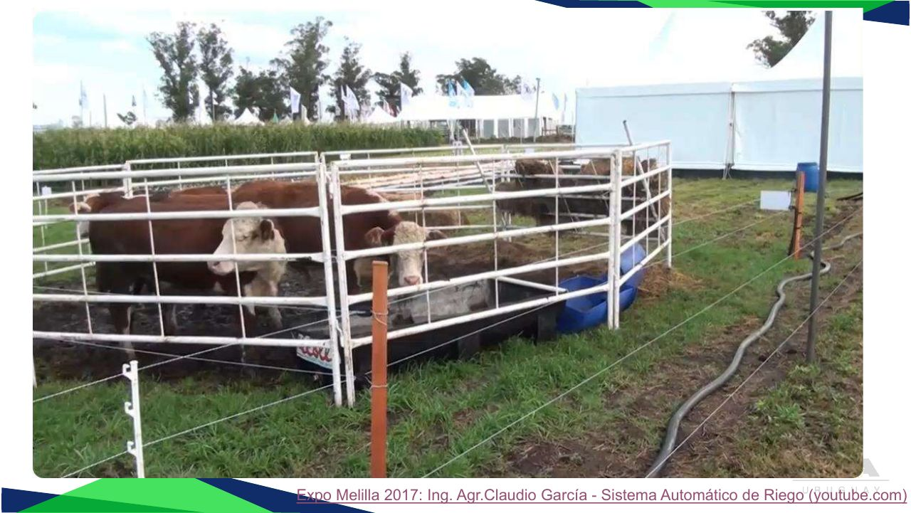
*Slide 69: captura del video sobre el sistema automático de riego (Expo Melilla 2017).*

### g) Robotización (02:14:59)
- **Dónde:** invernáculos, ordeñe, maquinaria agrícola (por ejemplo, un robot de cosecha).
- **Ordeñe voluntario robotizado (VMS)**, instalado en **INIA Las Brujas** y **INIA La Estanzuela** (Colonia).
- **En sistema pastoril (02:16:24):** normalmente estos robots están en sistemas mucho más intensivos. Acá se quiso probarlo a pasto.
- **Cómo funciona:**
  - Las vacas van **solas** a ordeñarse **cuando quieren**, atraídas por **comida** (grano, que les gusta más que la pastura). Ya no hay que salir a buscarlas cada mañana.
  - Un **collar identifica a la vaca** y el sistema sabe cuánto hace que se ordeñó. Si le toca, la deja entrar; si no, la manda para otro lado.
  - **(02:17:40)** Entran por jerarquía. Mientras la vaca come y se queda quieta, el robot le pone las **pezoneras** y ordeña. Al terminar, la deja salir hacia la pista de alimentación.
- **Muy caro (02:19:10):** un productor familiar no puede instalarlo, pero hay sistemas productivos que sí lo soportan.

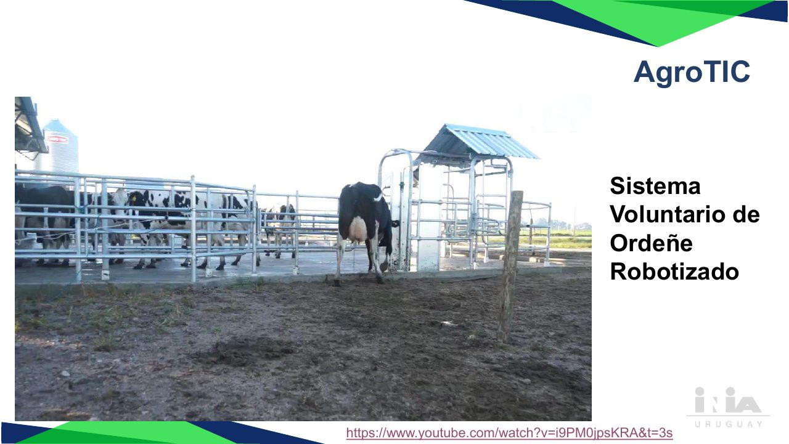
*Slide 72: el sistema voluntario de ordeñe robotizado, a pasto.*

### h) Alambrados virtuales (02:19:10)
- INIA está probando los collares de la empresa **Halter**. **Confinan al ganado en una zona definida virtualmente** mediante **estímulos negativos y positivos**.
- Una foto aérea muestra parcelas sin alambrado con las vacas confinadas. El perímetro se mueve **digitalmente** cuando hay que cambiar de potrero.
- **Ventajas (02:20:37):**
  - **No hay que instalar alambrados**, que son caros, sobre todo si hay que moverlos o reponerlos (por ejemplo, cuando un arroyo se los lleva).
  - Sirven para el manejo del pastoreo y para **proteger zonas sensibles**, como un bosque ribereño en regeneración.
- La slide muestra la web de Halter, los collares y una foto de ganado en una ladera con el polígono del cerco virtual dibujado. La web lo presenta como un collar inteligente con app móvil para crear cercas virtuales, manejar el pastoreo desde el celular y monitorear cada animal las 24 horas.

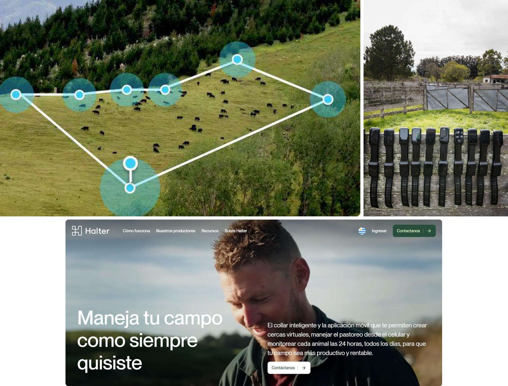
*Slide 70: el cerco virtual dibujado sobre el campo, los collares y la web de Halter.*

### i) Sistemas inteligentes de toma de decisión (02:20:37)
- **Para qué:** manejo de cultivos, manejo animal, gestión financiera y económica. La idea es **integrar toda la información predial** para que el productor decida **más informado**.
- **La decisión final es del productor (02:22:02)**, que puede tener otras lógicas y prioridades.

**Esquema de integración de la slide.** En el centro está el usuario (computadora o tablet, con un esquema cliente–internet–servidor). Los módulos forman un ciclo que termina en la **toma de decisión**:

| Componente | Qué incluye |
|---|---|
| Monitoreo y gestión animal | Producción (cantidad y calidad de leche); comportamiento (actividad con podómetro, estrés por temperatura, movimiento por GPS); nutrición; sanidad |
| Monitoreo ambiental | Clima (temperatura, humedad relativa, lluvia); suelo (contenido de agua); agua (calidad) |
| Riego automatizado | Cantidad de agua aplicada, tiempo, presión |
| Monitoreo de cultivos y pasturas | Pasturas (estado de la vegetación, stock); cultivos (mapas de rendimiento, registros de aplicaciones) |
| Sistema de vigilancia | Cámaras, drones |
| Maquinaria agrícola | Telemetría (rendimiento, aplicaciones, robot) |
| Pronósticos | Pronósticos climáticos y perspectivas ambientales y productivas |
| Alertas | Estrés calórico o hídrico, heladas, enfermedades |
| Acceso a la información | En una versión de la slide, "a través de **procesamiento del lenguaje natural**"; en la versión titulada "INTEGRACIÓN", "de manera fácil y usable" |

Todo converge en la **integración** y en el **acceso a la información de manera fácil y usable**. El **objetivo final** es gestionar de forma remota las actividades, la información generada y la toma de decisiones, con **capacitación al usuario**.

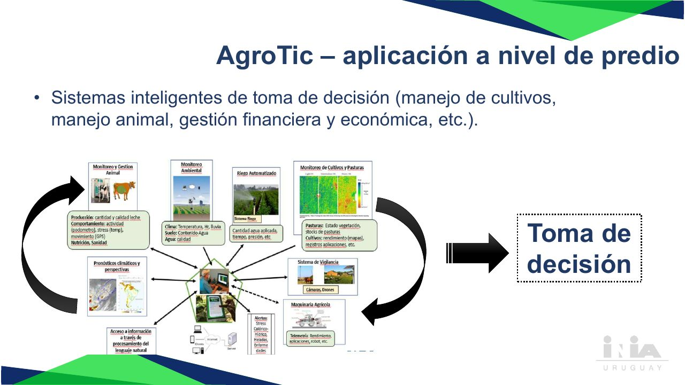
*Slide 73: los módulos de información alimentan la toma de decisión.*

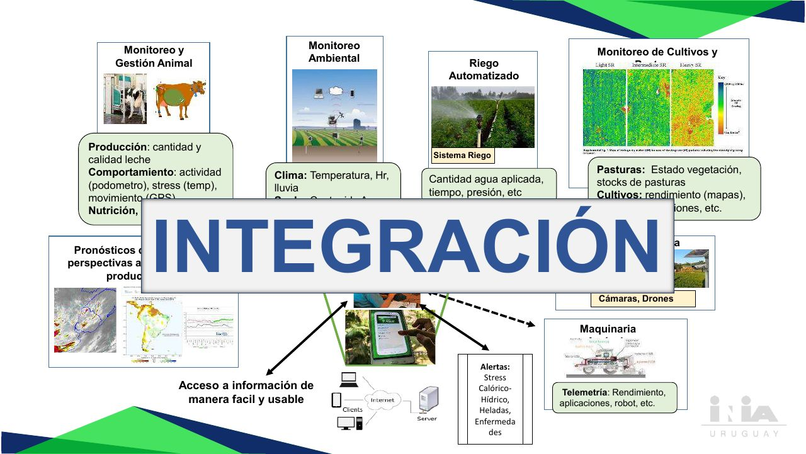
*Slide 75: la versión titulada "INTEGRACIÓN".*

**Qué tienen que lograr los sistemas de información:**
- **Integrar** información de **distintas fuentes y escalas** (02:22:02).
- Dar **resultados sencillos**, de fácil interpretación y aplicación, en la línea de alertas que permitan decidir.
- **No solo monitorear el pasado y diagnosticar el presente**, sino también **estimar el futuro**: proyecciones productivas, financieras y económicas a corto, mediano y largo plazo.
- **Respuestas concretas a consultas específicas**, como los **chatbots** o agentes (02:23:21). Necesitan información **robusta**; con información basura, "van a dar basura".
- Decisiones más precisas y consistentes, con información a nivel de predio.
- **Integración e interoperabilidad (02:23:21):** al desarrollar algo nuevo, tener en cuenta **qué ya tiene el productor** para no generar **islas de información**.
  - Sistemas que no se hablan entre sí causan perjuicios **operativos** y también **de percepción** (02:25:13): el productor no entiende por qué un sistema le dice una cosa y otro, otra.
- **Capacitación del usuario (02:25:13):** depende del **público objetivo**. Si la solución la va a usar un operario rural, hay que considerar su nivel educativo; si no, la herramienta termina siendo "más un problema que una solución".

### j) Difundir y facilitar el acceso a la información (02:26:27)
- **GRAS**, el área de INIA que coordina la docente, difunde las herramientas disponibles de forma amigable y ordenada (clima, monitoreo ambiental, INIA Móvil).
  - Web: [inia.uy/gras](http://www.inia.uy/gras) · gras@inia.org.uy · @GRAS_INIA.
- **La web de GRAS (en la slide)** tiene secciones de **monitoreo ambiental** (balance hídrico, NDVI, cultivos, APAR, por sección policial) y un banco de datos agroclimáticos.
- También tiene una sección de **seguros agropecuarios**:
  - **Seguro de sequía para soja** del BSE, basado en el índice PAD (agua disponible en el suelo). Según el nivel del índice, indemniza el 15 %, 25 % o 40 % del capital.
  - Un seguro para ganadería (2015–2018).

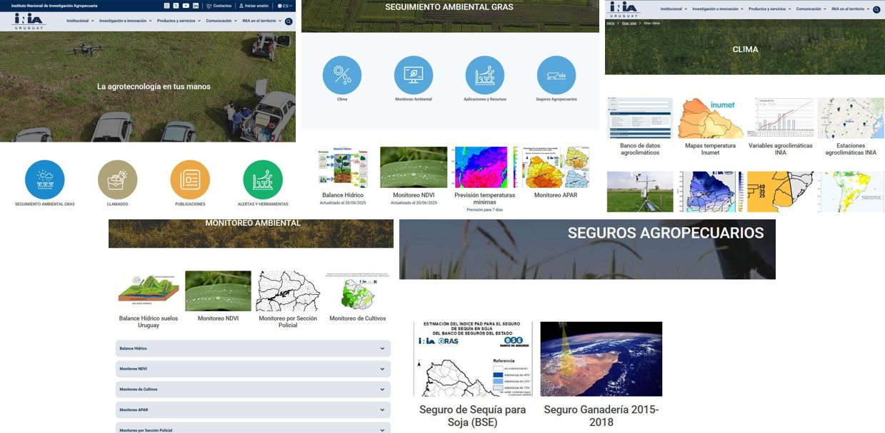
*Slide 77: la web de GRAS, con sus secciones de clima, monitoreo ambiental y seguros agropecuarios.*

- **Catálogo "Alertas y herramientas" de INIA (en la slide):**
  - AlertaOvina.
  - Previsión de estrés calórico en bovinos.
  - Sistema de Monitoreo Forrajero y Ambiental (productividad forrajera en kg de MS).
  - INIA Termomín.
  - CultiDatos_UY (selección de cultivares).
  - FertiRIEGO Horticultura (tomate).
  - OptiFert-P y OptiFert-N (nitrógeno en trigo).
  - SARAS.
  - Caracterización sanitaria y eficiencia de agroquímicos para trigo y cebada.
  - Red de Pastoreo.
  - SIGRAS y SIGRAS APP.

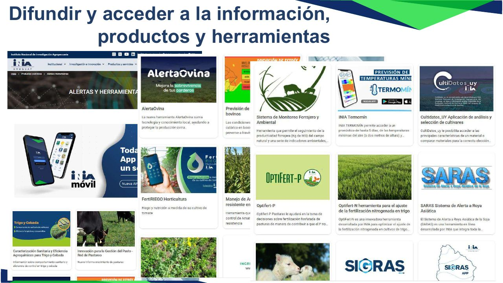
*Slide 78: el catálogo "Alertas y herramientas" de INIA.*

- **Programa Converge (02:27:49)**, activo hace ~3 años: busca **fomentar la adopción** de soluciones digitales bajando el **riesgo tecnológico**. Da evidencia **imparcial** a productores y técnicos.
  - **Verificación:** ¿la solución hace lo que dice?
  - **Validación:** ¿es usable y se entiende? Se evalúa con entrevistas a productores.
  - **Según la slide:** lo coordinan y cofinancian **INIA y BID Lab**, con apoyo de la ANII. Busca impulsar soluciones digitales que aumenten la **resiliencia al cambio climático**. Su lema: "Antes de llegar a tu campo, pasó por el nuestro".
  - Web: [inia.uy/converge](https://inia.uy/converge).


*Slide 79: Converge, "Antes de llegar a tu campo, pasó por el nuestro".*

## 13. ¿Cuándo tiene sentido digitalizar? (02:27:49)

Solo si **agrega valor**:
- producir más con menos,
- adaptarse al cambio climático (la variabilidad climática),
- abrir mercados,
- ser sostenibles,
- **incluir a pequeños y grandes productores** en la misma transformación.

**Por qué importan los pequeños (02:29:16):** el grande puede pagar más, pero los pequeños **son muchos más**. Aunque produzcan menos, son un **mercado potencial** y aportan a la **soberanía alimentaria**.

## 14. Oportunidades (02:29:16)

- **Optimización y eficiencia de recursos:** riego de precisión, fertilización diferenciada, control selectivo de plagas y enfermedades.
- **Mejora en productividad y toma de decisiones:** recopilación y análisis de datos; modelos de simulación y predictivos (pronóstico); gemelos digitales.
- **Sistemas de gestión y transferencia del riesgo (02:30:46):** el productor puede hacer todo bien y que algo salga mal, en general por el clima. Transferir parte del riesgo abre oportunidades en **seguros agropecuarios**. Ejemplo: el seguro de sequía para soja basado en el PAD (sección 12.j).
- **Mayor resiliencia y sostenibilidad ambiental:** reducir la huella ambiental gracias a usar insumos con más eficiencia; monitorear el estado y la salud del suelo y la vegetación.
- **Democratización de la información:** muchos productores **no tienen acceso a asesoramiento técnico**. Un **chatbot** con recomendaciones personalizadas, **buenas y confiables**, ayuda a que la información llegue a todos.
- **Acceso a mercados y trazabilidad (02:32:24):** trazabilidad, comercio digital, mercados diferenciales. La trazabilidad y los mercados diferenciales son críticos en **exportación**; el comercio digital sirve incluso para **pequeños productores a escala local**.
- **Eficiencia logística:** procesos más eficientes que ayudan con la falta de mano de obra.
- **Cumplimiento regulatorio y certificación.**

Las slides de oportunidades usan ilustraciones generadas con IA:
- un robot que pulveriza maíz;
- un productor con un dashboard en la tablet;
- un drone y un sensor de suelo portátil;
- un **chatbot** que detecta "infestación de pulgones" y una "probable deficiencia de zinc";
- un dashboard en un viñedo;
- una granja vertical de frutillas con robots que cosechan.

## 15. AgroTIC en investigación (02:33:53)

- La investigación también es **público objetivo**. Usa tecnología de forma más intensiva y está más abierta a probar.
- Sus soluciones pueden después **migrar a productores de avanzada** con recursos o capacidades.
- **Ejemplos** (lo que dijo la docente + lo que muestran las slides):
  - **Comunicación, integración y transmisión de datos:** nodos de sensores con panel solar en montes cítricos, un mapa de cobertura de radio en el litoral del río Uruguay y dashboards IoT.
  - **Soluciones en riego:** sensores más modernos, **radar** o **imágenes térmicas**, más allá de los índices de vegetación.
    - En la slide, una validación con "índices de vegetación + térmico" (mapa térmico de un establecimiento citrícola de Salto).
    - También **monitoreo de agua del suelo** con perfiles de humedad.
  - **Eficiencia de nutrientes (02:35:41):** **sensores de nutrientes** de medición más directa. En la slide, un sensor óptico de mano sobre el cultivo.
  - **Manejo y detección de plagas:** una **trampa electrónica** con cámara y antena, y un software ("polillas") que identifica y marca cada polilla en la foto de la trampa (tipos 1–4 y feromona).
  - **Monitoreos por ambiente**, con herramientas modernas.
    - En la slide, potreros divididos en zonas con su producción de forraje (kg de MS, de ~1.900 a ~4.500).
    - También mapas de zonas productivas (1 a 10).

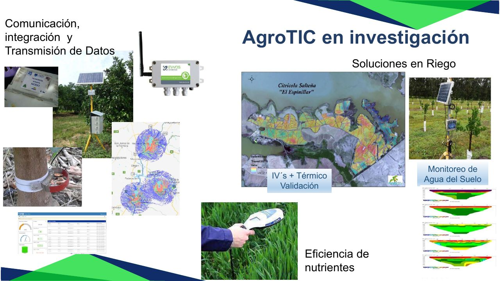
*Slide 87: transmisión de datos, soluciones en riego (índices de vegetación + térmico, agua del suelo) y eficiencia de nutrientes.*

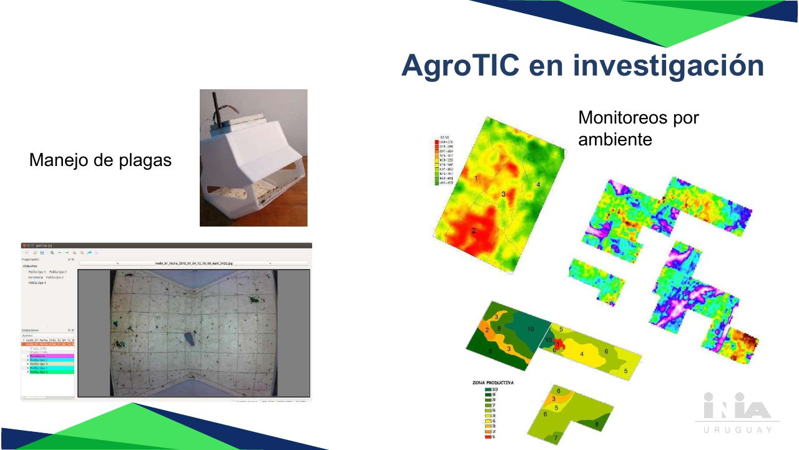
*Slide 88: la trampa electrónica con su software, y mapas de zonas por ambiente.*

## 16. Desafíos (02:35:41)

- **Infraestructura y conectividad:** mejora, pero sigue habiendo zonas con problemas.
- **Capacitación y usabilidad:** hay soluciones buenas con usabilidad malísima. Ejemplo: botones muy chicos en el celular y productores con "dedos grandes" que "aprietan cinco cosas".
- **Costos (02:37:17):** bajan, pero algunos siguen altos, y muchos productores no pueden o tienen otras prioridades.
- **Aversión al cambio y riesgo tecnológico**, que Converge intenta reducir.
- **Aumento de brechas** entre productores familiares y productores más avanzados tecnológicamente.
- **Transformación de la mano de obra, no sustitución (02:37:17).** Ejemplo del robot de ordeñe: quien antes salía a buscar las vacas bajo la lluvia y con −5 °C puede capacitarse para manejar o limpiar el robot. Son tareas que **requieren más capacitación**.
- **Poca integración entre los actores de la cadena (02:38:29):** silos de información a distintas escalas.
- **Propiedad de los datos y uso comercial no autorizado:** la maquinaria levanta muchísimos datos. Son del productor, pero no está claro si quiere que otros los usen, y se usan igual.
- **Datos no interoperables (02:39:46):** dos soluciones en un mismo sistema generan datos que no se pueden combinar.
- **Falta de herramientas para promover la adopción.**
- Otros. La docente invitó a sugerir más.

## 17. Cierre (02:41:15)

> **La digitalización no es un fin en sí mismo.** Es un proceso necesario, pero solo como un medio para generar valor real. La innovación en el agro debe repensarse a partir de **necesidades, no de modas**, para que genere valor **económico, ambiental y social**.

- El valor **no es solo económico**. También es ambiental y **social**: calidad de vida y tareas muy sacrificadas.
- Las soluciones que no responden a un problema real "terminan destruyendo" a las que sí lo hacen.
- **"El agro no necesita más apps, necesita más valor" (02:42:58).** Cualquier desarrollo tiene que responder a **un dolor o una problemática real** del sector. Crear una solución y después salir a buscarle un problema "suele terminar en fracasos".

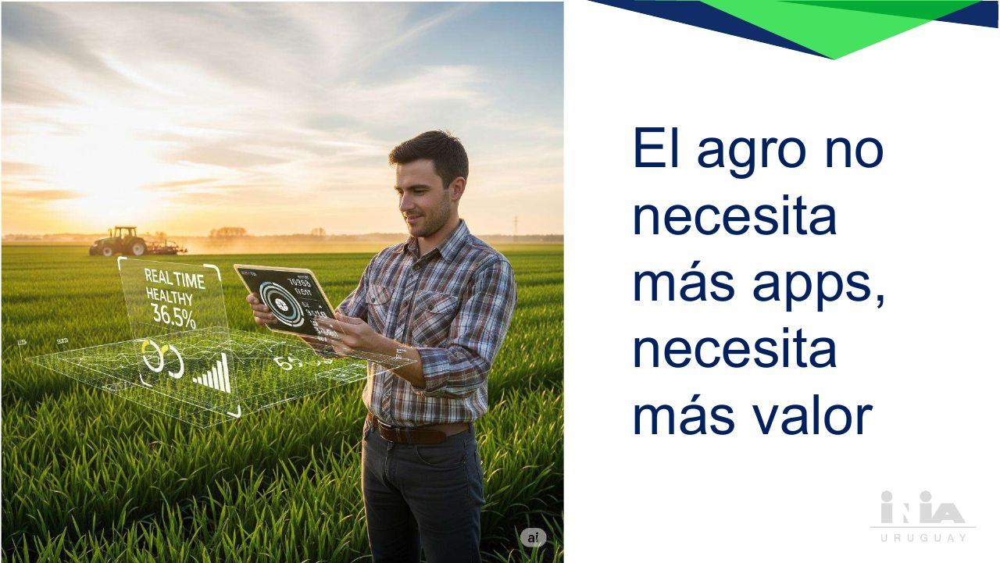
*Slide 93: el mensaje de cierre.*

## 18. Cierre de la clase y logística (02:44:21)

- **No hay campus.** Lola manda por mail, después de cada clase, las presentaciones de docentes y expositores.
- **Grabaciones:** están en un Drive cuyo link figura en el archivo de notas que comparte Lola. Pueden tardar unas horas en subir.
- **Próxima clase:** martes a las 19 h (27/10, fruticultura), arranca con el multiple choice sobre esta clase.

## Anexo: última slide (no se mostró en clase)

Mapa de Argentina por regiones con sus producciones principales (fuente: DNPER).

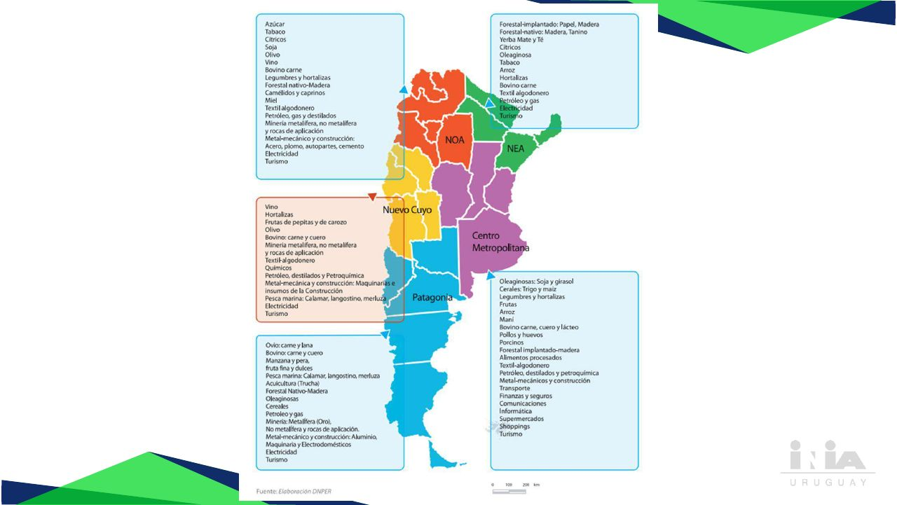
*Slide 96: regiones productivas de Argentina (DNPER).*

La tabla resume solo los rubros agropecuarios; la asignación de Nuevo Cuyo es aproximada.

| Región | Producciones agropecuarias |
|---|---|
| NOA | Azúcar, tabaco, cítricos, soja, olivo, vino, bovinos de carne, legumbres y hortalizas, forestal nativo, camélidos y caprinos, miel, algodón |
| NEA | Forestal implantado (papel, madera) y nativo (madera, tanino), yerba mate y té, cítricos, oleaginosas, tabaco, arroz, hortalizas, bovinos de carne, algodón |
| Nuevo Cuyo | Vino, hortalizas, frutas de pepita y carozo, olivo, bovinos |
| Patagonia | Ovinos (carne y lana), bovinos, manzana y pera, fruta fina, pesca, acuicultura (trucha), forestal nativo, oleaginosas, cereales |
| Centro | Soja y girasol, trigo y maíz, legumbres y hortalizas, frutas, arroz, maní, bovinos (carne, cuero, lácteos), pollos y huevos, porcinos, forestal implantado |

---

## Correcciones de la transcripción automática

| Dice la transcripción | Es |
|---|---|
| Iña, niña | INIA |
| Aura Bant, Auraband, Auroband | Auravant |
| NDBI | NDVI |
| Chilindex | *chill index* (índice de enfriamiento) |
| alerta o vina | Alerta Ovina |
| Starling | Starlink |
| ANI | ANII (Agencia Nacional de Investigación e Innovación, Uruguay) |
| Fitlot, feitlots | feedlot |
| bobinos | bovinos |
| olando | Holando |
| apariciones | pariciones (época de partos) |
| experssión | aspersión |
| hidropoña | hidroponía |
| FALPA | probablemente "alfalfa" (cultivo de la prueba de riego) |

---

## ✎ Relevancia para IA / ideas de TP

**Ideas que mencionó la docente:**
- Monitoreo de humedad en cosecha o almacenamiento de granos.
- Predicción de materia seca para ajustar la carga.
- Aplicación selectiva de insumos.
- Alertas asociadas a medidas de manejo.
- Chatbots con datos robustos para productores sin asesor.
- Integración e interoperabilidad de datos.
- Herramientas para investigación.

**Lecturas propias desde IA:**
- **Visión por computadora:** detección de malezas, frutos y estado del cultivo; drones; cosecha robotizada; conteo de plagas en trampas electrónicas, como el software "polillas" de las slides de investigación.
- **Teledetección:** NDVI y anomalías → zonas de manejo, biomasa, materia seca.
- **Series temporales:** pronóstico de heladas, estrés térmico, chill index, balance hídrico y demanda de riego.
- **LLMs y agentes:** recomendaciones para productores. El problema central es la calidad de los datos y la usabilidad para usuarios con poca alfabetización digital. La slide de sistemas inteligentes incluye explícitamente el "acceso a información a través de procesamiento del lenguaje natural".

**Criterios implícitos de la docente para evaluar una solución:**
- ¿Resuelve un problema real?
- ¿La predicción lleva a una **acción de manejo** posible?
- ¿Es usable por el perfil del usuario (productor, técnico, operario)?
- ¿Se integra con lo que el productor ya tiene?

## ✎ Glosario

- **Secano:** cultivo que solo usa agua de lluvia.
- **Pivot (pivote central):** equipo de riego que gira en círculo; genera los círculos verdes que se ven en imágenes aéreas.
- **Chacra:** parcela de cultivo.
- **Sistematización (arroz):** canales y terrazas para inundar la chacra.
- **Orear:** dejar secar el suelo.
- **Panoja:** espiga del arroz.
- **Plantines:** plantas jóvenes de vivero que después se trasladan a campo.
- **Chip:** madera triturada (por ejemplo, para celulosa).
- **Potrero:** subdivisión del campo para manejar el pastoreo.
- **Carga ganadera:** cantidad de animales por superficie.
- **Peón:** trabajador rural.
- **Rodeo:** conjunto de vacunos.
- **Majada:** conjunto de ovejas.
- **Pariciones:** época de partos.
- **Feedlot:** engorde a corral.
- **Holando:** raza lechera.
- **Tambo:** establecimiento lechero.
- **Efluentes:** residuos líquidos del tambo.
- **Cañada:** curso de agua pequeño.
- **Propóleo:** resina que producen las abejas.
- **Silvopastoril:** árboles + pasturas + ganado.
- **Verdeo de invierno:** cultivo forrajero anual, como la avena.
- **Pezoneras:** copas de la ordeñadora.
- **VMS:** sistema de ordeñe voluntario.
- **NDVI:** índice de vegetación de diferencia normalizada; usa la banda roja y la infrarroja cercana.
- **Década (agroclimática):** período de 10 días.
- **Chill index:** índice de enfriamiento en kJ/m²/h; combina frío, viento y lluvia.
- **ITH:** índice de temperatura y humedad; mide el estrés calórico.
- **PAD:** porcentaje de agua disponible en el suelo.
- **CONEAT:** clasificación de los suelos de Uruguay según su productividad.
- **Anomalía:** diferencia contra el promedio histórico del mismo período.
- **Balance hídrico:** estimación del agua disponible en el suelo.
- **Gemelo digital:** modelo que simula el sistema real para probar escenarios.
- **Interoperabilidad:** que los datos de distintos sistemas se puedan combinar.
- **Servicios ecosistémicos:** beneficios que da el ambiente (agua, polinización, suelo).
- **Soberanía alimentaria:** capacidad de un país o comunidad de producir sus propios alimentos.
- **CMNUCC:** Convención Marco de las Naciones Unidas sobre el Cambio Climático.

## ✎ Preguntas de práctica

1. ¿Cuáles son los componentes básicos de un sistema agropecuario?
2. ¿Qué tres elementos determinan un sistema según el enfoque de sistemas?
3. ¿El objetivo del productor es siempre maximizar la producción por hectárea? Dar dos ejemplos de otros objetivos.
4. ¿Cuál **no** es una característica de los cultivos extensivos? a) grandes superficies b) alta mano de obra por ha c) alto riesgo climático d) mucha mecanización
5. ¿Qué significa que un cultivo sea "de secano"? Si se riega, ¿con qué sistema suele hacerse?
6. ¿Por qué es crítico controlar la humedad en la cosecha de granos?
7. ¿Qué caracteriza al arroz frente a otros extensivos?
8. ¿Cuánto duran los ciclos forestales y para qué se produce?
9. ¿Qué factor es clave en fruticultura?
10. ¿En qué sistemas productivos se puede encontrar la horticultura?
11. ¿Qué diferencia a la ganadería extensiva de la intensiva en uso de insumos, mano de obra e impacto ambiental?
12. Nombrar tres puntos críticos de la lechería.
13. ¿Qué es un sistema silvopastoril? ¿Para qué sirve el bozal en fruticultura con ovejas?
14. ¿Qué rango define un predio mediano en cultivos extensivos? ¿De qué más depende el tamaño?
15. ¿Por qué hay baja adopción de soluciones digitales en el agro?
16. ¿Qué rol pueden tener los técnicos asesores en la adopción?
17. Según la CMNUCC, ¿qué es el cambio climático? ¿El Niño es cambio climático?
18. ¿Cuáles son las dos etapas del estudio del cambio climático?
19. Nombrar cuatro factores que promueven el uso de AgroTIC.
20. ¿Qué significa digitalizar según la clase?
21. ¿Cómo se construye un mapa de anomalía de lluvia?
22. ¿Qué mide el NDVI y con qué bandas?
23. ¿Qué principio debe cumplir toda alerta?
24. ¿Qué evalúa el programa Converge? ¿Qué es verificación y qué es validación?
25. ¿Para qué sirven los alambrados virtuales?
26. ¿Por qué el robot de ordeñe implica una transformación y no una sustitución de la mano de obra?
27. Nombrar tres desafíos de la digitalización del agro.
28. ¿Cuál es el mensaje final de la clase?
29. ¿En qué unidad se mide el chill index y desde qué valor el riesgo es crítico para los corderos?
30. ¿Qué índice usa INIA Termoestrés y con cuánta anticipación avisa?
31. ¿Qué es el PAD y en qué seguro agropecuario se usa?
32. ¿Cómo evoluciona la proporción de población rural mundial según la clase?
33. ¿Qué hace la trampa electrónica para plagas que aparece en las slides de investigación?
34. ¿Qué herramientas de INIA ayudan a fertilizar y cuál a regar?
35. ¿Cuáles son los niveles de riesgo del ITH?

<details>
<summary>Respuestas</summary>

1. Recursos naturales, componentes biológicos, capital humano, capital tecnológico, infraestructura y mercados.
2. Entradas, procesos y salidas (más las relaciones entre las partes).
3. No. Por ejemplo: calidad de vida, seguridad alimentaria, "caja de ahorro", aceptación social, volumen mínimo anual con bajo riesgo.
4. b) La alta mano de obra por ha es típica de los intensivos.
5. Que solo usa agua de lluvia. Si se riega, suele ser por pivot central.
6. Porque la humedad alta causa deficiencias de calidad y deterioro en el almacenaje (hongos, enfermedades).
7. La inundación en etapas de crecimiento: el riego es fundamental y la chacra está sistematizada.
8. Unos 10 años; se produce madera o celulosa.
9. La polinización.
10. A cielo abierto, en invernáculos, en túneles de plástico y en hidroponía.
11. La intensiva usa más insumos externos y más mano de obra, tiene ciclos más cortos y genera mayor impacto ambiental.
12. Manejo reproductivo, calidad de leche y efluentes (también: ordeñe diario sin feriados).
13. Es la integración de forestación, pasturas y ganado. El bozal deja comer el pasto del suelo pero no los brotes de la planta.
14. Entre 50 y 500 ha. También depende del sistema productivo y de la fertilidad del suelo.
15. Por miedo al riesgo tecnológico, costos, otras prioridades o necesidades más básicas, y porque no conocen las soluciones o no les ven valor.
16. Pueden ser aliados o barreras; a veces se resisten porque sienten la tecnología como una amenaza.
17. Es un cambio atribuible directa o indirectamente a la actividad humana, que se suma a la variabilidad natural. El Niño no lo es: es natural.
18. Detección y atribución.
19. Cualquiera de: conectividad, equipos más baratos, software maduro, recambio generacional, escasez de mano de obra, condiciones laborales, menos trabajo rutinario.
20. Integrar datos, procesos y decisiones en un ecosistema conectado que transforma la forma de producir.
21. Se compara el período actual (por ejemplo, marzo) contra el promedio histórico del mismo período.
22. El vigor de la vegetación, a partir de la clorofila; combina la banda roja y la infrarroja.
23. Tiene que estar asociada a una medida de manejo que el productor pueda tomar.
24. Evalúa soluciones digitales de forma imparcial. Verificación: si hace lo que dice. Validación: si es usable, con entrevistas a productores.
25. Para confinar el ganado sin alambrado físico, mover las parcelas digitalmente y proteger zonas sensibles.
26. Porque el personal se reconvierte en tareas más calificadas, como operar y limpiar el robot.
27. Cualquiera de: conectividad, usabilidad, costos, aversión al riesgo, brechas, propiedad de los datos, interoperabilidad, falta de herramientas de adopción.
28. "El agro no necesita más apps, necesita más valor": partir de necesidades reales.
29. En kJ/m²/h. El riesgo es crítico por encima de 1200.
30. El ITH (índice de temperatura y humedad). Avisa con 5–7 días; la slide dice 7.
31. Es el porcentaje de agua disponible en el suelo. Se usa en el seguro de sequía para soja del BSE (en la web de GRAS).
32. Cae: 63 % en 1970, 53 % en 2000 y 40 % proyectado para 2030.
33. Toma fotos y un software identifica y marca las polillas.
34. Para fertilizar: OptiFert-P (fósforo en pasturas), OptiFert-N (nitrógeno en trigo) y Fertiliz-Arr (arroz). Para regar: GESIR.
35. Sin riesgo < 68, alerta 68–72, peligro 72–79 y emergencia > 79.

</details>
