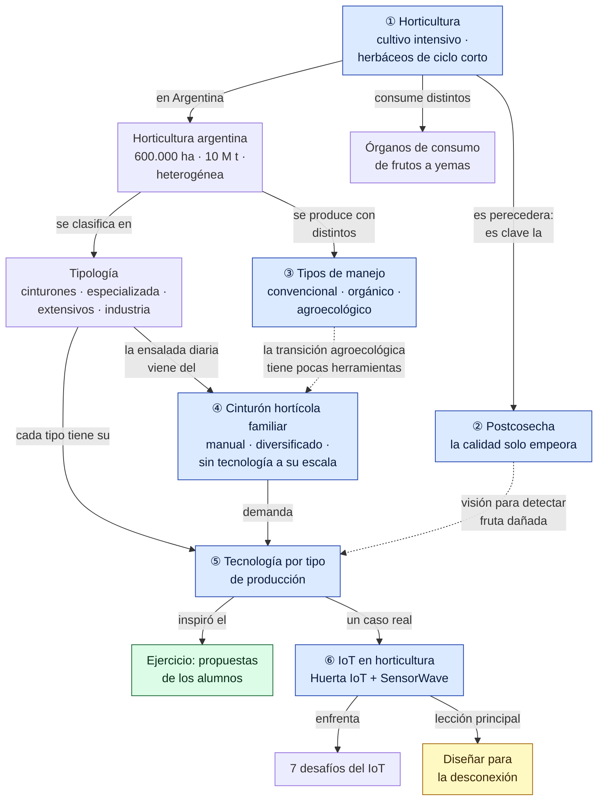
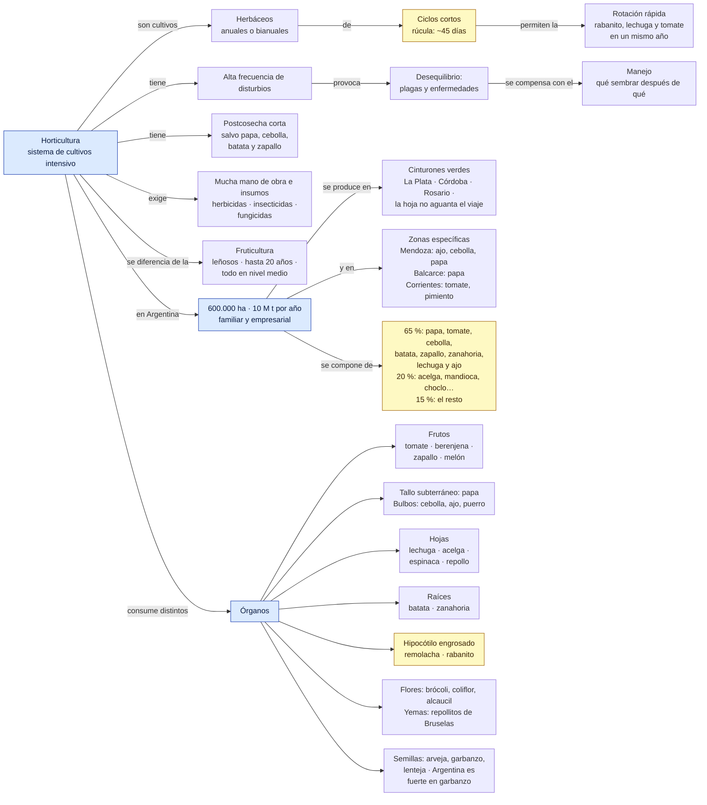
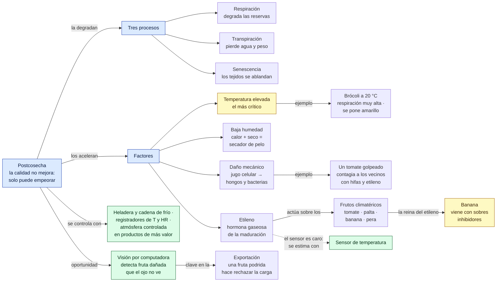
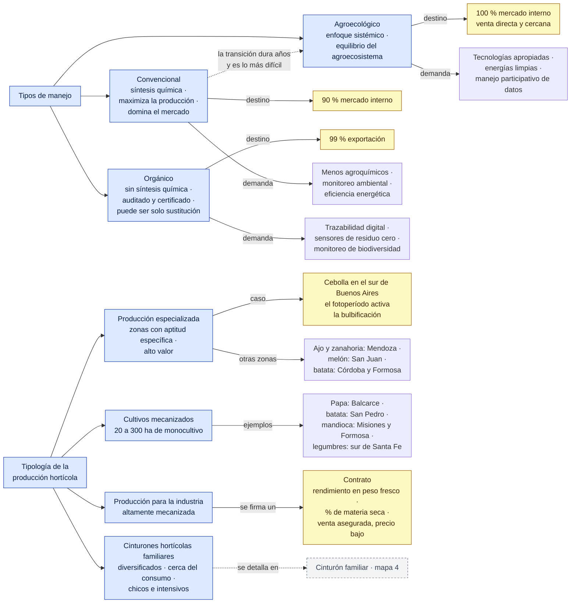
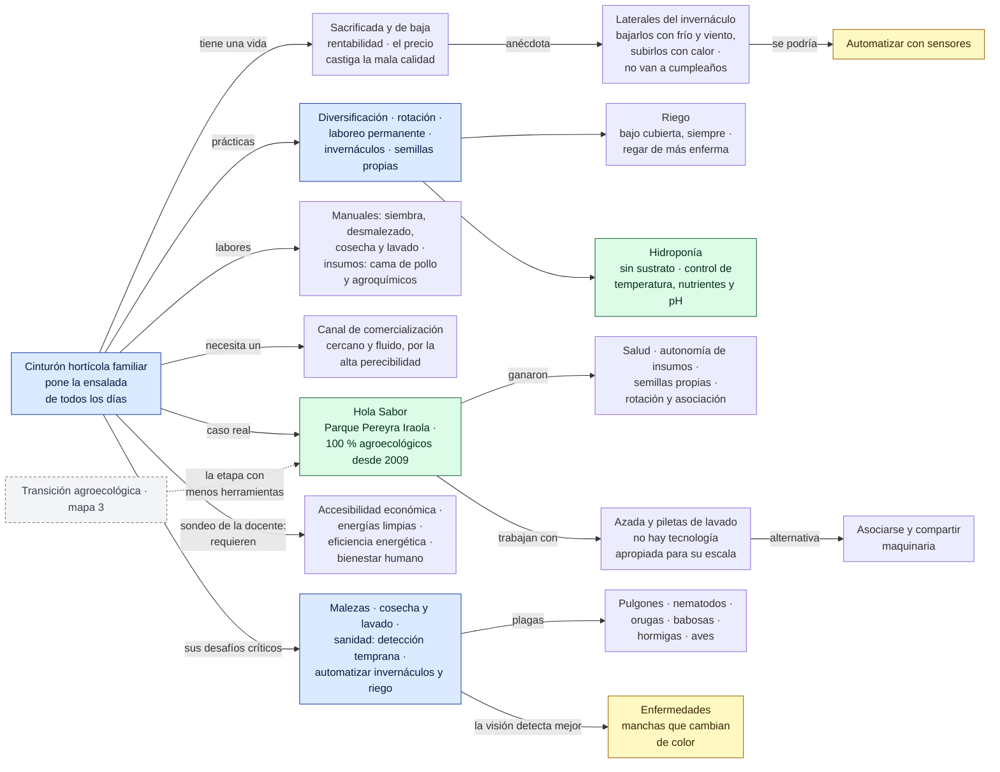
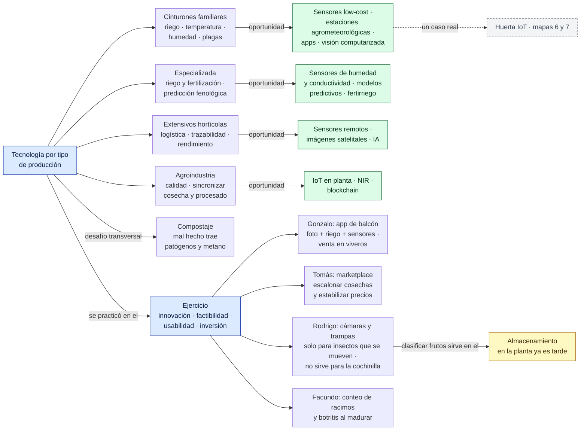
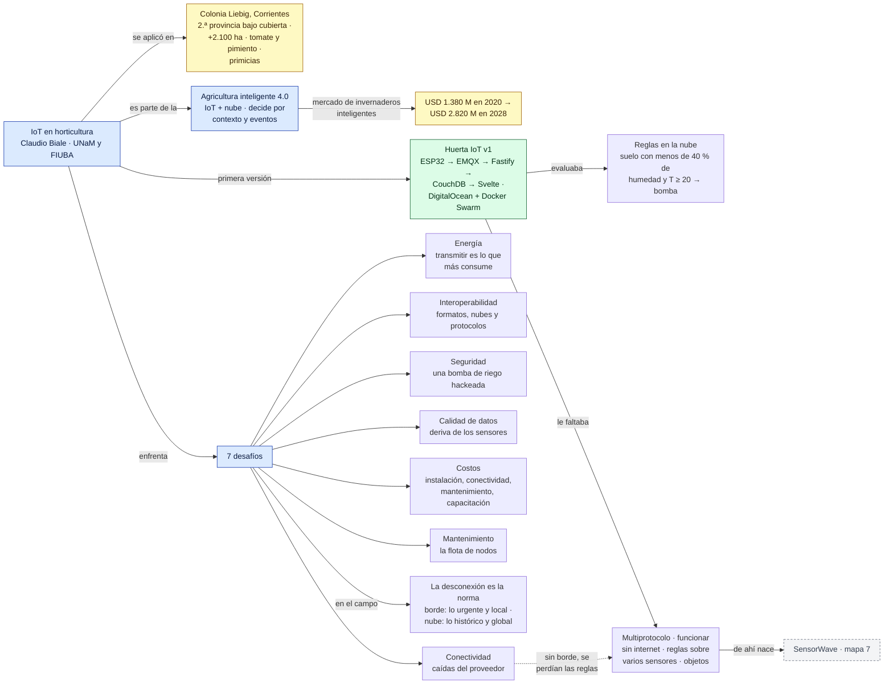
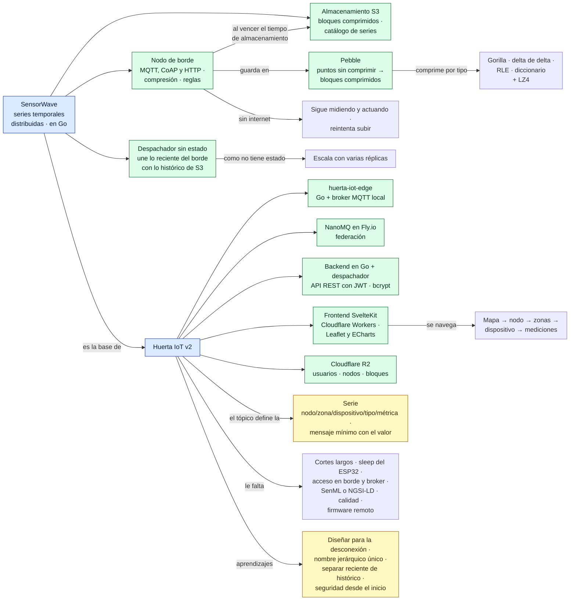

# Red conceptual — Clase 2: Horticultura

Complemento del [resumen](resumen.md). Primero hay una vista general de toda la clase y después un mapa por tema, en el orden en que se dieron. Los números de sección (§) remiten al resumen.

**Cómo leerla**
- Cada flecha forma una frase: *Horticultura → tiene → postcosecha corta*. Una flecha sin texto quiere decir "incluye".
- Las flechas punteadas unen conceptos de temas distintos.
- Colores: azul = tema · verde = herramienta, tecnología o caso real · amarillo = dato para memorizar · gris punteado = concepto que se desarrolla en otro mapa.

> Todo el contenido sale de la clase. La organización y las frases de las flechas son propias.

## Vista general

## 1. Qué es la horticultura y qué se produce en Argentina (§1 a §3)

## 2. Postcosecha (§4)

## 3. Manejo y tipología de la producción (§5, §6 y §10)

## 4. El cinturón verde y los productores familiares (§7 a §9 y §12)

## 5. Tecnología por tipo de producción y ejercicio (§11 y §13)

## 6. IoT en el campo: desafíos y Huerta IoT v1 (§14 a–d)

## 7. SensorWave y Huerta IoT v2 (§14 e–m)

