# Clase 2 — Horticultura

- **Docente:** Ing. Agr. Dra. Georgina Paula García Inza. Ingeniera agrónoma y doctora en Ciencias Agrarias por la UBA. Investiga en el INIA (Uruguay), "que es como el INTA, pero del Uruguay", en el sistema vegetal intensivo: cultivos hortícolas y frutícolas, con foco en agroecología y sostenibilidad. Da horticultura y fruticultura.
- **Expositor invitado:** Claudio Omar Biale (FCEQyN, UNaM). Egresado de la Especialización en IoT de la FIUBA, cursa la Maestría en IoT y le falta el trabajo final. Es docente de IoT en la FIUBA (Arquitectura de protocolos) y en las carreras de informática de la Facultad de Ciencias Exactas, Químicas y Naturales de la Universidad Nacional de Misiones. Lola lo presentó como ex alumno de la materia y lo despidió como "expositor ya fijo".
- **Fecha:** martes 27/10/2026. Se invirtió el cronograma: horticultura va antes que fruticultura, para que coincidan los expositores. Es la primera edición con este orden.
- **Duración:** 02:49 h. Ejercicio práctico desde 01:31 y recreo entre 01:54 y 02:08. Claudio expone desde 02:08.
- **Grabación:** [Google Drive](https://drive.google.com/file/d/1HchkqUlRgCPfbryj7eILFi-TvHL3Hiou/view)
- **Material:** [slides de horticultura](material/slides-horticultura.pdf) · [slides de Huerta IoT](material/slides-huerta-iot-sensorwave.pdf) · [notas Gemini](material/notas-gemini.txt) · [transcripción](material/transcripcion.txt)
- **Red conceptual:** [red-conceptual.md](red-conceptual.md)

> **Fuentes:** la transcripción completa y las slides de las dos presentaciones. Los tiempos `(hh:mm:ss)` indican dónde arranca cada tema en la grabación. Las secciones marcadas con ✎ son elaboración propia y no se dijeron en clase. Las imágenes `slide-NN` son de la presentación de horticultura y las `iot-slide-NN`, de la de Claudio.
>
> **Ojo con el PDF de horticultura:** es una versión anterior a la que se mostró (se llama "Clase 3 - Horti"). Le faltan dos ejemplos de postcosecha que se vieron en clase: la respiración de la zanahoria y el brócoli, y el tomate dañado que libera etileno. Y trae cinco slides que no se comentaron, que están en el [anexo](#anexo-slides-del-pdf-que-no-se-comentaron).

---

## Repaso rápido para el examen

- **Horticultura:** sistema de **cultivos intensivos**. Son cultivos **herbáceos** (no producen madera), **anuales o bianuales** y de **ciclos cortos**: la rúcula hace su ciclo en ~45 días. Eso permite una **rotación rápida**: rabanito, lechuga y tomate en un mismo año y en la misma tierra.
- **Horti vs. fruti:**

  | | Horticultura | Fruticultura |
  |---|---|---|
  | Cultivos | Herbáceos | Leñosos |
  | Ciclos | Cortos | Hasta 20 años |
  | Disturbios | **Alta** frecuencia | Baja frecuencia |
  | Postcosecha | **Baja** duración | Media-alta duración |
  | Mano de obra | **Alta** | Media |
  | Dependencia de insumos | **Alta** | Media |

- **Alta frecuencia de disturbios:** el suelo se mueve y las plantas cambian todo el tiempo → el agroecosistema se desequilibra → aparecen plagas y enfermedades. El **manejo** (las rotaciones) lo compensa.
- **Postcosecha corta**, salvo los "pesados": **papa, cebolla, batata y zapallo**.
- **Argentina:** ~**600.000 ha** y **10 millones de t** por año. No hay una sola horticultura: es **heterogénea** (familiar y empresarial, de distintas escalas).
- **Composición de la producción:**
  - **65 %:** papa, tomate, cebolla, batata, zapallo, zanahoria, lechuga y ajo.
  - **20 %:** acelga, mandioca, zapallito, choclo, berenjena y pimiento.
  - **15 %:** el resto.
  - Las notas de Gemini dicen 80 %: es un error.
- **Cinturones verdes:** rodean las ciudades (La Plata, Córdoba, Rosario) y dan verdura de cercanía, porque una lechuga no aguanta un viaje largo.
- **Zonas específicas:** Mendoza (ajo, cebolla, papa), Balcarce (papa) y Corrientes (tomate y pimiento).
- **Órganos que se consumen:**
  - frutos: tomate, berenjena, zapallo, melón;
  - tallo subterráneo: papa;
  - bulbos: cebolla, ajo, puerro;
  - hojas: lechuga, acelga, espinaca, repollo;
  - raíces: batata, zanahoria;
  - **hipocótilo engrosado:** remolacha, rabanito;
  - flores: brócoli, coliflor, alcaucil;
  - **yemas:** repollitos de Bruselas;
  - semillas (legumbres): arveja, garbanzo, lenteja. Argentina es **fuerte en garbanzo**.
- **Postcosecha:** la calidad **no mejora, solo empeora**. Tres procesos la degradan: **respiración, transpiración y senescencia**.
  - Factor más crítico: la **temperatura elevada**. Con baja humedad es lo peor, "tipo secador de pelo".
  - Otros factores: **daño mecánico**, **etileno** y patógenos.
- **Etileno:** hormona gaseosa de la maduración. Un fruto dañado acelera la maduración de los vecinos en los frutos **climatéricos** (como el tomate).
  - La banana es "la reina del etileno".
  - En vez de un sensor de etileno, que es caro, se lo estima con la **temperatura**.
- **Tipos de manejo:**
  - **Convencional:** síntesis química para maximizar la producción. Domina el mercado y va un **90 % al mercado interno**.
  - **Orgánico:** sin síntesis química, auditado y certificado. Va un **99 % a exportación**.
  - **Agroecológico:** enfoque sistémico, busca el equilibrio del agroecosistema. Va un **100 % al mercado interno**, con venta directa y cercana.
- **Orgánico ≠ agroecológico:** el orgánico puede ser una simple **sustitución** de insumos. El agroecológico piensa en el sistema.
- **Transición** de convencional a agroecológico: dura años, es la etapa más difícil y la que tiene menos herramientas.
- **Tipología de la producción:**
  - **cinturones hortícolas familiares:** diversificados y cerca del consumo;
  - **producción especializada:** en zonas aptas. Ejemplo: cebolla en el sur de Buenos Aires, por el **fotoperíodo**;
  - **cultivos mecanizados:** 20–300 ha de monocultivo de papa, batata, poroto, mandioca o legumbres;
  - **producción para la industria:** contrato por **rendimiento en peso fresco y % de materia seca**; la venta está asegurada, pero el precio es bajo.
- **Tecnología por tipo de producción:**
  - cinturón: riego, temperatura y plagas → sensores low-cost, apps, visión;
  - especializada: riego, fertilización y predicción fenológica;
  - extensivos: logística y trazabilidad → satélite, IA;
  - industria: calidad y sincronización → IoT en planta, NIR, blockchain.
- **Productores familiares:**
  - piden: accesibilidad económica, energías limpias, eficiencia energética y bienestar;
  - sus desafíos: malezas, cosecha y lavado, sanidad (detección temprana) y automatización de invernáculos y riego.
- **Visión por computadora:** detecta mejor **enfermedades** (manchas que cambian de color) que plagas. Las trampas con cámara solo sirven para insectos que se mueven: no para la cochinilla.
- **IoT (Claudio Biale):**
  - Huerta IoT funciona en **Colonia Liebig (Corrientes)**. Corrientes es la 2.ª provincia en hortalizas bajo cubierta: +2.100 ha, tomate y pimiento, **primicias**.
  - **Agricultura inteligente (4.0) vs. de precisión (3.0):** la inteligente decide según el contexto y los eventos, no solo según la ubicación.
  - **7 desafíos del IoT en el campo:** conectividad · energía · interoperabilidad · seguridad · calidad de datos · costos · mantenimiento.
- **Huerta IoT v1:** ESP32 → EMQX → Fastify → CouchDB → Svelte, todo en la nube.
  - Sin internet se perdían las reglas.
  - Las reglas eran de un solo sensor.
  - Solo hablaba MQTT y no usaba almacenamiento de objetos.
- **SensorWave** (en Go) tiene tres piezas:
  - el **nodo de borde**: recibe por MQTT, CoAP y HTTP, comprime y aplica reglas;
  - el **almacenamiento S3**: guarda bloques comprimidos y el catálogo;
  - el **despachador sin estado**: une lo reciente del borde con lo histórico de S3.
- **Huerta IoT v2:**
  - huerta-iot-edge: Go + broker MQTT local;
  - broker NanoMQ en Fly.io;
  - backend en Go + despachador, con API REST y JWT;
  - frontend SvelteKit en Cloudflare Workers;
  - datos en Cloudflare R2.
- **El tópico MQTT define la serie:** `huerta/zona-norte/esp32-1/sensor/temperatura_ambiente` → nodo/zona/dispositivo/tipo/métrica. El mensaje mínimo es `{"valor": 24.5}`.
- **Aprendizajes de Claudio:**
  - **diseñar para la desconexión**;
  - usar un nombre jerárquico único;
  - separar lo reciente (borde) de lo histórico (S3);
  - hacer la seguridad desde el principio.

---

## 0. Inicio de la clase (00:00:09)

**Logística**
- **Cambio de orden:** hoy horticultura y el martes siguiente fruticultura, con la misma docente. Así coinciden los expositores.
- **Expositor de hoy:** después de la docente expone un ex alumno de la materia que vive en el campo (Claudio).
- **Próximos expositores (00:03:16):** en fruticultura viene otro ex alumno con un trabajo más grande, quizás su tesis. Más adelante vienen empresas que aplican tecnología al agro.

**Trabajo final (00:06:10)**
- Gabriel Quiroga preguntó si se pueden ver trabajos anteriores. Lola va a mandar ejemplos.
- **El circuito, según Lola (00:10:35):**
  1. Escribir la idea en un párrafo, en un archivo de Word.
  2. Martín da feedback y se profundiza. Puede haber varias devoluciones: según el trabajo, hasta cuatro.
  3. Con el trabajo aprobado, se arma una presentación en PDF para la clase final.
- Algunos llegaron a mostrar **demos** de aplicaciones. En medicina digital, un grupo que ya tenía clientes aprovechó el TP para su propio proyecto.

**Multiple choice de la clase 1 (00:11:56)**
- Los exámenes "redondean la nota final". También le sirven a la coordinación para dar feedback a los docentes.
- El link del formulario no queda en el chat: quien llega tarde tiene que pedirlo de nuevo.
- Al ver los resultados, quienes acertaron explican las preguntas que generaron dudas (00:13:24):

| Pregunta | Respuesta correcta | Explicación en clase |
|---|---|---|
| ¿Cuál de los siguientes conceptos **no** corresponde a un tipo de sistema agropecuario? | **Lechería extensiva** | Gabriel: la lechería exige ordeñar todos los días, así que no puede ser extensiva en superficies muy grandes. ✎ En la tipología de la clase 1, la lechería es una categoría propia, junto a la ganadería extensiva y la intensiva. |
| En los cultivos extensivos, ¿cuál opción es **falsa**? (00:15:20) | **"Producción por hectárea mayor que los intensivos"** (la eligieron 8) | Tomás: algunos extensivos, como el arroz, piden más mano de obra. ✎ La clave es que los extensivos producen *menos* por hectárea y lo compensan con superficie. |
| ¿Cuál corresponde a las oportunidades de las TIC para cuidar el ambiente en el agro? (00:17:09) | **Todas las opciones**, incluida la reducción de emisiones de gases de efecto invernadero | Georgina (00:18:34): muchas soluciones bajan el uso de agroquímicos de síntesis y ahorran pasadas de tractor. Más eficiencia → menos huella de carbono. Es una **consecuencia indirecta**, que se usa mucho al formular proyectos para justificar el aporte a la mitigación del cambio climático. |

- Las demás preguntas salieron bien.

**Encuesta de terminología (00:19:53)**
- Se pasa cuando llega un docente nuevo, para que él y los alumnos vean dónde está parado el grupo. Había 16 personas conectadas. Resultados según la docente:

| Término | Cuántos lo conocían |
|---|---|
| Cinturón verde | Muy pocos |
| Agroecología | Bastantes (quizás la mitad) |
| Rotación | Un poco más seguros |
| Cultivo primicia | Pocos |
| Desmalezado | Algunos más |
| Intermediario | Casi todos |

- La idea es ir tocando estos términos a lo largo de la clase (ver el glosario).

**Presentaciones (00:22:55)**
- La docente se presentó (ver los datos de la clase). Nadie del curso trabaja en horticultura, ni siquiera de balcón.
- **Gonzalo Cuervo (00:24:18):** desde Mendoza, trabaja en una empresa con oficinas en San Pablo que **automatiza y electrifica tractores**, por ejemplo para caña de azúcar y soja. Contó que en Mendoza la cebolla y la papa son muy importantes, sobre todo en San Carlos.
- **Francisco (00:25:31, por chat):** diseña proyectos de **producción de alimentos bajo cubierta** y de mercados para el municipio de **Río Grande**, en Tierra del Fuego.
- Georgina ofreció seguir en contacto con quien quiera hacer el TP sobre horticultura o fruticultura.

## 1. ¿Qué es la horticultura? (00:26:42)

- Retoma el mapa de la clase 1: dentro de los sistemas de cultivos están los extensivos y los intensivos. Georgina es la docente de los intensivos (horticultura y fruticultura).

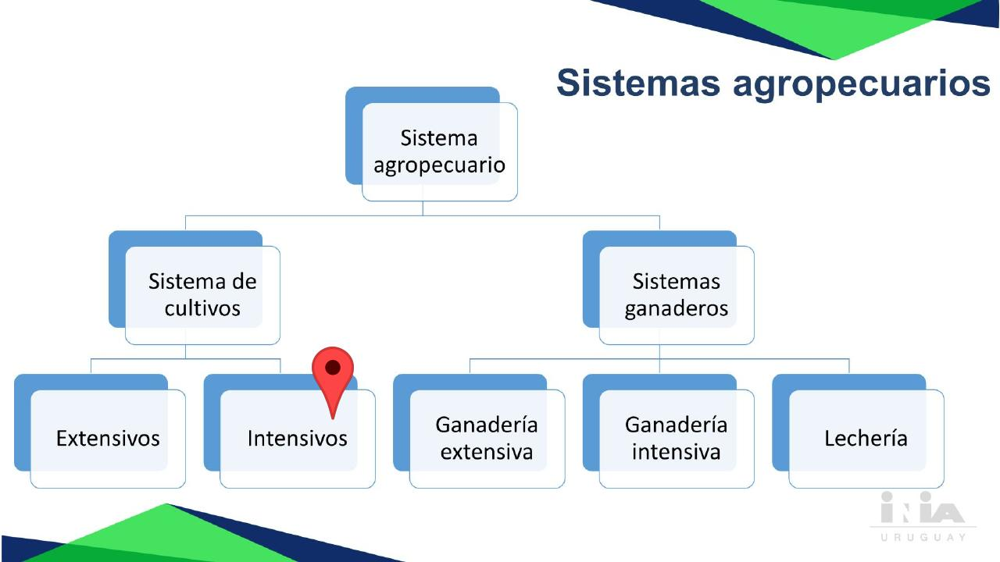
*Slide 2: la horticultura está dentro de los sistemas de cultivos intensivos.*

**Características (00:27:57)**
- **Cultivos herbáceos:** no producen madera.
- **Anuales o bianuales:** hacen su ciclo en uno o dos años, nunca más.
  - Algunos duran mucho menos: la **rúcula** puede completarlo en **45 días**, y aun así se la considera anual.
  - Después de cosechar se levantan y se implantan otras plantas.
- **Ciclos cortos → rotación rápida:** en un mismo año y en la misma porción de tierra se puede plantar rabanito, lechuga y tomate. Eso diferencia a la horticultura de otras producciones.
- **Alta frecuencia de disturbios:** la tierra se mueve y las plantas cambian todo el tiempo.
  - El cultivo depende de un montón de microorganismos del suelo y de la fauna y la flora de alrededor.
  - Con tanta intervención, el agroecosistema queda en perturbación constante → **desequilibrio → plagas y enfermedades**.
- **Manejo (00:29:25):** el trabajo del horticultor es combinar los cultivos: qué sembrar después de qué, para no seguir con la misma enfermedad ni con las mismas plagas.
- **Postcosecha de baja duración:** casi todo es muy perecedero, como se ve en la verdulería. Las excepciones son los "pesados": **papa, cebolla, batata y zapallo**.
- **Mano de obra intensiva:** son trabajos muy manuales.
- **Alta dependencia de insumos (00:30:45):** en la mayoría de los predios se aplican seguido **herbicidas** (contra las malezas), **insecticidas** (contra los insectos) y **fungicidas** (contra los hongos).

**Horticultura vs. fruticultura (slide 3)**

| | Fruticultura | Horticultura |
|---|---|---|
| Tipo de cultivo | Leñosos: estructuras permanentes | Herbáceos: anuales o bianuales |
| Ciclo | Largo: hasta 20 años de producción | Corto: rotación rápida de cultivos |
| Frecuencia de disturbios | Baja | **Alta** |
| Postcosecha | Duración media-alta | Duración **baja** (perecederos) |
| Mano de obra | Intensidad media | Intensidad **alta** |
| Insumos | Dependencia media | Dependencia **alta** |

## 2. La horticultura en Argentina (00:30:45)

- **No hay una única horticultura.** Conviven sistemas familiares y pequeños, medianos, extensivos y empresariales, en todas las combinaciones. Por eso es una actividad **heterogénea**.
- **Escala nacional:** unas **600.000 ha** y **10 millones de toneladas** de hortalizas por año.
- **Potencial tecnológico:** hay oportunidades en cada escala y en cada nicho. La slide habla de una actividad "intensiva en conocimiento y mano de obra" y de un "escenario ideal para IoT e IA".
- **La foto de la slide (00:32:18):** un productor cosechando repollos con un cajón de madera.
  - Entre las plantas hay malezas. Muchas veces se sacan a mano o con un **escardillo**, una herramienta muy básica, porque cerca de la cosecha no se pueden aplicar productos químicos.
  - Además, cosecha en una posición muy incómoda para todo un día.
- **Objetivo de estas clases:** entender cómo se produce y qué sistemas hay, para detectar nichos y oportunidades tecnológicas.

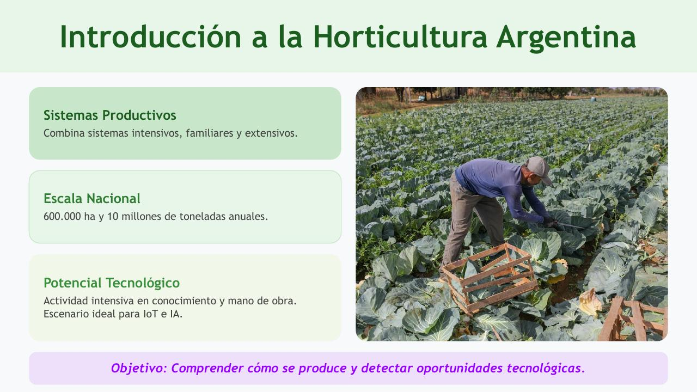
*Slide 4: sistemas productivos, escala nacional y potencial tecnológico, con la foto de la cosecha de repollos.*

**Dónde se produce (00:32:18)**
- **Cinturones verdes** alrededor de los grandes centros urbanos, que producen la verdura de cercanía.
  - Ejemplos: alrededor de **Córdoba** y de **Buenos Aires**, con el **cinturón hortícola de La Plata**.
  - Cada ciudad grande tiene uno, también en la Patagonia.
- **Por qué cerca de las ciudades (00:33:41):** el maíz se puede plantar en una zona conveniente y repartirse por todo el país o el mundo, porque aguanta el traslado. Una lechuga no tiene el valor para viajar lejos y llegaría deshidratada.
- **Zonas específicas:** lugares con características que hacen que un cultivo crezca bien. Producen mucho de lo mismo y lo redistribuyen:
  - **Mendoza:** ajo, cebolla y papa.
  - **Balcarce:** una zona papera.
  - **Corrientes:** morrón (pimiento) y tomate.
- **El mapa de la slide** marca siete regiones hortícolas: Noroeste, Noreste, Andina, Central, Valle de los ríos Colorado y Negro, Litoral y Patagónica.

**Qué se produce (00:34:52)**

Lo que más se produce es, "casualmente", lo que más pesa y lo que más se consume:

| Participación | Hortalizas |
|---|---|
| **65 %** | Papa, tomate, cebolla, batata, zapallo, zanahoria, lechuga y ajo |
| **20 %** | Acelga, mandioca, zapallito, choclo, berenjena y pimiento |
| **15 %** | Las demás hortalizas |

- El **choclo dulce** no es el maíz forrajero ni el de otros usos: es un tipo de maíz que se cultiva en horticultura.
- La docente dijo "el otro 20 %" y "el 15 % restante". El 65 % sale de la slide; las notas de Gemini dicen 80 %, que es un error.

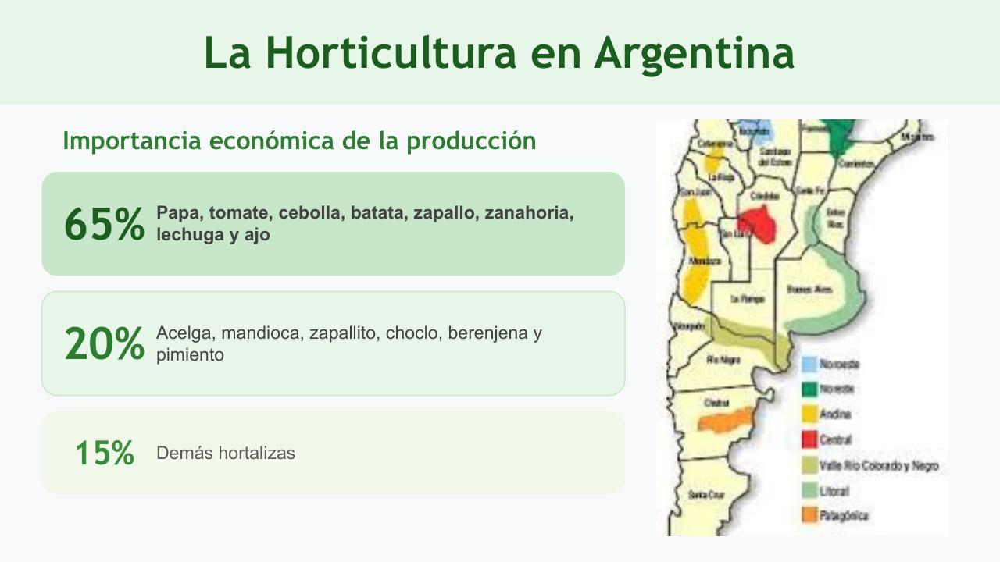
*Slide 5: la importancia económica de cada grupo de hortalizas y las regiones hortícolas de Argentina.*

## 3. Diversidad de órganos de consumo (00:34:52)

Es otra diferencia con los extensivos y con la fruticultura. En fruticultura se comen frutos o, a lo sumo, su parte interna (como en la nuez o la almendra). En horticultura se consumen órganos muy distintos:

| Órgano | Ejemplos | Detalle de la clase |
|---|---|---|
| **Frutos** (00:36:14) | Berenjena, tomate, zapallo, melón, pimiento | La planta de berenjena es erguida, parecida a la del morrón. El tomate necesita un **tutor** porque no se sostiene solo. El zapallo es una **enredadera**. El melón es **rastrero**: crece sobre el suelo. |
| **Tallo subterráneo** | Papa | |
| **Bulbos** | Cebolla, cebolla de verdeo, ajo, puerro | Crecen bajo tierra, pero son órganos de crecimiento, **no raíces**. |
| **Hojas** (00:37:30) | Repollo, rúcula, lechuga, espinaca, repollo chino (*akusay*), acelga | En la acelga se come la hoja entera: el **pecíolo** (la parte blanca) y la **lámina** (el área foliar). |
| **Raíces** | Batata, zanahoria | |
| **Hipocótilo engrosado** | Remolacha, rabanito | El hipocótilo es la parte entre el punto de crecimiento y las raíces. Suele pasar desapercibido, pero en estas plantas se engrosa y junta reservas. La raíz del rabanito es solo la "colita" de abajo. |
| **Flores** (00:38:58) | Brócoli, coliflor, alcaucil | Son órganos florales. |
| **Yemas** | Repollitos de Bruselas | Son puntos de crecimiento. Al cortarlos se ven los **primordios foliares**, hojitas ya formadas. Si se dejan en la planta, la yema brota. |
| **Semillas (legumbres)** | Arveja, garbanzo, lenteja | Lo que viene en las latas del supermercado. Parece marginal, pero ocupa muchas hectáreas y toneladas. Argentina es una exportadora importante y **es fuerte en garbanzo**. |

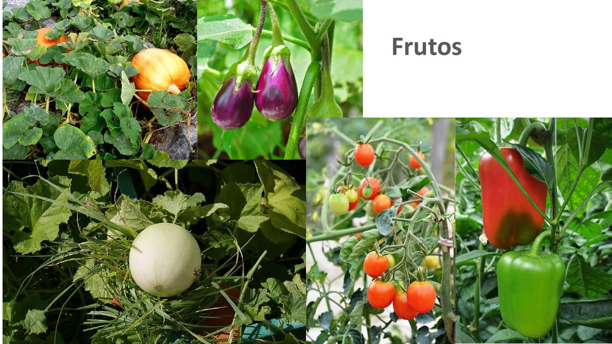
*Slide 6: frutos: zapallo, berenjena, melón, tomate y pimiento.*

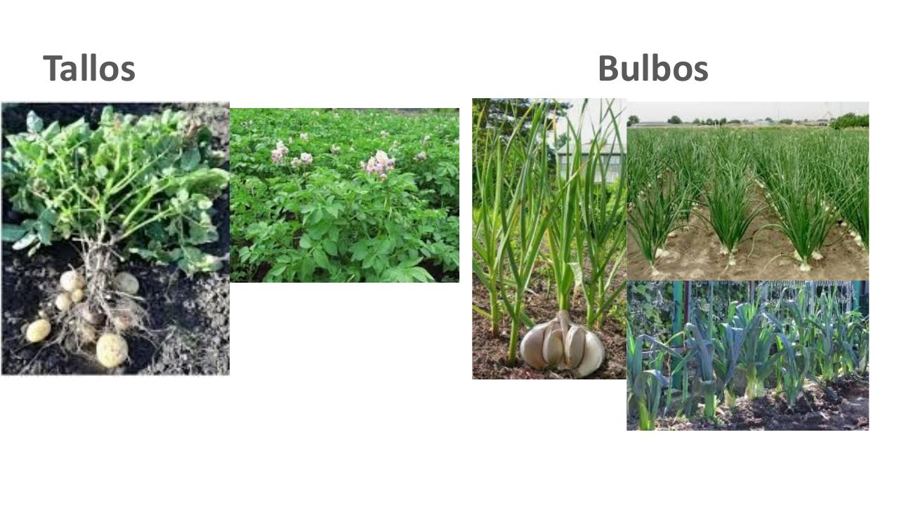
*Slide 7: tallos (la planta de papa con sus tubérculos y en flor) y bulbos (ajo, cebolla y puerro).*

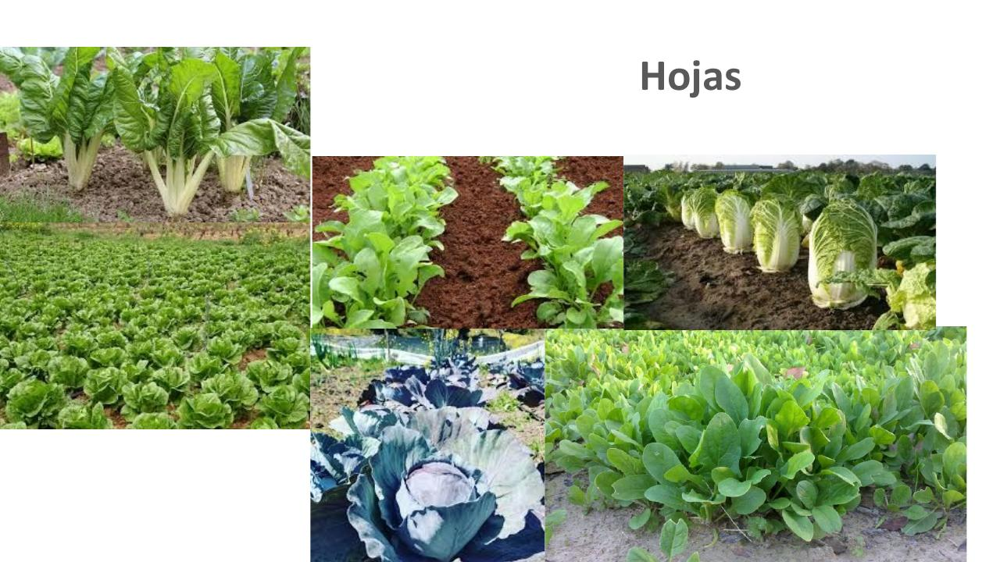
*Slide 8: hojas: acelga, lechuga, repollo chino, repollo colorado y espinaca, entre otras.*

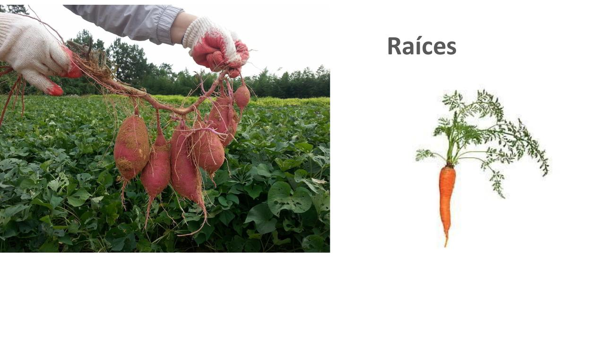
*Slide 9: raíces: batata y zanahoria.*

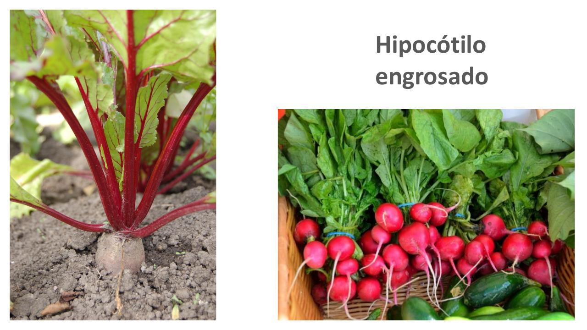
*Slide 10: hipocótilo engrosado: remolacha y rabanitos.*

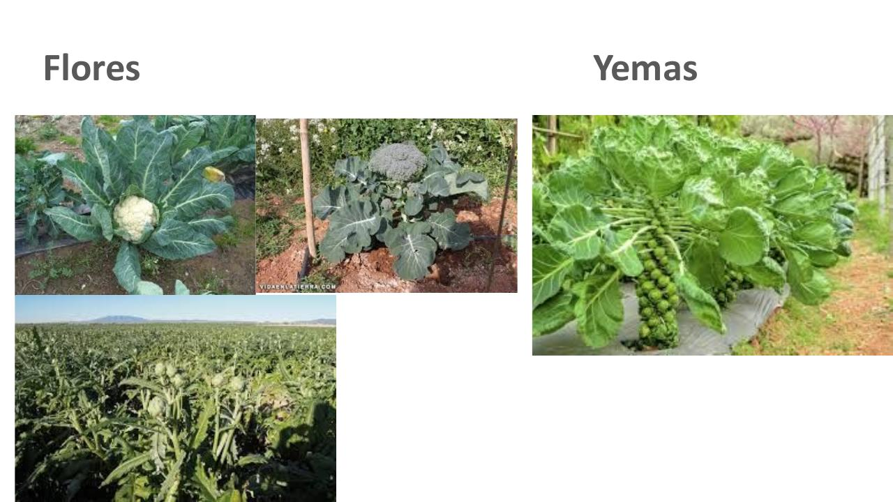
*Slide 11: flores (coliflor, brócoli y alcaucil) y yemas (repollitos de Bruselas).*

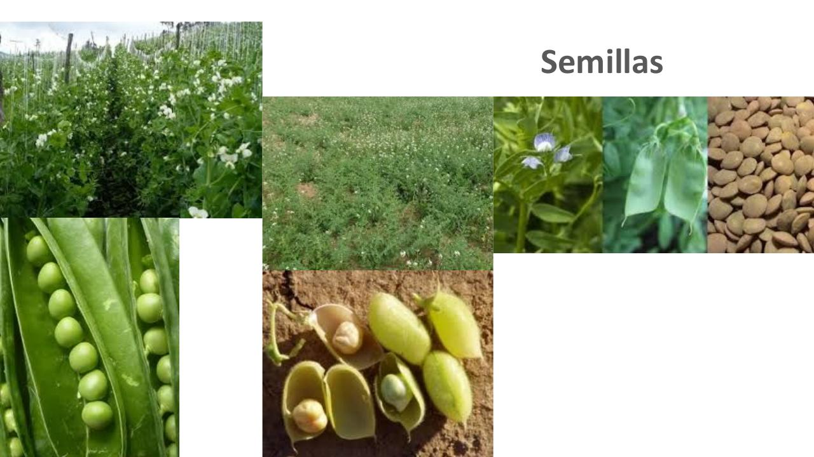
*Slide 12: semillas: arveja (cultivo en flor y vainas), garbanzo (cultivo y vainas) y lenteja (flor, vainas y granos).*

## 4. Postcosecha (00:40:38)

- Es un **momento crítico** para la mayoría de las hortalizas. El productor hace un gran esfuerzo para lograr un producto de calidad, pero **una vez cosechado, la calidad no mejora: solo puede empeorar**. En palabras de la docente: "o conservamos o hacemos lío".
- La slide lo resume así: la pérdida de calidad es **natural, pero altamente gestionable**.

**Los tres procesos**

| Proceso | Qué es |
|---|---|
| **Respiración** | Los órganos cosechados siguen respirando. Como ya no hacen fotosíntesis, la respiración **degrada sus reservas** de forma irreversible: según la slide, cambian el sabor y el valor nutricional. |
| **Transpiración** | Pérdida de agua, como vapor, por los poros y la cutícula. Según la slide, marchita el producto y reduce su **peso comercializable**. |
| **Senescencia** | El envejecimiento final: los tejidos se ablandan y termina la vida útil. |

El objetivo es que los tres procesos sean **lo más lentos posible** después de la cosecha.

**Factores que los aceleran (00:42:01)**
- **Temperatura elevada:** el factor **más crítico**. Acelera todos los procesos.
- **Baja humedad**, en la mayoría de los casos. Calor con poca humedad, "tipo secador de pelo", es la peor combinación. Por eso las cosas se conservan mejor en la heladera.
- **Daño mecánico:** se rompen las células y sale el jugo celular, que tiene algo de azúcar. Es un buen sustrato para hongos y bacterias, que después contaminan el resto.
- **Etileno:** un gas que producen algunos órganos, como los frutos. Promueve la maduración y acelera la senescencia.
- La slide suma los **patógenos**: los daños físicos, el etileno y los patógenos son causas directas de podredumbre.

**Ejemplo de respiración (00:43:22)**

La docente mostró datos de dos trabajos con zanahoria y brócoli (antes usaba espárragos). La tasa respiratoria sube con la temperatura y con la baja humedad:

| Hortaliza | Condición | Tasa respiratoria |
|---|---|---|
| Zanahoria | 1 °C, humedad alta | 10–20 |
| Zanahoria | 10 °C, humedad alta | 30–50 |
| Zanahoria | 10 °C y **70 % de humedad**, baja para almacenar | 45–65: se deshidrata y dura menos |
| Brócoli | 0 °C | Baja |
| Brócoli | 10 °C, misma humedad | Muy alta |
| Brócoli | 20 °C | Muy, muy alta: dura muy poco |

- Un brócoli fuera de la heladera **se pone amarillo**: es la senescencia. Por eso a veces se ve brócoli amarillento en la verdulería (00:44:44).
- **El PDF trae el ejemplo viejo**, con espárrago y ajo (tasa respiratoria en ml de CO₂ por kg y por hora):

  | Temperatura | Espárrago | Ajo |
  |---|---|---|
  | 0 °C | 14–40 | 2–6 |
  | 10 °C | 45–152 | 6–18 |
  | 20 °C | 138–250 | 7–15 |

**Contenido de agua (slide de transpiración)**
- Lechuga 95,8 % · tomate 94,7 % · perejil 89,1 % · brócoli 88,7 % · zanahoria 88,4 %.
- Cuánta agua libera cada hortaliza depende de ella misma, de la humedad y de la temperatura.

**Ejemplo del tomate (00:44:44)**
1. Se cosecha en cajones y se lleva a un **galpón de acondicionamiento**. Ahí se lava y se selecciona, y lo golpeado se descarta.
2. Si queda un tomate dañado, se rompe y libera jugo, que propaga el inóculo de algún hongo o bacteria (00:46:12). Las **hifas** de los hongos se dispersan y pueden romper las paredes de los tomates sanos vecinos.
3. Además, el tomate dañado da una **señal hormonal: el etileno**. Es una molécula muy chica que sale de un fruto y entra en otro con facilidad, y desencadena la **maduración**.
4. Los frutos vecinos se **ablandan** y cambian de textura (00:47:41). Así quedan más expuestos a dañarse y a los hongos, y terminan "hechos bolsa", ya no comercializables.
- El problema puede empezar por **una sola fruta golpeada** o por una gota de agua que quedó dando vueltas.

**Etileno y frutos climatéricos (00:46:12)**
- El tomate es un fruto **climatérico**: responde al etileno, como muchas frutas. Se ve en la clase de fruticultura.
- **Truco casero:** para madurar una palta verde, se la envuelve con una **banana**, "la reina del etileno" (00:47:41).
- Entre las bananas suelen venir **sobres inhibidores de etileno**, para que la maduración no se dispare antes de tiempo.
- Por eso las bananas llegan medio verdes: se calculan el tiempo y la temperatura del viaje para que estén a punto al llegar al consumidor.
- Lo mismo vale para las **peras** (00:50:29).

**Tecnología en postcosecha (00:48:54)**
- **Visión por computadora:** ya hay empresas que detectan fruta dañada que el ojo no ve, por un color distinto, indicios de un patógeno o marcas de golpes. Esa fruta se saca antes del almacenamiento.
- **Exportación:** la fruta viaja meses en barco. Una sola fruta en mal estado dentro de un contenedor puede hacer que **rechacen toda la carga** en destino.
- **Refrigeración (00:50:29):** la fruta viaja refrigerada, con **registradores de temperatura y humedad**. Sirven para probar que no hubo fallas en el viaje y evitar litigios. Pero si una fruta viene podrida, el proceso se desencadena igual.
- **¿Sensores de etileno?** (pregunta de Gabriel Quiroga): existen, pero el etileno **correlaciona muy bien con la temperatura** y con los picos de respiración. Es más barato estimarlo con un sensor de temperatura. Se ve en fruticultura.
- **Atmósfera controlada (00:51:45):** hay equipos que reemplazan el oxígeno por otro gas y retrasan estos procesos. Se usan en productos de más valor; para el tomate, que es muy barato, no conviene.

## 5. Tipos de manejo (00:51:45)

Hay tres formas de producir, y la clasificación vale casi para cualquier sistema, incluso con animales:

- **Convencional (00:53:23):** reemplaza la interacción entre el cultivo y los demás organismos por **productos de síntesis química**. Así defiende el cultivo y **maximiza la producción**.
  - Es lo que más consumimos: los sistemas productivos de hoy están **dominados por lo convencional** (00:54:52).
- **Orgánico:** no usa sustancias de síntesis química, o solo algunas permitidas. En general está **auditado y certificado**.
  - Puede ser una simple **sustitución**: no se fija en que el agroecosistema esté enriquecido y en equilibrio, solo asegura que no hay glifosato (herbicida) ni insecticidas.
  - Se consigue en ciertos circuitos y es más caro.
- **Agroecológico:** un enfoque distinto, que piensa en **el sistema en sí** y no solo en el producto.
  - Por ejemplo, combina las hortalizas con plantas florales y animales de granja, para que el agroecosistema funcione.
  - **Minimiza o elimina** los productos de síntesis química.
  - Es el enfoque más extendido en Argentina, Uruguay y Latinoamérica. Hay otras denominaciones parecidas, como **regenerativo** o agroforestería.

| Sistema | Enfoque productivo (slide) | Desafíos y demandas tecnológicas |
|---|---|---|
| Convencional | Alta dependencia de insumos y maquinaria | Reducir los agroquímicos; monitoreo ambiental; eficiencia energética |
| Orgánico | Sustentabilidad y certificación | **Trazabilidad digital**, porque todo está auditado; sensores de residuo cero; monitoreo de biodiversidad |
| Agroecológico | Enfoque sistémico e integración socioeconómica | Tecnologías apropiadas; energías limpias (la slide dice energía solar); automatización accesible en costo y en escala; **manejo participativo de datos** |

- El manejo participativo de datos encaja con la agroecología porque así también se produce, se gestiona y se comercializa (00:56:42).

**Destino de la producción según el manejo (00:56:42)**

| | Convencional | Orgánico | Agroecológico |
|---|---|---|---|
| Destino predominante | Mercado interno | Exportación | Mercado interno |
| Según la slide | **90 %** mercado interno · 10 % exportación | **99 % exportación** · 1 % mercado interno (SENASA, 2018) | **100 % mercado interno**: venta directa, cerca de donde se produce |

## 6. Tipología de la producción hortícola (00:56:42)

La docente simplificó la clasificación en cuatro tipos:

| Tipo | Características | Ejemplos |
|---|---|---|
| **Cinturones hortícolas familiares** | Producciones familiares chicas y **muy diversificadas**: producen todo lo que va en una ensalada o en la heladera. Están cerca de los centros de consumo, con superficies pequeñas y producción muy intensiva (00:58:20). | Verduras de hoja, tomate, pimiento |
| **Producción especializada** | Escala mayor, en zonas muy específicas con aptitud agroecológica. | Ajo, cebolla |
| **Cultivos extensivos** | Escala mayor. Necesitan mucha superficie: campos enteros de un solo cultivo. | Papa, arveja, poroto, batata |
| **Producción para la industria** | Superficies grandes, bastante **tecnificadas y mecanizadas**, para el procesamiento industrial. | Tomate para industria, arveja, algunos tipos de frutilla, maíz dulce |

- Los productores especializados, extensivos e industriales son más grandes, ya tienen cierta tecnificación y les interesa reducir la mano de obra. Por eso son **tentadores** para quien vende tecnología.
- Pero **la ensalada de todos los días la ponen los cinturones hortícolas** (00:59:59). Por eso la docente insiste en pensar soluciones para esa escala.

## 7. La vida en los cinturones hortícolas (00:59:59)

- Son los productores que están "metiendo el lomo en los canteros", una tarea muy pesada. En general son familias **humildes y de baja rentabilidad**, comparadas con los otros tipos.
- Es una vida "bastante esclava": están pendientes de la **calidad**, porque si no es óptima el precio los penaliza mucho. Y pequeñas cosas alcanzan para arruinarla.
- **La anécdota de la acelga:** una familia que abastecía a supermercados con acelga no iba a los cumpleaños familiares en ciertas temporadas. Tenían que subir y bajar los **nylons laterales del invernáculo**:
  - bajarlos cuando hace frío o hay viento;
  - subirlos cuando hace mucho calor, porque si no "se achicharra la hoja" (01:01:41).
  - Una vez fueron a un cumpleaños, dejaron los laterales arriba, vino el viento y les arruinó la cosecha. Desde entonces no van más.
- **Esto se podría automatizar** con un sensor que suba y baje los laterales sin una persona "atada" al invernáculo. Muchas producciones de cinturón tienen algún invernáculo para lo que no puede estar afuera.

## 8. Video: Hola Sabor y la transición agroecológica (01:02:51)

**El video** ([YouTube](https://youtu.be/nH_7PoMjJHA))
- **Matías** es parte de **Hola Sabor**, un emprendimiento familiar. Lo integran sus hermanos Miguel y Abel y sus padres, Yolanda y Rufino.
- La **transición a la agroecología** arrancó en **2003** con un **técnico asesor** y duró hasta ~**2009**. Desde entonces producen 100 % agroecológico.
- **Por qué la eligieron (01:06:05):**
  - para cuidarse a sí mismos y a quien consume: los **agrotóxicos** "nos enferman a todos", sobre todo a ellos, que eran los que aplicaban;
  - para cuidar el ambiente y el parque donde producen.
- **Beneficios:**
  - **salud** y un ambiente de trabajo más sano;
  - alimentos que no envenenan al consumidor;
  - **autonomía productiva**: no depender de insumos externos;
  - **recuperación y cuidado de semillas**: conocen el ciclo y las necesidades de sus variedades, que se van adaptando ("rusticando") a la zona;
  - la **rotación** y la **asociación de especies** dan plantas más sanas, que se enferman menos.

**Discusión (01:08:44)**
- **Así se produce:** el papá usa una **azada** para conducir el agua y mover la tierra, y las hortalizas se lavan en **piletas**. "No hay tecnologías alrededor de esto", y serían muy útiles.
- **¿Todos los agroecológicos trabajan así?** (pregunta de Lola, 01:10:16): sí, porque es un tema de **escala**.
  - Están en el **Parque Pereyra Iraola**, en una quinta grande para que la maneje una familia, pero chica para comprar maquinaria grande.
  - Lo que podrían hacer es **asociarse y compartir maquinaria**.
  - Los productores de mayor escala, más empresariales, sí acceden a más tecnología.
  - La pregunta clave es "**¿por qué no tenemos tecnologías apropiadas para la escala?**". No es que les guste trabajar así: trabajan todo el tiempo.
- **Contexto del video (01:11:39):**
  - Es de un proyecto financiado con la **Facultad de Agronomía de la UBA**.
  - La familia vende en la **feria del productor al consumidor** de esa facultad, y varios de los chicos del video son estudiantes universitarios.
  - **No hay empresas** que estudien sus problemas y les den soluciones.
- **¿Y el convencional?** (pregunta de Lola): reemplaza algunas tareas. Por ejemplo, en vez de **carpir** las malezas, aplica un **herbicida**.
  - Pero no le alivia tanto el trabajo (01:12:58). El agroecológico, con un manejo integral y el sistema en equilibrio, no tiene tanta invasión de malezas, plagas ni enfermedades.
- **Lo más difícil es la transición:** se pasa de un sistema muy perturbado a uno en equilibrio, y eso lleva **varios años**.
  - En ese tiempo no se pueden aplicar químicos y el sistema sigue desequilibrado: se complica la **subsistencia** del productor.
  - A esa etapa muchas veces le dicen **agricultura regenerativa**, porque hay que regenerar el sistema.
  - Es la etapa que más cuesta y la que tiene **menos herramientas**.

## 9. Producción del cinturón verde (01:14:09)

**Prácticas de manejo (slide y clase)**
- **Diversificación** de especies.
- **Rotación de cultivos**, que preserva el suelo.
  - Cuando se levanta un cultivo se pone otro, cruzando **familias u órganos de cosecha**. Por ejemplo, después de remolacha va un cultivo de fruto.
  - Así no se repiten las mismas plagas, enfermedades y malezas.
- **Laboreo permanente:** la tierra se prepara todo el tiempo.
- **Riego sistematizado:** bajo cubierta "no existe que no se riegue", y en horticultura casi todo se riega, porque el agua es el componente principal de las hortalizas (y de las frutas).
  - La clave es el **control hídrico eficiente**: regar de más trae enfermedades, humedad y podredumbres.
  - Hay muchos proyectos de **control de riego en invernáculos** (01:15:40).
- **Invernáculos:** producción bajo cubierta.
- **Hidroponía:** cultivos **sin sustrato**, en invernaderos o lugares cerrados.
  - Un sistema sostiene las plantas, y las raíces quedan siempre en agua con una **solución de nutrientes**.
  - Salen plantas sanas y muy limpias: las lechugas salen "bárbaras".
  - Hay que controlar la **temperatura** del agua, lo que contiene y el **pH**, entre otros indicadores. Todo está **automatizado**, con mucha tecnología.
- **Semillas:** cosecha y **almacenamiento propio**. Del almacenamiento de semillas y genotipos se habla muy poco, pero aparece en el video.

**Labores e insumos (01:17:16)**
- **Procesos manuales:** siembra, desmalezado, cosecha y acondicionamiento.
- **Insumos externos:**
  - **Fertilización:** cerca de las zonas donde se crían pollos se usa **cama de pollo**, excremento que se composta y después se aplica. En la producción orgánica también se usa estiércol de otros animales.
  - **Agroquímicos** en el convencional: fungicidas, plaguicidas y herbicidas.

**Cinturones hortícolas (slide y clase)**
- Rodean las grandes ciudades: la **cercanía al consumo** les da ventaja competitiva. Se destacan por la **diversidad de especies**.
- **Especies principales:**
  - de hoja: lechuga, acelga, rúcula, espinaca, kale, repollo;
  - de alto valor comercial: tomate, pimiento, pepino, zapallito, brócoli, coliflor.
- **Desafío logístico:** por la **alta perecibilidad**, necesitan un canal de comercialización **cercano, fluido y eficiente** para evitar pérdidas postcosecha (01:18:45).

## 10. Producción especializada, mecanizada y para la industria (01:18:45)

**Producción especializada**
- Se da en zonas con **condiciones agroclimáticas y edáficas específicas**, que optimizan un cultivo en particular y lo hacen de alto valor.
- **Ejemplo de la clase:** **ajo y cebolla** en lugares especiales. Allí se buscan las semillas, porque son **zonas libres de virus**.
- **Caso de la slide: cebolla en el sur de Buenos Aires.** El **fotoperíodo** (la duración del día) de esa región es ideal para activar la **bulbificación**.
- **Otras regiones (slide):** Mendoza (ajo y zanahoria), San Juan (melón) y Córdoba y Formosa (batata).

**Cultivos mecanizados o semimecanizados**
- **Grandes superficies (20 a 300 ha)** con **monocultivo** de papa, zanahoria, legumbres y mandioca.

| Cultivo | Región |
|---|---|
| Papa | Sudeste de Buenos Aires (**Balcarce**) |
| Batata | San Pedro (Buenos Aires), Córdoba y Formosa |
| Poroto | Norte y centro del país (la slide dice Salta y Córdoba) |
| Mandioca | Misiones y Formosa |
| Legumbres (arveja, lenteja) | Sur de Santa Fe y norte de Buenos Aires |

- Según la slide, entran en este grupo la papa, la batata, la zanahoria, el poroto, la arveja, la lenteja, el garbanzo y la mandioca.

**Producción para la industria (01:20:31)**
- Grandes superficies con un manejo **altamente mecanizado**.
- Productor e industria son **codependientes**. Firman de antemano un **contrato de compromiso**, que aparece en los informes del SENASA o de los ministerios. Se basa, por ejemplo, en:
  - el **rendimiento en peso fresco**;
  - el **porcentaje de materia seca**.
- El productor **asegura la venta total**, pero el **precio suele ser bajo**.
- **Cultivos y regiones (slide):**
  - arveja y maíz dulce en Buenos Aires y Santa Fe;
  - tomate en Mendoza, San Juan y Río Negro;
  - frutilla en Tucumán;
  - batata en Córdoba y Buenos Aires.

## 11. Sistemas de producción hortícola y tecnología (01:20:31)

Es la slide clave para el TP. La docente aclaró que es una lista para seguir completando, con las oportunidades que ve "desde la perspectiva de ustedes":

| Tipo | Ejemplo geográfico | Perfil del productor | Desafíos tecnológicos | Oportunidades IoT / IA |
|---|---|---|---|---|
| **Cinturones hortícolas familiares** | Gran Buenos Aires, Córdoba, Rosario | Familiar, trabajo manual, cultivos bajo cubierta | Control de riego, temperatura y humedad; detección de plagas | Sensores low-cost, estaciones agrometeorológicas, apps móviles, visión computarizada |
| **Producción especializada** | Cebolla en Villarino, ajo en Mendoza | Mediana escala, mecanización parcial | Ajuste de riego y fertilización; predicción fenológica | Sensores de humedad y conductividad, modelos predictivos, fertirriego |
| **Cultivos extensivos hortícolas** | Poroto, arveja, batata | Grandes superficies, mecanización total | Logística, trazabilidad, monitoreo de rendimiento | Sensores remotos, imágenes satelitales, IA para clasificar rendimientos |
| **Producción agroindustrial** | Tomate para industria, arveja | Contratos con la industria | Control de calidad; sincronización entre cosecha y procesado | IoT en planta, sensores NIR, trazabilidad con blockchain |

Lo que agregó en clase (01:22:01):
- **Compostaje:** un desafío transversal a todos los sistemas. Un compost mal hecho puede **meter patógenos**, porque es materia orgánica en descomposición. También puede **generar metano**, que aumenta el efecto invernadero.
- **Producción especializada (01:23:50):** la predicción fenológica requiere integrar información de clima, suelo, etc.
- **Extensivos hortícolas:** "no hay gente trabajando la tierra". Se parecen a lo que se verá en cultivos extensivos.
- **Agroindustria (01:25:06):**
  - Cuando el producto llega a la industria empiezan los **litigios por calidad**.
  - Las plantas industriales no pueden parar, así que necesitan un abastecimiento continuo: hay que **sincronizar cosecha y procesado**.

## 12. Demandas tecnológicas de los productores familiares (01:25:06)

La docente hizo un **sondeo con productores familiares** para entender qué necesitan:

| Requerimientos clave | Desafíos críticos |
|---|---|
| **Accesibilidad económica:** herramientas a un costo que el productor pueda asumir | **Malezas:** compiten con el cultivo y bajan el rendimiento. Hace falta un control eficiente y sostenible |
| **Energías limpias:** sistemas basados en fuentes renovables, algo que los productores consideraban relevante | **Cosecha y lavado (acondicionamiento):** optimizar los procesos y no usar tanta agua |
| **Eficiencia energética:** tecnologías que ahorren energía | **Sanidad vegetal:** detectar temprano las plagas y enfermedades hace el control mucho más eficiente. Muchas empresas ya identifican enfermedades con visión, por el tipo de manchas en las hojas |
| **Bienestar humano:** mejorar la calidad de vida del productor. Como dijo el del video, dejaron de aplicar químicos porque estaban en contacto con ellos | **Automatización:** gestión de los invernáculos (apertura y cierre) y del riego, "cosas que capaz son muy básicas" |

**Plagas y visión por computadora (01:28:05)** (preguntas de Rodrigo Hernández)
- **Tipos de plagas:**
  - **pulgones**, en hojas, frutos y yemas: se ven a simple vista;
  - **nematodos** del suelo: no se ven, pero la planta no crece o se empieza a morir, y al descalzarla las raíces están comidas;
  - **orugas**, que muerden las hojas;
  - **babosas**;
  - **hormigas**, que "hacen unos líos bárbaros";
  - en los frutos, **aves plaga**, muy importantes en los frutales.
- **¿La visión detecta una plaga específica o algo genérico?** Lo que mejor detecta son **enfermedades**, porque generan **manchas**: al principio puntitos, que después van virando de color y se distinguen del verde (01:29:37). Es más fácil que detectar plagas.
- **Señales tempranas**, tanto en hortalizas como en frutas: un cambio de color y una zona que **se deprime** (se hunde un poco), por donde empieza a entrar el hongo. Con el ojo entrenado se ve antes de que aparezca la podredumbre, por ejemplo en el tomate.

## 13. Ejercicio práctico (01:31:05)

**Consigna (10 minutos):** a partir de la propia especialización, proponer una **solución innovadora** a un problema real de la horticultura, visto en clase o propio. Vale la horticultura de **balcón o de traspatio**. La idea es bajar lo que uno sabe a una aplicación que resuelva un problema real.

**Criterios de evaluación (slide)**
- **Descripción:** un resumen breve de la propuesta.
- **Innovación:** de 1 a 10.
- **Factibilidad:** de 1 a 10. Puede ser una buena solución que igual nadie vaya a poder adoptar.
- **Usabilidad:** de 1 a 10.
- **Inversión:** costo bajo, medio o alto.

**Propuestas y devoluciones**

| Quién | Propuesta | Devolución de Georgina |
|---|---|---|
| **Gonzalo Cuervo** (01:36:39) | Una app para **plantas de balcón** con visión por computadora: con una foto identifica la especie y la enfermedad (por ejemplo, cochinilla) y dice cómo resolverla. Suma recordatorios de riego y conexión con **sensores de humedad** (domótica). Reconoce que ya hay apps parecidas, como Google Lens. | Baja en originalidad, pero válida. Se podría vender en **viveros**, por ejemplo como suscripción. No entiende por qué los viveros de la ciudad no ofrecen algo así. |
| **Tomás Moretti** (01:43:00) | Un **marketplace** que conecte a pequeños productores con verdulerías y mayoristas, para que compitan en precio. | Ataca un problema real que no se había visto. Si todos cosechan la lechuga el mismo día, "nuestra lechuga no vale nada"; si llega el día en que nadie llevó, se paga más (01:44:24). Serviría para **escalonar las cosechas** y lograr precios que convengan a todos. "Es increíble que todavía no exista", y quizás es menos sofisticado de lo que parece. |
| **Rodrigo Hernández** (01:45:59) | Encontró trampas que se ponen junto a la planta: los insectos se pegan y una **app escanea la trampa** para identificar la plaga. Propuso algo más genérico: **cámaras** y modelos entrenados, con poca inversión en hardware. También preguntó por **clasificar los frutos en sanos o dañados** para inferir las plagas. | **Entrenar modelos** parece obvio para un ingeniero, pero un productor no sabe "qué tienen que ver las modelos": estos cursos sirven para acercar mundos. **Las trampas con cámara solo sirven para insectos que se mueven** o que van a un cebo atrayente (01:47:28). La **cochinilla** se clava de chiquita en un punto y se queda ahí toda la vida, porque no tiene patas. Sí podría servir para la **mosca blanca** del tomate o el pimiento. **Clasificar frutos en la planta llega tarde**: el daño ya está hecho, "ya está medio al horno" (01:48:49). Donde sí sirve es en el **almacenamiento**, para sacar frutos con señales que el ojo no ve antes de que contaminen al resto. |
| **Facundo Quiroga** (01:50:09) | En una materia de visión por computadora entrenaron un modelo que **cuenta racimos** en fotos de viñedos. Sirve para estimar la producción, la mano de obra, los costos y la ganancia. Con datos de varios años y de otros productores podría detectar cuándo una plantación viene mal. | En la vid, las bayas pueden estar dañadas o infectadas con **botritis** (la podredumbre gris), que pudre el racimo y complica la vinificación (01:52:13). Se podría repetir el análisis **cuando la fruta madura**, para clasificar por calidad. |

- Facundo es de Tucumán, una zona de limones. Usaron un dataset de imágenes de internet, y la idea surgió de un compañero de Mendoza (01:53:33).
- **Cierre del ejercicio:** la diversidad entre agrónomos e ingenieros da mejores ideas, que complementan lo que ya existe.

*(Recreo: 01:54–02:08)*

## 14. IoT en horticultura: Huerta IoT y SensorWave (02:08:31)

### a) Presentación y contexto (02:08:31)
- Claudio presentó una **aplicación de IoT en horticultura**, fruto de una investigación conjunta entre docentes de la **UNaM** y de la **FIUBA**. Su tutor es el Dr. Ing. **Ariel Lutenberg**.
- **Dónde (02:10:05):** el desarrollo arrancó en **Colonia Liebig**, en **Corrientes**.
  - Corrientes es la **2.ª provincia** del país en hortalizas **bajo cubierta**, con **más de 2.100 ha**.
  - Sus cultivos principales son **tomate y pimiento**.
  - Produce **primicias**: los primeros productos de su tipo que llegan a los centros de distribución.
- **Agricultura inteligente:** une el IoT con la computación en la nube, más aprendizaje automático, vehículos no tripulados y robótica (02:11:39).
- **De precisión (3.0) vs. inteligente (4.0):** en la agricultura inteligente, las decisiones surgen del **contexto y de los eventos**. La slide aclara: "no solo según la ubicación".
- **Mercado mundial de invernaderos inteligentes:** según la slide, pasa de **USD 1.380 M en 2020 a USD 2.820 M en 2028** (previsión).
  - Los datos salen de su tesis de especialización (Biale, 2022).
  - La transcripción y las notas de Gemini dicen "2,20 millones", que es un error.

### b) Siete desafíos del IoT en el campo (02:11:39)

| # | Desafío | Qué dijo Claudio | Resumen de la slide |
|---|---|---|---|
| 1 | **Conectividad** | Caídas del proveedor de internet. La conexión satelital lo resolvió en parte, pero con proveedores locales sigue habiendo cortes. **El monitoreo no puede detenerse** cada vez que pasa (02:13:16). | Caídas frecuentes del proveedor de internet |
| 2 | **Energía** | Muchos nodos están lejos de una conexión eléctrica estable. Lo que más consume es **transmitir**, así que se suele medir continuamente y **enviar por lotes**. | Nodos lejos del tablero; transmitir es lo que más consume |
| 3 | **Interoperabilidad** | Cada fabricante trae su formato y a veces su propia nube, con un **costo de salida** alto para sacar los datos. Además hay interoperabilidad **multiprotocolo**: a un dispositivo restringido le conviene **CoAP**, porque MQTT y HTTP son más pesados (02:14:36). | Cada fabricante con su formato y su nube |
| 4 | **Seguridad** | Si alguien entra a una **bomba de riego** y la activa sin necesidad, ya no es un problema informático: produce estragos en la producción. | Claves por defecto y actuadores expuestos |
| 5 | **Calidad de datos** | Sensores que pierden calibración (**deriva**) y mandan valores que parecen razonables, pero no lo son (02:15:59). | Sensores que derivan y huecos por cortes |
| 6 | **Costos** | No es solo el sensor: también la instalación, la conectividad, el mantenimiento y la capacitación. | Sensor, conectividad, mantenimiento y capacitación |
| 7 | **Mantenimiento** | Mantener la **flota** de dispositivos: 10 nodos se controlan "a mano", pero 100 ya no. | Saber qué nodos viven y poder actualizarlos |

Huerta IoT **no los resuelve todos** (ver la sección *k*).

### c) Arquitectura de referencia (solo en la slide)

- **Capas:** **percepción** (sensores y actuadores) → **transporte** (WiFi, LoRa o celular) → **borde** (guarda y decide) → **plataforma** (series, APIs y analítica).
- **Borde, lo urgente y local:** latencia mínima, funciona sin internet, filtra y agrega antes de enviar.
- **Nube, lo histórico y global:** capacidad elástica, historia completa y vista unificada de varios predios.
- **Consistencia eventual:** sin red, las vistas se desactualizan; al volver, todo converge.
- El título de la slide lo resume: "En el campo la desconexión es la norma: el borde tiene que seguir funcionando".

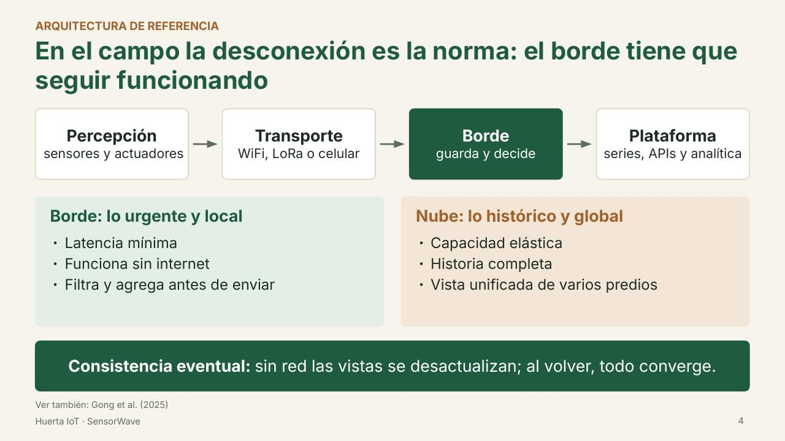
*Slide 4 de Huerta IoT: percepción → transporte → borde → plataforma, y qué le toca al borde y qué a la nube.*

### d) Huerta IoT v1 y sus límites (02:15:59)

Huerta IoT va por su segunda versión. La v1 funcionó y fue su trabajo final de la especialización.

- **Arquitectura (02:17:19):**
  - nodos **ESP32** con firmware basado en **Mongoose OS**;
  - publicaban por **MQTT** a un broker **EMQX** en clúster, en la nube;
  - backend en **Fastify**, un framework de JavaScript;
  - base de datos documental **CouchDB**;
  - frontend en **Svelte**.
- **Reglas evaluadas en la nube**, que el usuario configuraba desde el frontend.
  - La regla de ejemplo de la slide: "si la humedad del suelo es **menor a 40 %** y la temperatura ambiente es mayor o igual a 20, se enciende la bomba de agua".
  - En el audio dijo "mayor a 40 %", pero lo lógico es regar con el suelo seco.
- Todo corría en **DigitalOcean**, en un clúster de **Docker Swarm**, que es más liviano que otros orquestadores de contenedores.

**Problemas (02:19:08)**
1. **Solo MQTT:** para dispositivos de muy baja capacidad convenía otro protocolo.
2. **Sin funcionalidad en el borde:** si se cortaba la conexión, **se perdía el control de reglas**, que era lo que más les importaba.
3. **Reglas de un solo dispositivo:** no se podía, por ejemplo, regar según el **promedio de varios sensores** de humedad del suelo, ni según el promedio de una **ventana de tiempo**.
4. **Almacenamiento de objetos (02:20:21):** más que un problema, es una tendencia para las series temporales.
   - Se refiere a S3 o a un compatible, como MinIO, R2 de Cloudflare o Tigris Data.
   - Es **lento**, pero **más barato** por volumen almacenado.

Según la slide, **SensorWave nace de esas cuatro necesidades**.

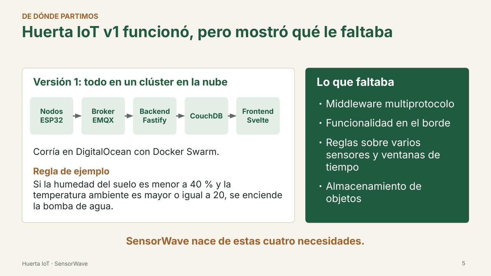
*Slide 5 de Huerta IoT: la v1, todo en un clúster en la nube, y lo que le faltaba.*

### e) SensorWave (02:20:21)

- Es un **almacenamiento distribuido de series temporales** escrito en **Go**, y la base de Huerta IoT 2.0.
- Tiene **tres piezas**:
  1. **Nodos de borde** (02:21:50):
     - reciben los datos de los sensores por **MQTT, CoAP y HTTP**, bajo una única interfaz de **publicación/suscripción**. MQTT es pub/sub; CoAP es requerimiento-respuesta, aunque con *observe* hace algo parecido; HTTP también es requerimiento-respuesta;
     - **comprimen** los datos localmente, así el dispositivo (una Raspberry Pi, por ejemplo) los envía comprimidos y **por lotes**;
     - cuando **vence el tiempo de almacenamiento**, que se configura **por serie**, suben los bloques comprimidos a un almacenamiento compatible con **S3** y los **borran del disco local**.
  2. **Almacenamiento S3** (02:23:01): guarda los bloques comprimidos y un **catálogo de series**. Cada nodo de borde publica ahí cuándo crea o modifica una serie y cuándo crea una regla.
  3. **Despachador:** un servicio **sin estado** que corre en la nube y responde las consultas.
     - Pide por un **broker MQTT en la nube** los datos **recientes** que todavía no subieron a S3.
     - Busca el **histórico en S3**.
     - Combina las dos cosas en la respuesta.
- **Ventajas (02:24:33):**
  - **El borde sigue funcionando sin internet**, porque las reglas están en el borde y hay almacenamiento local. Si vence el tiempo y no hay conexión, reintenta en la ventana siguiente, mientras sigue guardando datos y respondiendo a las reglas.
  - **El despachador escala fácil:** como no tiene estado, puede haber varios respondiendo consultas a la vez.

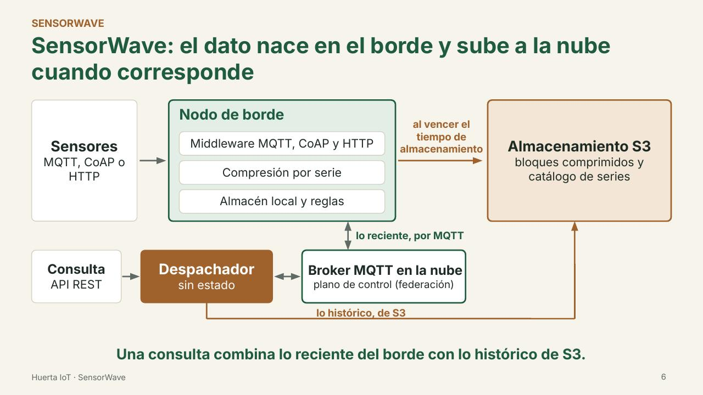
*Slide 6 de Huerta IoT: una consulta combina lo reciente del borde con lo histórico de S3.*

### f) Huerta IoT v2 sobre SensorWave (02:25:47)

| Pieza | Qué hace | Tecnología |
|---|---|---|
| **Nodos ESP32** | Tienen los sensores y pueden tener actuadores | ESP32 |
| **huerta-iot-edge** | Corre **cerca del invernadero**: implementa la biblioteca de SensorWave y recibe los datos de los ESP32 | Go + SensorWave + **broker MQTT local** (una biblioteca de Go) |
| **Broker MQTT en la nube** | **Federación**: comunica a los despachadores con los nodos de borde | **NanoMQ** en **Fly.io** (plano de control con tópicos `swctl/`) |
| **huerta-iot-backend** | La API REST de la aplicación, con la biblioteca **despachadora** de SensorWave (02:27:09) | Go, JWT, Fly.io |
| **huerta-iot-frontend** | La interfaz web, que le hace los pedidos al backend | **SvelteKit** sobre **Cloudflare Workers** |
| **Almacenamiento S3** | Bloques históricos y catálogo de nodos | **Cloudflare R2** |

- Según la slide, **el backend no guarda mediciones**: las consulta al borde (por el broker) y a S3.

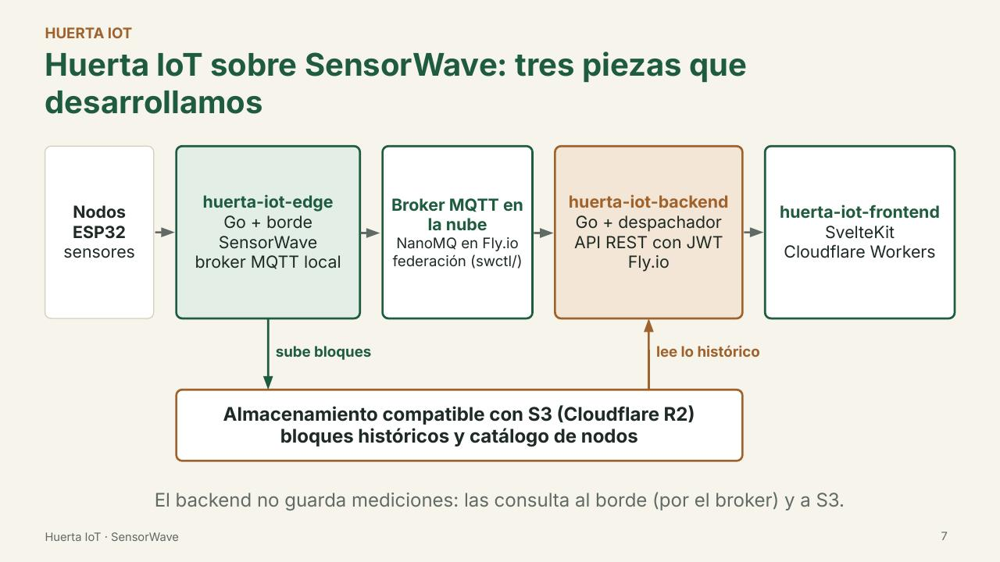
*Slide 7 de Huerta IoT: las tres piezas desarrolladas (edge, backend y frontend), el broker en la nube y R2.*

### g) Del tópico MQTT a la serie (02:27:09)

- El ESP32 publica en un tópico y el broker embebido en el borde lo escucha. **Del tópico se deriva la serie.**
- Por cada serie, SensorWave guarda pares de **marca de tiempo y valor** (02:28:38).
- La serie es un nombre plano, pero separado por barras como un tópico. Por eso la traducción es directa:

```
Tópico MQTT:  huerta / zona-norte / esp32-1 / sensor / temperatura_ambiente
Serie:        {id del nodo de borde} / zona / dispositivo / tipo / métrica
```

- El **ID del nodo de borde** es único.
- **Mensaje mínimo:** el ESP32 solo manda el valor, por ejemplo `{"valor": 24.5}`, y **el borde infiere el resto**. Se podría achicar más empaquetando los datos, pero no está pensado.
- **Según la slide:**
  - el ESP32 publica con **QoS 1**;
  - el broker del borde se suscribe a `huerta/+/+/sensor/+`;
  - el plano de control usa los tópicos `swctl/` del broker en la nube.

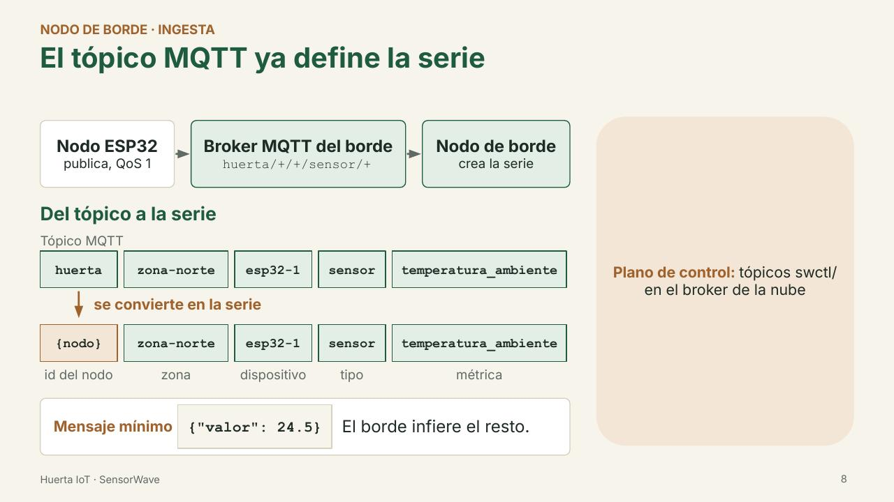
*Slide 8 de Huerta IoT: el tópico MQTT ya define la serie.*

### h) Almacenamiento y compresión en el borde (02:29:46)

- El borde **infiere el tipo de dato** y comprime cada serie localmente, en **dos niveles**.
- Usa **Pebble**, una base de datos **clave-valor**, con dos estados:
  1. **Puntos sin comprimir**, a medida que llegan. Otras bases los guardan en memoria, pero en el agro no se mide continuamente sino cada cierto tiempo. Si el nodo se cayera, se perderían esos datos, así que también se guardan en Pebble.
  2. Cuando se junta la cantidad de puntos definida para cada serie, se **comprimen**: se borran los puntos sin comprimir y se guarda el bloque comprimido (02:31:04).
- Al vencer el tiempo de almacenamiento, los bloques comprimidos **suben a S3 y se borran del borde**.
- **Compresión según la slide:**

  | Tipo | Compresión de los valores | Compresión del bloque |
  |---|---|---|
  | Real | XOR (estilo Gorilla) | LZ4 |
  | Entero | Delta de delta | LZ4 |
  | Booleano | RLE | LZ4 |
  | Texto | Diccionario | LZ4 |

  - Etiquetas automáticas: unidad, tipo de sensor y ubicación.
- **Ciclo de vida del dato, según la slide:** dato en memoria → **bloque de 100 puntos** comprimido → almacén local (Pebble) → vence el tiempo de almacenamiento → sube a S3 y se borra del borde.
  - La slide dice "en memoria", aunque en el audio Claudio explicó que los puntos sin comprimir también se guardan en Pebble.

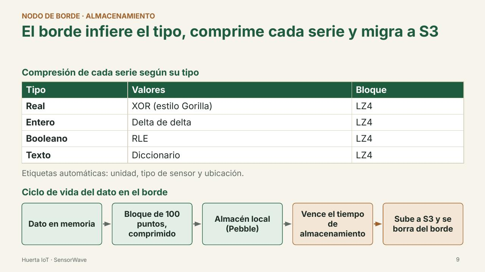
*Slide 9 de Huerta IoT: compresión por tipo de serie y ciclo de vida del dato en el borde.*

### i) Backend, seguridad y despliegue (02:31:04)

- **Flujo:** el frontend consulta una **API REST protegida con JWT**, que le delega las consultas al **despachador**. El despachador le pide lo reciente al borde, por el broker de la nube, y lo histórico a S3.
- **Tolerancia a fallas:** si un nodo de borde no responde, **no falla toda la consulta**. Se devuelve lo que hay en el histórico y se avisa que ese nodo no respondió.
- **Escalado:** hoy hay **un despachador por backend**, pero el día de mañana se podrían separar y escalar.
- **Seguridad (02:32:21):** las contraseñas se guardan con **bcrypt** en el almacenamiento compatible con S3 (R2).
- **Jerarquía UNS** (*Unified Namespace*): una forma de organizar la jerarquía a nivel de MQTT. Según la slide, las rutas siguen el orden nodo, zona, dispositivo y sensor.
- **Cuatro tipos de consulta:** por rango, último valor, agregación y agregación temporal.
- **Despliegue:**
  - el despachador con la API REST y el broker MQTT corren en **contenedores Docker**, que **Fly.io** convierte en máquinas virtuales;
  - el frontend corre en **Cloudflare Workers**.
- **Frontend:** TypeScript, Tailwind, **ECharts** para los gráficos y **Leaflet** para los mapas. La slide precisa las versiones (SvelteKit 2 y Tailwind 4). Las notas de Gemini dicen Chart.js, pero es ECharts.

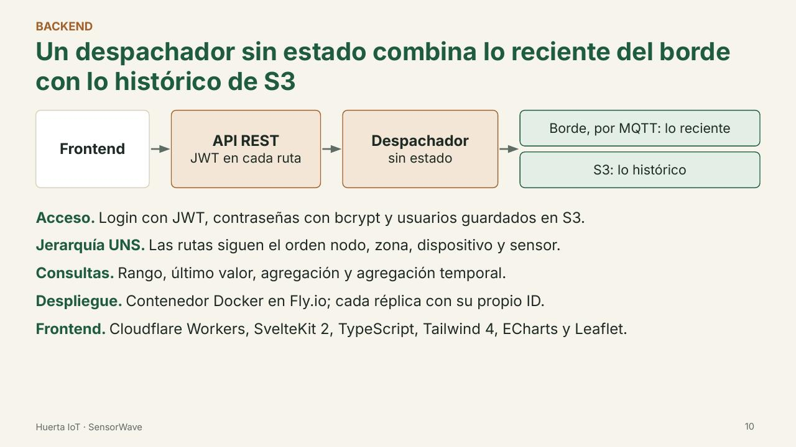
*Slide 10 de Huerta IoT: el despachador sin estado, con el acceso, las consultas, el despliegue y el frontend.*

- **La captura de Fly.io:** hay dos apps desplegadas, `sensorwave-mqtt` y `huerta-iot`, cada una con 2 máquinas en la región GRU (San Pablo).
- **El almacenamiento en objetos (02:33:40):** el bucket `sensorwave` de R2 tiene tres cosas:
  - `usuarios.json`, con los usuarios de la aplicación;
  - `nodos/`, con un JSON por nodo: ID, ubicación, tags, series, reglas, etc.;
  - `borde-cbiale-<uuid>/`, una carpeta por nodo de borde con los **bloques comprimidos** que se van subiendo.
  - En la captura, el bucket pesa unos 331 KB.

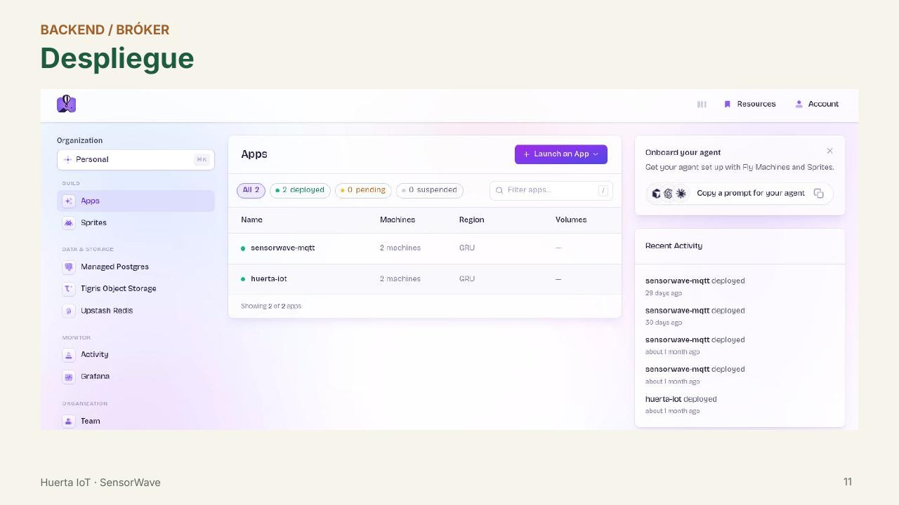
*Slide 11 de Huerta IoT: el panel de Fly.io con el broker (`sensorwave-mqtt`) y el backend (`huerta-iot`).*

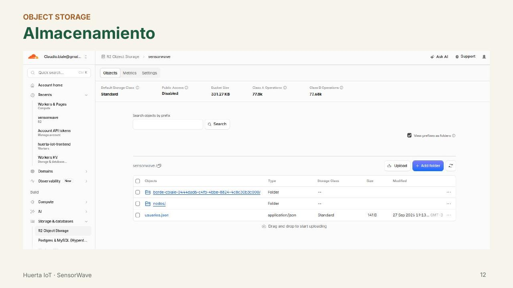
*Slide 12 de Huerta IoT: el bucket de Cloudflare R2, con la carpeta del nodo de borde, `nodos/` y `usuarios.json`.*

### j) Recorrido por el frontend (02:33:40)

1. **Mapa de nodos**, hecho con Leaflet: muestra el nodo de prueba, **Huerta Colonia Liebig**, donde está Claudio (coordenadas −27,91; −55,83).
2. **Nodos (02:34:56):** cada nodo de la app es un nodo de borde. Tiene **tags** (latitud, longitud, tipo), una característica propia de SensorWave.
   - La latitud y la longitud sirven para ubicarlo en el mapa.
   - El tipo da información adicional; en la captura, "invernadero".
3. **Detalle del nodo:**
   - la última lectura;
   - el acceso al dashboard y a las zonas;
   - la información (los tags);
   - un resumen de **sensores**, que no son lo mismo que dispositivos. En la captura hay 4 de humedad, 4 de humedad del suelo y 4 de temperatura (02:35:53).
4. **Zonas:** son **divisiones lógicas dentro de un nodo de borde**.
   - Por ejemplo, un único nodo de borde puede atender 3 o 4 invernaderos, y cada uno es una zona. En el ejemplo, `zona-norte` y `zona-sur`.
   - Cada zona tiene su dashboard y sus dispositivos (`esp32-3`, `esp32-4`).
5. **Detalle del dispositivo:** una caja por cada dato medido, con el valor, el porcentaje y la variación. En la captura del 27/10 a las 21:04, el `esp32-3` marcaba humedad 63,4 %, humedad del suelo 82 % y temperatura 32,5 °C.
6. **Mediciones o agregaciones (02:37:02):**
   - las agregaciones agrupan por tiempo o en general;
   - se puede cambiar el rango de tiempo y pedir las **últimas N mediciones**;
   - con S3 conviene pedir N mediciones, porque traer muchos datos es lento;
   - falta una **caché** de las últimas consultas en los despachadores.

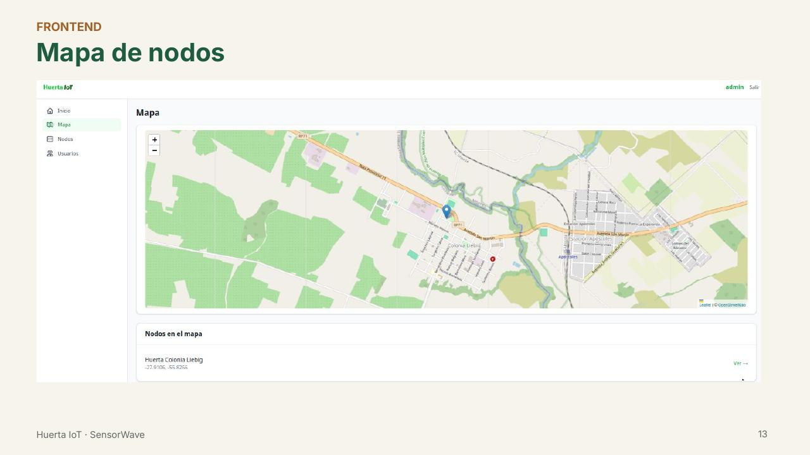
*Slide 13 de Huerta IoT: el mapa con el nodo Huerta Colonia Liebig.*

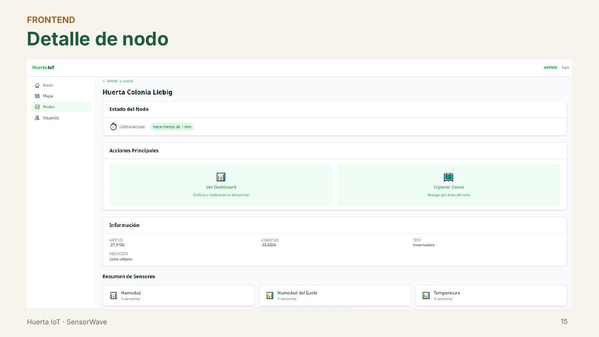
*Slide 15 de Huerta IoT: el estado, las acciones, los tags y el resumen de sensores del nodo.*

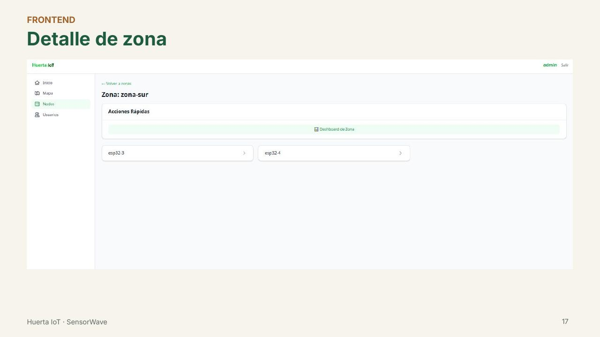
*Slide 17 de Huerta IoT: la zona sur con sus dos dispositivos ESP32.*

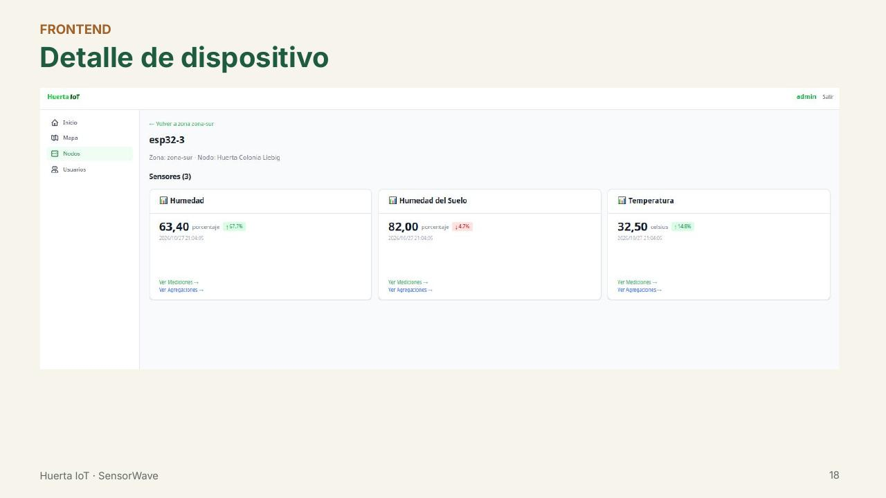
*Slide 18 de Huerta IoT: los tres sensores del `esp32-3`.*

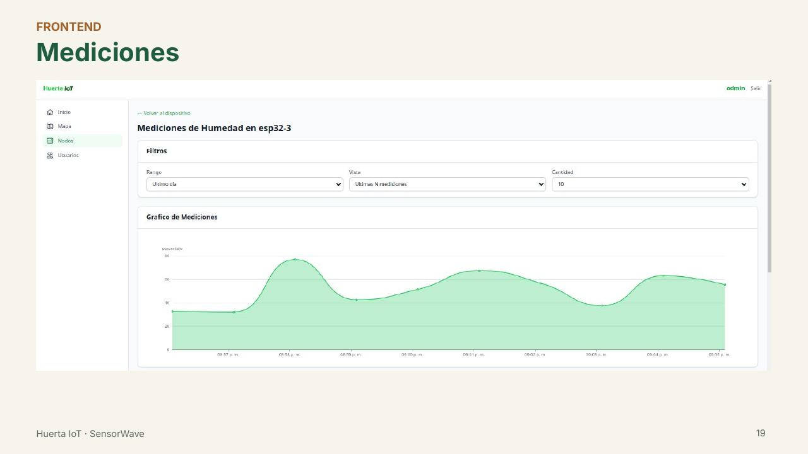
*Slide 19 de Huerta IoT: las mediciones de humedad, con filtros de rango, vista y cantidad.*

### k) Qué resuelve y qué falta (02:37:02)

| Desafío | Cómo responde Huerta IoT | Qué falta |
|---|---|---|
| **Conectividad** | Resuelto en parte: el borde no pierde datos y sigue midiendo. Si hubiera actuadores, también seguiría actuando. Sube a S3 cuando vuelve la conexión (02:38:14). | No probaron un **corte muy largo**, así que no saben qué pasa si se llena el almacenamiento. La slide dice "probarlo con cortes largos en campo". |
| **Energía** | La compresión reduce los datos que se guardan y se transmiten. | Que los ESP32 entren en **modo de descanso** (*sleep*). Depende del firmware, no de SensorWave (02:39:27). |
| **Seguridad** | JWT y contraseñas con bcrypt. | El control de acceso en el nodo de borde y en el broker. |
| **Interoperabilidad** | Tres protocolos entran por un mismo middleware y con un mismo esquema de nombres. Sirve para dispositivos más chicos que el ESP32, por ejemplo con CoAP. | No contemplan estándares abiertos como **SenML** o **NGSI-LD**. |
| **Calidad de datos** | Tipo por serie y **etiquetas** con información adicional, como en InfluxDB (02:40:54). La slide suma la marca de tiempo propia del dispositivo. | Controlar o marcar la calidad de cada registro: "no lo tocamos aún". |
| **Costos** | Compresión en dos etapas, como la mayoría de las bases de series temporales (TimescaleDB, InfluxDB, QuestDB, IoTDB): "no es algo nuevo". Almacenamiento de objetos, cada vez más usado y más barato. Despachador sin base de datos central. | — |
| **Mantenimiento** | Las series se crean solas y el catálogo se publica en S3. | La gestión **remota del firmware**. |

### l) Aprendizajes (02:41:59)

1. **Diseñar para la desconexión.** Es clave en el agro y simplifica todo el resto del desarrollo.
2. **Un nombre jerárquico único.** Asocia tópicos con series y simplificó la app, la API y las pantallas.
3. **Separar lo reciente (borde) de lo histórico (S3):**
   - abarata costos;
   - permite **escalar cada parte por separado**, con despachadores desacoplados;
   - S3 se encarga solo de la **replicación de datos**.
4. **La seguridad la dejó para el final, y conviene hacerla desde el comienzo** (02:43:12). En ese momento se le cortó el audio: se había quedado sin batería.

- **Para llevarse (slide):** "empezar por la decisión, diseñar para la falla y pensar en la operación".
- **Pregunta de debate (slide):** "¿Cuál de los siete desafíos es el más difícil en su invernadero o en su proyecto?".
- **El trabajo todavía no está terminado** (02:45:25).

### m) Preguntas (02:45:25)

- **¿Por qué dos lenguajes, Fastify y Go?** (pregunta de Rodrigo Hernández)
  - Fastify era de la **v1**.
  - En la v2, la **biblioteca despachadora de SensorWave está en Go** y no hay versión en JavaScript o TypeScript.
  - Por **simplicidad**, hicieron el backend directamente en Go (02:46:42). Si no, necesitaban un backend en Fastify para el frontend y otro en Go para el despachador.
- **Referencias de la slide final:**
  - Biale (2022), *Sistema de control de cultivos hortícolas*, trabajo final de especialización en la [biblioteca digital de la FIUBA](https://bibliotecadigital.fi.uba.ar/items/show/19385);
  - SensorWave en GitHub: [github.com/sensorwave-dev](https://github.com/sensorwave-dev);
  - revisiones sobre IoT y agricultura: Adli et al. (2023), Mansoor et al. (2025) y Gong et al. (2025).
- **Contacto:** claudiobiale@fceqyn.unam.edu.ar.

## 15. Cierre y logística (02:46:42)

- Lola va a mandar en la semana las dos presentaciones (la de la docente y la de Claudio). En un **mail aparte** manda ejemplos de trabajos finales de la materia.
- **Próxima clase:** martes 03/11, otra vez con Georgina, sobre **fruticultura**. Arranca con el multiple choice sobre esta clase.

## Anexo: slides del PDF que no se comentaron

Estas slides están en el PDF, pero no se comentaron en clase.

**Producción hortícola por provincia (slide 16)**
- Es un gráfico de barras en proporción, de 0 a 0,25. La slide no aclara qué mide.
- Encabezan **Buenos Aires** (~0,19), **Mendoza** (~0,15) y **Córdoba** (~0,15), seguidas por Salta (~0,08) y Santiago del Estero (~0,06).
- La Pampa, Santa Cruz y Tierra del Fuego quedan casi en cero.

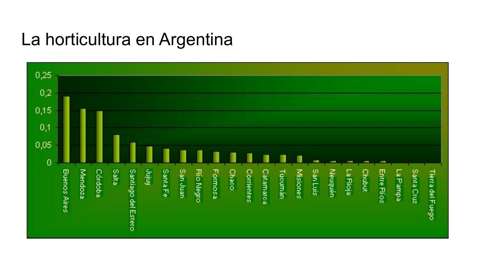
*Slide 16: la participación de cada provincia en la producción hortícola.*

**Economías regionales (slide 17)**
- **Cebolla:** Hilario Ascasubi, Villarino y Pedro Luro, en el sur de Buenos Aires.
- **Tomate y morrón en invernadero:** Bella Vista y Santa Lucía, en Corrientes.
- **Frutilla:** Coronda, en Santa Fe.

**Exportaciones (slide 18)**
- Son las toneladas exportadas entre 2000 y 2005.
- Domina la **cebolla**: pasa de ~100.000 t a un pico de ~225.000 t en 2004.
- Le siguen el **ajo** (entre ~65.000 y ~100.000 t), la papa y otras hortalizas (menos de 40.000 t).
- El **principal destino es Brasil**.

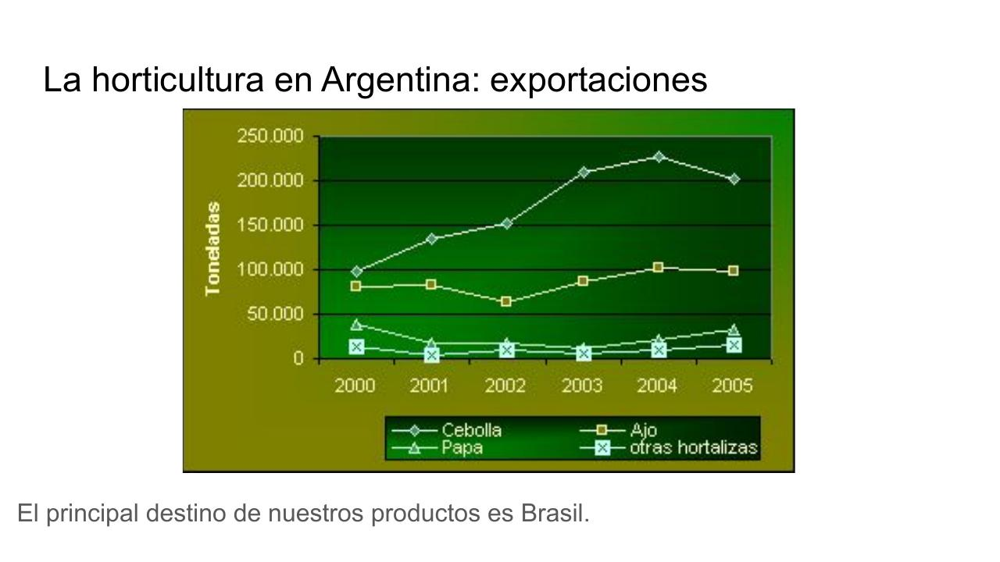
*Slide 18: exportaciones de cebolla, ajo, papa y otras hortalizas entre 2000 y 2005.*

**Circuitos comerciales (slide 19)**
- **Directo al consumidor final:** mercado minorista (verdulerías), feria franca y distribución domiciliaria.
- **Con intermediarios**, que terminan en verdulerías antes de llegar al consumidor:
  - productor o consignatario → mercado mayorista;
  - acopiadores mayoristas → hipermercados, supermercados y autoservicios;
  - plataforma logística → restaurantes y compras institucionales.
- **El 70–75 % se comercializa en el mercado minorista (verdulería).**

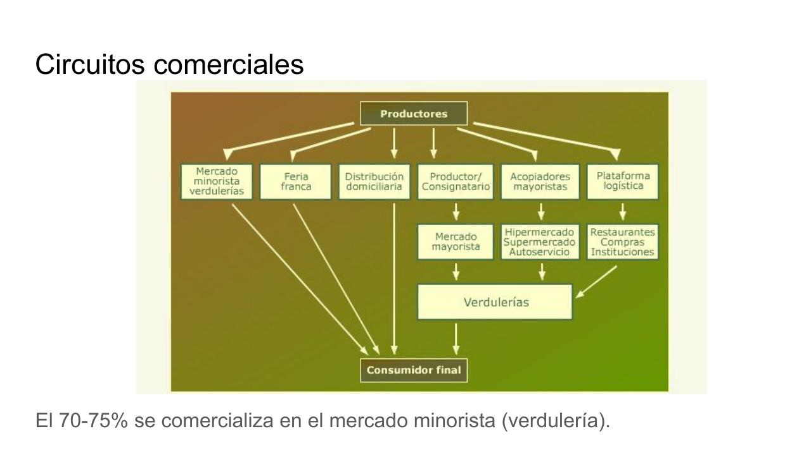
*Slide 19: los circuitos comerciales de las hortalizas, del productor al consumidor final.*

**Estructura de la cadena hortícola (slide 20)**
- Cultivo y cosecha → acondicionamiento → manipulación → fraccionamiento → empaque → almacenamiento → industrialización → transporte → consumo.

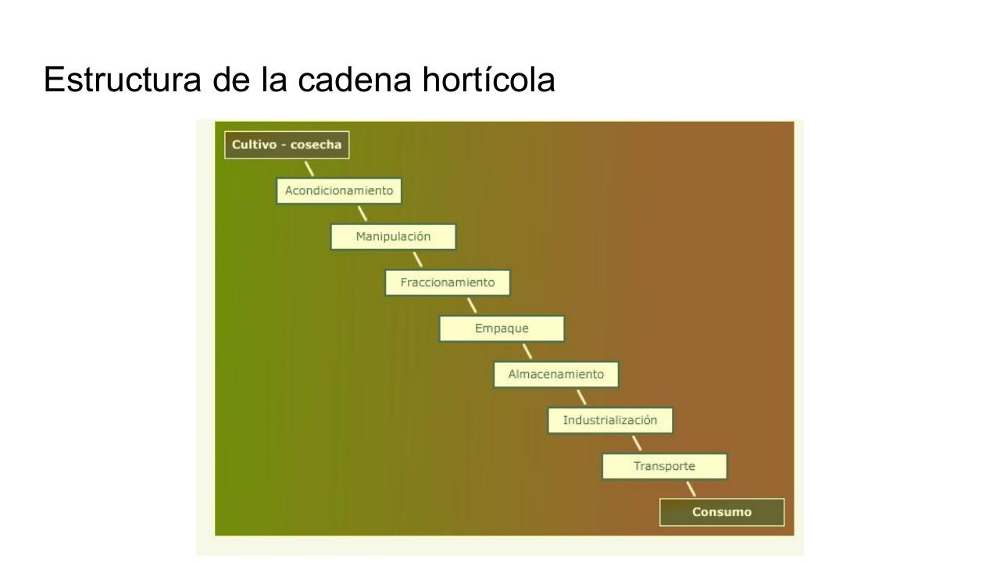
*Slide 20: la estructura de la cadena hortícola.*

---

## Correcciones de la transcripción automática

| Dice la transcripción | Es |
|---|---|
| IA ("el IA, que es como el INTA") | INIA (Instituto Nacional de Investigación Agropecuaria, Uruguay) |
| García Insa | García Inza |
| Orti, fruti | horti(cultura), fruti(cultura) |
| zapayo | zapallo |
| selga, Celga, cela | acelga |
| acusada ("el esa que es acusada") | *akusay*: el repollo chino (en japonés, *hakusai*) |
| alcausucil | alcaucil |
| bulvos | bulbos |
| pesíolo | pecíolo |
| hipocotile | hipocótilo |
| zapallito de brusela | repollito de Bruselas (lo corrigió ella misma) |
| arbejas, herja | arvejas, arveja |
| cenesencia, CNES, esa esencia | senescencia |
| tileno, litileno, tireno, chileno, deileno | etileno |
| cifas | hifas |
| cárcel, Valcarce | Balcarce |
| Corda | Córdoba |
| desmalesado | desmalezado |
| hericida | herbicida |
| aerotóxicos | agrotóxicos |
| aeroquímicos, aroquímicos | agroquímicos |
| arrusticando | rusticando (adaptándose a la zona) |
| asada | azada |
| negrocológicos, acológicos, lacología | agroecológicos, la agroecología |
| parque Peril Hola | Parque Pereyra Iraola |
| presibilidad | perecibilidad |
| aerometeorológicas | agrometeorológicas |
| fertilriego | fertirriego |
| en suciona | succiona |
| BID ("en BID uno de los problemas") | vid |
| vallitas | bayitas (cada grano de uva) |
| racismo, resimos | racimo, racimos |
| podredumbe gris, botritis | podredumbre gris, *Botrytis* |
| traspato | traspatio |
| mercaderos | probablemente mercados (las notas de Gemini dicen "mercados concentradores") |
| frutura | fruticultura |
| Fiúa | FIUBA |
| Universidad Nacional de Emisiones, Universidad de Sal de Misiones | Universidad Nacional de Misiones (UNaM) |
| Leopoldo sin piel | probablemente Leopoldo Zimperz, docente de la especialización en IoT |
| Colonia Lieve, Lievi | Colonia Liebig (Corrientes) |
| huerta OT, Huertayot, Werte Io OT, Werta IoT, Wot | Huerta IoT |
| sensor wave, sensor way, sensor Win, descenso, sensor web | SensorWave |
| SP32, SPT2 | ESP32 |
| firman basado en Mong OS, firware | firmware basado en Mongoose OS, firmware |
| broker MQX | broker EMQX |
| Fastfi, Fastfy | Fastify |
| COD | CouchDB |
| Dockers Swarm | Docker Swarm |
| MW, midlew, middlew | middleware |
| mini, Cloudfire, Clowfire, CLF, Tigri Data | MinIO, Cloudflare, Tigris Data |
| RASPDP, BL board | Raspberry Pi, probablemente BeagleBoard |
| S13, en3, ese tregojo compatible | S3, S3 o compatible |
| losadores, despador, despacharadores | (los) despachadores |
| Nano MQ en Flyo, Fallo | NanoMQ en Fly.io |
| API RES | API REST |
| es kit, CLF workers, Cloud Firewer | SvelteKit, Cloudflare Workers |
| PEBLE, Peble | Pebble |
| beccript | bcrypt |
| techp, tire win, chart, le flash | TypeScript, Tailwind, ECharts, Leaflet |
| se viiales | cbiale: el ID del nodo de borde es `borde-cbiale-<uuid>` |
| CNML o NGSD | SenML o NGSI-LD |
| Infl DB, influd, time escalb, quest db | InfluxDB, TimescaleDB, QuestDB |
| 2,20 millones de dólares | USD 2.820 millones (previsión para 2028, según la slide) |
| la humedad del suelo es mayor a 40 % | menor a 40 %, según la slide |

**Errores de las notas de Gemini**

| Dicen las notas | Es |
|---|---|
| Instituto de Investigación Agropecuaria (IA) | INIA |
| papa, tomate, cebolla y las otras del grupo principal son "el 80 % del total" | 65 %; el segundo grupo es el 20 % y el resto, el 15 % |
| Colonia Lieve | Colonia Liebig |
| broker MQX | EMQX |
| el mercado de invernaderos inteligentes llega a "2,20 millones de dólares para 2028" | USD 2.820 M en 2028, desde USD 1.380 M en 2020 |
| Chart.js para los gráficos | ECharts |
| frutura | fruticultura |

---

## ✎ Relevancia para IA / ideas de TP

**Ideas que mencionó la docente:**
- Automatizar la apertura y el cierre de los laterales de los invernáculos con sensores (la anécdota de la acelga).
- Detectar temprano las enfermedades con visión: manchas que viran de color y zonas que se hunden.
- Clasificar en el almacenamiento los frutos con daño que el ojo no ve, antes de que contaminen al resto. Es clave para exportación.
- Estimar la maduración y el etileno con sensores de temperatura, más baratos que uno de etileno.
- Tecnologías apropiadas y baratas para la escala familiar: control de malezas, lavado con menos agua, riego, invernáculos.
- Herramientas para acompañar la transición agroecológica, la etapa con menos herramientas.
- Monitorear el compostaje, para evitar patógenos y metano.
- Las oportunidades de la tabla de la sección 11: predicción fenológica, fertirriego, trazabilidad, NIR, blockchain.

**Ideas del ejercicio (compañeros):**
- Un marketplace para escalonar las cosechas y estabilizar los precios (Tomás).
- Una app de balcón con diagnóstico por foto, recordatorios de riego y sensores (Gonzalo).
- Trampas con cámara para insectos móviles, como la mosca blanca (Rodrigo).
- Contar racimos para estimar la cosecha y, después, detectar botritis al madurar (Facundo).

**Lecturas propias desde IA:**
- **Visión por computadora:** clasificar enfermedades foliares; detectar defectos en postcosecha, quizás con imágenes multiespectrales o NIR; contar frutos.
- **Series temporales:** predecir la vida postcosecha con la temperatura y la humedad de la cadena de frío; pronosticar oferta y precios en los mercados para decidir cuándo cosechar; predecir la fenología.
- **IA en el borde:** modelos livianos que corran en el nodo y funcionen sin internet. Es la lección de Claudio: "diseñar para la desconexión".
- **Optimización:** planificar siembras escalonadas para no saturar el mercado.

**Criterios para evaluar una propuesta:**
- Los del ejercicio: innovación, factibilidad, usabilidad e inversión.
- ¿Lo puede adoptar un productor familiar, con su escala y su presupuesto?
- ¿Se le puede explicar sin jerga? Al productor no hay que hablarle de "entrenar modelos".
- ¿Llega a tiempo? Detectar el daño en el fruto ya es tarde.

## ✎ Glosario

**Horticultura**
- **Hortaliza:** planta herbácea que se cultiva para consumir alguno de sus órganos, fresca o procesada.
- **Herbáceo / leñoso:** que no forma madera / que forma madera.
- **Anual / bianual:** que completa su ciclo en uno / dos años.
- **Disturbio:** perturbación del agroecosistema, como el laboreo o el cambio de cultivo.
- **Agroecosistema:** el sistema productivo como ecosistema: el cultivo, el suelo, los microorganismos y la fauna y flora asociadas.
- **Manejo:** el conjunto de decisiones y prácticas del productor.
- **Rotación:** alternar cultivos de distintas familias u órganos en un mismo lugar para cortar el ciclo de plagas, enfermedades y malezas.
- **Cinturón verde (u hortícola):** la zona de quintas que rodea una ciudad y la abastece de verdura fresca.
- **Quinta:** predio hortícola chico.
- **Cantero:** franja de tierra preparada donde se siembra o se planta.
- **Primicia:** producción que llega al mercado antes que la de otras zonas, con mejor precio.
- **Intermediario:** quien le compra al productor para revender, como un consignatario, un acopiador o un mayorista.
- **Mercado concentrador:** mercado mayorista que concentra la oferta de frutas y verduras de una región.
- **Maleza:** planta que crece donde no se la quiere y compite con el cultivo.
- **Desmalezado:** sacar las malezas a mano, con herramientas o con herbicidas.
- **Escardillo:** herramienta de mano para remover la tierra y sacar malezas.
- **Azada:** herramienta de hoja ancha para cavar y mover la tierra.
- **Carpir:** sacar las malezas removiendo la capa superficial del suelo.
- **Invernáculo o invernadero:** estructura cubierta con nylon que protege los cultivos. De ahí "producción bajo cubierta".
- **Laterales:** las cortinas de nylon de los costados del invernáculo, que se suben y se bajan para ventilar o proteger.
- **Hidroponía:** cultivo sin suelo, con las raíces en una solución de nutrientes.
- **Tutor:** estaca o hilo que sostiene una planta, como el tomate.
- **Rastrera / enredadera:** planta que crece sobre el suelo / que trepa.
- **Tubérculo:** tallo subterráneo engrosado, como la papa.
- **Bulbo:** órgano subterráneo de hojas engrosadas, como la cebolla y el ajo.
- **Fotoperíodo:** la duración del día, en horas de luz.
- **Bulbificación:** la formación del bulbo. En la cebolla depende del fotoperíodo.
- **Pecíolo / lámina:** el "cabito" que une la hoja con el tallo / la parte plana de la hoja.
- **Hipocótilo:** la porción del tallo entre las raíces y el punto de crecimiento.
- **Yema:** punto de crecimiento del que salen hojas o flores.
- **Primordios foliares:** hojas en formación dentro de una yema.
- **Legumbre:** semilla de las leguminosas (arveja, garbanzo, lenteja, poroto), que se forma en una vaina o chaucha.
- **Postcosecha:** la etapa que va de la cosecha al consumo.
- **Perecedero:** que se deteriora rápido.
- **Respiración / transpiración / senescencia:** consumo de reservas con liberación de CO₂ / pérdida de agua como vapor / envejecimiento de los tejidos.
- **Etileno:** hormona vegetal gaseosa que regula la maduración.
- **Climatérico:** fruto que sigue madurando después de cosechado y responde al etileno, como el tomate, la banana, la palta y la pera.
- **Hifas:** los filamentos que forman el cuerpo de un hongo.
- **Inóculo:** esporas u otras estructuras de un patógeno capaces de infectar.
- **Galpón de acondicionamiento:** donde se lava, se selecciona y se empaca la producción.
- **Atmósfera controlada:** almacenamiento con menos oxígeno para frenar la respiración.
- **Agroquímicos:** productos de síntesis química para el cultivo: herbicidas, insecticidas, fungicidas, plaguicidas.
- **Agroecología:** enfoque que diseña la producción buscando el equilibrio del agroecosistema, con el mínimo de insumos externos.
- **Producción orgánica:** producción certificada sin productos de síntesis química.
- **Transición agroecológica:** el paso de un manejo convencional a uno agroecológico. Lleva años.
- **Agricultura regenerativa:** prácticas que buscan recuperar la salud del suelo y del sistema.
- **Asociación de especies:** cultivar juntas especies que se benefician entre sí.
- **Cama de pollo:** excremento de pollo mezclado con el material del piso del galpón. Se composta y se usa como abono.
- **Compostaje:** descomposición controlada de materia orgánica para hacer abono.
- **Fertirriego:** aplicar los fertilizantes disueltos en el agua de riego.
- **Conductividad eléctrica:** medida de las sales disueltas en el suelo o en el agua; sirve como indicador de nutrientes y salinidad.
- **Predicción fenológica:** estimar cuándo ocurre cada etapa de desarrollo del cultivo.
- **NIR:** espectroscopía de infrarrojo cercano. Mide la composición (por ejemplo, la materia seca) sin destruir la muestra.
- **Materia seca:** lo que queda al sacarle el agua a un producto.
- **Trazabilidad:** poder seguir un producto a lo largo de toda la cadena.
- **Nematodos:** gusanos microscópicos del suelo. Algunos atacan las raíces.
- **Pulgones / cochinilla / mosca blanca:** insectos chupadores. La cochinilla vive fija en la planta; la mosca blanca es común en tomate y pimiento.
- **Botritis (*Botrytis cinerea*):** el hongo que causa la podredumbre gris.
- **SENASA:** Servicio Nacional de Sanidad y Calidad Agroalimentaria (Argentina).

**IoT**
- **Borde (*edge*):** procesar y guardar los datos cerca de donde se generan, en el predio.
- **MQTT:** protocolo liviano de publicación/suscripción a través de un broker.
- **Broker:** el servidor que recibe los mensajes MQTT y los reparte entre los suscriptos.
- **Tópico:** la "dirección" jerárquica de un mensaje MQTT, como `huerta/zona-norte/...`.
- **QoS 1:** nivel de servicio de MQTT que garantiza que el mensaje llega al menos una vez.
- **CoAP:** protocolo de requerimiento-respuesta para dispositivos restringidos, parecido a HTTP pero más liviano.
- **Federación:** conectar brokers para que los mensajes crucen entre el borde y la nube.
- **ESP32:** microcontrolador barato con WiFi y Bluetooth.
- **Firmware:** el software que corre en el dispositivo.
- **Actuador:** dispositivo que ejecuta una acción, como una bomba o un motor.
- **Deriva:** la pérdida de calibración de un sensor con el tiempo.
- **Serie temporal:** secuencia de valores, cada uno con su marca de tiempo.
- **Base de series temporales:** base de datos optimizada para series temporales, como InfluxDB, TimescaleDB, QuestDB o IoTDB.
- **Almacenamiento de objetos (S3):** guarda archivos ("objetos") en *buckets*. Es barato y replicado, pero lento. R2, MinIO y Tigris son compatibles con S3.
- **Pebble:** base de datos clave-valor embebida, escrita en Go.
- **Compresión estilo Gorilla:** codifica cada número real con un XOR contra el anterior. Funciona bien cuando los valores cambian poco.
- **Delta de delta:** guarda la diferencia entre diferencias sucesivas. Sirve para enteros y marcas de tiempo regulares.
- **RLE:** codifica las repeticiones como pares (valor, cantidad).
- **LZ4:** algoritmo de compresión general muy rápido.
- **Sin estado (*stateless*):** servicio que no guarda datos entre pedidos, así que se puede replicar libremente.
- **Consistencia eventual:** las copias pueden diferir un tiempo, pero terminan iguales.
- **JWT:** token firmado que prueba la identidad del usuario en cada pedido a la API.
- **bcrypt:** función para guardar contraseñas como hash, con sal.
- **UNS (*Unified Namespace*):** un único espacio de nombres jerárquico para todos los datos.
- **SenML / NGSI-LD:** estándares abiertos para representar datos de sensores y de contexto.
- **Agregación temporal:** resumir los datos por intervalos, como un promedio por hora.
- **Docker Swarm:** orquestador de contenedores simple.
- **DigitalOcean / Fly.io / Cloudflare Workers:** proveedores de nube. Workers corre código *serverless* en la red de Cloudflare.
- **Svelte / SvelteKit:** framework de frontend.
- **Leaflet / ECharts:** bibliotecas de mapas / de gráficos.
- **Fastify:** framework de backend para Node.js.
- **CouchDB:** base de datos documental, con documentos JSON.
- **EMQX / NanoMQ:** brokers MQTT.
- **Mongoose OS:** sistema operativo para el firmware de dispositivos IoT.

## ✎ Preguntas de práctica

1. ¿Qué características definen a los cultivos hortícolas?
2. ¿Cuánto puede durar el ciclo de la rúcula? ¿Qué permiten los ciclos cortos?
3. ¿Por qué la horticultura tiene alta frecuencia de disturbios y qué consecuencia trae?
4. Comparar la horticultura con la fruticultura en duración de la postcosecha, mano de obra y dependencia de insumos.
5. ¿Qué hortalizas son la excepción a la postcosecha corta?
6. ¿Cuántas hectáreas y cuántas toneladas por año produce la horticultura argentina?
7. ¿Qué porcentaje de la producción representan papa, tomate, cebolla, batata, zapallo, zanahoria, lechuga y ajo?
8. ¿Qué es un cinturón verde y por qué está cerca de las ciudades?
9. ¿Qué producen Mendoza, Balcarce y Corrientes?
10. ¿Qué órgano se consume en la papa, la cebolla, la remolacha, el brócoli y el repollito de Bruselas?
11. ¿Qué es el hipocótilo? Dar dos ejemplos de hipocótilo engrosado.
12. ¿En qué legumbre es fuerte Argentina como exportadora?
13. ¿Por qué la postcosecha es un momento crítico?
14. ¿Cuáles son los tres procesos que degradan la calidad en postcosecha?
15. ¿Cuál es el factor más crítico en postcosecha? ¿Qué combinación es la peor?
16. ¿Qué es el etileno y por qué un fruto dañado afecta a sus vecinos?
17. ¿Por qué se envuelve una palta verde con una banana?
18. Según la docente, ¿por qué no conviene un sensor de etileno? ¿Qué se usa en su lugar?
19. ¿Para qué viajan registradores de temperatura y humedad con la fruta de exportación?
20. ¿En qué se diferencian el manejo orgánico y el agroecológico?
21. ¿Cuál es el destino predominante de la producción convencional, la orgánica y la agroecológica?
22. ¿Cuáles son los cuatro tipos de producción hortícola en Argentina?
23. ¿Por qué se produce cebolla en el sur de Buenos Aires?
24. ¿En qué se basa el contrato entre el productor y la industria? ¿Qué gana y qué pierde el productor?
25. ¿Qué desafíos y oportunidades tecnológicas tiene el cinturón hortícola familiar?
26. ¿Por qué la transición de convencional a agroecológico es la etapa más difícil?
27. ¿Qué problema muestra la anécdota de la familia que producía acelga?
28. ¿Qué requerimientos clave y qué desafíos críticos tienen los productores familiares?
29. ¿Qué detecta mejor la visión por computadora: enfermedades o plagas? ¿Por qué?
30. ¿Por qué una trampa con cámara no sirve para la cochinilla?
31. ¿Con qué criterios se evaluaron las propuestas del ejercicio?
32. Según la docente, ¿qué problema resolvería un marketplace de productores?
33. ¿Cuáles son los siete desafíos del IoT en el campo?
34. ¿Qué diferencia a la agricultura inteligente (4.0) de la de precisión (3.0)?
35. ¿Qué problemas tenía Huerta IoT v1?
36. ¿Cuáles son las tres piezas de SensorWave? ¿Qué hace el despachador?
37. ¿Qué pasa en Huerta IoT v2 si se corta internet?
38. ¿Cómo se deriva una serie a partir de un tópico MQTT?
39. ¿Por qué el backend de Huerta IoT v2 está en Go y no en Fastify?
40. ¿Cuáles fueron los principales aprendizajes de Claudio?
41. ¿Por qué Corrientes es relevante en la horticultura bajo cubierta?

<details>
<summary>Respuestas</summary>

1. Son herbáceos (no producen madera), anuales o bianuales, de ciclos cortos y con rotación rápida. Tienen alta frecuencia de disturbios, postcosecha corta y alta demanda de mano de obra y de insumos.
2. Unos 45 días. Los ciclos cortos permiten rotar varios cultivos en un mismo año y en la misma tierra, como rabanito, lechuga y tomate.
3. Porque se mueve la tierra y se cambian las plantas todo el tiempo. El agroecosistema se desequilibra y aparecen plagas y enfermedades; por eso es clave el manejo (las rotaciones).
4. La horticultura tiene postcosecha de baja duración, mano de obra de intensidad alta y dependencia alta de insumos. La fruticultura tiene postcosecha media-alta, mano de obra media e insumos media.
5. Papa, cebolla, batata y zapallo.
6. Unas 600.000 ha y 10 millones de toneladas.
7. El 65 % (el 20 % es acelga, mandioca, zapallito, choclo, berenjena y pimiento, y el 15 %, el resto).
8. Es la zona de producción hortícola familiar que rodea una ciudad. Está cerca porque las verduras de hoja son muy perecederas: una lechuga no tiene valor para viajar lejos y llegaría deshidratada.
9. Mendoza: ajo, cebolla y papa. Balcarce: papa. Corrientes: tomate y pimiento.
10. Papa: tallo subterráneo. Cebolla: bulbo. Remolacha: hipocótilo engrosado. Brócoli: flor. Repollito de Bruselas: yema.
11. Es la parte de la planta entre el punto de crecimiento y las raíces. Ejemplos de hipocótilo engrosado: remolacha y rabanito.
12. En el garbanzo.
13. Porque una vez cosechado, el producto no mejora su calidad: solo puede empeorar ("o conservamos o hacemos lío").
14. Respiración, transpiración y senescencia.
15. La temperatura elevada. La peor combinación es calor con baja humedad, "tipo secador de pelo".
16. Es una hormona gaseosa que desencadena la maduración. Un fruto dañado lo libera; el etileno difunde fácil hacia los vecinos, que maduran, se ablandan y quedan expuestos a los hongos. Pasa en los frutos climatéricos.
17. Porque la banana es "la reina del etileno" y acelera la maduración de la palta.
18. Porque el etileno correlaciona muy bien con la temperatura y con los picos de respiración, así que se lo puede estimar con un sensor de temperatura, que es más barato.
19. Para probar que la cadena de frío no falló durante el viaje y evitar litigios.
20. El orgánico está certificado y no usa síntesis química, pero puede ser una simple sustitución de insumos. El agroecológico piensa en el sistema: busca el equilibrio del agroecosistema, con diversificación, animales y plantas florales.
21. Convencional: mercado interno (90 %). Orgánico: exportación (99 %). Agroecológico: mercado interno (100 %), con venta directa y cercana.
22. Cinturones hortícolas familiares, producción especializada, cultivos extensivos (mecanizados) y producción para la industria.
23. Porque el fotoperíodo de esa región es ideal para activar la bulbificación de la cebolla.
24. En el rendimiento en peso fresco y en el porcentaje de materia seca. El productor asegura la venta total, pero cobra un precio bajo.
25. Desafíos: control de riego, temperatura y humedad, y detección de plagas. Oportunidades: sensores de bajo costo, estaciones agrometeorológicas, apps móviles y visión computarizada.
26. Porque el sistema tarda años en equilibrarse. Mientras tanto, el productor no puede aplicar químicos y el sistema sigue desequilibrado, así que se complica su subsistencia. Además, es la etapa con menos herramientas.
27. Que el productor queda atado a tareas manuales que se podrían automatizar: subir y bajar los laterales del invernáculo según el frío, el viento o el calor. Si se olvida, pierde la cosecha.
28. Requerimientos: accesibilidad económica, energías limpias, eficiencia energética y bienestar humano. Desafíos: malezas, cosecha y lavado, sanidad vegetal (detección temprana) y automatización de invernáculos y riego.
29. Enfermedades, porque generan manchas que cambian de color y se distinguen del verde.
30. Porque la cochinilla no se mueve: se fija de chiquita en un punto de la planta y no tiene patas, así que nunca llega a la trampa.
31. Descripción, innovación, factibilidad y usabilidad (de 1 a 10), e inversión (baja, media o alta).
32. La caída del precio cuando todos cosechan lo mismo el mismo día. Permitiría escalonar las cosechas y lograr precios que convengan a todos.
33. Conectividad, energía, interoperabilidad, seguridad, calidad de datos, costos y mantenimiento.
34. La inteligente decide según el contexto y los eventos, no solo según la ubicación. Combina IoT y nube, con aprendizaje automático, vehículos no tripulados y robótica.
35. Todo estaba en la nube, así que sin internet se perdía el control de reglas. Las reglas eran de un solo dispositivo (sin promedios de varios sensores ni ventanas de tiempo), solo hablaba MQTT y no usaba almacenamiento de objetos.
36. Los nodos de borde, el almacenamiento S3 y el despachador. El despachador es un servicio sin estado que responde las consultas: une lo reciente, que pide al borde por el broker MQTT de la nube, con lo histórico, que lee de S3.
37. El borde sigue midiendo, guardando localmente y aplicando las reglas. Reintenta subir los bloques a S3 en la ventana siguiente. Las consultas devuelven el histórico y avisan qué nodo no respondió.
38. Cada nivel del tópico se mapea a la serie: `huerta/zona-norte/esp32-1/sensor/temperatura_ambiente` → id del nodo de borde/zona/dispositivo/tipo/métrica. El mensaje solo lleva el valor.
39. Porque la biblioteca despachadora de SensorWave está en Go y no hay versión en JavaScript. Así evitaron mantener dos backends.
40. Diseñar para la desconexión, usar un nombre jerárquico único, separar lo reciente (borde) de lo histórico (S3) y hacer la seguridad desde el comienzo.
41. Es la 2.ª provincia en hortalizas bajo cubierta, con más de 2.100 ha, sobre todo de tomate y pimiento, y produce primicias.

</details>
