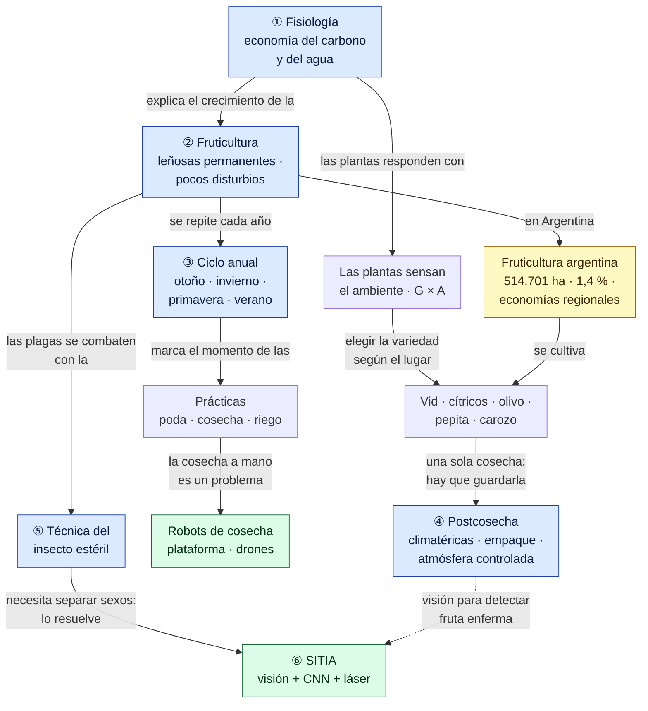
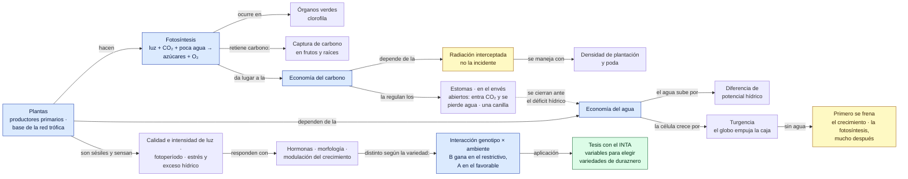
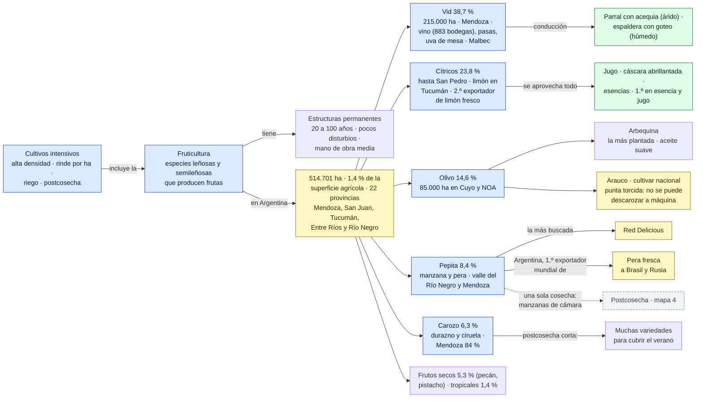
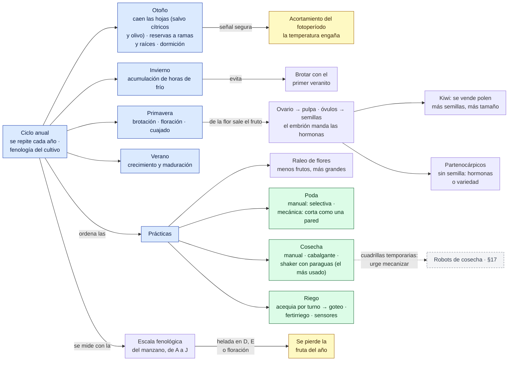
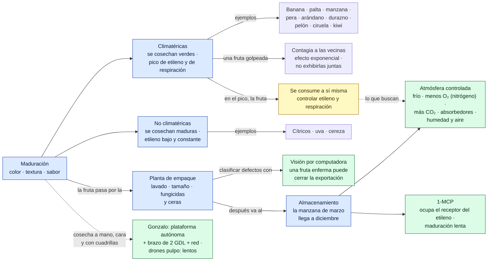
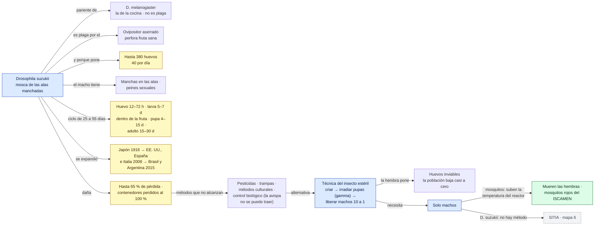
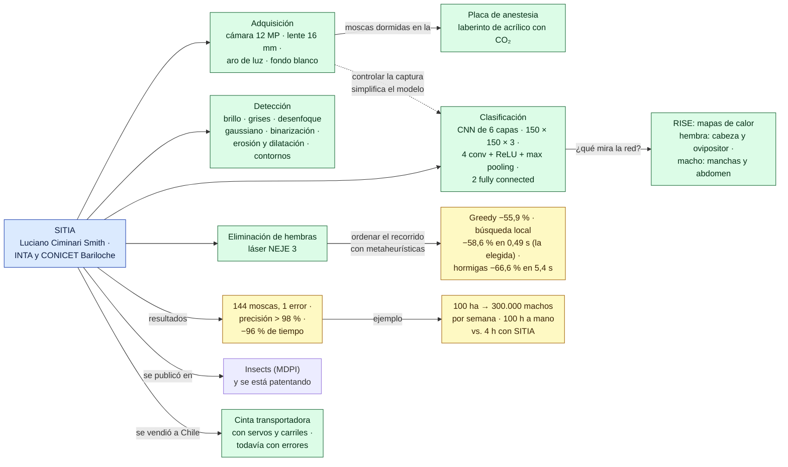

# Red conceptual — Clase 3: Fruticultura

Complemento del [resumen](resumen.md). Primero hay una vista general de toda la clase y después un mapa por tema, en el orden en que se dieron. Los números de sección (§) remiten al resumen.

**Cómo leerla**
- Cada flecha forma una frase: *Fruticultura → tiene → baja frecuencia de disturbios*. Una flecha sin texto quiere decir "incluye".
- Las flechas punteadas unen conceptos de temas distintos.
- Colores: azul = tema · verde = herramienta, tecnología o caso real · amarillo = dato para memorizar · gris punteado = concepto que se desarrolla en otro mapa.

> Todo el contenido sale de la clase. La organización y las frases de las flechas son propias.

## Vista general

## 1. Fisiología: carbono, agua y ambiente (§1 a §5)

## 2. La fruticultura en Argentina (§6 a §12)

## 3. Ciclo anual y prácticas de manejo (§13 y §14)

## 4. Postcosecha: maduración, empaque y almacenamiento (§15 a §17)

## 5. La plaga y la técnica del insecto estéril (§19 a–i)

## 6. SITIA: visión, IA y láser (§19 j–r)

