# Clase 3 — Fruticultura

- **Docente:** Ing. Agr. Dra. Georgina Paula García Inza (INIA, Uruguay). Es la misma docente de horticultura: ver la [clase 2](../02-horticultura/resumen.md).
- **Expositor invitado:** Luciano M. Ciminari Smith. Ingeniero industrial y docente de la FIUBA, donde da Investigación Operativa Superior. Presentó el trabajo final de su maestría, cuya segunda parte era de inteligencia artificial: un sistema de visión por computadora para separar machos y hembras de una mosca plaga, propuesto por el INTA de Bariloche. Ya había expuesto en la materia ("una vez más").
- **Fecha:** martes 03/11/2026.
- **Duración:** 02:51 h. Fruticultura hasta 01:34, recreo hasta 01:57 y Luciano desde ahí (la presentación arranca a las 02:01).
- **Grabación:** *(falta el link)*
- **Material:** [slides de fruticultura](material/slides-fruticultura.pdf) · [slides de Luciano](material/slides-separacion-machos-hembras-tie.pdf) · [notas Gemini](material/notas-gemini.txt) · [transcripción](material/transcripcion.txt)
- **Red conceptual:** [red-conceptual.md](red-conceptual.md)

> **Fuentes:** la transcripción completa y las slides de las dos presentaciones. Los tiempos `(hh:mm:ss)` indican dónde arranca cada tema en la grabación. Las secciones marcadas con ✎ son elaboración propia y no se dijeron en clase. Las imágenes `slide-NN` son de la presentación de fruticultura y las `tie-slide-NN`, de la de Luciano (SIT-ia).
>
> **Ojo con el PDF de fruticultura.** Se llama "Clase 2 Fruticultura GPGI", de cuando fruti iba antes que horti, y no coincide del todo con lo que se mostró:
> - Pone las slides 3 y 4 (cultivos intensivos y qué es la fruticultura) antes de la fisiología, pero en clase se vieron después (00:35:55).
> - La docente leyó "regulación estomática" en la slide 6, y en el PDF no está.
> - El gráfico de interacción genotipo × ambiente que explicó (dos variedades que se cruzan entre un ambiente restrictivo y uno favorable) no está en el PDF. La slide 9 trae otro gráfico, que no se comentó.
> - Trae slides que no se comentaron: están en el [anexo](#anexo-slides-del-pdf-que-no-se-comentaron).
>
> **El PDF de Luciano** es un handout con dos slides por hoja: las imágenes son recortes. Los dos videos que pasó (el lote de frambuesas atacado y la cinta transportadora de Chile) aparecen como una foto fija.

---

## Repaso rápido para el examen

**Fisiología (sirve para todos los sistemas)**
- Las plantas son **productores primarios**: están en la base de la red trófica porque generan **hidratos de carbono con la energía del sol** (fotosíntesis).
- **Fotosíntesis:** luz + CO₂ + una porción muy chica de agua → **azúcares + O₂**. Solo en los **órganos verdes** (clorofila). Los azúcares forman la estructura de la planta y la fruta.
- **Economía del carbono:** importa la **radiación interceptada** (la que capta la planta), no la **incidente** (la que llega al lugar). La densidad de plantación y la poda definen cuánto se intercepta.
- **Estomas:** poros, casi siempre en el **envés** de la hoja. Abiertos, entra CO₂ pero se pierde agua (transpiración); cerrados, no se pierde agua, pero no hay fotosíntesis. Funcionan como una **canilla**.
- **Economía del agua:** el agua va del suelo a la raíz por diferencia de **potencial hídrico**. La célula crece por **presión de turgencia**. **La primera señal de falta de agua es que se detiene el crecimiento**; la fotosíntesis se frena mucho después.
- Las plantas son **sésiles** y **sensan** el ambiente: calidad de luz (fotorreceptores), intensidad de luz, largo del día (**fotoperíodo**), estrés y exceso hídrico. Responden con ajustes fisiológicos y morfológicos, hormonas y mensajeros internos.
- **Interacción genotipo × ambiente:** comportamiento **diferencial** de los genotipos (por ejemplo, variedades de una especie) en ambientes distintos: la variedad B rinde más en el ambiente restrictivo y la A, en el favorable. Es clave en el **mejoramiento genético** (selección y recomendación).

**Fruticultura**
- **Cultivos intensivos:** alta densidad, superficies chicas, maximizan el rendimiento por hectárea, más mano de obra, riego clave, postcosecha importante, muy tecnificados.
- **Definición:** la ciencia que estudia el cultivo de especies **leñosas y semileñosas** que producen **frutas**, con tecnologías basadas en principios biológicos y fisiológicos, y que sea sostenible en lo ambiental, social y económico.
- **Vs. horticultura:** estructuras **permanentes** (20, 30 o 100 años), **baja frecuencia de disturbios**, mano de obra permanente de intensidad media.
- **Argentina:** **514.701 ha** (~500.000), el **1,4 %** de la superficie agrícola (CNA 2018), pero clave para las **economías regionales**. Hay 22 provincias productoras; las principales: **Mendoza, San Juan, Tucumán, Entre Ríos y Río Negro**.
- **Superficie por grupo (INTA 2020):** vid 38,7 % · cítricos 23,8 % · olivo 14,6 % · pepita 8,4 % · carozo 6,3 % · frutos secos 5,3 % (en crecimiento: pecán y pistacho) · tropicales 1,4 % (banana, ananá).

| Grupo | Datos clave |
|---|---|
| **Vid** | 215.000 ha. El principal cultivo frutícola; **Mendoza** es la principal provincia. La tracciona el **vino** (~900 bodegas; la slide dice 883), y también da pasas y uva de mesa. Variedad insignia: **Malbec**. |
| **Cítricos** | Al sur llegan **hasta San Pedro** (Buenos Aires); el pomelo va más al norte y el limón está en **Tucumán**. Limón: 2.ª fruta más exportada (después de la pera), **2.º exportador mundial de limón fresco**, 4.º productor de aceite esencial y **1.º exportador de esencia y jugo**. |
| **Olivo** | ~85.000 ha en zonas áridas de **Cuyo y el NOA**. **Arbequina:** la más implantada en los últimos 30 años, para aceite suave. **Arauco:** el cultivar nacional, de fruto grande con la punta torcida, que impide el **descarozado mecánico**. |
| **Pepita** | Manzana, pera y membrillo, en el **valle del Río Negro** (Alto Valle, Valle Medio y Valle Inferior) y Mendoza. La manzana más buscada es la **Red Delicious**. Argentina es el **principal exportador mundial de pera fresca** (a Brasil y Rusia). |
| **Carozo** | Durazno y ciruela: **Mendoza tiene el 84 %** (fresco, enlatado y ciruela pasa). El durazno dura poco en postcosecha, así que muchas variedades cubren el verano. |

- **Una sola cosecha anual** (en manzana, de diciembre a abril): si hay manzanas en noviembre es por el **almacenamiento en cámaras**.

**Ciclo anual y prácticas**
- **Otoño:** el **acortamiento del fotoperíodo** y la baja de temperatura disparan la senescencia y la caída de hojas (salvo en **cítricos y olivo**), el traslado de reservas a ramas y raíces y la dormición de las yemas. El fotoperíodo es la señal **segura**; la temperatura no ("veranitos").
- **Invierno:** las yemas acumulan **horas de frío**, para no brotar con el primer veranito. **Primavera:** brotación, floración, cuajado. **Verano:** crecimiento y maduración del fruto.
- **De la flor al fruto:** el **ovario** forma la parte carnosa y los **óvulos**, las semillas. El embrión del óvulo fecundado da las **señales hormonales** para que crezca el fruto. Para el kiwi se vende polen. Los **partenocárpicos** no tienen semilla (naranjas, uvas): por hormonas o por la variedad.
- **Las prácticas siguen la fenología:** poda anual o bianual con la planta en reposo, cosecha en verano y **raleo de flores** para tener menos frutos y más grandes. Una **helada** en los estadios D o E, o en floración, puede hacer perder la cosecha del año (escala fenológica del manzano).
- **Poda:** manual (selectiva) vs. **mecánica**, que corta todo "como una pared" en plantaciones intensivas y superintensivas.
- **Cosecha:** manual vs. mecanizada, con **cabalgantes** (olivo) o con el **shaker** (vibrador con paraguas invertido), el más usado.
- **Riego:** más del **90 %** del órgano cosechado es agua. Del riego **superficial por turno**, que desperdicia agua, al **goteo**, que dosifica en L/h, con **fertirriego**, sensores de humedad y estaciones meteorológicas.

**Postcosecha**
- **Climatéricas:** se cosechan verdes y maduran después; producen etileno y responden a él, con un **pico respiratorio**. Banana, palta, manzana, pera, arándano, durazno, pelón, ciruela y kiwi. Una fruta dañada "contagia" a las vecinas: no hay que exhibirlas juntas.
- **No climatéricas:** se cosechan maduras y no cambian; el etileno es bajo y constante. Cítricos, uva y cereza.
- **Para que la fruta dure hay que controlar el pico de etileno y la respiración.**
- **Empaque:** lavado, acondicionamiento, clasificación por tamaño y por defectos (personas o **visión**), fungicidas y ceras. Una fruta enferma puede **cerrar un mercado de exportación**.
- **Atmósfera controlada:** cámaras de frío con **menos O₂ y más CO₂** (se inyecta **nitrógeno**), absorbedores de CO₂ y de etileno, control de humedad y circulación de aire. La manzana de marzo tiene que llegar a diciembre.
- **1-MCP:** ocupa el receptor del etileno, así que la fruta madura más lento.

**Técnica del insecto estéril (Luciano)**
- ***Drosophila suzukii*** (mosca de las alas manchadas): pariente de la mosca de la cocina (*D. melanogaster*), pero **plaga**. La hembra tiene un **ovipositor aserrado** que perfora la fruta sana; el macho tiene **manchas en las alas** y **peines sexuales**.
- Pone hasta **380 huevos**, hasta 40 por día. **Ciclo de 25 a 55 días:** huevo 12–72 h → larva 5–7 días **dentro de la fruta** → pupa 4–15 días → adulto 15–30 días. Es **polífaga**: frambuesa, arándano, frutilla, cereza, uva, ciruela.
- **Expansión:** Japón en **1916** → EE. UU., España e Italia en **2008** → Brasil y Argentina en **2015** (hoy en unas 10 provincias). Se estima que hace perder hasta el **65 %** de la fruta, según el tipo.
- **Control:** pesticidas (no llegan a la larva y genera resistencia), trampas, métodos culturales y control biológico (una avispa que en Argentina no se puede traer). Ninguno alcanza.
- **TIE:** criar los insectos → **irradiar las pupas** (gamma) → liberar **machos estériles, 10 por cada fértil** → la hembra pone **huevos inviables**. Necesita **solo machos**: en los mosquitos se separan subiendo la temperatura (mueren las hembras), pero en *D. suzukii* no hay método.
- **SITIA:** adquisición de imágenes → **detección** (brillo, grises, desenfoque gaussiano, binarización, erosión y dilatación, contornos) → **clasificación** con una CNN simple (entrada **150 × 150 × 3**; cuatro bloques conv + ReLU + max pooling y dos fully connected) → **eliminación de las hembras con láser**.
- **RISE** (oclusiones aleatorias → mapas de calor): la red mira la **cabeza y el ovipositor** en las hembras, y las **manchas de las alas y el abdomen** en los machos.
- **Recorrido del láser** (metaheurísticas): greedy, −55,9 % de distancia en 0,24 s; **búsqueda local, −58,6 % en 0,49 s (la que usan)**; colonia de hormigas, −66,6 % pero en 5,4 s (demasiado lenta).
- **Resultados:** 144 moscas y **1 error** → precisión **superior al 98 %**, y **96 % menos de tiempo**. 100 ha con ataque importante (3 machos fértiles cada 100 m²) piden **300.000 machos estériles por semana**: 100 h de una persona o **4 h con SITIA**.
- Se **vendió a Chile** y se está **patentando**. La versión nueva usa una cinta transportadora con servos que desvían a las hembras.

---

## 0. Inicio de la clase (00:00:00)

**Logística**
- Lola le pidió a **Martín Horn** los trabajos finales de la edición anterior que más le llamaron la atención. Según Martín fueron muy dispares: "uno era el opuesto del otro". Los va a mandar para que se vea esa variedad.

**Multiple choice de la clase 2 (00:08:24)**
- Lo hicieron **9** personas; deberían ser 13. Las preguntas las arma la docente ("las que nos pasó Georgi").
- Todas salieron bien salvo una, de verdadero o falso:

| Afirmación | Respuesta | Discusión |
|---|---|---|
| "La mayoría de las hortalizas cuyo órgano de cosecha es el fruto o la hoja tienen una alta tasa respiratoria." | **Verdadero** (lo eligió la mayoría) | Lucas Didone puso falso porque entendió que varía según la especie y la temperatura, y la frase generaliza. Georgina (00:13:30): la **alta tasa respiratoria** es lo que las hace **perecederas**, y eso era lo importante. |

- Un alumno iba a cursar en forma asincrónica; Lola le va a preguntar si sigue.

**Encuesta de terminología (00:14:39)**
- La contestaron unas 8 personas. Según la docente, aparecieron términos conocidos: **etileno** (quizás por la clase anterior), **interacción genotipo por ambiente** (le sonaba a 4) y **radiación interceptada**. Ver el glosario.

## 1. Repaso de fisiología: la fotosíntesis (00:18:05)

- Fruticultura está en el mismo lugar del mapa que horticultura: los **sistemas de cultivos intensivos**.

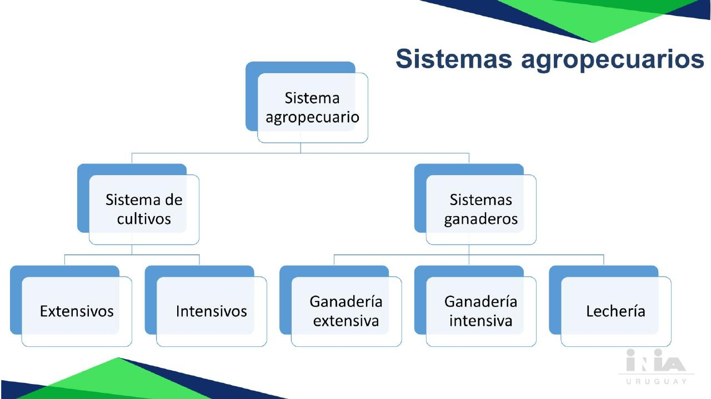
*Slide 2: fruticultura, como horticultura, está dentro de los sistemas de cultivos intensivos.*

- Antes de la fruticultura en sí, un repaso de cosas "de la escuela" que le dan sentido a todo el agro.
- **Las plantas son productores primarios:** están en la base de la red trófica porque, como muy pocos organismos, **generan hidratos de carbono a partir de la energía del sol**. Lo logran con la **fotosíntesis** (00:20:09).
- **Qué necesita:** energía lumínica, **dióxido de carbono** y una porción muy chiquita de agua. La planta sí necesita mucha agua, pero para crecer.
- **Qué produce:** **oxígeno**, que se libera a la atmósfera, y **azúcares**, que terminan en el "objeto productivo": la fruta.
- **Dónde:** solo en los **órganos verdes**, porque ahí está el pigmento, la **clorofila**, dentro de organelas específicas de la célula vegetal (✎ los cloroplastos).
- **Cómo, simplificado:**
  1. La energía de la luz **rompe la molécula de agua**, y el oxígeno se libera al aire.
  2. La energía queda acumulada y se usa en otra parte del ciclo (✎ el ciclo de Calvin, que aparece en el esquema de la slide).
  3. Ahí se toma el **CO₂ del aire** y se lo transforma en estructuras más complejas, pegando carbono con carbono (00:22:09): los **azúcares** de las manzanas, las peras y las mandarinas, que también forman la estructura de la planta.
- **Captura de carbono:** todo lo que se escuche sobre cambio climático y captura de carbono tiene que ver con esto. El CO₂ queda retenido en un fruto o en las raíces y tarda mucho en volver a la atmósfera. Hay **balances de carbono positivos**, en los que las plantas "chupan" carbono.
- El **oxígeno** es una parte muy chica de la atmósfera y es fundamental para la vida (00:23:28).
- **No cualquier radiación sirve:** solo algunas longitudes de onda excitan las clorofilas.
- De acá salen dos conceptos que sirven tanto para las producciones vegetales como para las animales: la **economía del carbono** y la **economía del agua**.

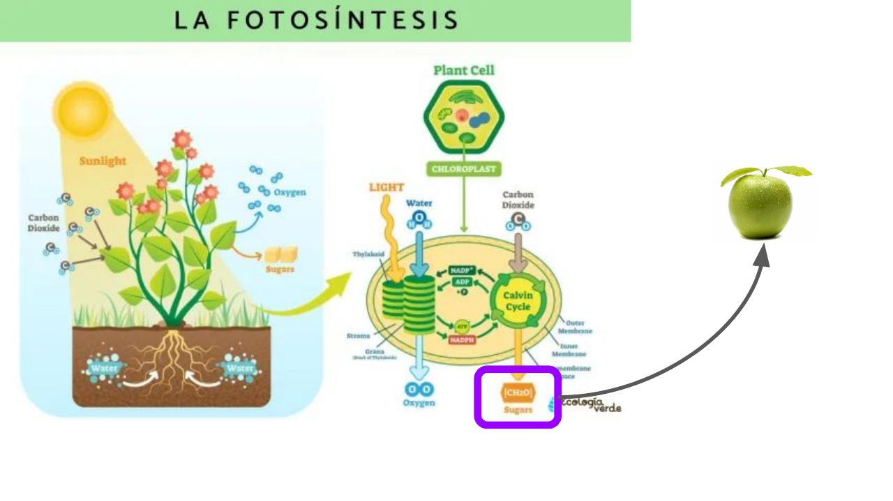
*Slide 5: la fotosíntesis: entran la luz, el agua y el CO₂; salen oxígeno y azúcares, que terminan en la fruta.*

## 2. Economía del carbono: radiación y estomas (00:24:40)

- **Radiación incidente:** la que llega a la superficie de la Tierra en el punto donde estamos. La cobertura vegetal no la aprovecha toda.
- **Radiación interceptada:** la que la planta logra captar. Se busca **maximizar la intercepción**.
  - Hay plantas que disponen las hojas para que la de arriba no sombree a la de abajo.
  - **Plantas muy juntas** se sombrean entre sí, pero ocupan mejor el espacio: llega menos radiación al suelo porque la interceptan las plantas.
  - Es un equilibrio: el productor o el ingeniero decide **cada cuánto plantar o cómo podar** según la intercepción que necesita.
- La radiación interceptada se relaciona con la fotosíntesis, con la fijación de CO₂ y, por lo tanto, con el **crecimiento de la fruta** que se va a cosechar (00:25:59).
- **Estomas (la "regulación estomática" de la slide):** preguntó qué eran y nadie se animó a responder.
  - Son **poros**, casi siempre en el **envés** de la hoja (la cara de abajo).
  - Por ahí se hace el **intercambio gaseoso**: entra el CO₂, que toma una **enzima** (una proteína) para empezar a armar las estructuras de carbono (✎ la RuBisCO).
  - Cuando el poro está **abierto**, difunde agua: la planta **transpira** (00:27:15). Cuando está **cerrado**, no pierde agua, pero tampoco entra CO₂.
  - Es como una **canilla o una válvula**: la planta se cierra si hay **déficit hídrico** o se mantiene abierta, perdiendo agua pero haciendo fotosíntesis.

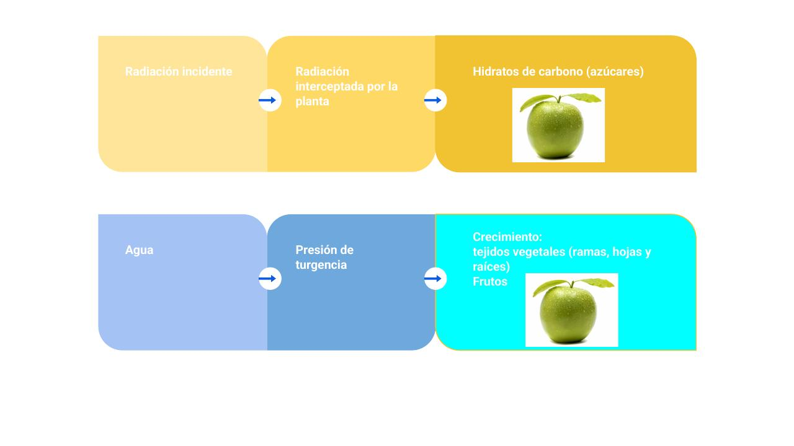
*Slide 6: radiación incidente → radiación interceptada → hidratos de carbono; agua → presión de turgencia → crecimiento de ramas, hojas, raíces y frutos.*

## 3. Economía del agua: turgencia y crecimiento (00:27:15)

- Depende de la **disponibilidad de agua en el suelo**. El agua se mueve del suelo a las raíces por **diferencia de presión (de potencial hídrico)** y circula por el tallo y por las nervaduras de las hojas.
- Si no hay agua en el suelo, la planta tiene mecanismos para **cerrar los estomas anticipándose a la desecación** (00:28:43).
- El agua que usa la fotosíntesis es un porcentaje "despreciable": sin ella no hay fotosíntesis, pero **el crecimiento se detiene mucho antes**.
- **Cómo crece una célula vegetal:** la **pared celular** es como una **caja** que contiene una membrana que es como un **globo**.
  - Con **turgencia**, el globo se infla, presiona la caja y la caja crece.
  - Si falta agua, el globo se desinfla, no presiona y la planta no crece.
- **La primera señal de falta de agua es que se detiene el crecimiento.** Nunca se frena primero la fotosíntesis: el crecimiento es un mecanismo "más grosero, más robusto", y la fotosíntesis se frena mucho después (00:30:02).
- Los dos conceptos sirven para cualquier sistema: el crecimiento de los pastos (ganadería), de las verduras y las raíces (horticultura), de los árboles (forestales) y de las frutas.

## 4. Las plantas sensan el ambiente (00:30:02)

- Las plantas son **sésiles**: una vez que nacieron o que se plantaron, no se pueden mover. ¿Cómo hacen si falta agua o si están a la sombra de otra?
- Tienen un **sistema receptor interno** que sensa (00:31:17):
  - la **calidad de la luz:** no solo si hay luz, sino qué tipo de radiación llega. La luz que atraviesa la hoja de una planta de arriba llega distinta a la de abajo (la slide 7 nombra los **fotorreceptores**);
  - la **intensidad de la luz**;
  - el **largo del día** (fotoperíodo);
  - las **señales hídricas:** falta o exceso de agua.
- Con eso generan respuestas para aclimatarse (o no): ajustes en la fisiología, cambios en la **morfología**, modulación del crecimiento, síntesis de **hormonas** y mensajeros internos.

## 5. Interacción genotipo × ambiente (00:32:36)

- La respuesta al ambiente **no es igual en todas las especies**, ni en todas las **variedades** de una misma especie: hay diferencias entre genotipos, "como si nos comparáramos entre nosotros".
- **El gráfico que explicó:** en el eje X, dos ambientes, uno **restrictivo** y otro **favorable**; en el eje Y, el **rendimiento** de dos genotipos.
  - En el ambiente restrictivo responde mejor el **genotipo B**.
  - En el favorable responde mejor el **genotipo A**.
  - Las respuestas son **diferenciales**: no siempre gana la misma variedad.
- **Definición (slide 8):** el comportamiento diferencial de genotipos a través de condiciones ambientales variables. Es muy importante en el **mejoramiento genético** porque está presente durante la **selección y la recomendación** de variedades.
- **Aplicación (00:34:10):** muchas tesis de "estos posgrados" se hicieron con el **INTA** para identificar **variables predictivas que ayuden a elegir variedades de duraznero**.
  - Se integra información ambiental (precipitaciones, temperaturas, fotoperíodo, heladas, tipo de suelo) o predicciones meteorológicas.
  - Con ese conjunto de variables se decide si conviene implantar el genotipo A, B, C o D. "Se puede traducir en trabajos que ustedes mismos puedan realizar."
- Con esto cerró la parte de fisiología y de **ecofisiología** ("¿ya los maté o siguen vivos?").

## 6. Cultivos intensivos y qué es la fruticultura (00:35:55)

- **Cultivos intensivos (slide 3):**
  - se implantan en **alta densidad** (muchas plantas por unidad de superficie);
  - en superficies relativamente **pequeñas**;
  - buscan **maximizar el rendimiento por hectárea**;
  - requieren **más mano de obra**;
  - el **riego** es clave (la slide aclara "aunque no todos usan");
  - le dan mucha importancia a la **postcosecha**;
  - están muy **tecnificados**.
- **Fruticultura (slide 4):** "la ciencia que estudia el cultivo de especies **leñosas y semileñosas** que producen **frutas**, aplicando **tecnologías basadas en principios biológicos y fisiológicos** y que sean **ambiental, social y económicamente sostenible**".
- **Diferencias con la horticultura:**
  - la horticultura tiene cultivos **herbáceos** de ciclo corto (anuales o bianuales), con rotación rápida y disturbios todo el tiempo para sembrar y cosechar;
  - la fruticultura tiene cultivos **leñosos**: estructuras **permanentes** que pueden ocupar el mismo lugar **20, 30 o 100 años**;
  - **baja frecuencia de disturbios:** al plantar hay un gran movimiento de tierra, pero después el agroecosistema puede entrar en cierto **equilibrio**;
  - necesita **mano de obra permanente**, de intensidad media (00:37:50);
  - tiene una **demanda de insumos externos** importante, según cómo se plantee el agroecosistema.

## 7. La fruticultura en Argentina (00:37:50)

- Ocupa **algo así como 500.000 ha**: la slide 15 dice **514.701 ha**, el **1,4 % de la superficie agrícola** (CNA 2018).
- Es una porción chica, pero **muy importante para las economías regionales**, y está en casi todas las provincias (según la slide, hay **22 provincias productoras**).
- **Las más importantes:** Mendoza, San Juan, Tucumán, Entre Ríos y Río Negro.
- **La slide 17**, que no se leyó entera, agrega que la fruticultura **genera empleo** e integra una cadena larga: plantas en **vivero** → **cultivo** (operarios capacitados en poda, riego y cosecha) → **plantas empacadoras** → distribución a los **mercados concentradores** o a la **industrialización secundaria** (vino, jugos, dulces, aceites).
- **Qué se cultiva**, de mayor a menor superficie:
  1. **Vid**.
  2. **Cítricos:** limón, mandarina, pomelo y naranja.
  3. **Olivo**.
  4. **Frutales de pepita:** manzana, pera y membrillo.
  5. **Frutales de carozo:** ciruela y durazno, principalmente.
  6. **Frutos secos:** una porción menor pero creciente, de la mano del **pecán** y del **pistacho**.
  7. **Tropicales:** sobre todo en el norte, como la banana y el ananá (00:39:11).

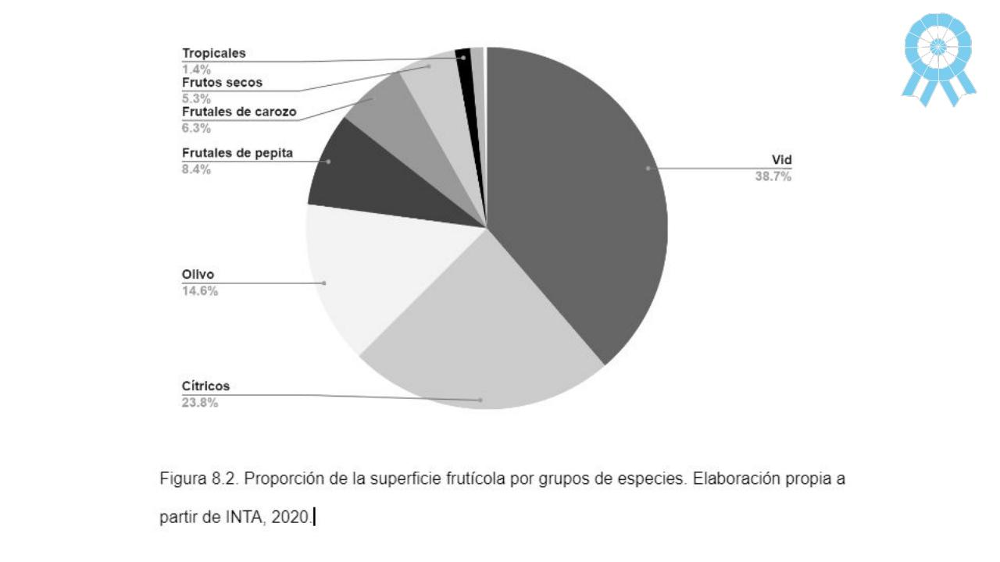
*Slide 19: proporción de la superficie frutícola por grupo de especies (INTA, 2020): vid 38,7 %, cítricos 23,8 %, olivo 14,6 %, pepita 8,4 %, carozo 6,3 %, frutos secos 5,3 % y tropicales 1,4 %.*

## 8. Vid (00:39:11)

- Es el **principal cultivo frutícola** del país. Hay plantaciones en muchas provincias y la viticultura **todavía se expande**: ya hay algo en **Entre Ríos** y en **Buenos Aires**.
- La provincia más importante es **Mendoza**, que también es muy importante para la fruticultura en general.
- **El mapa de la slide 20** marca seis zonas: **Noroeste** (1: Salta y Tucumán; 2: Catamarca y La Rioja), **Centro-Oeste** (3: San Juan; 4: Mendoza), **Sur** (5: Neuquén y Río Negro) y **otras** (6: Córdoba).

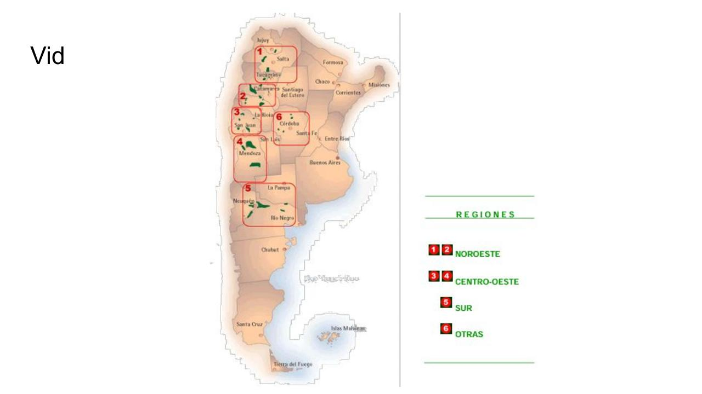
*Slide 20: las regiones vitícolas: Noroeste (1 y 2), Centro-Oeste (3 y 4), Sur (5) y otras (6).*

- **La tracciona el vino**, que requiere un **proceso industrial** que emplea a mucha gente (00:40:45).
  - Hay **casi 900 bodegas**; la slide dice **883**.
  - Es un proceso controlado y mediado por tecnología: la **fermentación**, las reacciones y el estado de maduración y el manejo de la uva para lograr una materia prima de calidad.
  - Según la slide 21, la uva se **prensa** en la bodega para obtener el **mosto**, que se vinifica (**fermentación alcohólica**). Esas reacciones y las **variedades o cepas** (que aportan aroma, sabor y textura) le dan el "carácter" al vino.
- **No es solo vino:** Argentina también es importante en **pasas de uva** y en **uva de mesa**.
- **215.000 ha** (slide 22). Distintos cultivares → distintos manejos y grados de tecnificación.
- **Variedad insignia:** la docente preguntó y Gabriel Quiroga respondió: **Malbec**.
- Se cultivan muchas variedades y se eligen **genotipos adaptados** a cada lugar (la interacción genotipo × ambiente): hay viñedos **hasta en la Patagonia** y también en **Salta** (00:42:33).

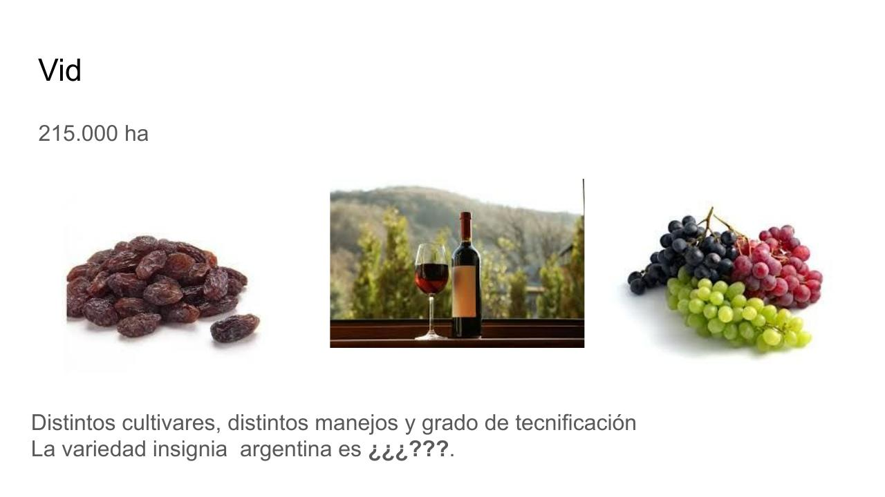
*Slide 22: vid, 215.000 ha: pasas, vino y uva de mesa. "La variedad insignia argentina es ¿¿¿???".*

**Dos sistemas de vid (00:42:33)**
- **Arriba, una zona árida de La Rioja:**
  - riego por **acequias**: canales con compuertas que se van abriendo; no tiene riego por goteo;
  - **sistema de conducción en parral**: la planta forma un "techito". El sistema de conducción es **cómo se podan y se sostienen las plantas**;
  - lo llamó **secano** porque no tiene riego por goteo (00:43:48). ✎ En sentido estricto, secano es sin riego.
- **Abajo, una zona húmeda**, con otras variedades:
  - **espaldera**: parece un arbolito, pero la vid no lo es; necesita un **sostén** de alambres, al que se van enganchando las plantas;
  - aunque es zona húmeda, tiene **riego por goteo**: los caños negros van por el piso, debajo del pasto.

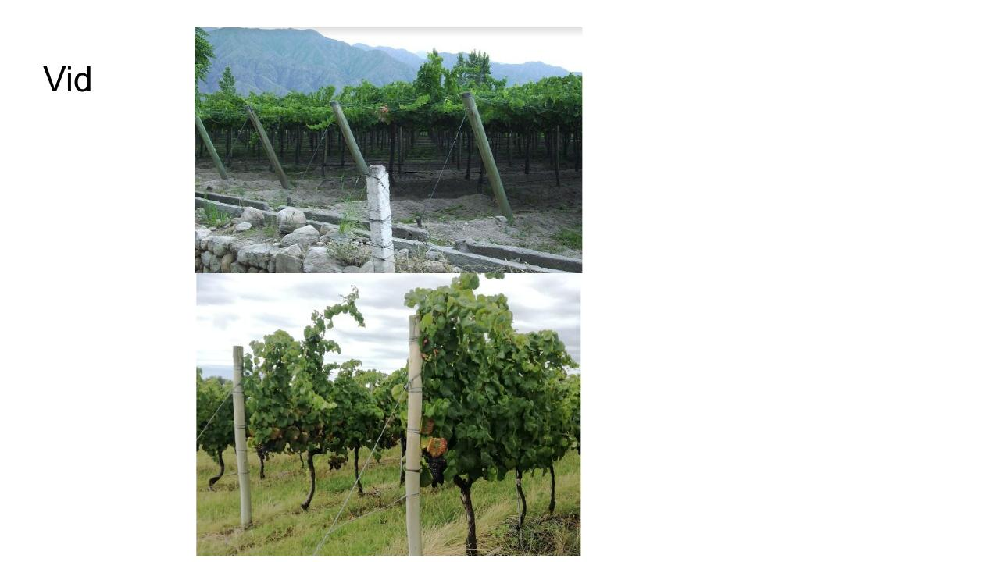
*Slide 23: arriba, un parral en zona árida con su canal de riego; abajo, una espaldera en zona húmeda.*

## 9. Cítricos (00:43:48)

- A diferencia de la vid, que llega a la Patagonia, los cítricos llegan al sur **hasta San Pedro** (Buenos Aires) a nivel productivo, con **naranja** y algo de **mandarina**. Una planta en el jardín de casa "es otra historia".
- El **pomelo** va más al norte porque es más **sensible al frío**.
- El **limón** está en la provincia de **Tucumán** (00:45:09). Argentina siempre está "en el ranking del segundo lugar" como exportadora.
  - Leyendo un comentario (parece que del chat), dijo que Tucumán es "la cabeza" y que aporta el **30 % de la producción mundial**: "somos realmente importantes". El audio es confuso y el dato no está en las slides.
- **Se aprovecha todo** (00:45:09):
  - en el campo, el cultivo y la cosecha;
  - en la **planta de empaque**, la selección y el acondicionamiento de la fruta;
  - en la **industria**, los **jugos** y las **cáscaras**, para frutas **abrillantadas** (las del pan dulce) o para la industria de las **esencias** (00:46:32);
  - el jugo se vende envasado (jugo puro) o a las **grandes compañías de gaseosas**, que hacen sus juguitos con un porcentaje muy chico de concentrado.

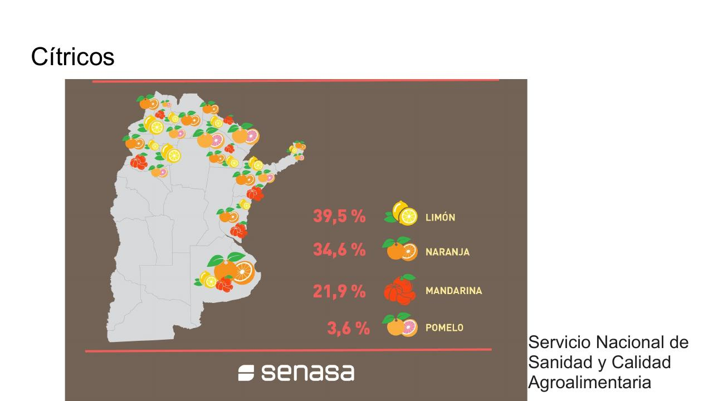
*Slide 24: distribución de los cítricos (SENASA): limón 39,5 %, naranja 34,6 %, mandarina 21,9 % y pomelo 3,6 %. La slide no aclara si es superficie o producción.*

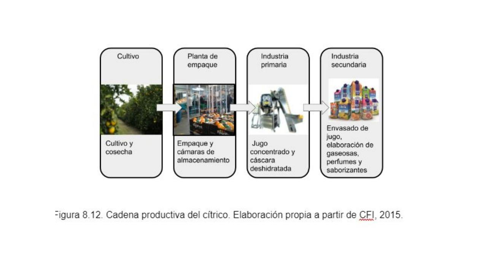
*Slide 25: la cadena productiva del cítrico (CFI, 2015): cultivo y cosecha → empaque y cámaras de almacenamiento → industria primaria (jugo concentrado y cáscara deshidratada) → industria secundaria (envasado de jugo, gaseosas, perfumes y saborizantes).*

**El limón en el mundo (slide 26, 00:46:32)**
- Es la **segunda fruta más exportada** de Argentina, **después de la pera** (32 % y 38 % de las exportaciones de fruta). El orden va cambiando según el año y los mercados que se consigan.
- **2.º exportador mundial de limón fresco.**
- **4.º productor mundial de aceite esencial de limón.**
- **1.º exportador mundial de esencia y jugo de limón.**
- **Destinos:** España, Rusia, Holanda e Italia, el **58 %** de las ventas de cítricos al exterior.

## 10. Olivo (00:46:32)

- Se da en **zonas áridas**: sobre todo en **Cuyo** y en el **Noroeste**, y un poco en Buenos Aires y en la Patagonia. La mayor concentración está en el **NOA y Cuyo**.
- **Casi 85.000 ha** hoy (00:48:18).
- **Mapa de la slide 27** (superficie implantada en 2016): **La Rioja 29 %**, **Mendoza 24 %**, **San Juan 21 %**, **Catamarca 18 %**, Córdoba 6 %, Buenos Aires 2 % y Río Negro 1 %.

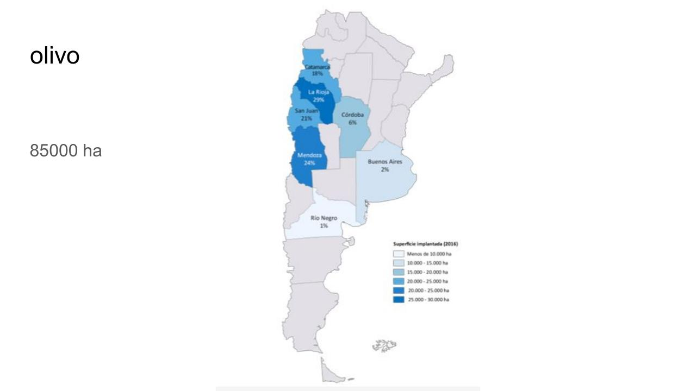
*Slide 27: olivo, 85.000 ha: la superficie implantada por provincia en 2016.*

- **Hay muchas variedades**, con distintos sabores y características, que le aportan distintas tonalidades y propiedades fisicoquímicas al aceite.
- **Aceituna de mesa:** se priorizan variedades para ese destino. La aceituna para **rellenar** tiene que ser **pareja** y **redondeada en la base**, para que el **descarozador mecánico** no la rompa.
- **Arbequina** (00:49:52): la segunda de la fila de arriba de la slide 28, chiquita, redonda y negra.
  - Es la **más implantada en Argentina en los últimos 30 años**.
  - Da un aceite **muy suave**. Son "pelotitas bien aceitosas", buenas para aceite, aunque a veces no de tan buena calidad.
  - **No sirve para mesa.**

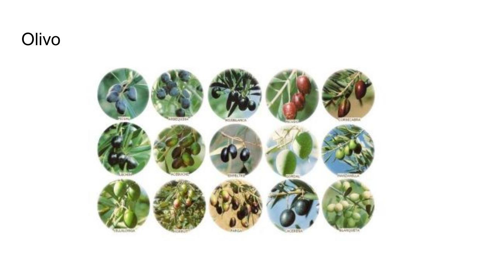
*Slide 28: quince variedades de olivo: Picual, Arbequina, Hojiblanca, Picudo, Cornicabra, Lechín, Acebuche, Empeltre, Gordal, Manzanilla, Villalonga, Morrut, Farga, Cacereña y Blanqueta.*

- **Olivo cuatricentenario:** hay muchos olivos viejos en Mendoza y en La Rioja, con leyendas de **más de 400 años**. Muestran cuánto tiempo puede quedarse la fruticultura en un lugar. ✎ El más conocido es el de Aimogasta (departamento Arauco, La Rioja), del que toma el nombre la variedad.
- **Arauco, el cultivar nacional:**
  - **fruto grande** y carnoso;
  - la punta está **inclinada hacia el costado**, "como el sombrerito de los pitufos", y eso **impide el descarozado mecánico** (00:51:09);
  - su aceite puro es **amarguito y un poco picante**;
  - muchas veces es la aceituna grandota que se vende en las verdulerías, en baldes.
- **Varietales y blends:** como en el vino, hay aceites varietales y mezclas. Conviene comprar **extra virgen**, que asegura mejor calidad y un sabor sin alterar.

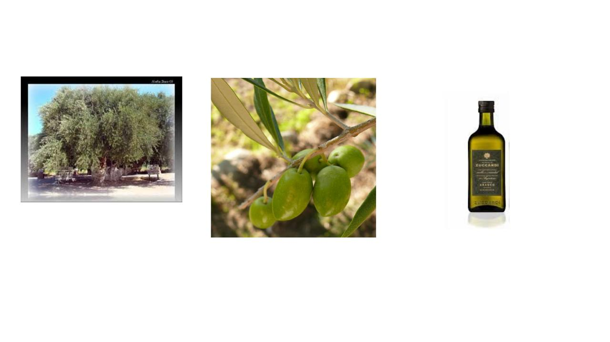
*Slide 29: un olivo cuatricentenario, frutos de Arauco y un aceite de esa variedad.*

## 11. Frutales de pepita: manzana y pera (00:51:09)

- Están mucho más **sectorizados**: el **valle del Río Negro** (Alto Valle, Valle Medio y Valle Inferior) y **Mendoza** (00:52:40).
- **Manzana y pera comparten las zonas** porque tienen requerimientos parecidos, al menos los cultivares que se manejan en Argentina.
- En Brasil y Uruguay se usan cultivares que se adaptan a zonas con **menos frío y más humedad**.

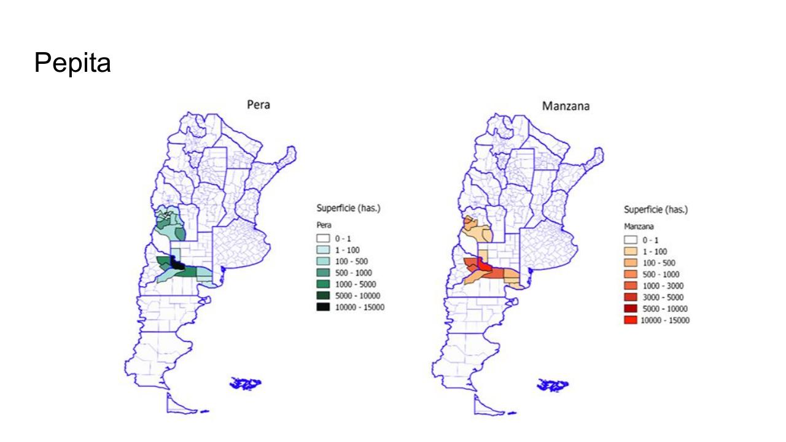
*Slide 31: superficie de pera y de manzana por departamento: la mayor concentración (10.000 a 15.000 ha) está en el Alto Valle de Río Negro y Neuquén, seguida por Mendoza.*

**Manzanas (slide 32)**
- No todas son rojas: está la **verde**, "que todos conocemos" (✎ la Granny Smith).
- Muchas no tienen el rojo parejo: **Fuji**, **Gala** y **Pink Lady**. Las "pink" son un grupo de manzanas rosadas, de otro gusto y **bien crocantes**.
- **La más buscada en Argentina es la Red Delicious** (00:54:06). Las otras se trajeron para cubrir nichos.
- **La Gala** tiene un fondo amarillento. Como la gente busca la manzana roja, cuando encuentra una Gala piensa que es una Red Delicious de menor calidad.

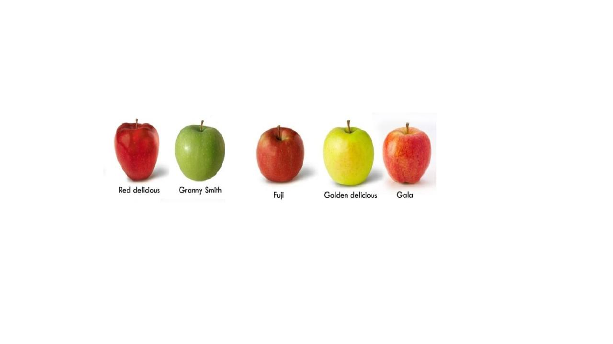
*Slide 32: Red Delicious, Granny Smith, Fuji, Golden Delicious y Gala.*

**Una sola cosecha y manzanas todo el año**
- En casi todas estas especies hay **una única cosecha anual**. En manzana va de **diciembre** (las variedades más tempranas) a **abril** (las más tardías).
- ¿Por qué hay manzanas en noviembre? **Son de cámaras** (00:55:26). La **postcosecha** y las estrategias de **almacenamiento** permiten **diferir el consumo**, y hay mucha investigación y tecnología para alargar la vida postcosecha con calidad.

**Peras (slide 33)**
- Nos gusta la **Williams**: es la que nos imaginamos al dibujar una pera.
- Hay muchas otras: una **rojita** no es una Williams pintada, y una **alargada** no está deformada: son otras variedades. La slide muestra Red Williams, Forelle, D'Anjou, Abate Fetel, Rocha, Packham's Triumph, Golden Russet Bosc y Red Anjou.
- **Argentina es el principal exportador mundial de peras frescas.** Destinos: **Brasil y Rusia** (00:56:41).
  - **Rusia** compra mucho, también cítricos.
  - **Brasil** es el principal socio comercial del agro argentino en general.

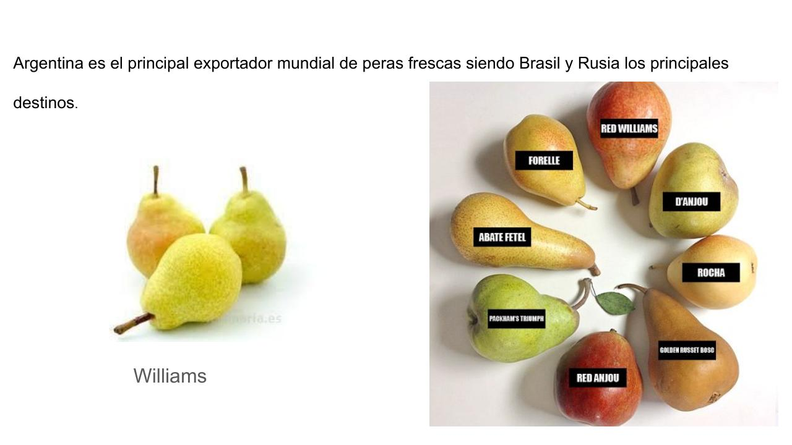
*Slide 33: Argentina es el principal exportador mundial de peras frescas. La Williams y otras ocho variedades.*

## 12. Frutales de carozo: durazno y ciruela (00:56:41)

- Están **más distribuidos**: el norte de Buenos Aires, los valles (Río Negro), Mendoza, San Juan y La Rioja.
- **Mendoza es el más importante:** según la slide, tiene el **84 %** de la superficie (Buenos Aires 6 %, Río Negro 5 %, San Juan 4 % y Neuquén 1 %).
- Además del durazno y la ciruela en fresco, Mendoza tiene **industria**: durazno y ciruela **enlatados** y **ciruela pasa** (00:58:05).

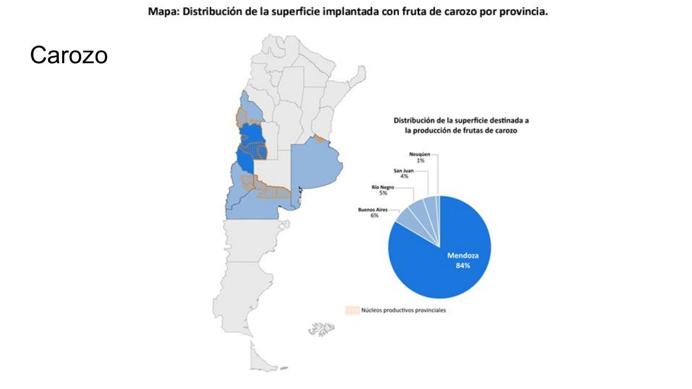
*Slide 35: superficie de carozo por provincia: Mendoza 84 %, Buenos Aires 6 %, Río Negro 5 %, San Juan 4 % y Neuquén 1 %.*

**Duraznos**
- Tienen una **vida postcosecha corta**, así que hay **muchas variedades** para ir cubriendo "ventanitas" del verano: desde antes de las fiestas hasta febrero, más o menos.
- **Pulpa roja:** el consumidor no la acepta mucho. "Puede haber trabajos vinculados a entender cómo medir" ese rojo en la pulpa.
- Cambian la punta (más o menos puntiaguda), la forma y el **color de la piel**. Como están poco tiempo en el mercado cuesta distinguirlos, salvo el **durazno chato**, que es muy llamativo.
- **La slide 36** muestra cuatro variedades: Elegant Lady (vida útil larga y carozo fácil de sacar), Flavorcrest (de las más populares), Sweet September (tardía, muy dulce y firme) y O'Henry (grande, de pulpa amarilla con rojo alrededor del carozo).

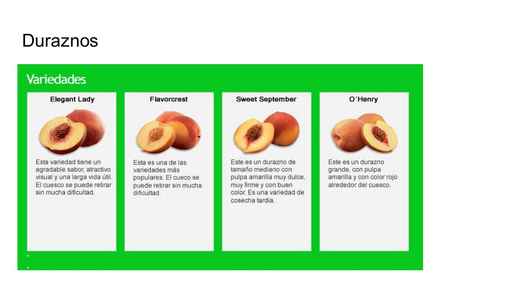
*Slide 36: cuatro variedades de durazno: Elegant Lady, Flavorcrest, Sweet September y O'Henry.*

**Ciruelas**
- Que hay variedades es obvio: la **amarilla** y la **remolacha**, de pulpa roja.
- Además tienen **destinos productivos distintos**: pasas, consumo en fresco o mermeladas (00:59:27).
- **La slide 37:** **Remolacha** (fruto grande, piel borravino, pulpa roja oscura), **Gota de oro** (amarilla y jugosa), **Cristal** (amarilla, más chica y de pulpa firme) y **Santa Rosa** (pulpa suave, muy jugosa, dulce y algo ácida).

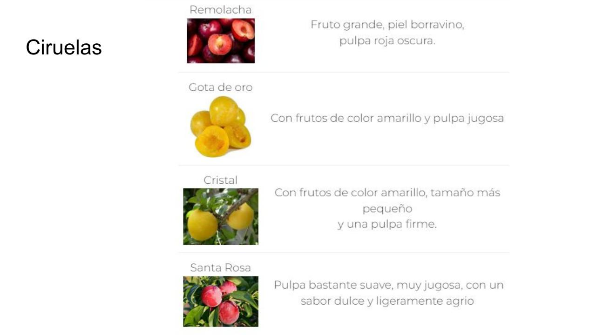
*Slide 37: variedades de ciruela: Remolacha, Gota de oro, Cristal y Santa Rosa.*

## 13. Ciclo productivo anual de los frutales (00:59:27)

- Lo pasó "medio rapidón": a diferencia de las hortalizas, el ciclo de los frutales **se repite año a año** siguiendo una **secuencia fenológica**.
- **Slide 38:** las especies frutales perennes tienen una fase **juvenil** y una **productiva**. Superada la juvenil, adquieren la **capacidad de florecer**. Cada año ocurren eventos sincronizados con las estaciones: el **ciclo anual**. Conocerlo permite ajustar las prácticas (poda, cosecha, fertilización, riego) a criterios fisiológicos: la **fenología del cultivo**.

**Otoño**
- La planta sensa el ambiente y **baja su crecimiento vegetativo**.
- Las hojas cambian de color (de verde a amarillo o naranja): los **pigmentos se degradan** y los **nutrientes se recirculan** hacia los órganos permanentes, como las ramas y las raíces (01:01:07).
- Las **yemas**, los puntos desde donde crece la planta, **detienen su crecimiento**.
- **Se caen las hojas**, salvo en los **cítricos** y el **olivo**.
- **La señal:** el **acortamiento del fotoperíodo**, junto con la **baja de temperatura**.
  - El largo del día es una **señal segura**.
  - La temperatura **no es tan buen predictor**: puede haber "veranitos" o "inviernitos" que confundan a la planta. Por eso las plantas tienen mecanismos acoplados.

**Invierno**
- Sin hojas, en las yemas se van **cuantificando las horas de frío** (01:02:21). Cuando acumulan suficiente frío, cambian y pueden brotar.
- Es una estrategia para sobrevivir: **no brotar con el primer veranito** del invierno.
- Permite implantar especies o variedades en **zonas muy frías**, donde todo lo que brota en invierno se congela y se muere.

**Primavera**
- Suben las temperaturas, la yema sale de la **dormición** y hay **brotación** de flores y de hojas.
- **La parte crítica (01:03:42): las flores son las que dan los frutos.**
  - El **ovario** es lo que entendemos como la **parte carnosa** del fruto.
  - Los **óvulos** se transforman en **semillas**.
  - La primavera es clave: están la flor y las primeras etapas del fruto, que en la mayoría de los casos sigue creciendo en verano.
- Casi siempre, para que la flor se transforme en fruto tiene que estar **polinizada y fecundada**: el óvulo fecundado forma un **embrión**, que genera las **señales hormonales** para que se desarrolle el fruto.
  - **Kiwi (01:05:08):** tiene muchas semillitas. Mucho polen → muchas semillas → kiwis más grandes. Hay empresas que **juntan polen y lo venden en frasquitos**, que se dispersa a mano o con distintas herramientas.
  - **Partenocárpicos:** frutos **sin semilla**, como las naranjas o las uvas sin semilla. Se logran con **hormonas exógenas** que aplica el productor o con **variedades** que forman fruto aunque no haya polinización.

**Verano:** sigue el crecimiento del fruto y llega la maduración (slide 39).

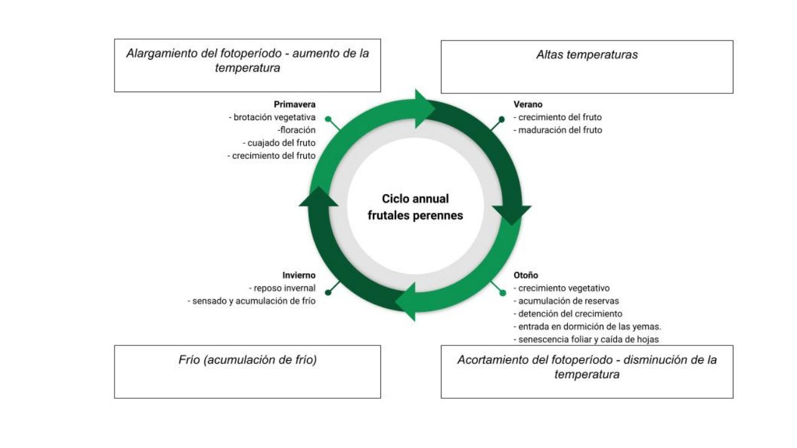
*Slide 39: el ciclo anual de los frutales perennes, con la señal de cada estación: el alargamiento del fotoperíodo y el aumento de temperatura (primavera), las altas temperaturas (verano), el acortamiento del fotoperíodo y la baja de temperatura (otoño) y la acumulación de frío (invierno).*

**Las prácticas siguen el ciclo (01:06:27)**
- No se poda en cualquier momento: los frutales se podan en forma **anual o bianual**, con la planta **en reposo** (dijo "en el otoño"; ✎ la poda suele hacerse en el reposo invernal).
- La **cosecha** es en **verano**.
- **Raleo de flores:** un arbolito chico con muchas flores polinizadas da muchos frutitos chiquitos, y el productor no los quiere. Se arrancan flores para dejar **pocos frutos ubicados estratégicamente**, que crecen más y se pagan mejor.

**Escalas fenológicas (01:07:37)**
- Los esquemas de la slide 40 son una escala de estadios del **manzano** (✎ la de Fleckinger).
- **La yema:** si se la parte, se ven los **primordios**, hojitas bebé enrolladas "como un repollo". "El repollo es una yema gigante."
  - La **yema vegetativa** da hojas.
  - La **yema floral** da flores.
- Al salir del invierno, con las horas de frío acumuladas, la yema se empieza a abrir.
- **Heladas:** en el estadio **D** ya empiezan a hacer daño; en el **E**, más; y en **floración** se pone en riesgo la producción: "si se queman los frutos, ya no va a haber fruta ese año" (01:08:47).

| Estadio | Qué se ve |
|---|---|
| A | Yema de invierno |
| B | Comienza a hincharse |
| C – C3 | Yema hinchada |
| D | Aparición de los botones florales |
| E – E2 | Los sépalos dejan ver los pétalos |
| F | Primera flor |
| F2 | Plena floración |
| G | Caída de los primeros pétalos |
| H | Caída de los últimos pétalos |
| I | Cuajado del fruto |
| J | Engrosamiento del fruto |

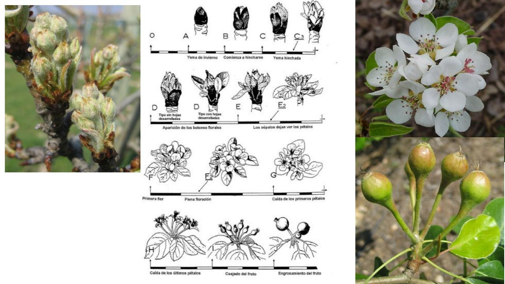
*Slide 40: la escala fenológica del manzano, de la yema de invierno (A) al engrosamiento del fruto (J), con fotos de yemas, flores y frutitos.*

## 14. Prácticas de manejo: poda, cosecha y riego (01:08:47)

Son prácticas que se pueden hacer a mano o asistidas, cada una con sus ventajas y desventajas.

**Poda**
- Se hace en todos los frutales, en forma **anual o bianual**.
- **Manual:** el operario **elige qué rama sacar**. No todas las ramas tienen la misma relevancia, y con la poda se le da forma a la **arquitectura del árbol**.
- **Mecánica (01:10:24):** llegó con las plantaciones **intensivas y superintensivas**, con las plantas más juntas.
  - Tractores con implementos de **cuchillas** que cortan "**como si fuese una pared**".
  - **No es selectiva:** corta todo por igual y deja plantaciones **uniformes**. Para algunos cultivos funciona y se está adoptando; para otros, todavía no.
  - Un operario podando **sale caro y tarda mucho**; la máquina es "una pasadita de tractor por cada fila". Lo que pierde por no ser selectiva lo compensa por otro lado.
  - Se está tratando de desarrollar **artefactos** para podar de forma más selectiva.

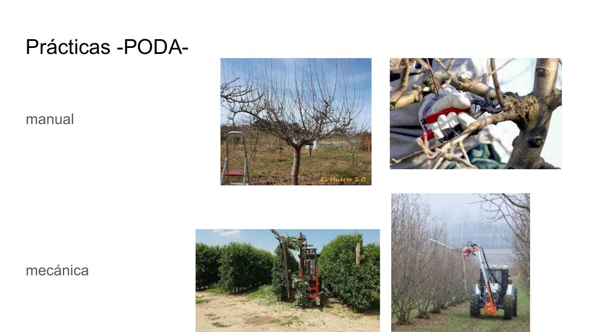
*Slide 41: poda manual y mecánica.*

**Cosecha**
- En los últimos años **tiende a mecanizarse**; antes era siempre manual.
- **Manual:** en la slide, una cosecha de cítricos o duraznos y otra de **arándanos**, mucho más sensibles, que se ponen en canastitos con mucha suavidad.
- **Mecanizada (01:11:58):**
  - **Cabalgantes** (en olivo): van montadas sobre la fila y, con unos cepillos que giran adentro, golpean las ramas para que caiga la fruta, que se junta sola en contenedores.
  - **Vibrador (shaker)** con un "**paraguas invertido**": agarra el tronco y lo **vibra a frecuencias muy altas**; la fruta cae en el paraguas y se vuelca a un **bin** (una caja grande). **Es el más usado** en la fruticultura en general.

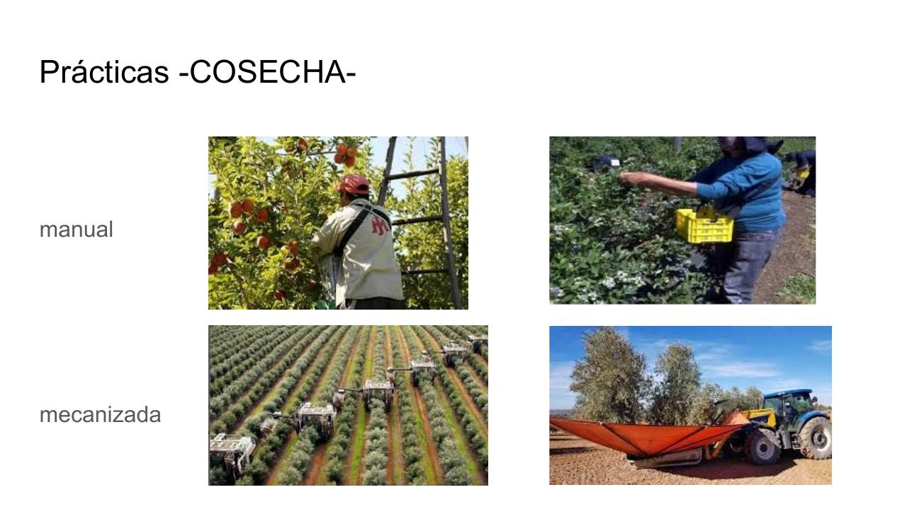
*Slide 42: cosecha manual (manzanas y arándanos) y mecanizada (una cabalgante en un olivar y un vibrador con paraguas invertido).*

**Riego (01:13:28)**
- Cada vez es más **preciso y tecnificado**. Es fundamental porque **más del 90 % del órgano que se cosecha es agua**, tanto en horti como en fruti.
- **Superficial (por acequia):** se riega **cuando toca el turno de agua**, no cuando la planta lo necesita, y se **desperdicia** muchísima agua, que se evapora y no llega directo a las raíces.
- **Goteo:** cintas con **goteros** de distintos **litros por hora**, que permiten **dosificar** cuánto recibe cada planta y humedecer solo alrededor de ella (01:14:52).
- **Fertirriego:** por la misma cañería se pueden conducir **fertilizantes**.
- **Automatización:** hay **sensores de humedad del suelo** que automatizan el riego según la humedad que miden, y sistemas acoplados a **estaciones meteorológicas** que deciden no regar (✎ por ejemplo, si va a llover). "Está más cerca de lo que están estudiando."

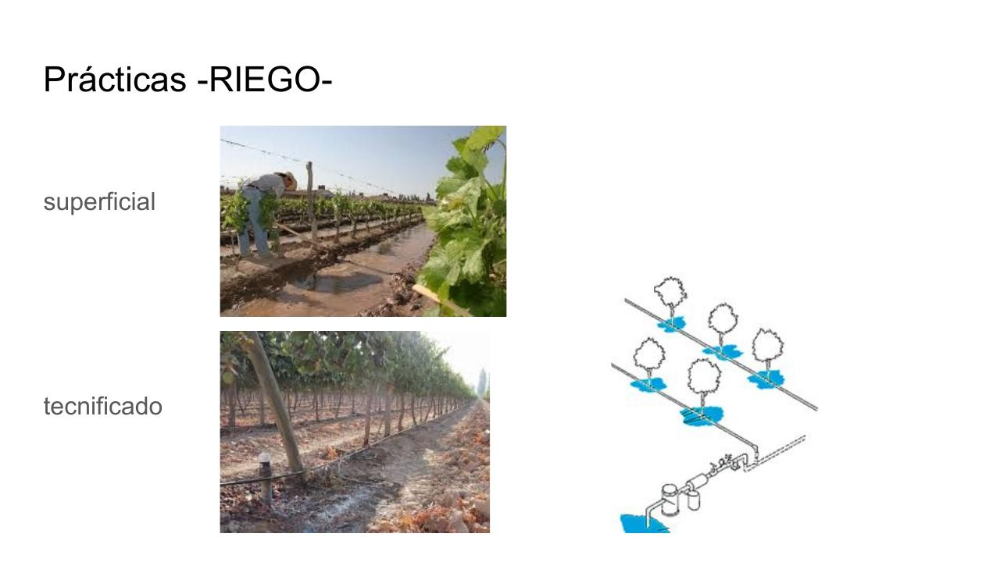
*Slide 43: riego superficial y tecnificado (goteo), con un esquema del goteo y su cabezal.*

## 15. Maduración: climatéricas y no climatéricas (01:14:52)

- La postcosecha es muy importante en fruticultura.
- **Hay frutas que se cosechan maduras**, en el punto en que se comercializan, como los **cítricos**: hay que conservar ese mismo sabor.
- **Otras se pueden cosechar medio verdes** y madurar durante la comercialización, que no es instantánea (01:16:20). Son las **climatéricas**: **producen etileno y responden a él**, el gas que se vio la clase pasada con los tomates.
- **Slide 45:** la maduración es el conjunto de procesos de las últimas etapas de crecimiento y desarrollo del fruto que generan cambios físico-químicos y cambian sus **cualidades organolépticas**. Muestra **bananas y paltas**.
- **El truco de la palta:** si compraron una palta "que es un cascote", pónganla con una **banana, envueltas en papel de diario**. El etileno de la banana dispara la síntesis de etileno de la palta y desencadena su maduración.
- **El riesgo:** alcanza con que una fruta empiece a producir etileno (porque **se machucó**, la **golpearon** o le **entró un bicho**). La vecina empieza a producir etileno, los receptores se activan y sintetizan más: un **efecto exponencial**, y toda la fruta empieza a madurar (01:17:46).
- **La maduración** cambia el **color**, **ablanda** los tejidos y cambia el **sabor**. La fruta se debería consumir madura.

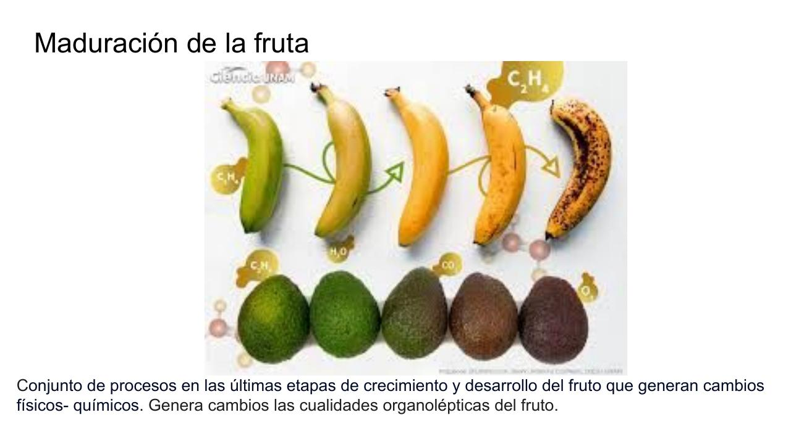
*Slide 45: la maduración de la banana y de la palta, mediada por el etileno (C₂H₄).*

**Climatéricas (slide 46):** banana, manzana, pera, arándano, durazno, pelón, ciruela y kiwi, además de la palta. En el supermercado o la verdulería **no deberían estar juntas**, para que no se activen la maduración unas a otras.

**No climatéricas (01:19:13):** cítricos, uva y cereza.
- Como se cosechan, así se mantienen: **no hay cambios de maduración** de la planta a la mesa.
- Sí puede haber **senescencia**: se deseca la piel o se pudren, porque la fruta **sigue respirando** y consume sus hidratos de carbono a nivel basal, pero sin picos de etileno.

**El gráfico (slide 47)**
- **No climatéricas** (azul, "las más fáciles"): la **respiración baja** hasta un nivel basal y el **etileno es muy bajo y constante**.
- **Climatéricas** (rojo): **sube la síntesis de etileno** y, cerca del máximo, hay un **pico en la tasa respiratoria** (01:20:51).
- En ese pico la fruta consume hidratos de carbono (**respiración celular**): "se está consumiendo ella misma" para producir etileno.
- **Lo que hay que llevarse:** para que la fruta dure hay que **controlar el pico de etileno o la respiración**, que se mueven en conjunto. Y una fruta puede afectar a sus vecinas si **comparten atmósfera**.

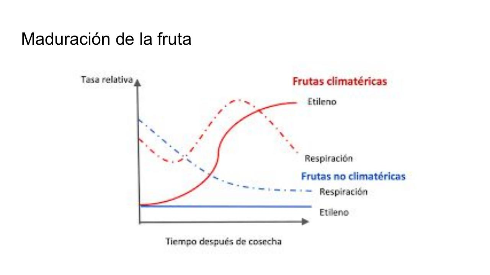
*Slide 47: la tasa de respiración y la de etileno después de la cosecha, en frutas climatéricas (rojo) y no climatéricas (azul).*

## 16. Empaque y almacenamiento (01:20:51)

**Planta de empaque**
- Apenas llega la fruta del campo se **lava**, se **acondiciona** y se **selecciona por tamaño**.
- En la foto hay operarias seleccionando, pero se puede reemplazar por **visión**: saber si la fruta está **deformada** o **manchada** (01:22:11).
- **Es crítico para exportar:** hay mercados que, si detectan una naranja con cierta enfermedad, **cierran el mercado de exportación entero**. El ojo humano se puede equivocar, así que conviene **confirmar con una clasificación robótica** después de la humana, para detectar y sacar las fallas.
- Se clasifica por **tamaño**: no todos los tamaños van al mismo destino.
- Se impregna la fruta con **fungicidas** y con **ceras** que la protegen de la **desecación**.
- En Argentina son plantas con un **gran volumen** de fruta circulando todo el tiempo.

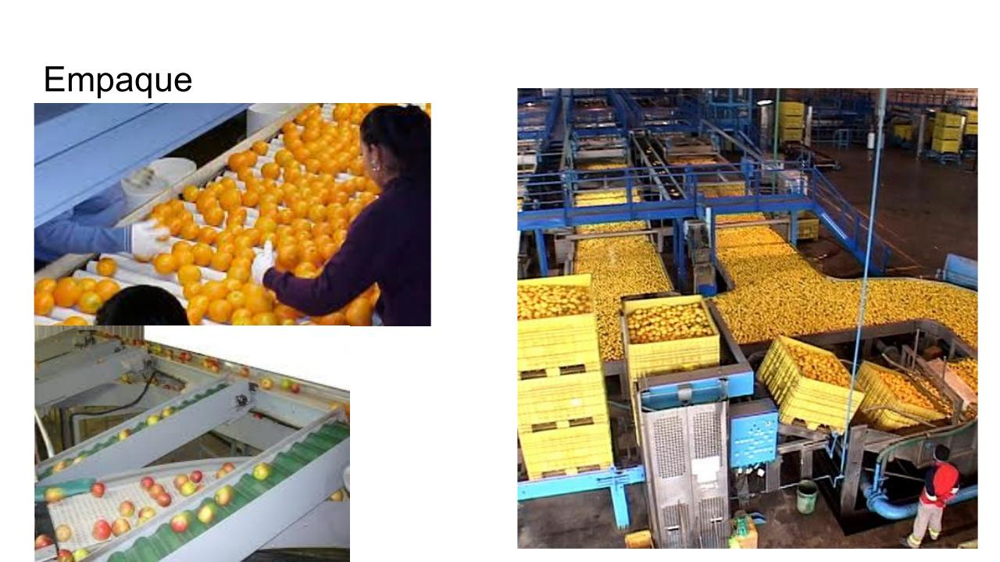
*Slide 48: la planta de empaque: selección manual, cintas y volcado de bins.*

**Almacenamiento (01:22:11)**
- Es crítico porque tiene que **aguantar la fruta**: la manzana cosechada en **marzo** tiene que llegar hasta **diciembre** (01:23:49).
- **La primera medida:** **cámaras** que bajan la temperatura.
- **Atmósfera controlada (AC):** se cambian las proporciones de **oxígeno y CO₂** para que baje la **tasa respiratoria**.
  - Según la slide 49, son cámaras de refrigeración con una atmósfera **pobre en O₂ y más rica en CO₂**, estrictamente controlada durante todo el almacenamiento y ajustada a cada producto con **nitrógeno**, **absorbedores de CO₂ y de etileno**, y control de **temperatura, humedad relativa y circulación del aire**.
- Se ponen **absorbedores** para retener el etileno y bajar la tasa de maduración.
- **Frío, humedad y circulación de aire:** para que no quede retenido el etileno y para que no haya **podredumbres**, porque los hongos "están esperando" lugares húmedos.
- **Por dentro (01:25:22):** la foto muestra una cámara con sectores vacíos, pero suelen estar **a tope**.
- **El esquema:** el **nitrógeno** compite con el oxígeno: se inyecta para que haya menos O₂ disponible y baje la respiración.

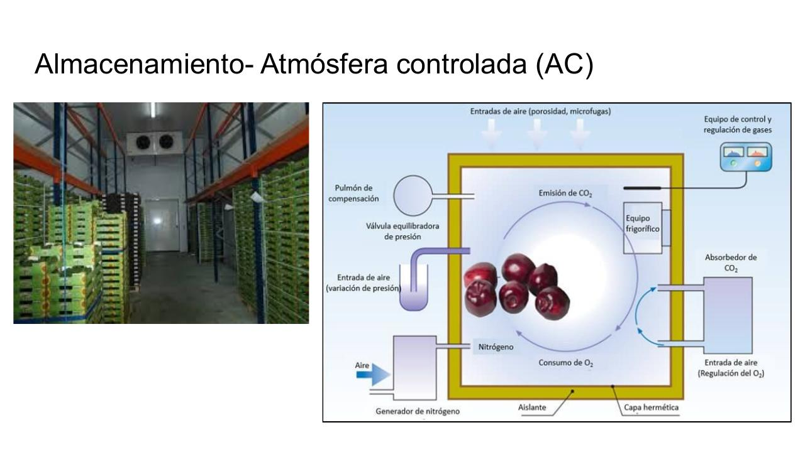
*Slide 50: una cámara de atmósfera controlada por dentro y su esquema: generador de nitrógeno, absorbedor de CO₂, equipo frigorífico, válvula equilibradora de presión, pulmón de compensación y capa hermética.*

**1-MCP**
- Es una molécula que **ocupa el lugar del etileno** en el receptor. La fruta "agarra" el 1-MCP en vez del etileno, ese receptor ya no lo puede ocupar otra molécula y **no se sintetiza más etileno** (01:27:02).
- En las climatéricas la **maduración es más lenta**. Se usa.

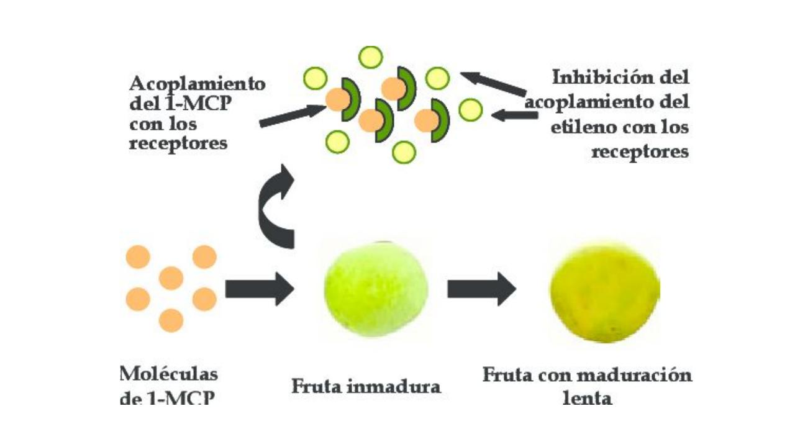
*Slide 52: el 1-MCP se acopla a los receptores e inhibe el acoplamiento del etileno: la fruta inmadura madura más lento.*

## 17. Intercambio: robots para la cosecha (01:27:02)

- La docente pidió comentarios: "este grupo es muy callado", quizás por el fin de año.
- **Gonzalo Cuervo**, de Mendoza, tiene proyectos de **visión por computadora para la cosecha de manzana** (01:28:21).
  - En las mismas hileras que se mecanizan con tractor, la gente cosecha a mano montada en una especie de andamio: la **plataforma de cosecha** (el nombre lo dio la docente).
  - Van dos personas arriba y una manejando a **3 km/h**: "el que va manejando literalmente va tomando mate".
  - **Su idea:** que la plataforma **se maneje sola**.
  - Más adelante (01:29:40): sumarle un **brazo robótico simple, de dos grados de libertad**, con visión y una **red neuronal chica** que vea si la manzana está madura, para sacar solo las que están bien.
  - El proyecto es de hace unos **3 años** y quedó parado: "no hay muchas ganas de invertir" (01:30:49).
- **Georgina:**
  - Uno de los desarrollos recientes son los **drones cosechadores**, "drones pulpo" con bracitos mecánicos que detectan y cosechan la fruta. **Son lentos, pero pueden trabajar de noche.** Por acá nadie los tiene todavía.
  - En los rubros en que ella se mueve hay una **fuerte necesidad de mecanizar la cosecha**: vienen **cuadrillas** de cosecheros temporarios, a veces de otras provincias, y es "una revolución dentro de las quintas". Reemplazarlas les interesa a los productores, "al menos desde lo discursivo".
  - La plataforma le parece **más realista** que algo que vuele: son distintas soluciones para el mismo problema.

## 18. Cierre de la primera parte (01:30:49)

- ¿Sirvió el repaso de fisiología? Hubo un pulgar arriba: "yo lo tenía olvidado". La docente insistió en tenerlo presente porque **sirve para las clases que vienen** (01:32:19).
- **Recreo hasta las 21 h.**
- Después habla Luciano sobre una **plaga**. La docente no tocó plagas y enfermedades, pero afectan a los cultivos y **es importante detectarlas en forma temprana**. Él trae "un mecanismo ingenioso" para mitigarlas (01:33:51).

## 19. Separación de machos y hembras para la técnica del insecto estéril (01:57:41)

### a) Antes de empezar: el proyecto hoy (01:57:41)
- Luciano se conectó desde **Cariló** y apaga la cámara al exponer para no distraerse.
- El proyecto se **vendió a Chile** y está **en proceso de patentamiento**. Para patentarlo tuvo que **bajar la tesis** de la biblioteca (01:58:39).
- Sumó al final un **video** de lo nuevo: una **cinta transportadora** por la que pasan los insectos, para procesar más cantidad y más rápido (01:59:31).
- **¿Sirve para otras plagas?** Sí, si cumplen ciertas condiciones:
  - que **no exista un método químico, físico o genético para separar machos y hembras**. En los mosquitos, por ejemplo, se **sube la temperatura del reactor** de cría: mueren las hembras y quedan los machos (02:00:35);
  - que la **radiación no las mate** y que aguanten la manipulación (02:01:38).
- En Bariloche hay sectores especializados en distintas plagas; el suyo trabaja con *D. suzukii*, y en el video se ve el póster. Muchos países estudian el método para distintas plagas.

### b) Cómo eligió el tema (02:01:38)
- Era el **trabajo final de la maestría**, cuya segunda parte era de **inteligencia artificial**.
- Es **ingeniero industrial**, y su primera opción fue un tema de **IA en la industria**: un trabajo que proponía una **metalúrgica de Estados Unidos**. Tardaban **15 a 30 días** en responder, así que le avisó al posgrado y siguió buscando (02:02:52).
- Le gustaba **mezclar la biología con la ingeniería**, sobre todo con la matemática (02:04:03).
- Encontró el título "**Sistema para la separación de machos y hembras para uso en la técnica del insecto estéril**", un trabajo propuesto por el **INTA de Bariloche**, junto con el CONICET.

### c) La plaga: *Drosophila suzukii* (02:04:03)
- ***Drosophila melanogaster*** es la mosquita que aparece en la cocina al día siguiente de olvidar una fruta. Se reproduce muy rápido (02:05:09).
  - Bajo la lupa es **marrón**, con los **ojos rojos** bien marcados.
  - **No es plaga:** molesta, pero no afecta a los cultivos. Se atrapa con vinagre y detergente en un frasco.
- ***Drosophila suzukii*** es una **pariente cercana**, del mismo tamaño, **pero es plaga** (02:06:11).
  - Le dicen **mosca de las alas manchadas** (*spotted wing drosophila*, **SWD**) porque **los machos tienen dos manchas en las alas**.
  - El nombre completo es *Drosophila suzukii* (**Matsumura**), por quien la describió por primera vez.
- **Cómo se distinguen** (02:07:16):
  - **Macho:** las **manchas oscuras** en las alas y los **peines sexuales**, unos pelitos negros en las patas, difíciles de ver.
  - **Hembra:** el **ovipositor aserrado**, "como una sierra", por donde deposita los huevos.
- **Por qué es plaga:**
  - **Por el ovipositor:** la pariente de la cocina necesita fruta en descomposición o blanda. *D. suzukii* **perfora la fruta sana** y pone los huevos adentro.
  - **Porque se reproduce muy rápido:** una hembra pone **hasta 380 huevos** en su vida, **hasta 40 por día** (02:08:23). Unas pocas moscas pueden destruir un cultivo en poco tiempo si no se hace nada.

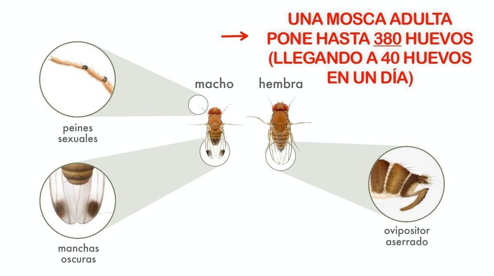
*Slide 4 de SIT-ia: el macho (peines sexuales y manchas oscuras en las alas) y la hembra (ovipositor aserrado). Una hembra pone hasta 380 huevos, hasta 40 por día.*

### d) Ciclo de vida (02:08:23)

| Etapa | Duración | Detalle |
|---|---|---|
| Huevo | 12–72 h | Eclosiona y sale la larva |
| Larva | 5–7 días | Vive **dentro de la fruta** y se alimenta de ella. Ahí los **pesticidas no tienen mucho efecto** (02:09:28) |
| Pupa | 4–15 días | Sale de la fruta y forma una "cápsula" donde se transforma en mosca |
| Adulto | 15–30 días | La hembra pone huevos todo ese tiempo |

- **El ciclo completo dura de 25 a 55 días.** Depende de la **temperatura** y de la **alimentación** (02:10:29).
- Es **polífaga**: come frambuesas, arándanos, frutillas, cerezas, uvas y ciruelas.

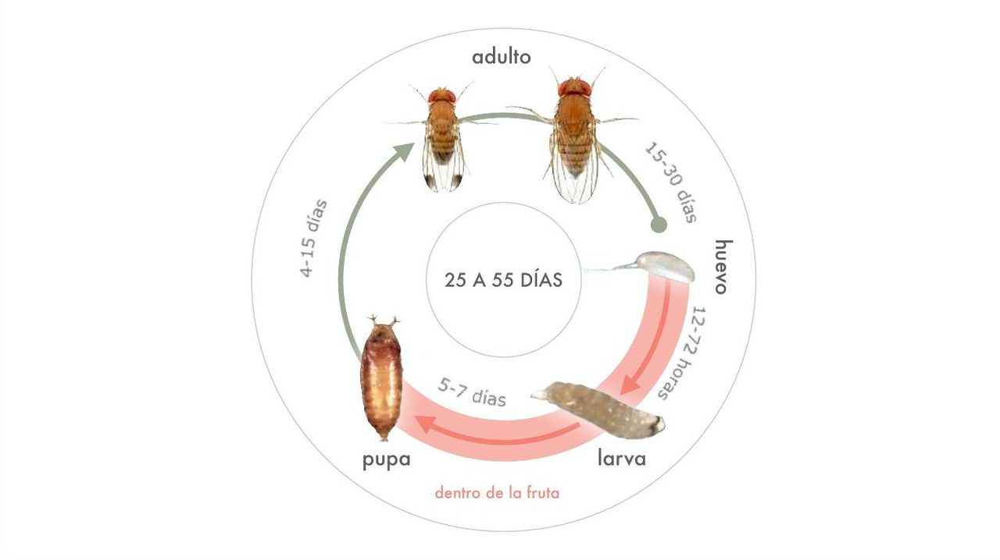
*Slide 5 de SIT-ia: el ciclo de vida, de 25 a 55 días; el huevo y la larva están dentro de la fruta.*

### e) Expansión mundial (02:10:29)
- **1916, Japón:** el biólogo Matsumura describe una mosca de alas manchadas. **En Japón no es plaga** (ver *g*).
- **Hasta 2008 no pasa nada.** En **2008** aparece a la vez en **España, Italia y la costa oeste de EE. UU.**, muy probablemente por el **comercio internacional** de fruta en barcos (02:11:36).
- **2015:** llega a **Brasil y a Argentina**. Probablemente de Brasil pasó a Uruguay, de ahí a Argentina y después a Chile.
- **En Argentina** se reportó en unas **10 provincias** (02:12:49): Buenos Aires (frambuesa y arándano), Río Negro (donde se hizo este trabajo), Chubut, Mendoza, San Juan, Tucumán, Salta y Santa Cruz. **Vive bien en climas muy distintos.**

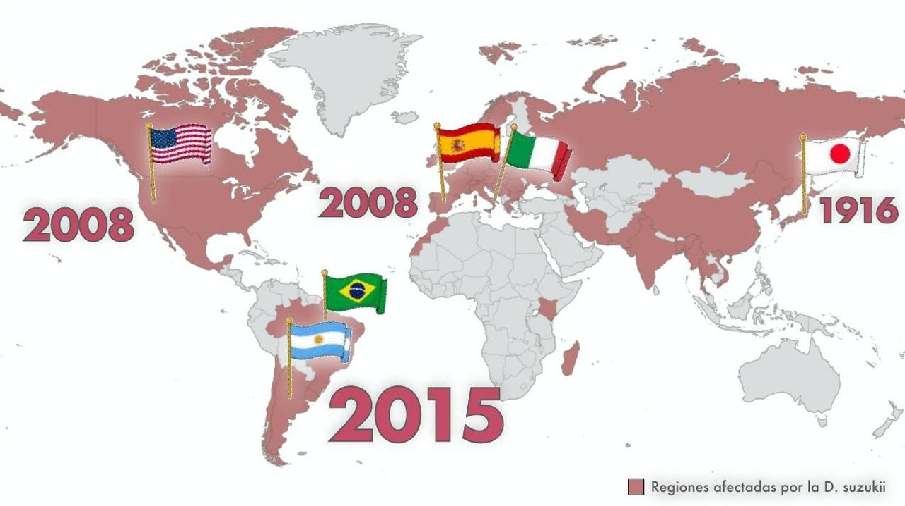
*Slide 6 de SIT-ia: las regiones afectadas por D. suzukii: Japón en 1916; EE. UU., España e Italia en 2008; Brasil y Argentina en 2015.*

### f) Daños (02:12:49)
- Mostró un **video de un lote de frambuesas** atacado.
- **Lo peor es la exportación:** a Chile le pasó exportar **contenedores de frambuesa a Asia**. Al cerrar el contenedor todo estaba perfecto, porque la larva está **dentro de la fruta** y no se detecta; al abrirlo, toda la fruta estaba arruinada. **Pérdida del 100 %**, devolución y todo el costo de cultivo, transporte y exportación perdido (02:14:01).
- **Se estima que en el mundo se pierde hasta el 65 %** de ciertas frutas, según el tipo de fruta. La que más ataca es la **frambuesa**: la foto muestra una frambuesa cortada con larvas adentro.

### g) Métodos de control y sus límites (02:14:01)

| Método | Límite |
|---|---|
| **Pesticidas** | No hacen efecto con la larva adentro de la fruta. La especie **desarrolla resistencia** con facilidad, por su ciclo rápido (02:15:10). Además, se busca usar menos agroquímicos. |
| **Trampas** | A él no le parecen muy efectivas: los productores las ponen y les funcionan, pero **no eliminan la plaga** por completo. "Un método para tomar con precaución." |
| **Métodos culturales** | Mantener el cultivo ordenado, podar y **no dejar fruta en el piso**, porque el olor atrae a las moscas. Ayudan un poco, pero no eliminan la plaga (02:16:20). |
| **Control biológico** | Traer una **avispa** que pone sus huevos **dentro de la pupa** de la mosca: sus larvas se la comen antes de que llegue a mosca. **Por eso en Japón no es plaga.** Pero en Argentina y otros países **no se pueden traer especies de afuera**: lo impide un tratado (✎ probablemente el Protocolo de Nagoya) (02:17:19). |

- Se recomienda un **uso integral** de todo esto, pero **no alcanza**.

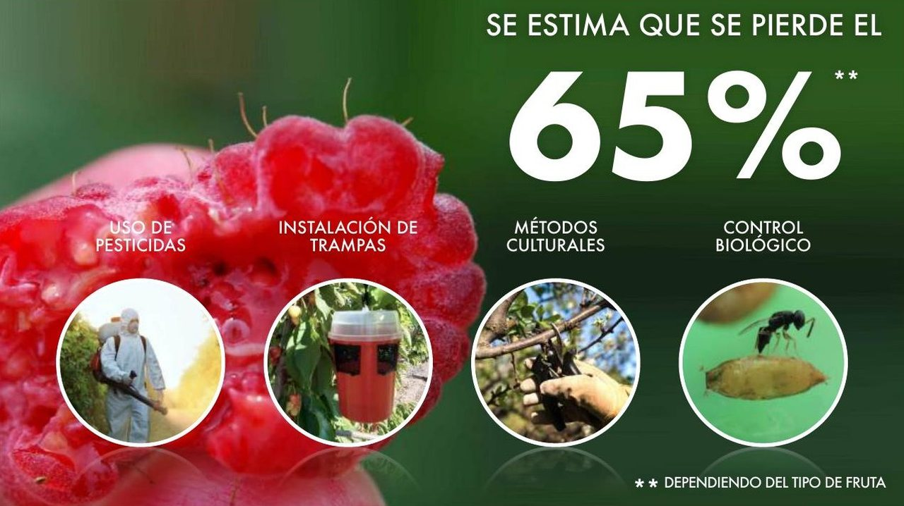
*Slide 9 de SIT-ia: se estima que se pierde hasta el 65 % (según la fruta). Los métodos de control: pesticidas, trampas, métodos culturales y control biológico.*

### h) La técnica del insecto estéril (02:17:19)
- **¿Se acuerdan de los mosquitos rojos contra el dengue?** En Buenos Aires se pedía no matarlos: se liberaban con un pigmento rojo para identificarlos. Eran parte de la **técnica del insecto estéril (TIE)**.
- **Cómo funciona con esta mosca** (02:18:19):
  1. Se **crían** los insectos y se obtienen las **pupas**.
  2. Se **irradian las pupas**, generalmente con **radiación gamma**. En Bariloche se llevaban a un lugar con una máquina que aplica radiación gamma (02:19:20).
  3. Salen moscas adultas **estériles**.
  4. Se **liberan machos estériles** en los cultivos afectados en una proporción de **10 a 1**: 10 estériles por cada macho fértil.
- **Por qué funciona:** sube mucho la probabilidad de que una **hembra fértil copule con un macho estéril**. Los huevos que tiene adentro (los 400 y pico) quedan fecundados, pero son **inviables**: la hembra los pone igual en la fruta, pero **no sale ninguna larva** (02:20:25).
- Si se libera esa proporción cada cierto tiempo, la población baja muchísimo, "**prácticamente a cero**".

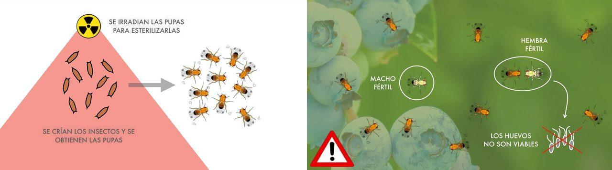
*Slides 12 y 13 de SIT-ia: se crían los insectos, se irradian las pupas y se liberan los machos estériles; la hembra fértil que copula con uno pone huevos que no son viables.*

### i) El problema: separar machos y hembras (02:20:25)
- **La técnica necesita solo machos estériles.** Si se liberan también hembras estériles, los machos estériles "se ocupan" con ellas y baja la probabilidad de que se crucen con las fértiles (02:21:36).
- **En los mosquitos** se **sube la temperatura** del reactor de cría: mueren las hembras y quedan los machos, que se irradian, se pintan de rojo y se liberan.
- **Para *D. suzukii* no existe** un método de bioingeniería (químico, físico o genético) para separar machos y hembras. Ahí entra este trabajo: **visión por computadora e inteligencia artificial** (02:22:40).

### j) El sistema y la detección de insectos (02:22:40)
- Cuatro etapas: **adquisición de imágenes → detección de insectos → clasificación** (la parte de IA) **→ eliminación de hembras**.
- La detección y la clasificación resultaron **más sencillas de lo que pensaba**. Tenía dudas: la mosca es igual de chica que la de la cocina y lo que identifica a la hembra (el ovipositor) es diminuto.
- **En Bariloche** conoció la plaga y sacó las primeras fotos. Las moscas se **duermen con CO₂**, porque no se las puede clasificar despiertas (02:23:50).
- **Algoritmos de detección** (los que había visto en el posgrado):
  1. **Incremento de brillo.**
  2. **Escala de grises.**
  3. **Desenfoque gaussiano**, para eliminar el ruido.
  4. **Binarización.**
  5. **Erosión y dilatación**, para que cada mosca quede bien delimitada.
  6. **Detección de contornos.**
- Así logró **detectar bien los insectos**. En la reunión no se veían las animaciones de la presentación.

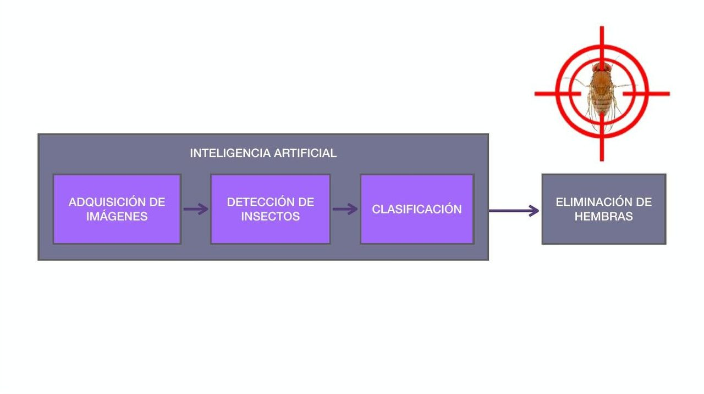
*Slide 15 de SIT-ia: el sistema: adquisición de imágenes, detección y clasificación (la parte de IA) y eliminación de hembras.*

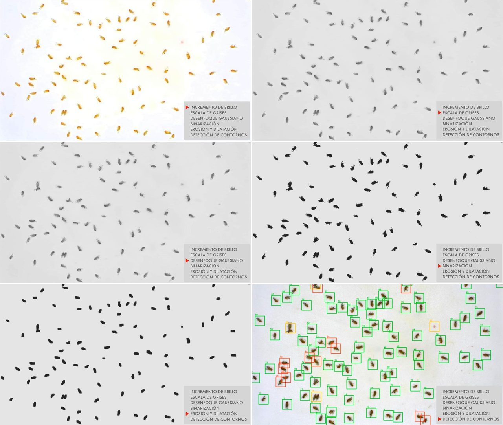
*Slides 18 a 23 de SIT-ia: los pasos de la detección sobre la misma foto: brillo, escala de grises, desenfoque gaussiano, binarización, erosión y dilatación, y detección de contornos (los recuadros numerados).*

### k) Clasificación con una red convolucional (02:24:57)
- De vuelta en Buenos Aires, probó **distintas arquitecturas de redes neuronales**.
- **La cámara es esencial:** comprar una **cámara industrial** y una **lente industrial a medida** fue muy importante.
  - Primero sacó fotos con su **cámara réflex Nikon**, y con eso determinó qué recorte necesitaba.
  - Tras varias pruebas: recortes de **150 × 150 píxeles y 3 canales** de color.
- Probó muchas redes conocidas, de las que se ven en las materias de visión por computadora. **La mejor fue una red simple de seis capas** (02:25:58):
  - **cuatro convolucionales + ReLU**, cada una seguida de **max pooling**;
  - **dos fully connected** al final.
- Fue la **más rápida y la de mejores resultados**, y **la siguen usando** en la versión nueva.

| Capa | Tipo | Salida |
|---|---|---|
| Entrada | Imagen | 150 × 150 × 3 |
| 1 | Conv + ReLU + max pooling | 75 × 75 × 16 |
| 2 | Conv + ReLU + max pooling | 37 × 37 × 32 |
| 3 | Conv + ReLU + max pooling | 18 × 18 × 64 |
| 4 | Conv + ReLU + max pooling | 9 × 9 × 128 |
| 5 | Fully connected | 512 |
| 6 | Fully connected | 2 (macho o hembra) |

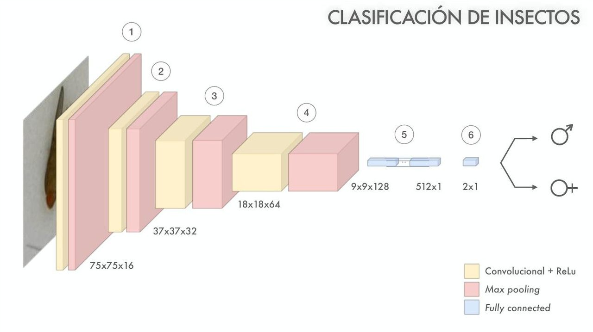
*Slide 24 de SIT-ia: la red: cuatro bloques de convolución + ReLU + max pooling y dos capas fully connected que terminan en macho o hembra.*

### l) ¿Qué mira la red? Interpretabilidad con RISE (02:25:58)
- Su tutor del CONICET y el INTA le preguntaba todo el tiempo: funciona, pero **¿por qué** clasifica a esta como hembra y a este como macho?
- Aplicó **RISE**, una técnica que se había usado en otros trabajos (✎ *Randomized Input Sampling for Explanation*):
  - se le hacen a la imagen **oclusiones aleatorias** y se la clasifica;
  - si clasifica bien, la parte tapada no influye y la que quedó a la vista sí;
  - se combinan todas las pruebas en **mapas de calor** (02:27:24).
- **Lo que encontró** (02:28:35):
  - **en las hembras**, la **cabeza** (algo nuevo, que no tenían en cuenta) y el **ovipositor** (el final del abdomen). Se podría pensar que la red usaba el tamaño, porque la hembra es un poco más grande, pero marcó mucho la cabeza;
  - **en los machos**, las **manchas de las alas** y el **abdomen**, que en el macho suele ser **más curvo**.
- Sirvió también para "**tranquilizar al director**" de la tesis.

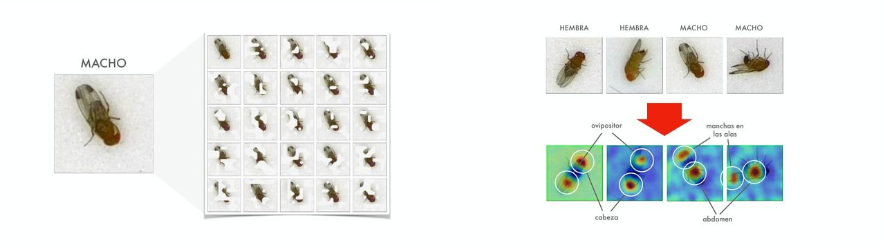
*Slides 26 y 27 de SIT-ia: RISE tapa partes de la imagen al azar (izquierda) y arma mapas de calor: ovipositor y cabeza en las hembras, manchas en las alas y abdomen en los machos.*

### m) Eliminación con láser y optimización del recorrido (02:29:33)
- Con las moscas clasificadas, había que **eliminar las hembras**. En una lluvia de ideas surgió de todo, "**desde una aspiradora hasta un láser**".
- El primer prototipo usó un **láser de los que se usan para cortar madera**: funcionó y elimina la mosca con bastante precisión.
- **El problema:** el láser recorría las moscas en el **orden en que estaban numeradas** (de abajo hacia arriba), y eso era muy ineficiente (02:30:46).
- Luciano es **docente de Investigación Operativa Superior** en la Facultad de Ingeniería, donde enseña a hacer recorridos eficientes con **metaheurísticas**. Probó varias:

| Método | Tiempo de cálculo | Reducción de la distancia | Comentario |
|---|---|---|---|
| Original (orden de numeración) | 0,003 s | — | Muy ineficiente |
| **Greedy** | 0,243 s | **55,9 %** | |
| **Búsqueda local** (*local search*) | 0,486 s | **58,6 %** | **La que más usan**: "menos de medio segundo" (02:31:54) |
| **Colonia de hormigas** (*ant colony optimization*) | 5,380 s | **66,6 %** | El mejor recorrido, pero tarda demasiado |

- **El trade-off:** hay que comparar el **tiempo de cálculo del recorrido** con el **tiempo de láser que se ahorra**. Un recorrido mejor que tarda más en calcularse no hace más eficiente el proceso.

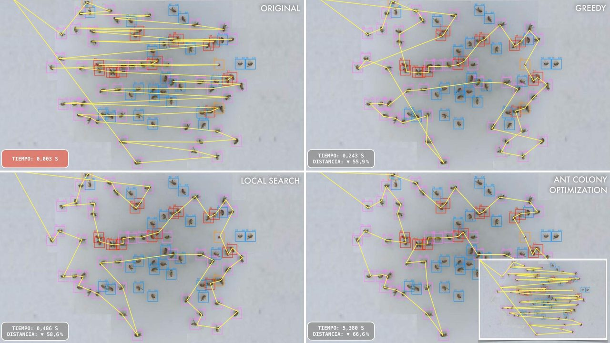
*Slides 28 a 31 de SIT-ia: el recorrido del láser con el orden original, greedy, búsqueda local y colonia de hormigas, con su tiempo de cálculo y la reducción de la distancia.*

### n) El prototipo (02:31:54)
- En realidad es el **segundo** prototipo (el primero está en el *backstage*).
- **Componentes:**
  - **cámara industrial de 12 MP**, comprada en China, con **lente fija de 16 mm**;
  - **anillo de luz** (aro de iluminación);
  - **láser NEJE 3**, de los que se compran en Mercado Libre;
  - **placa de anestesia:** se conecta a una manguera de CO₂ y tiene una superficie porosa que lo va liberando; las moscas se ponen arriba y se duermen (02:32:50).
- **La ventaja frente a otros trabajos** sobre esta especie o especies parecidas: no buscaban clasificar una mosca fotografiada con un celular en una planta, con toda esa variabilidad. Acá las moscas están en un **laboratorio**, sobre un **fondo blanco** (la placa de anestesia), con **lente y cámara fijas**. Eso ayudó muchísimo a la eficiencia del algoritmo.

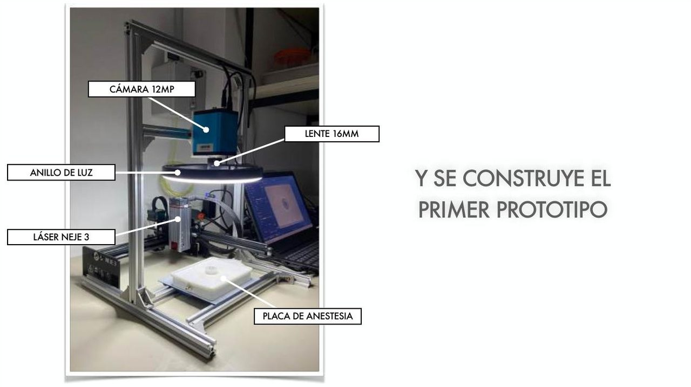
*Slide 32 de SIT-ia: el primer prototipo: cámara de 12 MP, lente de 16 mm, anillo de luz, láser NEJE 3 y placa de anestesia.*

### o) Resultados (02:33:57)
- **Prueba con 144 moscas:** clasificó **mal solo una**. Luciano cree que en realidad está bien clasificada y que habría que sacarla de la cuenta.
- **La matriz de confusión de la slide:** 78 machos bien clasificados, 0 machos tomados por hembras, **1 hembra tomada por macho** y 65 hembras bien clasificadas.
- **Precisión superior al 98 %**. ✎ Son 143 aciertos sobre 144, un 99,3 % de exactitud. El único error es el más caro para la técnica: una hembra que se liberaría con los machos.
- **Ahorro de tiempo:** antes había que dormirlas y mirarlas **una por una con lupa** (miden unos **2 mm**), separándolas a mano con un **pincelito**.
- **El ejemplo** (02:35:11):
  - un campo de **100 ha** con un **ataque importante** (**3 machos fértiles cada 100 m²**) requiere liberar **300.000 machos estériles por semana**: 10 veces los fértiles;
  - con los datos del INTA, clasificarlos a mano lleva **100 horas** de una persona: **dos semanas y media** en turnos de 8 h;
  - con **SITIA**, el nombre del software, son **4 horas**: una **reducción del 96 %**;
  - ✎ la cuenta: 100 ha = 1.000.000 m² → 30.000 machos fértiles × 10 = 300.000.
- **Paper publicado** (lo pagó el CONICET): *SIT-ia: A software-hardware system to improve male sorting efficacy for the Sterile Insect Technique*, en la revista **Insects** (MDPI): [mdpi.com/2075-4450/16/11/1108](https://www.mdpi.com/2075-4450/16/11/1108/pdf).

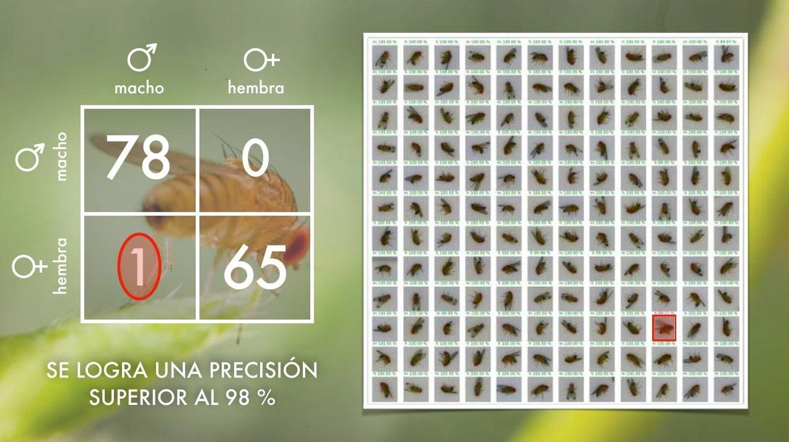
*Slide 34 de SIT-ia: la matriz de confusión y las 144 moscas de la prueba (en rojo, la mal clasificada).*

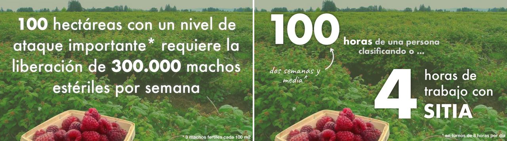
*Slides 36 y 37 de SIT-ia: 100 ha con un ataque importante requieren 300.000 machos estériles por semana: 100 horas de una persona o 4 horas con SITIA.*

### p) Backstage (02:36:21)
- El **INTA de Bariloche** está a orillas del **lago Nahuel Huapi** y tiene un edificio solo para el estudio de insectos, con el laboratorio dedicado a *D. suzukii*.
- Trabajó en los primeros recortes de las moscas desde el hotel.
- **Prototipo 0:** una **Nikon colgada de un trípode de laboratorio** y una **lámpara LED de plafón**, de las de baño, con un agujero en el medio (02:37:35).
- En el INTA y el CONICET hacen experimentos con **impresoras 3D**, cosa que lo asombró.
- **Ataques en frutos:** la mosca los mancha y los marchita. Lo peor es que no se detecte y llegue al consumidor: en internet hay fotos de **Franui** (frambuesas con chocolate) con un bichito adentro. **El insecto es inofensivo para la salud.**
- **Pruebas con el láser:** le hacía agujeros a la mosca, que moría enseguida (02:38:35).
- **Curiosidad:** su director, que vive en Bariloche, encontró una *D. suzukii* en un árbol cerca de **Mar del Plata** (la slide marca **Mar de Cobo, a 30 km**). Si uno presta atención, las puede ver en distintos lugares.
- **La placa de anestesia:** un **laberinto de acrílico hecho con CNC** (también se puede comprar), y probaron distintos materiales para la parte porosa.

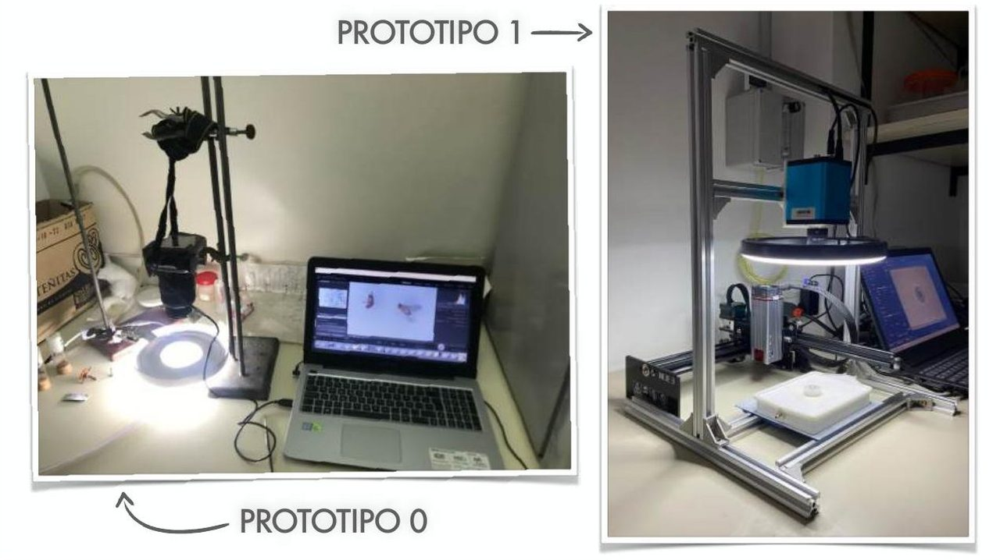
*Slide 43 de SIT-ia: el prototipo 0 (una Nikon en un trípode de laboratorio y una lámpara LED) y el prototipo 1.*

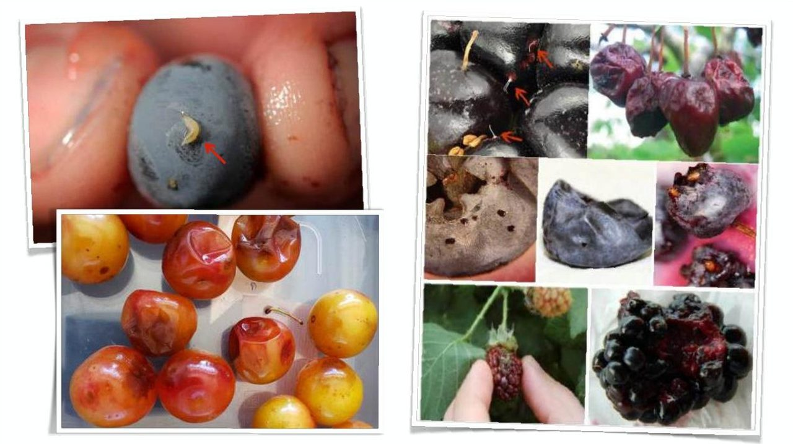
*Slide 44 de SIT-ia: daños de la mosca en arándanos, cerezas y frutos rojos.*

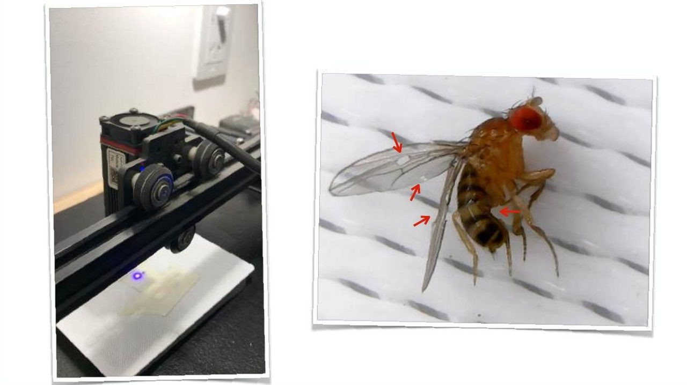
*Slide 45 de SIT-ia: el láser sobre la placa y una mosca con los agujeros que le hizo.*

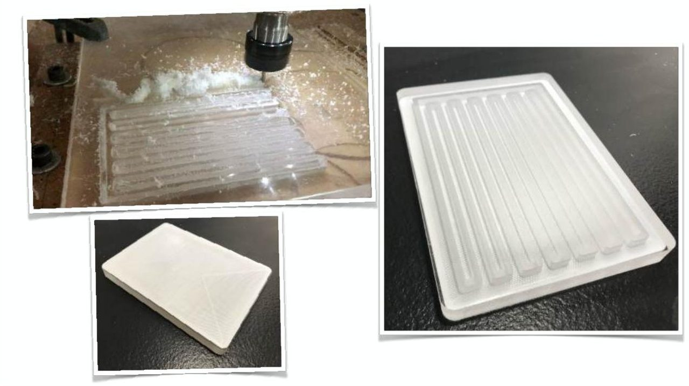
*Slide 47 de SIT-ia: la placa de anestesia: el laberinto de acrílico fresado con CNC y la parte porosa.*

### q) Lo que viene: la cinta transportadora de Chile (02:38:35)
- **Chile** tiene muchos problemas con esta plaga y **compró el proyecto**.
- Para procesar **grandes cantidades** de moscas imprimieron piezas en **3D** y armaron una **cinta transportadora** con piezas de internet y **servomotores** que **cambian a las moscas de carril** (02:39:36).
- El software, ya modificado, analiza **en tiempo real**: cuando detecta una **hembra**, la cambia de carril. Unos carriles llevan a un lugar donde las moscas viven y otros, a uno con una **sustancia que las mata**.
- **Está en desarrollo:** Luciano vio bastantes **errores de clasificación** y tienen que ajustarlo (02:40:41).

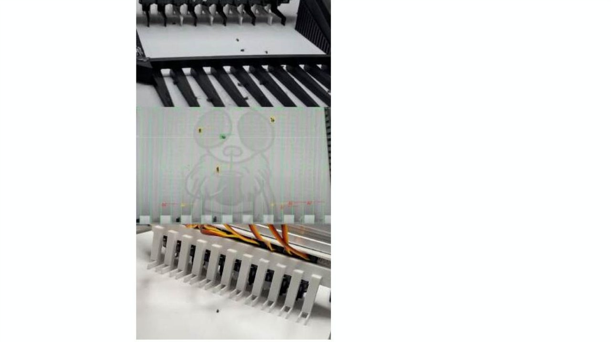
*Slide 48 de SIT-ia: un cuadro del video de Chile: la cinta transportadora con carriles y servomotores.*

### r) Preguntas (02:40:41)
- **¿De qué año es?** (Gabriel Quiroga). No se acuerda: "**hace 4 o 5 años**". La tesis estaba en la biblioteca de trabajos finales del **Laboratorio de Sistemas Embebidos (LSE)**, pero la bajaron porque para patentar **no tiene que haber publicaciones previas**. En el listado del posgrado figura el año (02:42:00).
- **Las avionetas de Mendoza** (Gabriel): en Mendoza pasan avionetas tirando **bolsas de moscas**. ¿Es lo mismo?
  - En Mendoza está el **ISCAMEN**, el lugar de Argentina que hace la técnica del insecto estéril. **Los mosquitos rojos se producen en el ISCAMEN** y se llevan a Buenos Aires o a donde se necesiten.
  - Probablemente sea la **mosca de la fruta**, que es otra especie (02:42:56). En otras plagas sí se pueden separar machos y hembras por bioingeniería: con un químico o con algo genético producen **directamente solo machos**.
  - El resto del método es igual: se **irradian**, quedan estériles y se suelen **pintar** para reconocerlas (02:43:56).
- **Cómo se mide el resultado:** en el cultivo se pone un **papel con adhesivo y un atrayente**; las moscas se pegan y se cuenta cuántos **machos fértiles y estériles** hay después del tratamiento. Si el **100 % es estéril**, se eliminó la plaga.
- **¿No te quisieron cooptar para otras investigaciones?** (Georgina)
  - Sí lo llamaron, pero tiene otro trabajo, y para que le valga la pena hizo un **presupuesto**, que hoy es difícil de aprobar (02:45:06).
  - El trabajo final lo hizo con **su propia inversión**, para terminar la maestría y porque le gustaba. No espera retribución, aunque le dijeron que le van a mandar algo porque se **vendió a Chile** (02:46:07).
  - El INTA y el CONICET se encargan de la documentación y de la **patente**, que lleva **también su nombre**, y pagaron el **paper**, que es muy caro de publicar en una revista importante.
  - Georgina: en la academia la moneda de intercambio es **figurar en las publicaciones**; fuera del mundo académico vale menos.
- **Otros experimentos del laboratorio** (02:47:10): él les sugirió usar la **impresora 3D** y compraron una.
  - **Vuelo:** pegan una mosca a un palito con un cono; al volar, la mosca hace girar el palito y un **contador** de vueltas, con la circunferencia medida, permite estimar la **velocidad** y la **distancia máxima** que puede volar (02:48:10).
  - **Olores:** una especie de **pecera** donde prueban qué olores las atraen.
- **Su recomendación:** "**muy recomendable que hagan ese tipo de cosas como trabajo final**".
- **Contacto (slide final):** lsmith@fi.uba.ar.

## 20. Cierre (02:49:58)

- Lola le pidió a Luciano la **presentación nueva con el video**, para mandarla a los alumnos.
- Lola va a mandar la **selección de trabajos finales anteriores** que hizo Martín Horn.
- **Próxima clase:** martes 10/11. Según el cronograma, forestal, con Santiago Ferrando.

## Anexo: slides del PDF que no se comentaron

Estas slides están en el PDF de fruticultura, pero no se comentaron en clase.

**Temperatura, peso del fruto y aceite (slide 9)**
- Está bajo el título "Interacciones Genotipo x Ambiente". Son dos gráficos contra la **temperatura media de crecimiento** (°C), con cuatro tratamientos (T0, T4−, T5+ y T10+):
  - **(A) Peso seco del fruto (g):** se mantiene en ~2 g hasta los **25 °C** y después cae 0,08 g por grado (y = 2,04 − 0,08 (x − 25) si x > 25; R² = 0,69).
  - **(B) Concentración de aceite (%):** baja **1,13 puntos por grado** (y = 58,4 − 1,13x; R² = 0,74; P < 0,01).
- ✎ Por la concentración de aceite, es un ensayo en olivo. Muestra la respuesta a un factor del ambiente, no la comparación entre genotipos que se explicó en clase.

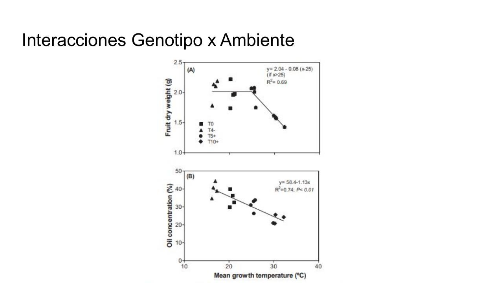
*Slide 9 (no comentada): el peso seco del fruto y la concentración de aceite según la temperatura media de crecimiento.*

**La fruticultura en el mundo (slides 10 a 14)**
- La slide 10 pregunta: "¿Qué se produce? ¿Dónde se producen frutas? ¿Cuánto se produce?".
- **Frutas más producidas** (millones de t): plátanos 124,98 · sandías 101,63 · manzanas 93,14 · naranjas 75,57 · uvas 73,52 · mangos, mangostanes y guayabas 57,01 · plátanos macho y otros 45,32 · tangerinas, mandarinas, clementinas y satsumas 41,95 · piñas 28,65 · cantalupos y otros melones 28,62.
- **Países productores** (miles de t): **China 260.234** e **India 111.591**, muy lejos del resto; después Brasil 41.668, Turquía 25.683, Indonesia 24.790, México 24.735, EE. UU. 21.347, Italia 18.122, Nigeria 16.932, Filipinas 16.592, España 16.543, Irán 15.991, Egipto 14.290, Vietnam 12.168 y Colombia 11.637. Argentina no está entre los 15.
- **Producción mundial (slide 13):** crece todos los años, de unos **570 millones de t en 2000** a unos **930 millones en 2022**.
- **Consumo habitual de frutas y verduras (slide 14)**, en % de encuestados de 18 a 64 años entre 2022 y 2023: México y **Argentina 86 %**, España 83, Sudáfrica 81, Italia 80, Brasil 76, Reino Unido 74, India 69, EE. UU. 66, China 60 y Japón 58.

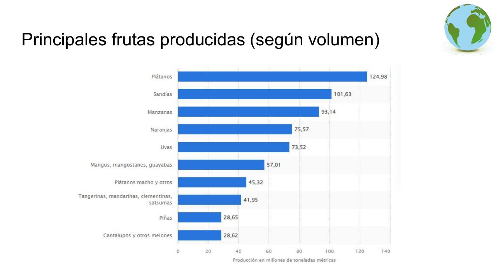
*Slide 11 (no comentada): las frutas más producidas en el mundo, en millones de toneladas.*

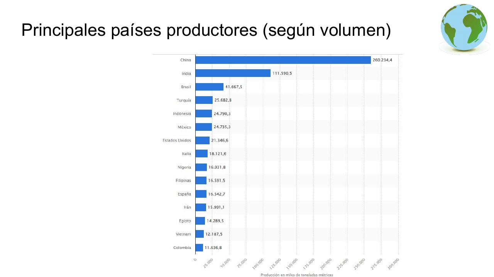
*Slide 12 (no comentada): los principales países productores de fruta, en miles de toneladas.*

**Cambios en el uso de la tierra (slide 16)**
- La superficie frutícola es **dinámica**: entran cultivos nuevos, se reemplazan variedades y se abandona la actividad o se la reemplaza por otra.
- La presionan la **urbanización**, la **minería** y la conversión a **cultivos anuales** (Pengue y Rodríguez, 2018).
- **En retroceso** en los últimos 30 años: pepita (manzana y pera), carozo (durazno, ciruela, damasco), arándano, banano, pomelo y uva de mesa.
- **En expansión:** frutos secos, kiwi, limón y cerezo.
- **El patrón común:** la producción se **concentra en menos productores con más superficie**.

**Consumo en Argentina (slide 18)**
- La **manzana**, los **cítricos** y la **banana** son el **64 %** del volumen de frutas que se comercializa en el **MCBA** (✎ el Mercado Central de Buenos Aires).
- Consumo promedio por habitante y por año: **8 kg de manzana** y **2,5 kg de pera** frescas.

**Olivo: dos modelos productivos (slide 30)**

| | Diferimiento | Tradicional |
|---|---|---|
| Tamaño promedio del lote | 100 a 1.000 ha | 5 a 15 ha |
| Densidad de plantación | 330 plantas/ha | 100 plantas/ha |
| Riego | Presurizado, por goteo | Por turno, por inundación |
| Cosecha | Mecanizada | Manual |
| Cultivar representativo | Arbequina | Arauco |
| Destino productivo | Aceite de oliva extra virgen | Aceituna de mesa |

- ✎ "Diferimiento" son los grandes olivares que se plantaron con el régimen de diferimiento impositivo en Catamarca, La Rioja y San Juan. Explica por qué la Arbequina es la más implantada de los últimos 30 años.

**La cadena de la pera y la manzana (slide 34)**
- **Frutales de pepita: 53.500 ha.**
- Datos solo de **Río Negro y Neuquén**:
  - producción primaria: **pera 560.000 t** y **manzana 532.000 t**;
  - va a **empaque**: pera 73 %, manzana 70 %;
  - va a **industrialización**: pera 72 % (✎ seguramente es 27 %, para sumar 100 con el empaque) y manzana 30 %;
  - **destino:** mercado interno, pera 25 % y manzana 73 %; exportación, pera **75 %** y manzana 27 %.
- ✎ La pera es sobre todo de exportación y la manzana, de mercado interno.

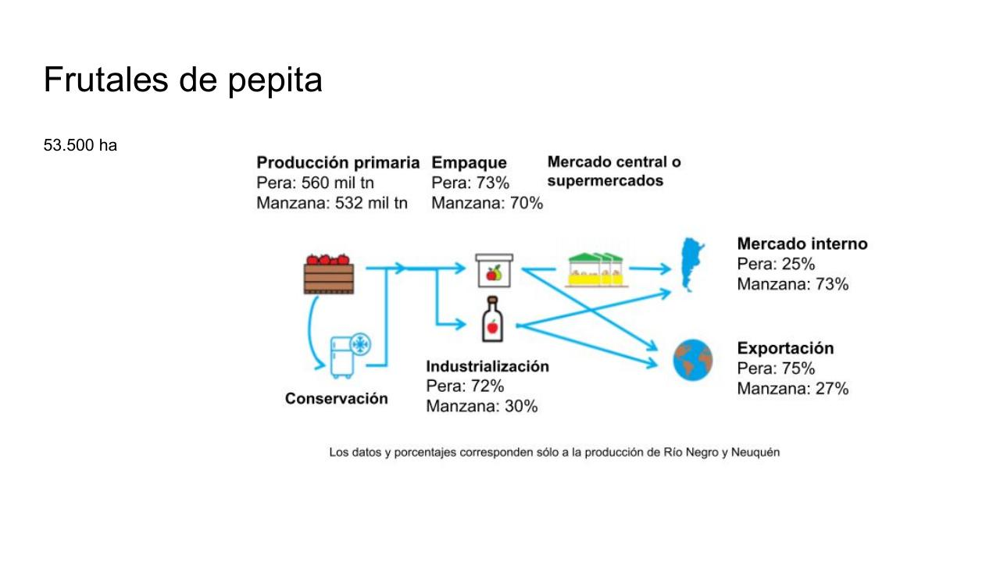
*Slide 34 (no comentada): la cadena de la pera y la manzana en Río Negro y Neuquén.*

**Vista aérea (slide 44)**
- Una foto aérea, sin texto, de chacras con **cortinas de álamos** y un canal al costado de una ruta. ✎ Parece un valle frutícola bajo riego, como el Alto Valle.

**Condiciones de almacenamiento en atmósfera controlada (slide 51)**, según Barreiro y Sandoval (2006):

| Producto | Temperatura (°C) | O₂ (%) | CO₂ (%) |
|---|---|---|---|
| Aguacate (palta) | 5–13 | 2–5 | 5–10 |
| Durazno | 0–5 | 1–2 | 5 |
| Fresa (frutilla) | 0–5 | 10 | 15–20 |

---

## Correcciones de la transcripción automática

| Dice la transcripción | Es |
|---|---|
| Georgi, Jori, Georgie | Georgina, la docente |
| lse posgrados | Lola (la cuenta del LSE, que organiza el posgrado) |
| Fruti, Orti | fruti(cultura), horti(cultura) |
| etilenio, tileno, tireno, tilileno, etirileno, estileno | etileno |
| interacción genere por ambiente | interacción genotipo por ambiente |
| decofisiología | ecofisiología |
| env de la hoja | envés de la hoja |
| evaporotraspirando | evapotranspirando |
| "cuando hay urgencia, el globo se infla" | turgencia |
| céciles | sésiles |
| censar | sensar |
| durasneros | durazneros |
| neñosos | leñosos |
| haáreas | hectáreas |
| pomero | pomelo |
| plano Specán | pecán |
| viid, "la producción de vida" | vid |
| El Mbec | Malbec |
| asequias | acequias |
| "enganchando las plantas a la alarma" | alambre |
| "donde pasa el riesgo", "el riesgo es fundamental" | riego |
| Tucán, tu cumana | Tucumán |
| planta del paque | planta de empaque |
| frutas abellantadas | frutas abrillantadas |
| lévite | Levité (una marca de agua saborizada) |
| Cullo | Cuyo |
| descarrozado, descorazado | descarozado |
| Fushi | Fuji |
| red deus | Red Delicious |
| fartirriego | fertirriego |
| climatéos | climatéricos |
| enesencias | senescencia |
| vianual | bianual |
| un MCP, 1 MCP | 1-MCP (✎ 1-metilciclopropeno) |
| relentear | ralentizar |
| prisión por computadora | visión por computadora |
| Carilo | Cariló |
| drosófila Melanogaster, drosófilia | *Drosophila melanogaster* |
| drosófila Suzuki Matsumura | *Drosophila suzukii* (Matsumura) |
| mosca de las salas manchadas | mosca de las alas manchadas |
| obvipositor, obipositor, oiipositor, positado | ovipositor |
| ovipositor "cerrado" | ovipositor aserrado |
| ecclusión | eclosión |
| uovas | uvas |
| tratado de Nogoyá | ✎ probablemente el Protocolo de Nagoya |
| CONISET, conet, Iset | CONICET |
| Insta; "los laboratorios de Linda" | INTA (lo segundo, probablemente) |
| "el INTA, que depende del CONICET" | ✎ son organismos distintos; en Bariloche trabajan juntos |
| esembra | hembra |
| vinalización | binarización |
| gauciano | gaussiano |
| Rise | RISE |
| metaurísticas, metodísticas | metaheurísticas |
| Gridiara | greedy (algoritmo voraz) |
| Uncolony optimization | *ant colony optimization* (optimización por colonia de hormigas) |
| Mercadolibbre | Mercado Libre |
| "la si" (el nombre del software) | SITIA (SIT-ia) |
| Naerwapi | Nahuel Huapi |
| Mar de Plata | Mar del Plata |
| iscamén | ISCAMEN (✎ Instituto de Sanidad y Calidad Agropecuaria Mendoza) |
| biblioteca de sistemas embebid | la biblioteca del Laboratorio de Sistemas Embebidos (LSE) de la FIUBA |
| coptar | cooptar |

**Ojo con las notas de Gemini:**
- Mezclan el examen con los trabajos de Martín Horn: el examen es sobre la clase 2, y los trabajos son ejemplos de TP que Lola va a mandar.
- Dicen que Tucumán es "líder mundial" con el 30 % de la producción de limón: es un comentario confuso del audio, que no está en las slides.
- Describen la red como "cuatro convolucionales con ReLU, una capa de max pooling": cada convolucional va seguida de su max pooling.
- Escriben "Gridara": es greedy.
- Dicen que el control biológico está "prohibido por el tratado de Nogoyá": Luciano dijo que un tratado impide traer especies de afuera (✎ probablemente el Protocolo de Nagoya).
- Dicen que la cinta transportadora optimiza tiempos "respecto a métodos anteriores en reactores de cría": el reactor es el de los mosquitos, no el de esta mosca.
- Dicen que el proyecto de Gonzalo se "implementó": quedó parado hace 3 años.

---

## ✎ Relevancia para IA / ideas de TP

**Ideas que se mencionaron en clase:**
- Recomendar qué variedad implantar a partir de variables ambientales (lluvia, temperatura, fotoperíodo, heladas, suelo) y pronósticos. Muchas tesis "de estos posgrados" lo hicieron con el INTA para el duraznero (Georgina).
- Medir el rojo en la pulpa del durazno, que el consumidor rechaza (Georgina).
- Visión en la planta de empaque para detectar fruta deformada, manchada o enferma, después de la clasificación humana: una fruta enferma puede cerrar un mercado de exportación (Georgina).
- Riego automático con sensores de humedad del suelo y estaciones meteorológicas (Georgina).
- Podadoras más selectivas que la mecánica, y mecanizar la cosecha: drones cosechadores o plataformas (Georgina).
- Una plataforma de cosecha de manzana autónoma, con un brazo de dos grados de libertad y una red que detecte la madurez (Gonzalo).
- Separar sexos por visión en otras plagas que no tienen método de separación, como SITIA. Luciano lo recomienda como TP.

**Lecturas propias desde IA:**
- **Series temporales y fenología:** alertas de helada según el estadio fenológico (D, E, floración); modelos de horas de frío para predecir la brotación y la floración.
- **Visión por computadora:** contar flores y frutos para planificar el raleo y estimar la cosecha; detectar larvas de *D. suzukii* dentro de la fruta antes de cerrar un contenedor (quizás con imágenes hiperespectrales o rayos X); contar machos fértiles y estériles (pintados) en las trampas adhesivas, que hoy se cuentan a mano para medir la TIE.
- **Control y predicción en postcosecha:** predecir la vida útil en atmósfera controlada con la temperatura, la humedad, el O₂, el CO₂ y el etileno, y ajustar la cámara.
- **Optimización:** los mismos recorridos (TSP) del láser sirven para robots de cosecha o de poda. El trade-off de Luciano vale para cualquier sistema en tiempo real: el tiempo de cálculo cuenta.
- **Interpretabilidad:** RISE u otras técnicas para mostrarle al experto qué mira el modelo. Fue lo que convenció al director.

**Lecciones de Luciano para el TP:**
- Elegir una contraparte que responda: su primer tema se cayó porque la empresa tardaba 15 a 30 días en contestar.
- Controlar la captura de datos (cámara y lente fijas, fondo blanco, iluminación) simplifica muchísimo el modelo: una red de seis capas alcanzó más del 98 %.
- Medir el impacto en números del usuario: 100 horas contra 4.

## ✎ Glosario

**Fisiología**
- **Productor primario:** organismo que fabrica su propia materia orgánica a partir de energía (luz) y compuestos simples. Está en la base de la red trófica.
- **Red trófica:** quién se come a quién en un ecosistema.
- **Fotosíntesis:** proceso por el que la planta usa la energía de la luz para transformar CO₂ y agua en azúcares, y libera oxígeno.
- **Clorofila / cloroplasto:** el pigmento verde que capta la luz / la organela donde está.
- **Ciclo de Calvin:** la etapa de la fotosíntesis que fija el CO₂ en azúcares.
- **Radiación incidente / interceptada:** la que llega a un lugar / la que capta la planta.
- **Estoma:** poro de la hoja, casi siempre en el envés, que regula la entrada de CO₂ y la salida de agua.
- **Envés / haz:** la cara de abajo / de arriba de la hoja.
- **Transpiración:** pérdida de agua por los estomas.
- **Potencial hídrico:** la "presión" del agua que define hacia dónde se mueve: del suelo húmedo a la raíz, de la raíz a las hojas.
- **Turgencia:** presión del contenido de la célula contra la pared celular. Sin ella, la célula no crece.
- **Sésil:** que no se puede desplazar.
- **Fotorreceptor:** molécula que percibe la luz (su calidad, su intensidad, el largo del día).
- **Fotoperíodo:** la duración del día.
- **Genotipo:** la constitución genética; en la práctica, la variedad.
- **Interacción genotipo × ambiente:** cuando el ranking de variedades cambia según el ambiente.
- **Mejoramiento genético:** selección o creación de variedades mejores.
- **Ecofisiología:** cómo responde la fisiología de la planta al ambiente.

**Fruticultura**
- **Leñoso / semileñoso:** que forma madera / que la forma solo en parte.
- **Cultivar (variedad):** grupo de plantas seleccionadas por sus características, que se mantienen al propagarlas.
- **Frutales de pepita:** los de fruto con semillas chicas (pepitas): manzana, pera, membrillo.
- **Frutales de carozo:** los de fruto con un carozo duro: durazno, ciruela, damasco, cereza.
- **Frutos secos:** nuez, almendra, pecán, pistacho, avellana.
- **Economías regionales:** las actividades productivas que sostienen el empleo de una región, como la fruticultura en los valles.
- **Bodega:** planta donde se elabora el vino.
- **Mosto:** el jugo de la uva prensada, antes de fermentar.
- **Vinificación:** la elaboración del vino a partir del mosto (fermentación alcohólica).
- **Varietal / blend:** vino o aceite de una sola variedad / de una mezcla.
- **Sistema de conducción:** cómo se forma y se sostiene la planta con la poda (parral, espaldera).
- **Parral:** conducción de la vid en un "techo" horizontal.
- **Espaldera:** conducción de la vid en un plano vertical, sobre alambres.
- **Acequia:** canal de riego superficial.
- **Turno de riego:** el momento en que a cada productor le toca recibir el agua del canal.
- **Secano:** cultivo sin riego, que depende de la lluvia.
- **Descarozado:** sacar el carozo (de la aceituna, por ejemplo).
- **Aceite extra virgen:** la categoría de mayor calidad, obtenida solo por medios mecánicos y sin defectos.
- **Aceite esencial:** el aceite aromático que se extrae de la cáscara de los cítricos, para perfumes y saborizantes.
- **Fruta abrillantada:** fruta confitada en almíbar, como la del pan dulce.

**Ciclo y prácticas**
- **Fenología:** el estudio de las etapas del desarrollo de la planta y de cuándo ocurren.
- **Escala fenológica:** la lista de estadios, con letras o números (la del manzano va de A a J).
- **Yema:** punto de crecimiento. **Vegetativa** si da hojas, **floral** si da flores.
- **Primordio:** el órgano en formación dentro de la yema.
- **Dormición:** el reposo de las yemas en invierno.
- **Horas de frío:** las horas por debajo de cierta temperatura que la yema necesita acumular para brotar.
- **Brotación:** cuando la yema se abre y crecen hojas o flores.
- **Cuajado:** el paso de flor a fruto.
- **Polinización / fecundación:** la llegada del polen a la flor / la unión que forma el embrión.
- **Partenocarpia:** formación de fruto sin fecundación, por eso sin semillas.
- **Raleo:** sacar flores o frutos para que los que quedan crezcan más.
- **Helada:** temperatura bajo cero que daña los tejidos.
- **Plantación superintensiva:** muy alta densidad, pensada para mecanizar la poda y la cosecha.
- **Cabalgante:** cosechadora que se monta sobre la fila de plantas.
- **Shaker (vibrador):** máquina que sacude el tronco para que caiga la fruta.
- **Bin:** caja grande para la fruta cosechada.
- **Riego por goteo:** el agua llega a cada planta por goteros de caudal conocido.
- **Fertirriego:** aplicar fertilizantes con el agua de riego.

**Postcosecha**
- **Maduración:** los cambios del final del desarrollo del fruto: color, textura, sabor.
- **Etileno:** hormona gaseosa que dispara la maduración.
- **Fruto climatérico / no climatérico:** con / sin un pico de etileno y de respiración después de cosechado.
- **Respiración:** el consumo de las reservas (azúcares) del fruto, que sigue después de la cosecha.
- **Senescencia:** el envejecimiento y deterioro de los tejidos.
- **Planta de empaque:** donde se lava, clasifica, trata y embala la fruta.
- **Atmósfera controlada (AC):** cámara fría con O₂ y CO₂ regulados para frenar la respiración.
- **Absorbedor:** material que retiene un gas (CO₂ o etileno).
- **1-MCP:** molécula que bloquea el receptor del etileno y frena la maduración.
- **MCBA:** el Mercado Central de Buenos Aires.

**Plagas y técnica del insecto estéril**
- **Plaga:** organismo que daña un cultivo y causa pérdidas económicas.
- **Polífago:** que se alimenta de muchas especies.
- **Ovipositor:** el órgano de la hembra para poner los huevos.
- **Peines sexuales:** cerdas negras en las patas delanteras de los machos de *Drosophila*.
- **Larva / pupa:** el estado que come y crece / el estado inmóvil donde la larva se transforma en adulto.
- **Eclosión:** cuando el huevo se abre y sale la larva.
- **Resistencia:** cuando una plaga deja de morir con un pesticida.
- **Métodos culturales:** prácticas de manejo que reducen la plaga, como podar o sacar la fruta caída.
- **Control biológico:** usar enemigos naturales (depredadores, parasitoides) contra la plaga.
- **Parasitoide:** insecto que pone sus huevos en otro, y sus larvas lo matan.
- **Técnica del insecto estéril (TIE):** liberar machos esterilizados en masa para que las hembras pongan huevos inviables.
- **Radiación gamma:** radiación ionizante que se usa para esterilizar las pupas.
- **ISCAMEN:** el instituto de sanidad agropecuaria de Mendoza, que aplica la TIE.
- **Placa de anestesia:** superficie porosa que libera CO₂ para dormir a los insectos.

**Visión e IA**
- **Binarización:** convertir la imagen a blanco y negro con un umbral.
- **Desenfoque gaussiano:** suavizado que elimina ruido.
- **Erosión / dilatación:** operaciones morfológicas que achican / agrandan las regiones blancas para separar o rellenar objetos.
- **Detección de contornos:** encontrar el borde de cada objeto para ubicarlo.
- **CNN (red convolucional):** red neuronal que aprende filtros sobre la imagen.
- **ReLU:** función de activación que deja pasar los valores positivos y anula los negativos.
- **Max pooling:** reduce la imagen quedándose con el máximo de cada ventana.
- **Fully connected:** capa en la que todas las neuronas se conectan con todas las de la capa anterior.
- **Matriz de confusión:** tabla de aciertos y errores por clase.
- **RISE:** técnica de interpretabilidad que tapa partes de la imagen al azar y arma un mapa de calor de lo que importa.
- **Mapa de calor:** imagen que pinta qué zonas pesaron más en la decisión del modelo.

**Optimización**
- **Metaheurística:** método general para encontrar soluciones buenas (no necesariamente óptimas) en poco tiempo.
- **Greedy (voraz):** elige en cada paso la mejor opción inmediata, por ejemplo, ir a la mosca más cercana.
- **Búsqueda local:** mejora una solución con cambios chicos mientras siga mejorando.
- **Colonia de hormigas (ACO):** imita cómo las hormigas refuerzan los mejores caminos con feromonas.
- **TSP (problema del viajante):** encontrar el recorrido más corto que pasa una vez por cada punto. Es el problema del láser.

## ✎ Preguntas de práctica

1. ¿Por qué se dice que las plantas son productores primarios?
2. ¿Qué necesita la fotosíntesis, qué produce y en qué órganos ocurre?
3. ¿Qué diferencia hay entre la radiación incidente y la interceptada? ¿Cómo la maneja el productor?
4. ¿Qué son los estomas, dónde están y qué disyuntiva regulan?
5. ¿Por qué el agua se mueve del suelo a la raíz?
6. Si falta agua, ¿qué se frena primero, la fotosíntesis o el crecimiento? ¿Por qué?
7. ¿Qué señales del ambiente perciben las plantas?
8. ¿Qué es la interacción genotipo × ambiente? Describir el ejemplo de la clase. ¿Por qué importa en el mejoramiento?
9. ¿Qué caracteriza a los cultivos intensivos?
10. Definir fruticultura. ¿En qué se diferencia de la horticultura?
11. ¿Cuántas hectáreas ocupa la fruticultura en Argentina y qué porcentaje de la superficie agrícola representa? ¿Cuáles son las provincias más importantes?
12. Ordenar de mayor a menor superficie: carozo, cítricos, olivo, pepita y vid.
13. ¿Qué tracciona la producción de vid? ¿Cuántas bodegas hay y qué otros productos da?
14. ¿Cuál es la variedad insignia de la vid argentina?
15. Diferenciar el parral de la espaldera y el riego por acequia del riego por goteo.
16. ¿Hasta dónde llegan los cítricos en el sur? ¿Por qué el pomelo va más al norte? ¿Dónde está el limón?
17. ¿Qué lugar ocupa Argentina en limón fresco, en aceite esencial y en esencia y jugo de limón? ¿Cuáles son sus destinos?
18. ¿Qué se hace con el jugo y la cáscara de los cítricos?
19. ¿Cuántas hectáreas de olivo hay y en qué regiones?
20. Comparar la Arbequina y el Arauco. ¿Por qué el Arauco no sirve para el descarozado mecánico?
21. ¿Dónde se producen manzanas y peras? ¿Por qué comparten las zonas?
22. ¿Cuál es la manzana más buscada en Argentina? ¿Por qué se confunde a una Gala?
23. ¿Por qué hay manzanas en noviembre si la cosecha termina en abril?
24. ¿De qué fruta Argentina es el principal exportador mundial? ¿A qué países?
25. ¿Qué provincia concentra el carozo y qué industrias tiene?
26. ¿Por qué hay tantas variedades de durazno? ¿Qué característica de la pulpa rechaza el consumidor?
27. ¿Qué le pasa a un frutal en otoño? ¿Qué señal usa y por qué no se guía solo por la temperatura?
28. ¿Para qué sirven las horas de frío?
29. ¿Qué parte de la flor forma la pulpa del fruto y cuál forma las semillas? ¿Por qué hace falta la fecundación?
30. ¿Por qué se vende polen para el kiwi? ¿Qué es un fruto partenocárpico?
31. ¿Qué es el raleo de flores y para qué se hace?
32. ¿En qué estadios fenológicos es más grave una helada?
33. Comparar la poda manual y la mecánica.
34. ¿Cómo funcionan una cosechadora cabalgante y un shaker? ¿Cuál es el más usado?
35. ¿Por qué el riego es tan importante en fruticultura? ¿Cómo evolucionó?
36. ¿Qué es una fruta climatérica? Dar ejemplos de climatéricas y de no climatéricas.
37. ¿Por qué una banana hace madurar una palta? ¿Qué riesgo trae ese mecanismo en un depósito?
38. Describir el gráfico de respiración y etileno después de la cosecha.
39. ¿Qué se hace en una planta de empaque? ¿Por qué es crítica la clasificación para exportar?
40. ¿Qué es la atmósfera controlada y qué variables se controlan? ¿Para qué se inyecta nitrógeno?
41. ¿Cómo actúa el 1-MCP?
42. ¿Qué propuso Gonzalo para la plataforma de cosecha y qué opinó la docente de los drones cosechadores?
43. ¿Qué diferencia a *D. suzukii* de *D. melanogaster*? ¿Cómo se distinguen el macho y la hembra?
44. Describir el ciclo de vida de *D. suzukii*. ¿Por qué los pesticidas no son eficaces?
45. ¿Cuándo y por dónde se expandió la plaga? ¿Por qué en Japón no es plaga?
46. ¿Cómo funciona la técnica del insecto estéril? ¿En qué proporción se liberan los machos?
47. ¿Por qué la TIE necesita solo machos y cómo se resuelve en los mosquitos?
48. ¿Cuáles son las etapas del sistema de Luciano y los pasos de la detección?
49. Describir la red neuronal que eligió.
50. ¿Qué es RISE y qué encontró con esa técnica?
51. ¿Por qué no eligió la colonia de hormigas para el recorrido del láser?
52. ¿Por qué la clasificación funcionó tan bien comparada con otros trabajos?
53. ¿Qué resultados obtuvo y cuánto tiempo ahorra? Rehacer la cuenta de los 300.000 machos.
54. ¿Qué cambia en la versión de Chile?
55. ¿Qué es el ISCAMEN y cómo se mide si la TIE funcionó en un cultivo?

Respuestas

1. Porque, como muy pocos organismos, generan hidratos de carbono a partir de la energía del sol (fotosíntesis). Están en la base de la red trófica.
2. Necesita energía lumínica, CO₂ y una porción muy chica de agua. Produce azúcares y oxígeno. Ocurre en los órganos verdes, donde está la clorofila.
3. La incidente es la que llega al lugar; la interceptada, la que capta la planta. El productor la maneja con la densidad de plantación (plantas más juntas se sombrean, pero interceptan más) y con la poda.
4. Son poros, casi siempre en el envés de la hoja. Si están abiertos entra CO₂ (hay fotosíntesis), pero se pierde agua por transpiración; si están cerrados, no se pierde agua, pero no entra CO₂. Son una canilla.
5. Por diferencia de presión, de potencial hídrico.
6. Primero se frena el crecimiento: la célula crece por turgencia (el globo que empuja la caja de la pared), y sin agua no hay turgencia. La fotosíntesis se frena mucho después.
7. Calidad de luz (fotorreceptores), intensidad de luz, largo del día (fotoperíodo), estrés hídrico y exceso hídrico.
8. El comportamiento diferencial de los genotipos en ambientes distintos. En el ejemplo, la variedad B rinde más en el ambiente restrictivo y la A en el favorable. Importa porque está presente en la selección y la recomendación de variedades.
9. Alta densidad, superficies chicas, maximizan el rendimiento por hectárea, más mano de obra, riego clave, importancia de la postcosecha y alta tecnificación.
10. La ciencia que estudia el cultivo de especies leñosas y semileñosas que producen frutas, con tecnologías basadas en principios biológicos y fisiológicos, y sostenible en lo ambiental, social y económico. A diferencia de la horticultura, sus cultivos son permanentes (20 a 100 años), con baja frecuencia de disturbios y mano de obra de intensidad media.
11. 514.701 ha (unas 500.000), el 1,4 % de la superficie agrícola. Mendoza, San Juan, Tucumán, Entre Ríos y Río Negro.
12. Vid (38,7 %), cítricos (23,8 %), olivo (14,6 %), pepita (8,4 %) y carozo (6,3 %).
13. La elaboración de vino, un proceso industrial que emplea a mucha gente. Hay casi 900 bodegas (883). También da pasas de uva y uva de mesa.
14. El Malbec.
15. El parral forma un "techito"; la espaldera sostiene la planta en alambres, como un arbolito. La acequia riega por turno con canales y desperdicia agua; el goteo dosifica el agua planta por planta.
16. Hasta San Pedro, en Buenos Aires (naranja y algo de mandarina). El pomelo es más sensible al frío. El limón está en Tucumán.
17. 2.º exportador mundial de limón fresco, 4.º productor de aceite esencial y 1.º exportador de esencia y jugo. Destinos: España, Rusia, Holanda e Italia (58 % de las ventas de cítricos).
18. El jugo se vende envasado o como concentrado a las empresas de gaseosas. La cáscara se usa para frutas abrillantadas y para la industria de las esencias.
19. Unas 85.000 ha, en zonas áridas de Cuyo y el NOA (La Rioja, Mendoza, San Juan y Catamarca, sobre todo).
20. La Arbequina es chica, redonda y aceitosa: la más implantada en los últimos 30 años, para aceite suave, y no sirve para mesa. El Arauco es el cultivar nacional, de fruto grande y carnoso y aceite amargo y picante. Su punta inclinada hacia el costado traba el descarozador mecánico.
21. En el valle del Río Negro (Alto Valle, Valle Medio y Valle Inferior) y en Mendoza. Porque tienen requerimientos parecidos, al menos los cultivares que se usan en Argentina.
22. La Red Delicious. La Gala tiene un fondo amarillento, y la gente cree que es una Red Delicious de menor calidad.
23. Porque se almacenan en cámaras: la postcosecha permite diferir el consumo.
24. De pera fresca. A Brasil y Rusia.
25. Mendoza (84 % del carozo). Tiene industria de durazno y ciruela enlatados y de ciruela pasa.
26. Porque el durazno tiene una vida postcosecha corta y hacen falta variedades que vayan cubriendo todo el verano. La pulpa roja.
27. Baja el crecimiento vegetativo, se degradan los pigmentos, los nutrientes vuelven a ramas y raíces, las yemas detienen su crecimiento y se caen las hojas (salvo en cítricos y olivo). La señal es el acortamiento del fotoperíodo, que es segura; la temperatura falla con los "veranitos" e "inviernitos".
28. Para que la yema no brote con el primer veranito del invierno: solo brota cuando acumuló suficiente frío. Permite cultivar en zonas muy frías.
29. El ovario forma la parte carnosa y los óvulos, las semillas. El embrión del óvulo fecundado genera las señales hormonales para que el fruto se desarrolle.
30. Porque mucho polen da muchas semillas, y más semillas dan kiwis más grandes. Un partenocárpico es un fruto sin semilla, por hormonas exógenas o por la variedad.
31. Arrancar flores para dejar pocos frutos bien ubicados, que crezcan más y se paguen mejor.
32. A partir del estadio D (aparición de los botones florales), peor en el E y crítico en floración: se puede perder la fruta del año.
33. La manual es selectiva y forma la arquitectura del árbol, pero es cara y lenta. La mecánica corta todo parejo "como una pared" en plantaciones intensivas: es rápida, pero no selectiva.
34. La cabalgante va montada sobre la fila y golpea las ramas con cepillos giratorios. El shaker agarra el tronco y lo vibra a alta frecuencia; la fruta cae en un paraguas invertido y va a un bin. El más usado es el shaker.
35. Porque más del 90 % del órgano cosechado es agua. Pasó del riego superficial por turno, que desperdicia agua, al goteo dosificado, con fertirriego y automatización con sensores de humedad y estaciones meteorológicas.
36. La que se puede cosechar verde y madurar después, porque produce etileno y responde a él, con un pico respiratorio. Climatéricas: banana, palta, manzana, pera, arándano, durazno, pelón, ciruela, kiwi. No climatéricas: cítricos, uva, cereza.
37. Porque la banana libera etileno, que dispara la síntesis de etileno y la maduración de la palta. En un depósito, una fruta golpeada o con un bicho empieza a liberar etileno y activa a sus vecinas en un efecto exponencial.
38. En las no climatéricas la respiración baja hasta un nivel basal y el etileno es bajo y constante. En las climatéricas sube el etileno y, cerca del máximo, hay un pico de respiración en el que la fruta consume sus reservas.
39. Se lava, se acondiciona, se clasifica por tamaño y por defectos, y se aplican fungicidas y ceras. Porque si un mercado detecta una fruta enferma puede cerrar toda la exportación; por eso conviene sumar visión a la clasificación humana.
40. Cámaras de frío con menos O₂ y más CO₂, estrictamente controladas. Se controlan la temperatura, la humedad, la circulación de aire, el O₂, el CO₂ y el etileno (con absorbedores). El nitrógeno desplaza al oxígeno para bajar la respiración.
41. Ocupa el receptor del etileno, así que la fruta no responde al etileno ni sintetiza más, y madura más lento.
42. Que la plataforma de cosecha se maneje sola y, más adelante, sumarle un brazo de dos grados de libertad con una red que detecte madurez. La docente dijo que los drones son lentos, aunque pueden trabajar de noche, y que la plataforma le parece más realista.
43. *D. suzukii* es plaga porque la hembra tiene un ovipositor aserrado que perfora la fruta sana; *D. melanogaster* solo usa fruta blanda o en descomposición. El macho tiene manchas en las alas y peines sexuales; la hembra, el ovipositor.
44. Huevo 12–72 h, larva 5–7 días dentro de la fruta, pupa 4–15 días y adulto 15–30 días: de 25 a 55 días en total. Los pesticidas no llegan a la larva dentro de la fruta, y la especie genera resistencia rápido.
45. Japón (1916) → EE. UU., España e Italia (2008) → Brasil y Argentina (2015) y después Chile, por el comercio internacional. En Japón no es plaga porque hay una avispa que ataca sus pupas.
46. Se crían los insectos, se irradian las pupas con radiación gamma y se liberan machos estériles, 10 por cada macho fértil. Las hembras que copulan con ellos ponen huevos inviables.
47. Porque las hembras estériles "ocupan" a los machos estériles y baja la probabilidad de que crucen a las fértiles. En los mosquitos se sube la temperatura del reactor y mueren las hembras.
48. Adquisición de imágenes, detección, clasificación y eliminación de hembras. La detección: incremento de brillo, escala de grises, desenfoque gaussiano, binarización, erosión y dilatación, y detección de contornos.
49. Una CNN de seis capas: cuatro convolucionales + ReLU, cada una con max pooling (de 150 × 150 × 3 a 9 × 9 × 128), y dos fully connected (512 y 2).
50. Una técnica que tapa partes de la imagen al azar y combina los resultados en mapas de calor. Encontró que la red mira la cabeza y el ovipositor en las hembras, y las manchas de las alas y el abdomen en los machos.
51. Porque tardaba 5,4 s en calcular el recorrido: lo que se ahorraba de láser se perdía en cálculo. Usan la búsqueda local (−58,6 % de distancia en menos de medio segundo).
52. Porque las moscas se fotografían en laboratorio, dormidas sobre un fondo blanco, con cámara y lente fijas e iluminación controlada: no hay la variabilidad de una foto de celular en el campo.
53. 144 moscas con un solo error: más del 98 % de precisión, y 96 % menos de tiempo (4 h contra 100 h de una persona). 100 ha = 1.000.000 m²; con 3 machos fértiles cada 100 m² hay 30.000, y por 10 son 300.000 machos estériles por semana.
54. Una cinta transportadora impresa en 3D con servomotores que cambian de carril a las hembras en tiempo real, para procesar muchas más moscas. Todavía tiene errores de clasificación.
55. El instituto de Mendoza que aplica la TIE (por ejemplo, contra la mosca de la fruta, y produce los mosquitos rojos). Se ponen trampas adhesivas con atrayente y se cuenta la proporción de machos estériles (pintados) y fértiles: si el 100 % es estéril, se eliminó la plaga.

